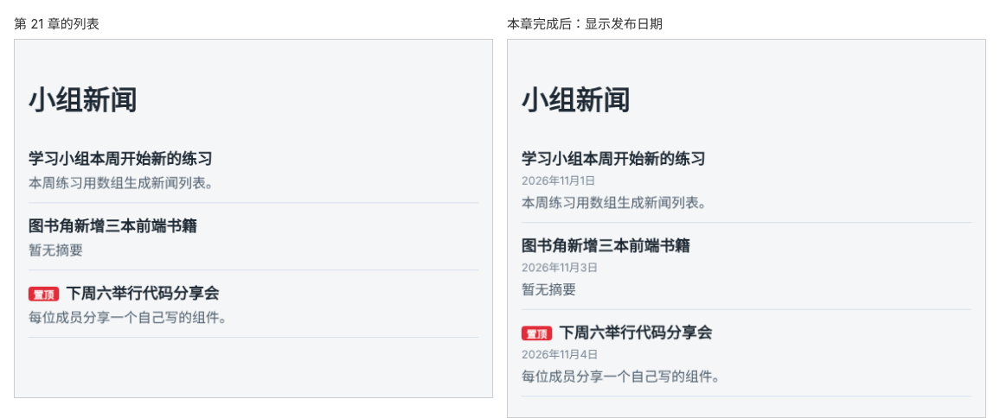

# 第 22 章：如何把日期时间显示成容易阅读的格式？

前置：[第 21 章：如何只给符合条件的项显示标记？](第021章-如何只给符合条件的项显示标记.md)

## 一、本章要解决的问题

每条新闻都要显示发布日期。数据中的时间通常是 `2026-11-02T16:30:00Z` 这样的格式，方便程序之间交换，但直接显示给用户很难读，而且它是世界标准时间，和北京时间不一样，日期可能差一天。

本章把发布时间显示成“2026年11月3日”这样的中文日期，并按北京时间计算。完成后，每条新闻标题下方显示一行灰色的发布日期。

下图左边是现在的新闻列表，右边是本章完成后的样子：



## 二、必要原理

### 数据中的时间格式

`2026-11-02T16:30:00Z` 是国际通用的 ISO 8601 时间格式：

- `2026-11-02` 是日期，`T` 是分隔符，`16:30:00` 是时间；
- 最后的 `Z` 表示这是**世界标准时间**（UTC）。

北京时间比世界标准时间早 8 小时，所以世界标准时间 11 月 2 日 16:30，就是北京时间 11 月 3 日 0:30。如果只截取前十个字符 `2026-11-02` 显示，日期就错了一天。

服务器和数据库通常用世界标准时间保存时间，由页面按用户所在的时区显示。

### 把字符串变成时间：new Date

`new Date('2026-11-02T16:30:00Z')` 根据字符串创建一个日期对象，它代表一个确定的时间点，可以交给格式化工具处理。

### 格式化日期：Intl.DateTimeFormat

浏览器内置的 `Intl.DateTimeFormat` 可以按指定的语言、时区和格式显示日期：

```ts
const dateFormatter = new Intl.DateTimeFormat('zh-CN', {
  year: 'numeric',
  month: 'long',
  day: 'numeric',
  timeZone: 'Asia/Shanghai',
});

dateFormatter.format(new Date('2026-11-02T16:30:00Z')); // '2026年11月3日'
```

- `'zh-CN'`：按简体中文的习惯显示，所以有“年”“月”“日”。
- `year`、`month`、`day`：要显示年、月、日。`month: 'long'` 在中文中显示为“11月”。
- `timeZone: 'Asia/Shanghai'`：按北京时间计算。不写这一项，就按用户电脑的时区计算，不同地区的读者会看到不同的日期。

格式化工具只需要创建一次，所以把 `dateFormatter` 写在组件函数外面，而不是每次显示组件都重新创建。

### time 标签

HTML 的 `<time>` 标签专门用来表示时间。`dateTime` 属性中保存机器能读懂的原始时间，标签内显示给人看的日期：

```tsx
<time dateTime="2026-11-02T16:30:00Z">2026年11月3日</time>
```

搜索引擎和辅助工具可以从 `dateTime` 中读到准确的时间。

## 三、动手实现

### 第 1 步：给每条新闻加上发布时间

打开 `src/data/news.ts`，在类型中加入 `publishedAt: string;`（没有问号，每条新闻都必须有发布时间），并给三条新闻都写上时间：

```ts
export type NewsItem = {
  id: number;
  title: string;
  summary?: string;
  pinned?: boolean;
  publishedAt: string;
};
```

```ts
  {
    id: 1,
    title: '学习小组本周开始新的练习',
    summary: '本周练习用数组生成新闻列表。',
    publishedAt: '2026-11-01T02:00:00Z',
  },
  { id: 2, title: '图书角新增三本前端书籍', publishedAt: '2026-11-02T16:30:00Z' },
  {
    id: 3,
    title: '下周六举行代码分享会',
    summary: '每位成员分享一个自己写的组件。',
    pinned: true,
    publishedAt: '2026-11-04T09:00:00Z',
  },
```

### 第 2 步：创建日期格式化工具

打开 `src/pages/NewsPage.tsx`，在导入语句下面、组件函数上面加入：

```tsx
const dateFormatter = new Intl.DateTimeFormat('zh-CN', {
  year: 'numeric',
  month: 'long',
  day: 'numeric',
  timeZone: 'Asia/Shanghai',
});
```

### 第 3 步：在标题下方显示日期

在 `</h2>` 和摘要的 `<p>` 之间加入：

```tsx
              <p className={styles.date}>
                <time dateTime={item.publishedAt}>
                  {dateFormatter.format(new Date(item.publishedAt))}
                </time>
              </p>
```

在 `src/pages/NewsPage.module.css` 末尾加入日期的样式：

```css
.item .date {
  margin-bottom: 4px;
  color: #7b8794;
  font-size: 13px;
}
```

选择器写成 `.item .date` 而不是 `.date`，是因为前面已有一条 `.item p` 规则设置了段落的颜色和外边距。`.item .date` 比 `.item p` 更具体，浏览器会优先使用它。

## 四、运行与检查

保持开发服务器运行（`npm.cmd run dev`），保存文件后在浏览器中查看。

1. 三条新闻的标题下方分别显示“2026年11月1日”“2026年11月3日”“2026年11月4日”，字号较小，颜色比摘要浅。
2. 第二条新闻的数据是 `2026-11-02T16:30:00Z`，页面显示的是 11 月 3 日，因为按北京时间已经过了零点。
3. 按 F12，在 Elements（元素）面板中查看日期，`<time>` 标签的 `datetime` 属性是原始的时间字符串。
4. 把 `timeZone` 临时改成 `'UTC'`，保存，第二条新闻变成“2026年11月2日”。检查后改回 `'Asia/Shanghai'`。

最后运行检查，应没有错误：

```powershell
npm.cmd run check
```

**小练习**：在格式化选项中加入 `hour: '2-digit'` 和 `minute: '2-digit'`，看看日期后面多出了什么。再试试把 `month: 'long'` 改成 `month: '2-digit'`。练习后恢复本章代码。

## 五、常见错误

| 现象 | 原因 | 怎么改 |
| --- | --- | --- |
| 编辑器提示某条新闻缺少 `publishedAt` | 类型要求每条都有发布时间，有一条漏写了 | 给每条新闻都加上 `publishedAt` |
| 页面空白，控制台报 `RangeError: Invalid time value` | 时间字符串写错了，例如月份写成了 13，无法转换成日期 | 按 `2026-11-02T16:30:00Z` 的格式检查数据 |
| 日期比预期早一天或晚一天 | 没有指定 `timeZone`，或者直接截取了字符串的前十位 | 用 `Intl.DateTimeFormat` 并指定 `timeZone` |
| 页面空白，控制台报 `Invalid time zone specified` | 时区名称写错，例如写成了 `'Beijing'` | 使用标准名称 `'Asia/Shanghai'` |
| 日期颜色和摘要一样，没有变小 | 选择器写成了 `.date`，被 `.item p` 覆盖 | 写成 `.item .date` |

## 六、本章完整代码

### `src/data/news.ts`

```ts
export type NewsItem = {
  id: number;
  title: string;
  summary?: string;
  pinned?: boolean;
  publishedAt: string;
};

export const newsItems: NewsItem[] = [
  {
    id: 1,
    title: '学习小组本周开始新的练习',
    summary: '本周练习用数组生成新闻列表。',
    publishedAt: '2026-11-01T02:00:00Z',
  },
  { id: 2, title: '图书角新增三本前端书籍', publishedAt: '2026-11-02T16:30:00Z' },
  {
    id: 3,
    title: '下周六举行代码分享会',
    summary: '每位成员分享一个自己写的组件。',
    pinned: true,
    publishedAt: '2026-11-04T09:00:00Z',
  },
];
```

### `src/pages/NewsPage.tsx`

```tsx
import { newsItems } from '../data/news';
import styles from './NewsPage.module.css';

const dateFormatter = new Intl.DateTimeFormat('zh-CN', {
  year: 'numeric',
  month: 'long',
  day: 'numeric',
  timeZone: 'Asia/Shanghai',
});

export default function NewsPage() {
  return (
    <main className="page">
      <h1>小组新闻</h1>
      {newsItems.length === 0 ? (
        <p className={styles.empty}>暂时没有新闻。</p>
      ) : (
        <ul className={styles.list}>
          {newsItems.map((item) => (
            <li key={item.id} className={styles.item}>
              <h2>
                {item.pinned && <span className={styles.badge}>置顶</span>}
                {item.title}
              </h2>
              <p className={styles.date}>
                <time dateTime={item.publishedAt}>
                  {dateFormatter.format(new Date(item.publishedAt))}
                </time>
              </p>
              <p>{item.summary ?? '暂无摘要'}</p>
            </li>
          ))}
        </ul>
      )}
    </main>
  );
}
```

### `src/pages/NewsPage.module.css`

```css
.list {
  margin: 0;
  padding: 0;
  list-style: none;
}

.item {
  padding: 12px 0;
  border-bottom: 1px solid #d9e2ec;
}

.item h2 {
  margin: 0 0 4px;
  font-size: 18px;
}

.item p {
  margin: 0;
  color: #52606d;
}

.empty {
  color: #52606d;
}

.badge {
  display: inline-block;
  margin-right: 8px;
  padding: 0 6px;
  border-radius: 4px;
  background: #e12d39;
  color: #ffffff;
  font-size: 12px;
  vertical-align: middle;
}

.item .date {
  margin-bottom: 4px;
  color: #7b8794;
  font-size: 13px;
}
```

## 七、本章改动小结

修改 `src/data/news.ts`（每条新闻增加 `publishedAt`）、`src/pages/NewsPage.tsx`（创建日期格式化工具，在标题下显示日期）和 `src/pages/NewsPage.module.css`（新增 `.item .date`）。

---

下一章：[第 23 章：【组合】如何用同一个列表组件显示不同栏目的新闻？](第023章-如何用同一个列表组件显示不同栏目的新闻.md)
