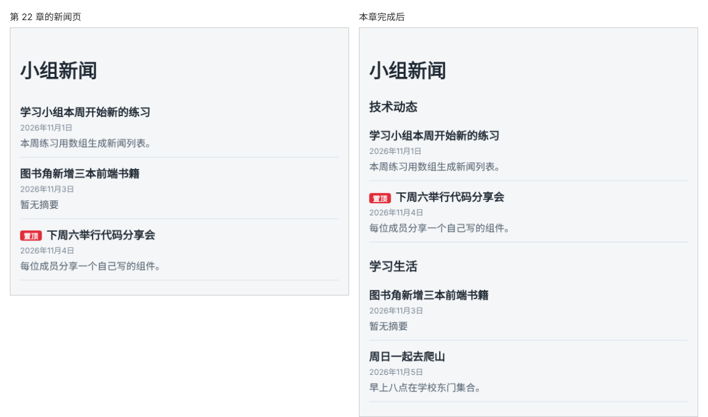

# 第 23 章：【组合】如何用同一个列表组件显示不同栏目的新闻？

前置：[第 22 章：如何把日期时间显示成容易阅读的格式？](第022章-如何把日期时间显示成容易阅读的格式.md)

## 一、本章要解决的问题

新闻越来越多，小组决定把新闻分成两个栏目：“技术动态”和“学习生活”。两个栏目的显示方式完全一样：都有置顶标签、发布日期、没有摘要时的默认文字、没有新闻时的提示。

如果把第 17—22 章写好的列表代码复制一份给第二个栏目，以后改一处就要改两处。本章把列表提取成一个组件 `NewsList`，栏目名称和新闻数据通过 props 传入，两个栏目使用同一个组件。完成后，页面上依次显示两个栏目，各自列出自己的新闻。

本章不引入新技术，组合使用的是：

- 第 8 章：把一段界面提取成组件；
- 第 9、10 章：通过有类型的 props 传入不同数据；
- 第 15 章：CSS Modules；
- 第 17—22 章：列表、key、空状态、默认值、条件标记、日期格式。

下图左边是现在的新闻页，右边是本章完成后分成两个栏目的样子：



## 二、必要原理

### 先想清楚组件负责什么

按第 11 章的方法划分：

- `NewsPage` 是整个页面，负责“页面上有哪些栏目、每个栏目放哪些新闻”。
- `NewsList` 负责“给我一个栏目名称和一组新闻，我把它们显示成列表”。它不关心新闻从哪里来，也不知道页面上一共有几个栏目。

所以栏目名称 `title` 和新闻数组 `items` 都是 `NewsList` 的 props，数据仍由 `NewsPage` 决定。

### 跟着组件一起搬走的东西

列表的样式、日期格式化工具、空状态提示，都是“显示一个列表”所需要的，全部跟着移到 `NewsList` 中。`NewsPage.module.css` 中的规则不再被页面使用，移到 `NewsList.module.css` 后删除原文件。

### 标题层级要跟着调整

页面的一级标题 `h1` 是“小组新闻”。每个栏目名称是页面下的一个部分，用 `h2`；栏目中每条新闻的标题再低一级，用 `h3`。原来新闻标题用的是 `h2`，现在改成 `h3`，读屏软件和搜索引擎才能正确理解“栏目—新闻”的层次。

### 两个栏目的数据分开保存

`news.ts` 中原来的一个数组 `newsItems` 拆成两个：`techNews` 和 `lifeNews`。同一个列表中的 `id` 不能重复（第 18 章），不同列表之间没有这个要求，但本章仍然让所有新闻的 `id` 各不相同，以后如果把它们合并显示也不会出问题。

## 三、动手实现

### 第 1 步：把新闻分成两个栏目

把 `src/data/news.ts` 中的 `newsItems` 数组替换为两个数组，类型 `NewsItem` 不变：

```ts
export const techNews: NewsItem[] = [
  {
    id: 1,
    title: '学习小组本周开始新的练习',
    summary: '本周练习用数组生成新闻列表。',
    publishedAt: '2026-11-01T02:00:00Z',
  },
  {
    id: 3,
    title: '下周六举行代码分享会',
    summary: '每位成员分享一个自己写的组件。',
    pinned: true,
    publishedAt: '2026-11-04T09:00:00Z',
  },
];

export const lifeNews: NewsItem[] = [
  { id: 2, title: '图书角新增三本前端书籍', publishedAt: '2026-11-02T16:30:00Z' },
  {
    id: 4,
    title: '周日一起去爬山',
    summary: '早上八点在学校东门集合。',
    publishedAt: '2026-11-05T01:00:00Z',
  },
];
```

### 第 2 步：新建列表组件的样式

在 `src/components` 中新建 `NewsList.module.css`。内容来自 `NewsPage.module.css`，有三处变化：新增 `.section` 和 `.section h2` 两段栏目样式；`.item h2` 改为 `.item h3`。

```css
.section {
  margin-top: 24px;
}

.section h2 {
  margin: 0 0 8px;
  font-size: 20px;
}

.item h3 {
  margin: 0 0 4px;
  font-size: 18px;
}
```

其余规则（`.list`、`.item`、`.item p`、`.empty`、`.badge`、`.item .date`）原样复制过来，完整内容见第六节。复制完成后，删除 `src/pages/NewsPage.module.css`。

### 第 3 步：新建 NewsList 组件

在 `src/components` 中新建 `NewsList.tsx`，写入：

```tsx
import type { NewsItem } from '../data/news';
import styles from './NewsList.module.css';

const dateFormatter = new Intl.DateTimeFormat('zh-CN', {
  year: 'numeric',
  month: 'long',
  day: 'numeric',
  timeZone: 'Asia/Shanghai',
});

type NewsListProps = {
  title: string;
  items: NewsItem[];
};

export default function NewsList({ title, items }: NewsListProps) {
  return (
    <section className={styles.section}>
      <h2>{title}</h2>
      {items.length === 0 ? (
        <p className={styles.empty}>这个栏目暂时没有新闻。</p>
      ) : (
        <ul className={styles.list}>
          {items.map((item) => (
            <li key={item.id} className={styles.item}>
              <h3>
                {item.pinned && <span className={styles.badge}>置顶</span>}
                {item.title}
              </h3>
              <p className={styles.date}>
                <time dateTime={item.publishedAt}>
                  {dateFormatter.format(new Date(item.publishedAt))}
                </time>
              </p>
              <p>{item.summary ?? '暂无摘要'}</p>
            </li>
          ))}
        </ul>
      )}
    </section>
  );
}
```

日期格式化工具和列表部分都是从 `NewsPage.tsx` 中移过来的，改了三处：`newsItems` 改为 props 中的 `items`；新闻标题从 `h2` 改为 `h3`，因为栏目名称已经用了 `h2`；没有新闻时的提示改为“这个栏目暂时没有新闻。”。`NewsItem` 用 `import type` 从 `../data/news` 导入，因为这里只用到它的类型。

### 第 4 步：在新闻页中使用两个栏目

把 `src/pages/NewsPage.tsx` 改为：

```tsx
import NewsList from '../components/NewsList';
import { lifeNews, techNews } from '../data/news';

export default function NewsPage() {
  return (
    <main className="page">
      <h1>小组新闻</h1>
      <NewsList title="技术动态" items={techNews} />
      <NewsList title="学习生活" items={lifeNews} />
    </main>
  );
}
```

页面组件现在只剩下“有哪些栏目”这一件事，一眼就能看清页面结构。

## 四、运行与检查

保持开发服务器运行（`npm.cmd run dev`），保存文件后在浏览器中查看。

1. 页面依次显示“小组新闻”、“技术动态”栏目（两条新闻，代码分享会带“置顶”标签）、“学习生活”栏目（两条新闻）。
2. “图书角新增三本前端书籍”显示“暂无摘要”，日期是“2026年11月3日”；爬山新闻的日期是“2026年11月5日”。
3. 把 `lifeNews` 临时改成空数组 `[]`，保存。只有“学习生活”栏目显示“这个栏目暂时没有新闻。”，“技术动态”不受影响。检查后恢复。
4. 按 F12，在 Elements（元素）面板中确认标题层级：`h1` 小组新闻，两个 `h2` 栏目名，每条新闻是 `h3`。

最后运行检查，应没有错误：

```powershell
npm.cmd run check
```

### 阶段练习：自己做一个课程列表页

学到这里，你已经能做出布局清楚、能显示多组数据的静态页面。下面的练习请**不看教程代码**，独立完成。参考答案见[附录 A](附录A-阶段练习参考答案.md)，完成后再对照。

**需求**：新建一个“课程列表”页，在 `App` 中切换为显示它。

- 每门课程有：编号、课程名、授课老师、课时数、开课日期。其中授课老师可能还没确定，可以没有。
- 课程用卡片显示，在电脑上并排、在手机上自动换行。
- 每张卡片显示课程名、“授课：老师名字”、“共 N 课时”和中文格式的开课日期。没有老师的课程显示“授课：待定”。
- 没有课程时，显示“暂时没有开放的课程。”。

**验收标准**：

1. 准备至少 3 门课程，其中 1 门没有老师，页面显示正确。
2. 浏览器宽度 375 时卡片一行一张，页面不能左右滑动。
3. 把课程数组改成空数组，显示空状态提示。
4. `npm.cmd run check` 没有错误，控制台没有警告。

练习完成后，把 `App` 换回 `NewsPage`，后面的章节从本章的完整代码继续。

## 五、常见错误

| 现象 | 原因 | 怎么改 |
| --- | --- | --- |
| 编辑器提示找不到 `newsItems` | `news.ts` 中已经没有 `newsItems`，`NewsList` 中还在用它 | `NewsList` 中改用 props 的 `items` |
| 删除 `NewsPage.module.css` 后页面空白，提示找不到这个文件 | `NewsPage.tsx` 中还留着它的导入 | 按第三节第 4 步替换 `NewsPage.tsx` 全部内容 |
| 新闻标题变成了普通大小的文字 | 标题改成了 `h3`，样式中仍是 `.item h2` | 样式改为 `.item h3` |
| 两个栏目显示的是同一组新闻 | 两处都传了同一个数组 | 分别传 `techNews` 和 `lifeNews` |
| 空状态提示出现在两个栏目中 | 改空数组时改错了数组，或者两个都改了 | 只把 `lifeNews` 改为 `[]` |

## 六、本章完整代码

### `src/data/news.ts`

```ts
export type NewsItem = {
  id: number;
  title: string;
  summary?: string;
  pinned?: boolean;
  publishedAt: string;
};

export const techNews: NewsItem[] = [
  {
    id: 1,
    title: '学习小组本周开始新的练习',
    summary: '本周练习用数组生成新闻列表。',
    publishedAt: '2026-11-01T02:00:00Z',
  },
  {
    id: 3,
    title: '下周六举行代码分享会',
    summary: '每位成员分享一个自己写的组件。',
    pinned: true,
    publishedAt: '2026-11-04T09:00:00Z',
  },
];

export const lifeNews: NewsItem[] = [
  { id: 2, title: '图书角新增三本前端书籍', publishedAt: '2026-11-02T16:30:00Z' },
  {
    id: 4,
    title: '周日一起去爬山',
    summary: '早上八点在学校东门集合。',
    publishedAt: '2026-11-05T01:00:00Z',
  },
];
```

### `src/components/NewsList.module.css`

```css
.section {
  margin-top: 24px;
}

.section h2 {
  margin: 0 0 8px;
  font-size: 20px;
}

.list {
  margin: 0;
  padding: 0;
  list-style: none;
}

.item {
  padding: 12px 0;
  border-bottom: 1px solid #d9e2ec;
}

.item h3 {
  margin: 0 0 4px;
  font-size: 18px;
}

.item p {
  margin: 0;
  color: #52606d;
}

.empty {
  color: #52606d;
}

.badge {
  display: inline-block;
  margin-right: 8px;
  padding: 0 6px;
  border-radius: 4px;
  background: #e12d39;
  color: #ffffff;
  font-size: 12px;
  vertical-align: middle;
}

.item .date {
  margin-bottom: 4px;
  color: #7b8794;
  font-size: 13px;
}
```

### `src/components/NewsList.tsx`

内容同第三节第 3 步。

### `src/pages/NewsPage.tsx`

内容同第三节第 4 步。

## 七、本章改动小结

新增 `src/components/NewsList.tsx` 和 `src/components/NewsList.module.css`；修改 `src/data/news.ts`（拆分为 `techNews` 和 `lifeNews`）和 `src/pages/NewsPage.tsx`（使用两个 `NewsList`）；删除 `src/pages/NewsPage.module.css`。

---

下一章：[第 24 章：如何在点击按钮时执行一段代码？](第024章-如何在点击按钮时执行一段代码.md)
