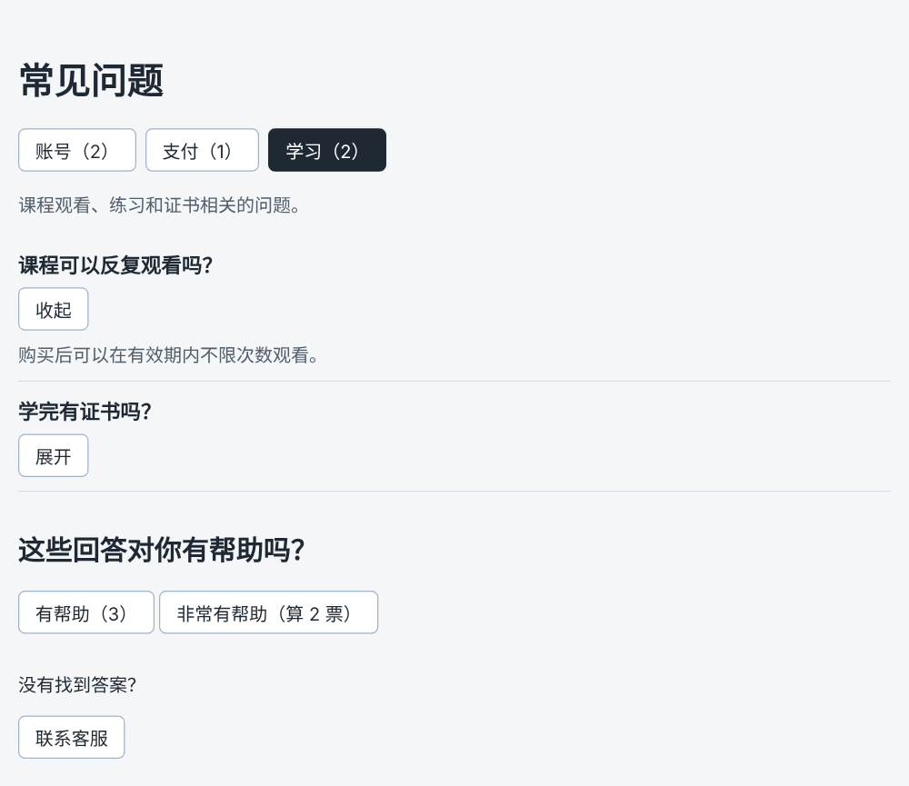

# 第 24 章：如何在点击按钮时执行一段代码？

前置：[第 23 章：【组合】如何用同一个列表组件显示不同栏目的新闻？](第023章-如何用同一个列表组件显示不同栏目的新闻.md)

## 一、本章要解决的问题

到目前为止，页面只能看，不能操作。从本章开始做一个新页面：常见问题页。用户在页面上会点击按钮、展开答案、切换分类，页面要对这些操作做出反应。

先从最简单的开始：页面底部有一个“联系客服”按钮，点击后弹出一个提示框，显示客服邮箱和回复时间。完成后，打开页面时不会弹出提示，只有点击按钮才会弹出。

本章是第 4 部分的起点。学完第 4 部分（第 24—34 章）时，常见问题页会变成下图的样子：可以按分类切换问题，点击展开答案，还能给回答投票。



## 二、必要原理

### 事件与事件处理函数

用户点击、输入、按键，浏览器都会产生一个**事件**。我们写一个函数，告诉 React：“发生这个事件时，调用这个函数”。这个函数叫**事件处理函数**。

在 JSX 中，给按钮的 `onClick` 属性传入一个函数，按钮被点击时 React 就会调用它：

```tsx
<button type="button" onClick={handleContactClick}>
  联系客服
</button>
```

事件处理函数习惯以 `handle` 开头，后面写清楚处理的是什么，例如 `handleContactClick`。这只是命名习惯，React 没有要求。

### 传函数，而不是调用函数

`onClick={handleContactClick}` 和 `onClick={handleContactClick()}` 只差一对括号，意思却完全不同：

- 不加括号：把函数本身交给 React，**等用户点击时**再调用。
- 加了括号：在 React **生成页面时就立刻调用**它，再把调用的结果交给 `onClick`。打开页面就会弹出提示框，点击按钮反而没有反应。

### 事件处理函数写在组件内部

事件处理函数通常写在组件函数里面、`return` 之前。这样它可以使用组件中的其他变量，后面几章会用到这一点。

### button 的 type 属性

`<button>` 写在表单里时，默认会提交表单。`type="button"` 明确表示“这是一个普通按钮，只执行点击操作”，以后即使把它放进表单也不会意外提交。养成每个普通按钮都写 `type="button"` 的习惯。

### window.alert

`window.alert('文字')` 是浏览器自带的提示框，会显示文字并等待用户点击“确定”。本章用它来确认“点击后代码确实执行了”。实际项目中很少用它，后面的章节会把反馈显示在页面上。

## 三、动手实现

### 第 1 步：给按钮添加通用样式

浏览器默认的按钮样式比较简陋。在 `src/App.css` 末尾加入全站通用的按钮样式：

```css
button {
  padding: 6px 14px;
  border: 1px solid #9fb3c8;
  border-radius: 6px;
  background: #ffffff;
  color: #1f2933;
  font: inherit;
  cursor: pointer;
}

button:hover {
  background: #f0f4f8;
}
```

`font: inherit` 让按钮使用和页面相同的字体；`cursor: pointer` 让鼠标移到按钮上时变成手形；`:hover` 是鼠标悬停时的样式。

### 第 2 步：新建常见问题页

在 `src/pages` 中新建 `FaqPage.module.css`：

```css
.section {
  margin-top: 32px;
}
```

再新建 `FaqPage.tsx`：

```tsx
import styles from './FaqPage.module.css';

export default function FaqPage() {
  function handleContactClick() {
    window.alert('客服邮箱：help@example.com，工作日 9:00—18:00 回复。');
  }

  return (
    <main className="page">
      <h1>常见问题</h1>
      <section className={styles.section}>
        <p>没有找到答案？</p>
        <button type="button" onClick={handleContactClick}>
          联系客服
        </button>
      </section>
    </main>
  );
}
```

`handleContactClick` 定义在 `FaqPage` 函数里面，按钮通过 `onClick` 使用它。

### 第 3 步：让 App 显示常见问题页

修改 `src/App.tsx`：

```tsx
import './App.css';
import FaqPage from './pages/FaqPage';

export default function App() {
  return <FaqPage />;
}
```

新闻页和学习小组页的文件都保留。

## 四、运行与检查

保持开发服务器运行（`npm.cmd run dev`），保存文件后在浏览器中查看。

1. 页面显示“常见问题”标题、“没有找到答案？”和“联系客服”按钮。打开页面时没有弹出提示框。
2. 鼠标移到按钮上，按钮背景变浅，鼠标变成手形。
3. 点击“联系客服”，弹出提示框，显示客服邮箱和回复时间。点击“确定”关闭。
4. 用键盘按 Tab 键，焦点移到按钮上（按钮周围出现一圈高亮），按 Enter 或空格键，同样弹出提示框。`button` 天生支持键盘操作。
5. 把 `onClick={handleContactClick}` 临时改成 `onClick={handleContactClick()}`，保存。页面一打开就弹出了提示框，关掉后紧接着又弹出一次；再点击按钮，没有反应。弹出两次是因为开发时 React 会把组件函数执行两遍，帮助发现这类问题，第 75 章会详细讲。检查后改回。

最后运行检查，应没有错误：

```powershell
npm.cmd run check
```

**小练习**：在“联系客服”旁边再加一个“查看客服电话”按钮，点击后用 `window.alert` 显示一个电话号码。新写一个事件处理函数 `handlePhoneClick`。练习后恢复本章代码。

## 五、常见错误

| 现象 | 原因 | 怎么改 |
| --- | --- | --- |
| 打开页面就弹出提示框（开发时会连续弹出两次），点击按钮没反应 | 写成了 `onClick={handleContactClick()}` | 去掉括号，只传函数名 |
| 编辑器提示 `onclick` 不是有效的属性，点击没反应 | 属性名写成了全小写 `onclick` | React 中写 `onClick`，C 大写 |
| 编辑器提示找不到 `handleContactClick` | 函数名拼写不一致，或函数写在了别的组件里 | 检查两处名字完全一致，函数写在 `FaqPage` 内部 |
| 用 `<div onClick={...}>` 做按钮，键盘无法操作 | `div` 不是按钮，不能用 Tab 选中，也不响应 Enter | 可以点击的操作用 `<button>` |
| `onClick={'handleContactClick'}` 点击报错 | 传入的是一段文字，不是函数 | 花括号中直接写函数名，不加引号 |

## 六、本章完整代码

### `src/App.css`

```css
body {
  margin: 0;
  font-family: system-ui, sans-serif;
  background: #f4f6f8;
  color: #1f2933;
}

.page {
  max-width: 960px;
  margin: 0 auto;
  padding: 24px 16px;
}

.page-header p {
  color: #52606d;
}

.page-footer {
  margin-top: 24px;
  padding-top: 16px;
  border-top: 1px solid #d9e2ec;
  color: #52606d;
}

.card-list {
  display: flex;
  flex-wrap: wrap;
  gap: 16px;
  margin-top: 16px;
}

.card-list > * {
  flex: 1 1 200px;
}

button {
  padding: 6px 14px;
  border: 1px solid #9fb3c8;
  border-radius: 6px;
  background: #ffffff;
  color: #1f2933;
  font: inherit;
  cursor: pointer;
}

button:hover {
  background: #f0f4f8;
}
```

### `src/pages/FaqPage.module.css`

内容同第三节第 2 步。

### `src/pages/FaqPage.tsx`

内容同第三节第 2 步。

### `src/App.tsx`

内容同第三节第 3 步。

## 七、本章改动小结

新增 `src/pages/FaqPage.tsx` 和 `src/pages/FaqPage.module.css`；修改 `src/App.css`（新增按钮通用样式）和 `src/App.tsx`（改为显示常见问题页）。

---

下一章：[第 25 章：为什么修改普通变量后，页面没有跟着变化？](第025章-为什么修改普通变量后，页面没有跟着变化.md)
