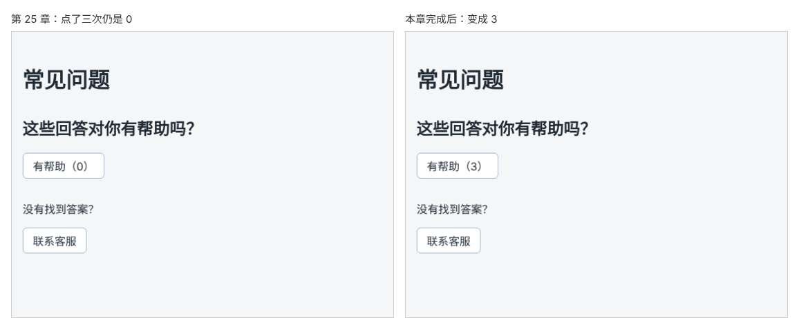

# 第 26 章：如何用 state 记住数据并更新页面？

前置：[第 25 章：为什么修改普通变量后，页面没有跟着变化？](第025章-为什么修改普通变量后，页面没有跟着变化.md)

## 一、本章要解决的问题

第 25 章的“有帮助（0）”按钮点了也不会变。原因有两个：普通变量的变化不会通知 React 更新页面；每次渲染变量又会回到 0。

本章用 React 的 state 保存投票次数。完成后，每点击一次按钮，括号里的数字就加 1。

下图是点击“有帮助”三次以后的页面，左边是第 25 章的写法，右边是本章完成后的写法：



## 二、必要原理

### state：组件的记忆

**state**（状态）是 React 为组件保存的数据。它解决了普通变量的两个问题：

1. **记得住**：React 在组件之外替你保存这个值，组件重新渲染时，拿到的是上一次保存的值，而不是初始值。
2. **会通知**：修改 state 时，React 知道数据变了，会重新渲染组件，页面随之更新。

### 用 useState 创建 state

```tsx
import { useState } from 'react';

const [helpfulCount, setHelpfulCount] = useState(0);
```

- `useState(0)` 创建一个 state，`0` 是它的初始值，只在组件第一次渲染时使用。
- 它返回一个包含两项的数组：第一项是 state 当前的值，第二项是修改它的函数。
- `const [a, b] = ...` 是数组解构，把数组的两项分别取出来，起名为 `helpfulCount` 和 `setHelpfulCount`。名字可以自己定，习惯写成“`xxx` 和 `setXxx`”。

TypeScript 会根据初始值 `0` 自动推断出这个 state 是数字，不需要手写类型。

### 用 set 函数修改 state

```tsx
setHelpfulCount(helpfulCount + 1);
```

调用 `setHelpfulCount` 并传入新的值，React 会记下新值，然后重新渲染 `FaqPage`。重新渲染时，`useState` 返回的是新值，JSX 中的 `{helpfulCount}` 读到新值，页面就更新了。

注意两点：

- **不要直接给 state 赋值**，例如 `helpfulCount = helpfulCount + 1`。这样和第 25 章的普通变量一样，React 不知道它变了。而且 `helpfulCount` 是用 `const` 声明的，编辑器也会报错。
- **调用 set 函数后，当前这次执行中的变量不会立刻变成新值。** 它要等下一次渲染才是新值。下一章会遇到这一点带来的问题。

### 以 use 开头的函数叫 Hook

`useState` 这类以 `use` 开头、由 React 提供的函数叫做 **Hook**。使用 Hook 有一条规则：**只能在组件函数的最顶层调用**，不能写在 `if`、循环或事件处理函数里面。React 靠调用顺序区分组件中的多个 state，如果某次渲染跳过了一个 Hook，顺序就乱了。

第 7 章配置的 oxlint 规则 `react/rules-of-hooks` 会检查这一点，违反时 `npm.cmd run check` 会报错。

## 三、动手实现

### 第 1 步：导入 useState

打开 `src/pages/FaqPage.tsx`，在第一行加入：

```tsx
import { useState } from 'react';
import styles from './FaqPage.module.css';
```

`useState` 是从 `react` 包中按名字导入的，所以要写在花括号里。

### 第 2 步：用 state 代替普通变量

把第 25 章写的 `let helpfulCount = 0;` 和 `handleHelpfulClick` 替换为：

```tsx
  const [helpfulCount, setHelpfulCount] = useState(0);

  function handleHelpfulClick() {
    setHelpfulCount(helpfulCount + 1);
  }
```

`useState` 写在组件函数的最顶层。`console.log` 已经完成了观察的任务，一起删掉。

JSX 中的 `有帮助（{helpfulCount}）` 不用修改，它读取的已经是 state 了。

## 四、运行与检查

保持开发服务器运行（`npm.cmd run dev`），保存文件后在浏览器中查看。

1. 按钮显示“有帮助（0）”。
2. 点击一次，变成“有帮助（1）”；再点两次，变成“有帮助（3）”。
3. 刷新页面，数字回到 0。state 保存在浏览器内存中，刷新页面后组件重新创建，又从初始值开始。把数据长期保存起来，要等到学习服务器（第 86 章）或浏览器本地存储（第 123 章）。
4. 点击“联系客服”，提示框正常弹出，投票数字不受影响。

最后运行检查，应没有错误：

```powershell
npm.cmd run check
```

**小练习**：在 `const [helpfulCount, ...]` 那一行的下面临时加入 `if (helpfulCount > 5) { useState(''); }`，运行 `npm.cmd run lint`（只运行代码检查），看看 oxlint 报告了哪条规则、说了什么。再想一想：点到第 6 次时，这个组件中调用 Hook 的顺序发生了什么变化？读懂后删除这一行。

## 五、常见错误

| 现象 | 原因 | 怎么改 |
| --- | --- | --- |
| 编辑器提示不能给常量赋值 | 直接写了 `helpfulCount = helpfulCount + 1` | 调用 `setHelpfulCount(...)` |
| 编辑器提示找不到 `useState` | 没有导入，或写成了 `import useState from 'react'` | 写成 `import { useState } from 'react';` |
| `check` 报告 `react/rules-of-hooks` | 把 `useState` 写在了 `if`、循环或事件处理函数里 | 移到组件函数的最顶层 |
| 页面一直在刷新，控制台报 `Too many re-renders` | 写成了 `onClick={setHelpfulCount(helpfulCount + 1)}`，渲染时就修改 state，又引起渲染，循环不止 | 传入函数：`onClick={handleHelpfulClick}` |
| 写成 `useState('0')` 后，点击后显示“01”“011” | 初始值是字符串，`+ 1` 变成了拼接文字 | 初始值写数字 `0`，不加引号 |

## 六、本章完整代码

### `src/pages/FaqPage.tsx`

```tsx
import { useState } from 'react';
import styles from './FaqPage.module.css';

export default function FaqPage() {
  const [helpfulCount, setHelpfulCount] = useState(0);

  function handleHelpfulClick() {
    setHelpfulCount(helpfulCount + 1);
  }

  function handleContactClick() {
    window.alert('客服邮箱：help@example.com，工作日 9:00—18:00 回复。');
  }

  return (
    <main className="page">
      <h1>常见问题</h1>
      <section className={styles.section}>
        <h2>这些回答对你有帮助吗？</h2>
        <button type="button" onClick={handleHelpfulClick}>
          有帮助（{helpfulCount}）
        </button>
      </section>
      <section className={styles.section}>
        <p>没有找到答案？</p>
        <button type="button" onClick={handleContactClick}>
          联系客服
        </button>
      </section>
    </main>
  );
}
```

## 七、本章改动小结

修改 `src/pages/FaqPage.tsx`：导入 `useState`，用 state `helpfulCount` 代替普通变量，点击时调用 `setHelpfulCount`。

---

下一章：[第 27 章：如何点击按钮展开或收起一段文字？](第027章-如何点击按钮展开或收起一段文字.md)
