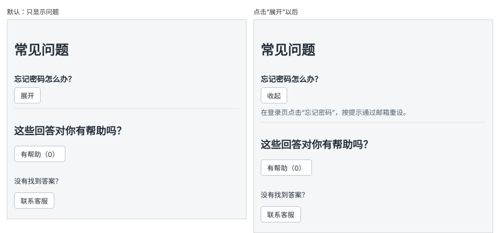

# 第 27 章：如何点击按钮展开或收起一段文字？

前置：[第 26 章：如何用 state 记住数据并更新页面？](第026章-如何用state记住数据并更新页面.md)

## 一、本章要解决的问题

常见问题页上的答案往往比较长，全部展开会让页面很长，用户也不容易找到自己关心的问题。常见的做法是：默认只显示问题，点击“展开”才显示答案，再点“收起”又隐藏答案。

本章先做一个问题“忘记密码怎么办？”。完成后，答案默认隐藏，按钮文字是“展开”；点击后显示答案，按钮变成“收起”；再点击又隐藏。

下图左边是打开页面时的样子，右边是点击“展开”以后的样子：



## 二、必要原理

### 用布尔值 state 记住“是否展开”

答案只有两种状态：显示或隐藏。用一个布尔值 state 记住它：

```tsx
const [isAnswerOpen, setIsAnswerOpen] = useState(false);
```

初始值 `false` 表示默认收起。布尔值的变量名习惯以 `is`、`has` 开头，读起来像一个问题：“答案是否展开？”

### 点击时取反

每次点击，都把状态切换成相反的值：

```tsx
setIsAnswerOpen(!isAnswerOpen);
```

`!` 是“取反”运算符：`!true` 是 `false`，`!false` 是 `true`。

### 根据 state 决定显示什么

state 变化后组件重新渲染，JSX 根据新的值决定显示的内容：

- 答案是否显示：用第 21 章学过的 `&&`，`{isAnswerOpen && <p>……</p>}`。
- 按钮文字：用第 19 章学过的条件运算符，`{isAnswerOpen ? '收起' : '展开'}`。

我们没有写任何“隐藏这个元素”“修改按钮文字”的代码，只修改了 state。页面怎样显示，完全由 state 当前的值决定。这是 React 的基本思路：**先描述“什么状态下页面是什么样子”，再通过修改状态来改变页面。**

### 直接在 onClick 中写箭头函数

处理函数只有一行时，可以不单独起名字，直接在 `onClick` 中写一个箭头函数：

```tsx
<button type="button" onClick={() => setIsAnswerOpen(!isAnswerOpen)}>
```

`() => setIsAnswerOpen(!isAnswerOpen)` 是一个没有参数的函数，点击时 React 调用它，它再调用 `setIsAnswerOpen`。注意这里传给 `onClick` 的仍然是一个函数，而不是 `setIsAnswerOpen(...)` 的调用结果，第 24 章的规则没有变。

### 告诉读屏软件按钮的状态

`aria-expanded` 属性说明这个按钮控制的内容当前是否展开。读屏软件会读出“已展开”或“已折叠”，看不到页面的用户也能知道按钮的作用。它的值直接使用 state：`aria-expanded={isAnswerOpen}`。

## 三、动手实现

### 第 1 步：添加问题的样式

在 `src/pages/FaqPage.module.css` 末尾加入：

```css
.item {
  padding: 12px 0;
  border-bottom: 1px solid #d9e2ec;
}

.question {
  margin: 0 0 8px;
  font-size: 18px;
}

.answer {
  margin: 8px 0 0;
  color: #52606d;
}
```

### 第 2 步：增加“是否展开”的 state

打开 `src/pages/FaqPage.tsx`，在 `helpfulCount` 那一行的下面加入：

```tsx
  const [isAnswerOpen, setIsAnswerOpen] = useState(false);
```

一个组件可以有多个 state，每个 state 各自独立。

### 第 3 步：显示问题、按钮和答案

在 `<h1>常见问题</h1>` 的下面、投票区域的上面加入：

```tsx
      <div className={styles.item}>
        <h2 className={styles.question}>忘记密码怎么办？</h2>
        <button
          type="button"
          aria-expanded={isAnswerOpen}
          onClick={() => setIsAnswerOpen(!isAnswerOpen)}
        >
          {isAnswerOpen ? '收起' : '展开'}
        </button>
        {isAnswerOpen && (
          <p className={styles.answer}>在登录页点击“忘记密码”，按提示通过邮箱重设。</p>
        )}
      </div>
```

答案的 JSX 较长，用圆括号包起来换行书写，与第 19 章的写法相同。

## 四、运行与检查

保持开发服务器运行（`npm.cmd run dev`），保存文件后在浏览器中查看。

1. 页面显示问题“忘记密码怎么办？”和“展开”按钮，下面没有答案。
2. 点击“展开”，答案出现，按钮变成“收起”。
3. 点击“收起”，答案消失，按钮变回“展开”。
4. 按 F12，在 Elements（元素）面板中观察：收起时页面中根本没有答案的 `p` 元素，展开时才出现；按钮的 `aria-expanded` 随之在 `false` 和 `true` 之间变化。
5. 先展开答案，再点击“有帮助”投票，答案保持展开。两个 state 互不影响。

最后运行检查，应没有错误：

```powershell
npm.cmd run check
```

**小练习**：把初始值改成 `useState(true)`，让答案默认展开，观察按钮文字是否正确。再把按钮文字改为“▲ 收起”和“▼ 展开”。练习后恢复本章代码。

## 五、常见错误

| 现象 | 原因 | 怎么改 |
| --- | --- | --- |
| 打开页面就报 `Too many re-renders` | 写成了 `onClick={setIsAnswerOpen(!isAnswerOpen)}`，渲染时就修改 state | 写成箭头函数 `onClick={() => setIsAnswerOpen(!isAnswerOpen)}` |
| 点击后答案出现，再点不会消失 | 写成了 `setIsAnswerOpen(true)` | 用 `!isAnswerOpen` 取反 |
| 按钮文字和答案状态对不上 | 条件运算符两边写反了 | 展开时（`true`）显示“收起” |
| 答案一直显示 | 答案的 `p` 没有放在 `{isAnswerOpen && ...}` 中 | 用 `&&` 包住答案 |
| 编辑器提示 `aria-expanded` 的值类型不对 | 写成了字符串 `aria-expanded="isAnswerOpen"` | 用花括号传入布尔值 |

## 六、本章完整代码

### `src/pages/FaqPage.module.css`

```css
.section {
  margin-top: 32px;
}

.item {
  padding: 12px 0;
  border-bottom: 1px solid #d9e2ec;
}

.question {
  margin: 0 0 8px;
  font-size: 18px;
}

.answer {
  margin: 8px 0 0;
  color: #52606d;
}
```

### `src/pages/FaqPage.tsx`

```tsx
import { useState } from 'react';
import styles from './FaqPage.module.css';

export default function FaqPage() {
  const [helpfulCount, setHelpfulCount] = useState(0);
  const [isAnswerOpen, setIsAnswerOpen] = useState(false);

  function handleHelpfulClick() {
    setHelpfulCount(helpfulCount + 1);
  }

  function handleContactClick() {
    window.alert('客服邮箱：help@example.com，工作日 9:00—18:00 回复。');
  }

  return (
    <main className="page">
      <h1>常见问题</h1>
      <div className={styles.item}>
        <h2 className={styles.question}>忘记密码怎么办？</h2>
        <button
          type="button"
          aria-expanded={isAnswerOpen}
          onClick={() => setIsAnswerOpen(!isAnswerOpen)}
        >
          {isAnswerOpen ? '收起' : '展开'}
        </button>
        {isAnswerOpen && (
          <p className={styles.answer}>在登录页点击“忘记密码”，按提示通过邮箱重设。</p>
        )}
      </div>
      <section className={styles.section}>
        <h2>这些回答对你有帮助吗？</h2>
        <button type="button" onClick={handleHelpfulClick}>
          有帮助（{helpfulCount}）
        </button>
      </section>
      <section className={styles.section}>
        <p>没有找到答案？</p>
        <button type="button" onClick={handleContactClick}>
          联系客服
        </button>
      </section>
    </main>
  );
}
```

## 七、本章改动小结

修改 `src/pages/FaqPage.tsx`（新增 state `isAnswerOpen`，显示一个可展开的问题）和 `src/pages/FaqPage.module.css`（新增问题、答案的样式）。

---

下一章：[第 28 章：如何根据上一次的值连续更新状态？](第028章-如何根据上一次的值连续更新状态.md)
