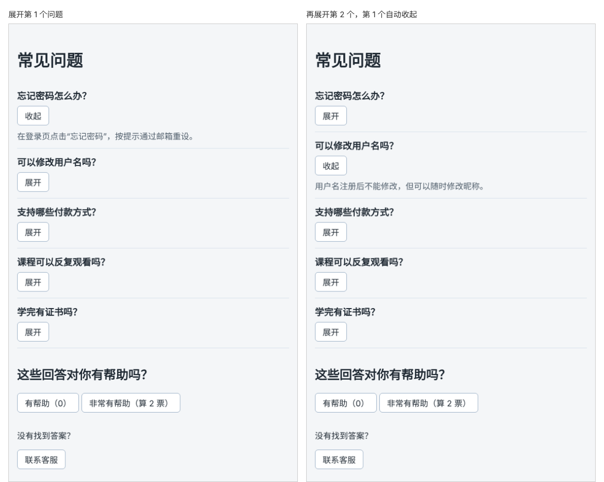

# 第 29 章：如何让多个问题中同时只展开一个？

前置：[第 28 章：如何根据上一次的值连续更新状态？](第028章-如何根据上一次的值连续更新状态.md)

## 一、本章要解决的问题

常见问题页不止一个问题。问题多了以后，常见的设计是“同时只展开一个”：展开一个新问题时，原来展开的那个自动收起，页面不会被一长串答案撑得很长。

本章把问题改为来自一个数组，用列表显示，并且同时最多只展开一个。完成后，页面有五个问题；展开第二个时，第一个自动收起；再点一次已展开的问题，它会收起，所有问题都处于收起状态。

下图左边是展开第 1 个问题的样子，右边是接着展开第 2 个问题的样子：



## 二、必要原理

### 每个问题一个布尔值，行不通

第 27 章用 `isAnswerOpen` 记住一个问题是否展开。五个问题，难道要写五个 state？就算写了，“展开一个时收起其他所有”也要同时修改好几个 state，问题越多越麻烦，而且问题的数量来自数组，事先并不知道有几个。

### 换个角度：只记住“哪一个展开了”

“同时只展开一个”意味着：任何时候，展开的问题要么只有一个，要么没有。所以只需要记住**展开的那个问题的编号**：

```tsx
const [openId, setOpenId] = useState<number | null>(null);
```

- 有问题展开时，`openId` 是那个问题的 `id`。
- 没有问题展开时，`openId` 是 `null`，表示“没有”。

判断某个问题是否展开：`faq.id === openId`。展开另一个问题时，只需把 `openId` 改成新问题的编号，原来那个自然就不再相等，自动收起了。用一个 state 就同时管住了所有问题。

### 给 useState 写明类型

初始值是 `null`，TypeScript 只能推断出“这个 state 永远是 `null`”，以后就不能把数字放进去。这时要在尖括号中写明类型：

```tsx
useState<number | null>(null)
```

`number | null` 是**联合类型**，竖线表示“或”：这个值可以是数字，也可以是 `null`。

### 点击时：展开或收起

```tsx
function handleToggle(id: number) {
  setOpenId(openId === id ? null : id);
}
```

点击的正是已展开的问题，就设为 `null`，全部收起；否则把它设为展开的那一个。

### 在 onClick 中传入参数

`handleToggle` 需要知道点的是哪个问题。`onClick={handleToggle}` 没办法传入 `id`，`onClick={handleToggle(faq.id)}` 又会在渲染时就调用。用箭头函数包一层：

```tsx
onClick={() => handleToggle(faq.id)}
```

点击时 React 调用这个箭头函数，箭头函数再用当前问题的 `id` 调用 `handleToggle`。

### map 中写多行代码

每一项都要用到“这个问题是否展开”，先算出来存进变量，JSX 会更清楚。箭头函数后面用花括号时，可以写多行代码，最后用 `return` 返回 JSX：

```tsx
{faqs.map((faq) => {
  const isOpen = faq.id === openId;
  return <li key={faq.id}>……</li>;
})}
```

第 17 章的写法 `(faq) => (<li>……</li>)` 用圆括号直接返回 JSX，只适合没有其他代码的情况。

## 三、动手实现

### 第 1 步：准备问题数据

新建 `src/data/faqs.ts`：

```ts
export type Faq = {
  id: number;
  question: string;
  answer: string;
};

export const faqs: Faq[] = [
  { id: 1, question: '忘记密码怎么办？', answer: '在登录页点击“忘记密码”，按提示通过邮箱重设。' },
  { id: 2, question: '可以修改用户名吗？', answer: '用户名注册后不能修改，但可以随时修改昵称。' },
  { id: 3, question: '支持哪些付款方式？', answer: '支持银行卡和常见的第三方支付。' },
  { id: 4, question: '课程可以反复观看吗？', answer: '购买后可以在有效期内不限次数观看。' },
  { id: 5, question: '学完有证书吗？', answer: '完成全部练习并通过测验后，可以下载结业证书。' },
];
```

### 第 2 步：添加列表样式

在 `src/pages/FaqPage.module.css` 末尾加入：

```css
.list {
  margin: 0;
  padding: 0;
  list-style: none;
}
```

### 第 3 步：用 openId 代替 isAnswerOpen

打开 `src/pages/FaqPage.tsx`，导入问题数据：

```tsx
import { useState } from 'react';
import { faqs } from '../data/faqs';
import styles from './FaqPage.module.css';
```

把 `isAnswerOpen` 那一行替换为：

```tsx
  const [openId, setOpenId] = useState<number | null>(null);
```

在 `addHelpful` 的上方加入 `handleToggle`：

```tsx
  function handleToggle(id: number) {
    setOpenId(openId === id ? null : id);
  }
```

### 第 4 步：把单个问题换成列表

把第 27 章写的整个 `<div className={styles.item}>……</div>` 替换为：

```tsx
      <ul className={styles.list}>
        {faqs.map((faq) => {
          const isOpen = faq.id === openId;
          return (
            <li key={faq.id} className={styles.item}>
              <h2 className={styles.question}>{faq.question}</h2>
              <button type="button" aria-expanded={isOpen} onClick={() => handleToggle(faq.id)}>
                {isOpen ? '收起' : '展开'}
              </button>
              {isOpen && <p className={styles.answer}>{faq.answer}</p>}
            </li>
          );
        })}
      </ul>
```

每一项的结构与第 27 章相同，只是把 `isAnswerOpen` 换成了这一项自己算出的 `isOpen`，文字来自数据。

## 四、运行与检查

保持开发服务器运行（`npm.cmd run dev`），保存文件后在浏览器中查看。

1. 页面显示五个问题，全部收起。
2. 展开第一个问题，答案出现。再展开第三个问题，第三个的答案出现，第一个自动收起。
3. 点击第三个问题的“收起”，它收起，所有问题都是收起状态。
4. 展开一个问题后点击“有帮助”，计数增加，展开的问题保持不变。
5. 按 F12，在 Elements（元素）面板中观察：任何时候最多只有一个按钮的 `aria-expanded` 是 `true`。

最后运行检查，应没有错误：

```powershell
npm.cmd run check
```

**小练习**：把初始值改为 `useState<number | null>(1)`，打开页面时第一个问题默认展开。再试着把初始值写成 `useState(null)`（不写尖括号中的类型），运行 `check`，读一读 TypeScript 的提示。练习后恢复本章代码。

## 五、常见错误

| 现象 | 原因 | 怎么改 |
| --- | --- | --- |
| 编辑器提示 `number` 不能赋给 `null` | `useState(null)` 没有写类型，TypeScript 认为它只能是 `null` | 写成 `useState<number \| null>(null)` |
| 点击任何一个问题，所有答案都展开 | 用了一个布尔值 state 控制所有问题 | 用 `openId` 记住展开的那一个 |
| 展开后再点同一个问题，无法收起 | `handleToggle` 中直接写了 `setOpenId(id)` | 已展开时设为 `null` |
| 页面打开就报 `Too many re-renders` | 写成了 `onClick={handleToggle(faq.id)}` | 写成 `onClick={() => handleToggle(faq.id)}` |
| 列表什么都不显示 | `map` 后面用了花括号，但漏写了 `return` | 花括号中要写 `return (...)` |

## 六、本章完整代码

### `src/data/faqs.ts`

内容同第三节第 1 步。

### `src/pages/FaqPage.module.css`

```css
.section {
  margin-top: 32px;
}

.item {
  padding: 12px 0;
  border-bottom: 1px solid #d9e2ec;
}

.question {
  margin: 0 0 8px;
  font-size: 18px;
}

.answer {
  margin: 8px 0 0;
  color: #52606d;
}

.list {
  margin: 0;
  padding: 0;
  list-style: none;
}
```

### `src/pages/FaqPage.tsx`

```tsx
import { useState } from 'react';
import { faqs } from '../data/faqs';
import styles from './FaqPage.module.css';

export default function FaqPage() {
  const [helpfulCount, setHelpfulCount] = useState(0);
  const [openId, setOpenId] = useState<number | null>(null);

  function handleToggle(id: number) {
    setOpenId(openId === id ? null : id);
  }

  function addHelpful() {
    setHelpfulCount((current) => current + 1);
  }

  function handleHelpfulClick() {
    addHelpful();
  }

  function handleVeryHelpfulClick() {
    addHelpful();
    addHelpful();
  }

  function handleContactClick() {
    window.alert('客服邮箱：help@example.com，工作日 9:00—18:00 回复。');
  }

  return (
    <main className="page">
      <h1>常见问题</h1>
      <ul className={styles.list}>
        {faqs.map((faq) => {
          const isOpen = faq.id === openId;
          return (
            <li key={faq.id} className={styles.item}>
              <h2 className={styles.question}>{faq.question}</h2>
              <button type="button" aria-expanded={isOpen} onClick={() => handleToggle(faq.id)}>
                {isOpen ? '收起' : '展开'}
              </button>
              {isOpen && <p className={styles.answer}>{faq.answer}</p>}
            </li>
          );
        })}
      </ul>
      <section className={styles.section}>
        <h2>这些回答对你有帮助吗？</h2>
        <button type="button" onClick={handleHelpfulClick}>
          有帮助（{helpfulCount}）
        </button>{' '}
        <button type="button" onClick={handleVeryHelpfulClick}>
          非常有帮助（算 2 票）
        </button>
      </section>
      <section className={styles.section}>
        <p>没有找到答案？</p>
        <button type="button" onClick={handleContactClick}>
          联系客服
        </button>
      </section>
    </main>
  );
}
```

## 七、本章改动小结

新增 `src/data/faqs.ts`；修改 `src/pages/FaqPage.tsx`（用 `openId` 代替 `isAnswerOpen`，问题改为列表）和 `src/pages/FaqPage.module.css`（新增 `.list`）。

---

下一章：[第 30 章：如何切换标签页显示的内容？](第030章-如何切换标签页显示的内容.md)
