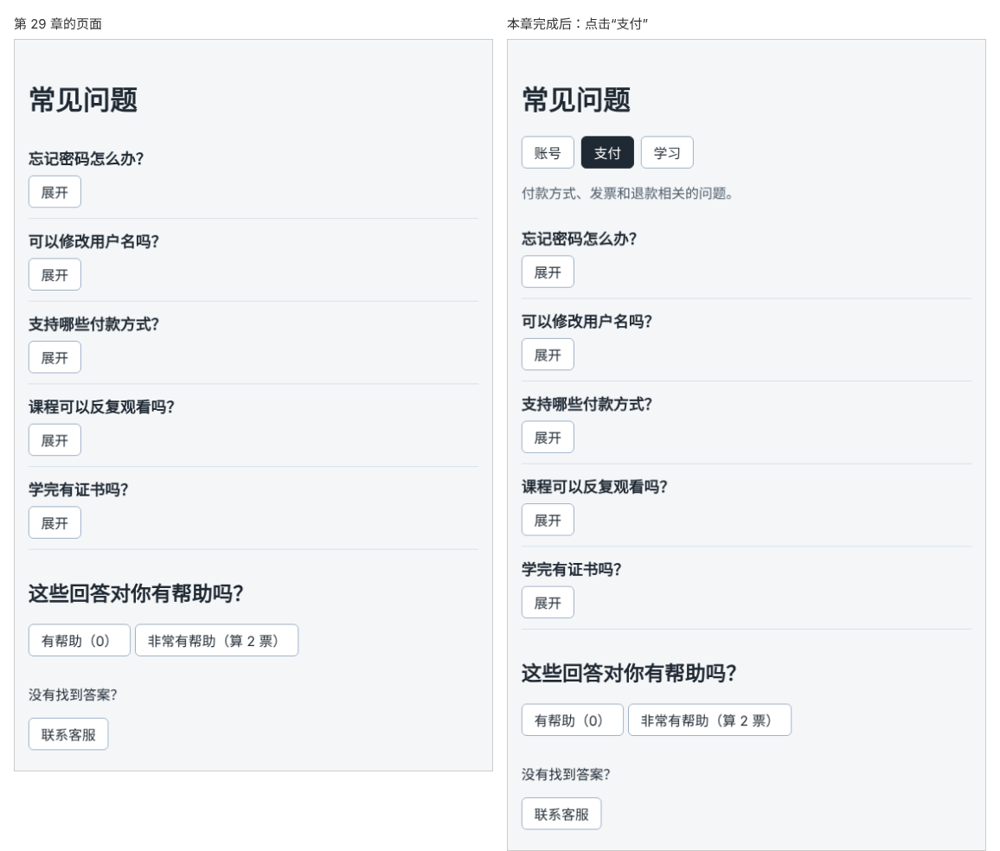

# 第 30 章：如何切换标签页显示的内容？

前置：[第 29 章：如何让多个问题中同时只展开一个？](第029章-如何让多个问题中同时只展开一个.md)

## 一、本章要解决的问题

问题越来越多，需要按分类查看。页面顶部要有三个标签：“账号”“支付”“学习”，点击哪个标签，哪个标签就高亮显示，下方显示这个分类的说明。

本章先做标签本身：切换标签、高亮当前标签、显示对应说明。按分类筛选问题列表，在第 34 章完成。完成后，打开页面时“账号”标签高亮，下方说明是账号相关的内容；点击“学习”，“学习”高亮，说明随之变化。

下图左边是现在的页面，右边是本章完成后点击“支付”标签的样子：



## 二、必要原理

### 用 state 记住当前标签

当前选中的是哪个标签，需要记住，并且变化时页面要更新，所以用 state。

标签只有三个可能的值。用字符串表示每个标签，例如 `'account'`、`'payment'`、`'study'`。分类名用英文单词，是因为以后它们会出现在数据和网址中，英文更通用；显示给用户的文字另外写。

### 字面量联合类型：只允许几个固定的值

如果 state 的类型是 `string`，任何字符串都能放进去，拼错一个字母（例如 `'acount'`）也不会报错，标签却永远不会高亮。TypeScript 可以把类型限定为几个具体的字符串：

```ts
export type FaqCategory = 'account' | 'payment' | 'study';
```

这表示 `FaqCategory` 只能是这三个字符串之一。写成别的值，编辑器会立刻报错。这是第 29 章联合类型的另一种用法。

```tsx
const [activeTab, setActiveTab] = useState<FaqCategory>('account');
```

### 用数组描述标签，用 map 生成按钮

三个标签的结构相同，只是值和文字不同。把它们写成一个数组，用 `map` 生成按钮：

```ts
export const faqTabs: { value: FaqCategory; label: string }[] = [
  { value: 'account', label: '账号' },
  ……
];
```

`{ value: FaqCategory; label: string }[]` 直接写出了数组中每个对象的类型，不单独起名。类型只在这里用一次时，可以这样写。

### 高亮当前标签

当前标签用不同的样式表示。根据条件选择类名：

```tsx
className={tab.value === activeTab ? styles.activeTab : undefined}
```

是当前标签就使用 `styles.activeTab`，否则是 `undefined`，React 不会给元素加 `class` 属性。

再加上 `aria-pressed={tab.value === activeTab}`，告诉读屏软件这个按钮当前是否处于“按下”的状态。

## 三、动手实现

### 第 1 步：定义分类类型和标签数据

在 `src/data/faqs.ts` 的最上方加入：

```ts
export type FaqCategory = 'account' | 'payment' | 'study';

export const faqTabs: { value: FaqCategory; label: string }[] = [
  { value: 'account', label: '账号' },
  { value: 'payment', label: '支付' },
  { value: 'study', label: '学习' },
];
```

### 第 2 步：添加标签样式

在 `src/pages/FaqPage.module.css` 末尾加入：

```css
.tabs {
  display: flex;
  flex-wrap: wrap;
  gap: 8px;
}

.tabs .activeTab {
  border-color: #1f2933;
  background: #1f2933;
  color: #ffffff;
}

.hint {
  color: #52606d;
}
```

标签用第 12、13 章学过的 Flex 布局横向排列。高亮样式写成 `.tabs .activeTab`，比 `App.css` 中的 `button` 规则更具体，鼠标悬停时也能保持深色背景。

### 第 3 步：增加当前标签的 state

打开 `src/pages/FaqPage.tsx`，修改导入：

```tsx
import { faqs, faqTabs } from '../data/faqs';
import type { FaqCategory } from '../data/faqs';
```

在 `openId` 那一行的下面加入：

```tsx
  const [activeTab, setActiveTab] = useState<FaqCategory>('account');
```

### 第 4 步：显示标签和说明

在 `<h1>常见问题</h1>` 的下面、问题列表的上面加入：

```tsx
      <div className={styles.tabs}>
        {faqTabs.map((tab) => (
          <button
            key={tab.value}
            type="button"
            aria-pressed={tab.value === activeTab}
            className={tab.value === activeTab ? styles.activeTab : undefined}
            onClick={() => setActiveTab(tab.value)}
          >
            {tab.label}
          </button>
        ))}
      </div>
      {activeTab === 'account' && <p className={styles.hint}>登录、密码和个人资料相关的问题。</p>}
      {activeTab === 'payment' && <p className={styles.hint}>付款方式、发票和退款相关的问题。</p>}
      {activeTab === 'study' && <p className={styles.hint}>课程观看、练习和证书相关的问题。</p>}
```

标签的 `value` 是唯一的，正好用作 `key`。

## 四、运行与检查

保持开发服务器运行（`npm.cmd run dev`），保存文件后在浏览器中查看。

1. 标题下方有三个标签按钮，“账号”是深色背景，下方说明是“登录、密码和个人资料相关的问题。”。
2. 点击“支付”，“支付”变成深色，“账号”恢复白色，说明变成付款相关的内容。点击“学习”同理。
3. 鼠标移到当前标签上，它仍然是深色背景。
4. 切换标签后，下方的五个问题和投票区都不受影响；本章的问题列表还没有按分类筛选。
5. 把 `useState<FaqCategory>('account')` 中的 `'account'` 临时改成 `'acount'`，编辑器立刻在这里标红。检查后改回。

最后运行检查，应没有错误：

```powershell
npm.cmd run check
```

**小练习**：在 `FaqCategory` 和 `faqTabs` 中增加第四个分类“其他”（值为 `'other'`），并增加它的说明。看看还需要改哪些地方，TypeScript 会不会提醒你。练习后恢复本章代码。

## 五、常见错误

| 现象 | 原因 | 怎么改 |
| --- | --- | --- |
| 点击标签后高亮没有变化 | `onClick` 中写的值和 `faqTabs` 中的值不一致，或者 state 没有用于判断 | 高亮条件写 `tab.value === activeTab` |
| 编辑器提示 `'acount'` 不能赋给 `FaqCategory` | 拼写错误，联合类型只允许三个固定的值 | 改成正确的值，这正是联合类型的作用 |
| 编辑器提示找不到 `FaqCategory` | 只导入了数据，没有导入类型 | `import type { FaqCategory } from '../data/faqs';` |
| 鼠标移上去后高亮背景变浅 | 高亮样式写成了 `.activeTab`，被 `App.css` 的 `button:hover` 覆盖 | 写成 `.tabs .activeTab` |
| 控制台警告缺少 `key` | `map` 生成的按钮上没有写 `key` | 写 `key={tab.value}` |

## 六、本章完整代码

### `src/data/faqs.ts`

```ts
export type FaqCategory = 'account' | 'payment' | 'study';

export const faqTabs: { value: FaqCategory; label: string }[] = [
  { value: 'account', label: '账号' },
  { value: 'payment', label: '支付' },
  { value: 'study', label: '学习' },
];

export type Faq = {
  id: number;
  question: string;
  answer: string;
};

export const faqs: Faq[] = [
  { id: 1, question: '忘记密码怎么办？', answer: '在登录页点击“忘记密码”，按提示通过邮箱重设。' },
  { id: 2, question: '可以修改用户名吗？', answer: '用户名注册后不能修改，但可以随时修改昵称。' },
  { id: 3, question: '支持哪些付款方式？', answer: '支持银行卡和常见的第三方支付。' },
  { id: 4, question: '课程可以反复观看吗？', answer: '购买后可以在有效期内不限次数观看。' },
  { id: 5, question: '学完有证书吗？', answer: '完成全部练习并通过测验后，可以下载结业证书。' },
];
```

### `src/pages/FaqPage.module.css`

```css
.section {
  margin-top: 32px;
}

.item {
  padding: 12px 0;
  border-bottom: 1px solid #d9e2ec;
}

.question {
  margin: 0 0 8px;
  font-size: 18px;
}

.answer {
  margin: 8px 0 0;
  color: #52606d;
}

.list {
  margin: 0;
  padding: 0;
  list-style: none;
}

.tabs {
  display: flex;
  flex-wrap: wrap;
  gap: 8px;
}

.tabs .activeTab {
  border-color: #1f2933;
  background: #1f2933;
  color: #ffffff;
}

.hint {
  color: #52606d;
}
```

### `src/pages/FaqPage.tsx`

```tsx
import { useState } from 'react';
import { faqs, faqTabs } from '../data/faqs';
import type { FaqCategory } from '../data/faqs';
import styles from './FaqPage.module.css';

export default function FaqPage() {
  const [helpfulCount, setHelpfulCount] = useState(0);
  const [openId, setOpenId] = useState<number | null>(null);
  const [activeTab, setActiveTab] = useState<FaqCategory>('account');

  function handleToggle(id: number) {
    setOpenId(openId === id ? null : id);
  }

  function addHelpful() {
    setHelpfulCount((current) => current + 1);
  }

  function handleHelpfulClick() {
    addHelpful();
  }

  function handleVeryHelpfulClick() {
    addHelpful();
    addHelpful();
  }

  function handleContactClick() {
    window.alert('客服邮箱：help@example.com，工作日 9:00—18:00 回复。');
  }

  return (
    <main className="page">
      <h1>常见问题</h1>
      <div className={styles.tabs}>
        {faqTabs.map((tab) => (
          <button
            key={tab.value}
            type="button"
            aria-pressed={tab.value === activeTab}
            className={tab.value === activeTab ? styles.activeTab : undefined}
            onClick={() => setActiveTab(tab.value)}
          >
            {tab.label}
          </button>
        ))}
      </div>
      {activeTab === 'account' && <p className={styles.hint}>登录、密码和个人资料相关的问题。</p>}
      {activeTab === 'payment' && <p className={styles.hint}>付款方式、发票和退款相关的问题。</p>}
      {activeTab === 'study' && <p className={styles.hint}>课程观看、练习和证书相关的问题。</p>}
      <ul className={styles.list}>
        {faqs.map((faq) => {
          const isOpen = faq.id === openId;
          return (
            <li key={faq.id} className={styles.item}>
              <h2 className={styles.question}>{faq.question}</h2>
              <button type="button" aria-expanded={isOpen} onClick={() => handleToggle(faq.id)}>
                {isOpen ? '收起' : '展开'}
              </button>
              {isOpen && <p className={styles.answer}>{faq.answer}</p>}
            </li>
          );
        })}
      </ul>
      <section className={styles.section}>
        <h2>这些回答对你有帮助吗？</h2>
        <button type="button" onClick={handleHelpfulClick}>
          有帮助（{helpfulCount}）
        </button>{' '}
        <button type="button" onClick={handleVeryHelpfulClick}>
          非常有帮助（算 2 票）
        </button>
      </section>
      <section className={styles.section}>
        <p>没有找到答案？</p>
        <button type="button" onClick={handleContactClick}>
          联系客服
        </button>
      </section>
    </main>
  );
}
```

## 七、本章改动小结

修改 `src/data/faqs.ts`（新增 `FaqCategory` 类型和 `faqTabs` 标签数据）、`src/pages/FaqPage.module.css`（新增标签和说明的样式）和 `src/pages/FaqPage.tsx`（新增 state `activeTab`，显示标签和对应说明）。

---

下一章：[第 31 章：如何让子组件中的按钮通知父组件？](第031章-如何让子组件中的按钮通知父组件.md)
