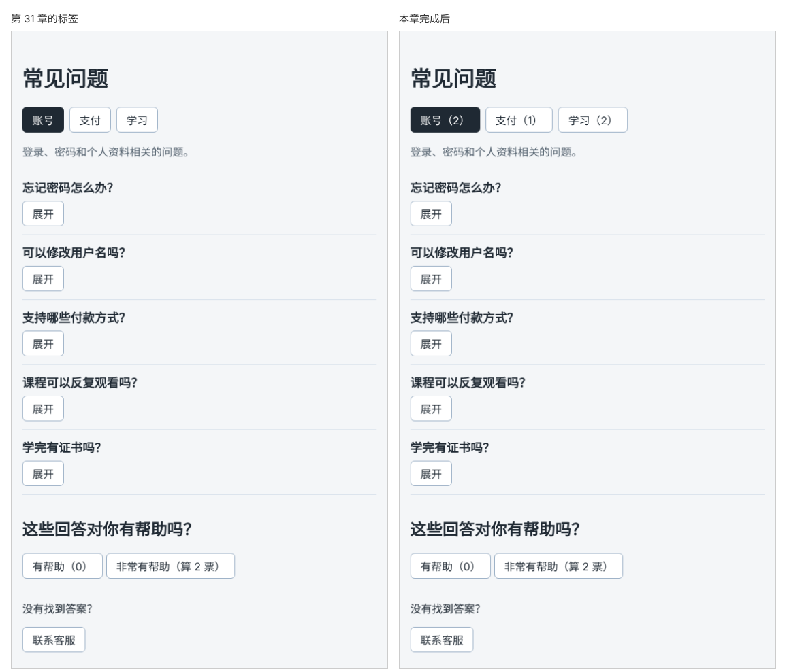

# 第 32 章：哪些数据需要放进 state，哪些可以直接计算出来？

前置：[第 31 章：如何让子组件中的按钮通知父组件？](第031章-如何让子组件中的按钮通知父组件.md)

## 一、本章要解决的问题

标签上要显示每个分类有几个问题，例如“账号（2）”“支付（1）”“学习（2）”，用户切换之前就知道每个分类有多少内容。

学了 state 以后，很容易想到“再加一个 state 保存这些数量”。本章说明为什么不该这样做：凡是能从已有数据中算出来的值，都直接计算，不另存 state。完成后，三个标签显示各自的问题数量，问题数据中增加一个问题，对应标签的数字自动变化。

下图左边是现在的标签，右边是本章完成后显示数量的标签：



## 二、必要原理

### 判断一个值是否需要 state 的三个问题

1. **它会随时间或用户操作变化吗？** 不会变的值（例如标签的文字）是普通常量，放在数据文件中即可。
2. **它能从其他 state 或 props 算出来吗？** 能算出来的值不要放进 state，每次渲染时直接计算。
3. **组件需要在多次渲染之间记住它吗？** 需要记住、又算不出来的值，才放进 state。

用这三个问题检查现在的 `FaqPage`：

| 数据 | 会变吗 | 能算出来吗 | 结论 |
| --- | --- | --- | --- |
| `faqs` 问题列表 | 本章不会 | — | 普通数据 |
| `activeTab` 当前标签 | 会 | 不能，取决于用户点了哪个 | state |
| `openId` 展开的问题 | 会 | 不能 | state |
| `helpfulCount` 投票数 | 会 | 不能 | state |
| 每个分类的问题数 | 只在问题列表变化时变 | **能**，数一数问题列表就知道 | 直接计算 |

### 为什么不把计算结果存进 state

如果用一个 state 保存每个分类的数量，就有了两份描述同一件事的数据：问题列表和数量。以后在问题列表中增加、删除一个问题，必须记得同时修改数量，忘了一处，两者就对不上，页面显示错误的数字。

直接计算则没有这个问题：组件每次渲染都根据当前的问题列表重新算一遍，结果永远和列表一致。这类由其他数据算出来的值叫**派生数据**。

不用担心计算的开销。几百条数据的简单计算非常快，不会让页面变慢。真正需要优化时，再按进阶专题中的方法处理。

### 用 filter 挑出符合条件的元素

要数“账号分类有几个问题”，先挑出所有账号分类的问题。数组的 `filter` 方法会依次检查每个元素，把检查函数返回 `true` 的元素组成一个新数组：

```ts
faqs.filter((faq) => faq.category === 'account');
```

结果是只包含账号问题的新数组，原来的 `faqs` 不变。再读取它的 `length`，就是数量。

`filter` 和第 17 章的 `map` 很像：都接收一个函数、都返回新数组。区别是 `map` 把每个元素**转换**成别的东西，`filter` 则**挑选**出一部分元素。

## 三、动手实现

### 第 1 步：给每个问题加上分类

打开 `src/data/faqs.ts`，在 `Faq` 类型中加入 `category` 字段，并给每个问题写上分类：

```ts
export type Faq = {
  id: number;
  category: FaqCategory;
  question: string;
  answer: string;
};
```

```ts
export const faqs: Faq[] = [
  {
    id: 1,
    category: 'account',
    question: '忘记密码怎么办？',
    answer: '在登录页点击“忘记密码”，按提示通过邮箱重设。',
  },
```

其余四个问题依次是 `'account'`、`'payment'`、`'study'`、`'study'`，完整内容见第六节。`category` 的类型是第 30 章定义的 `FaqCategory`，写错分类名时编辑器会报错。

### 第 2 步：写一个计算数量的函数

打开 `src/pages/FaqPage.tsx`，在 `handleToggle` 的上方加入：

```tsx
  function countByCategory(category: FaqCategory) {
    return faqs.filter((faq) => faq.category === category).length;
  }
```

这个函数在每次渲染时被调用，根据当前的 `faqs` 计算数量。它不修改任何数据，只返回结果。

### 第 3 步：在标签上显示数量

把标签按钮中的 `{tab.label}` 改为：

```tsx
            {tab.label}（{countByCategory(tab.value)}）
```

## 四、运行与检查

保持开发服务器运行（`npm.cmd run dev`），保存文件后在浏览器中查看。

1. 三个标签分别显示“账号（2）”“支付（1）”“学习（2）”。
2. 在 `faqs.ts` 末尾增加一个问题，分类为 `'payment'`，例如 `{ id: 6, category: 'payment', question: '可以开发票吗？', answer: '付款后可以在订单页面申请电子发票。' }`，保存，“支付”标签变成“支付（2）”。没有修改任何数量相关的代码，数字自动更新了。检查后删掉这一条。
3. 切换标签、展开问题、投票，数量都保持正确。

最后运行检查，应没有错误：

```powershell
npm.cmd run check
```

**小练习**：在页面标题下方显示一行“共 5 个问题”。这个数字应该放进 state 吗？按本章的三个问题判断，然后实现它。练习后恢复本章代码。

## 五、常见错误

| 现象 | 原因 | 怎么改 |
| --- | --- | --- |
| 编辑器提示某个问题缺少 `category` | `Faq` 类型要求每个问题都有分类 | 给五个问题都写上 `category` |
| 编辑器提示 `'acount'` 不能赋给 `FaqCategory` | 分类名拼写错误 | 改为三个合法值之一 |
| 所有标签都显示同一个数字 | `filter` 中写成了固定的分类，例如 `faq.category === 'account'` | 使用参数：`faq.category === category` |
| 数量显示为 0 | `filter` 的函数写成了花括号却没有 `return` | 写成 `(faq) => faq.category === category` |
| 用 state 保存了数量，增加问题后数字没变 | 两份数据没有同步 | 删掉这个 state，直接计算 |

## 六、本章完整代码

### `src/data/faqs.ts`

```ts
export type FaqCategory = 'account' | 'payment' | 'study';

export const faqTabs: { value: FaqCategory; label: string }[] = [
  { value: 'account', label: '账号' },
  { value: 'payment', label: '支付' },
  { value: 'study', label: '学习' },
];

export type Faq = {
  id: number;
  category: FaqCategory;
  question: string;
  answer: string;
};

export const faqs: Faq[] = [
  {
    id: 1,
    category: 'account',
    question: '忘记密码怎么办？',
    answer: '在登录页点击“忘记密码”，按提示通过邮箱重设。',
  },
  {
    id: 2,
    category: 'account',
    question: '可以修改用户名吗？',
    answer: '用户名注册后不能修改，但可以随时修改昵称。',
  },
  {
    id: 3,
    category: 'payment',
    question: '支持哪些付款方式？',
    answer: '支持银行卡和常见的第三方支付。',
  },
  {
    id: 4,
    category: 'study',
    question: '课程可以反复观看吗？',
    answer: '购买后可以在有效期内不限次数观看。',
  },
  {
    id: 5,
    category: 'study',
    question: '学完有证书吗？',
    answer: '完成全部练习并通过测验后，可以下载结业证书。',
  },
];
```

### `src/pages/FaqPage.tsx`

```tsx
import { useState } from 'react';
import FaqItem from '../components/FaqItem';
import { faqs, faqTabs } from '../data/faqs';
import type { FaqCategory } from '../data/faqs';
import styles from './FaqPage.module.css';

export default function FaqPage() {
  const [helpfulCount, setHelpfulCount] = useState(0);
  const [openId, setOpenId] = useState<number | null>(null);
  const [activeTab, setActiveTab] = useState<FaqCategory>('account');

  function countByCategory(category: FaqCategory) {
    return faqs.filter((faq) => faq.category === category).length;
  }

  function handleToggle(id: number) {
    setOpenId(openId === id ? null : id);
  }

  function addHelpful() {
    setHelpfulCount((current) => current + 1);
  }

  function handleHelpfulClick() {
    addHelpful();
  }

  function handleVeryHelpfulClick() {
    addHelpful();
    addHelpful();
  }

  function handleContactClick() {
    window.alert('客服邮箱：help@example.com，工作日 9:00—18:00 回复。');
  }

  return (
    <main className="page">
      <h1>常见问题</h1>
      <div className={styles.tabs}>
        {faqTabs.map((tab) => (
          <button
            key={tab.value}
            type="button"
            aria-pressed={tab.value === activeTab}
            className={tab.value === activeTab ? styles.activeTab : undefined}
            onClick={() => setActiveTab(tab.value)}
          >
            {tab.label}（{countByCategory(tab.value)}）
          </button>
        ))}
      </div>
      {activeTab === 'account' && <p className={styles.hint}>登录、密码和个人资料相关的问题。</p>}
      {activeTab === 'payment' && <p className={styles.hint}>付款方式、发票和退款相关的问题。</p>}
      {activeTab === 'study' && <p className={styles.hint}>课程观看、练习和证书相关的问题。</p>}
      <ul className={styles.list}>
        {faqs.map((faq) => (
          <FaqItem
            key={faq.id}
            faq={faq}
            isOpen={faq.id === openId}
            onToggle={() => handleToggle(faq.id)}
          />
        ))}
      </ul>
      <section className={styles.section}>
        <h2>这些回答对你有帮助吗？</h2>
        <button type="button" onClick={handleHelpfulClick}>
          有帮助（{helpfulCount}）
        </button>{' '}
        <button type="button" onClick={handleVeryHelpfulClick}>
          非常有帮助（算 2 票）
        </button>
      </section>
      <section className={styles.section}>
        <p>没有找到答案？</p>
        <button type="button" onClick={handleContactClick}>
          联系客服
        </button>
      </section>
    </main>
  );
}
```

## 七、本章改动小结

修改 `src/data/faqs.ts`（每个问题增加 `category`）和 `src/pages/FaqPage.tsx`（新增 `countByCategory`，标签上显示数量）。没有新增 state。

---

下一章：[第 33 章：如何在 React 开发者工具中查看组件的 props 和 state？](第033章-如何在React开发者工具中查看组件的props和state.md)
