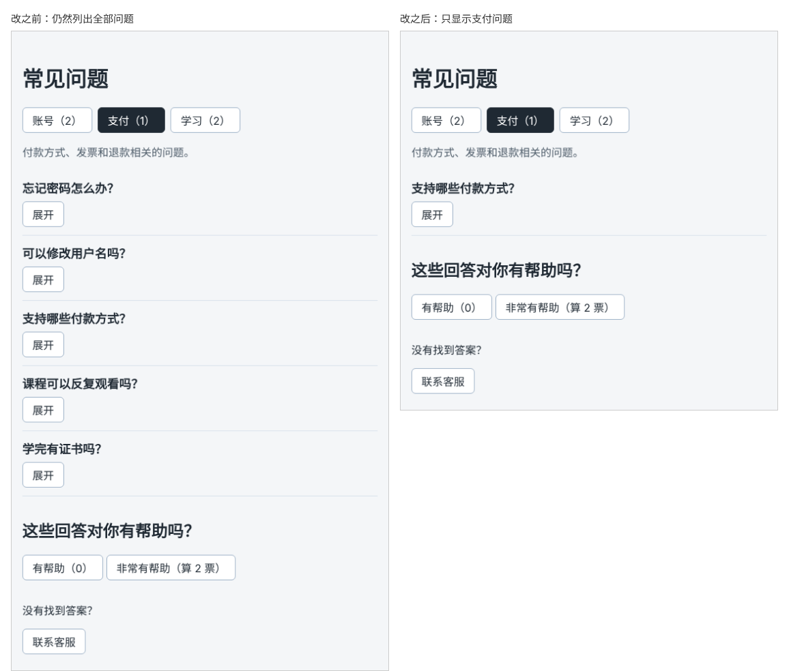

# 第 34 章：【组合】如何让标签页切换时显示对应的问题列表？

前置：[第 33 章：如何在 React 开发者工具中查看组件的 props 和 state？](第033章-如何在React开发者工具中查看组件的props和state.md)

## 一、本章要解决的问题

现在的标签只改变说明文字，下面仍然列出全部五个问题。本章完成常见问题页的最后一步：点击哪个标签，就只显示这个分类的问题。

还有一个细节：在“账号”中展开了一个问题，切换到“学习”再切回来，那个问题仍然是展开的，因为 `openId` 没有变。更好的体验是切换标签时把展开的问题全部收起。

完成后，切换标签时问题列表随之变化，并且新标签下的问题都处于收起状态；每个分类中仍然同时只展开一个问题。

本章不引入新技术，组合使用的是：

- 第 26 章：state；
- 第 29 章：用 `openId` 实现同时只展开一个；
- 第 30 章：标签切换；
- 第 31 章：`FaqItem` 组件和 `onToggle`；
- 第 32 章：用 `filter` 直接计算派生数据。

下图都是点击“支付”标签以后的页面，左边是现在的样子，右边是本章完成后的样子：



## 二、必要原理

### 当前分类的问题是派生数据

“当前要显示哪些问题”能从两样东西算出来：全部问题 `faqs` 和当前标签 `activeTab`。按第 32 章的判断方法，它不需要 state，每次渲染时直接计算：

```tsx
const visibleFaqs = faqs.filter((faq) => faq.category === activeTab);
```

点击标签时，`activeTab` 变化，组件重新渲染，`visibleFaqs` 重新计算，列表自然就换成了新分类的问题。我们不需要写任何“切换时更新列表”的代码。

### 在一个事件中修改两个 state

切换标签时要做两件事：改变当前标签，收起展开的问题。把它们写进同一个事件处理函数：

```tsx
function handleTabClick(category: FaqCategory) {
  setActiveTab(category);
  setOpenId(null);
}
```

第 28 章说过，React 会等事件处理函数执行完，再统一处理所有更新、渲染一次。所以这里修改两个 state，页面只更新一次，不会先闪一下“新分类但问题还展开着”的中间状态。

为什么不在别的地方“监视” `activeTab` 的变化再收起问题？因为收起问题的原因就是“用户点击了标签”，直接写在这个点击的处理函数中最清楚。

## 三、动手实现

### 第 1 步：计算当前分类的问题

打开 `src/pages/FaqPage.tsx`，在三个 `useState` 的下面加入：

```tsx
  const visibleFaqs = faqs.filter((faq) => faq.category === activeTab);
```

### 第 2 步：切换标签时收起问题

在 `handleToggle` 的下面加入：

```tsx
  function handleTabClick(category: FaqCategory) {
    setActiveTab(category);
    setOpenId(null);
  }
```

把标签按钮的 `onClick` 改为调用它：

```tsx
            onClick={() => handleTabClick(tab.value)}
```

### 第 3 步：列表只显示当前分类

把问题列表中的 `faqs.map` 改为 `visibleFaqs.map`：

```tsx
        {visibleFaqs.map((faq) => (
```

其余代码不变。

## 四、运行与检查

保持开发服务器运行（`npm.cmd run dev`），保存文件后在浏览器中查看。

1. 打开页面，“账号（2）”高亮，下面只有两个问题：“忘记密码怎么办？”和“可以修改用户名吗？”。
2. 点击“支付（1）”，只显示“支持哪些付款方式？”这一个问题；点击“学习（2）”，显示两个学习相关的问题。
3. 在“学习”中展开第一个问题，再展开第二个，第一个自动收起。
4. 在“学习”中展开一个问题，切换到“账号”，再切回“学习”，所有问题都是收起的。
5. 投票区和客服按钮与之前相同，切换标签不会清空投票数。
6. 打开 React 开发者工具（第 33 章），点击标签时，`FaqPage` 的第二、第三个 `State` 同时变化；组件树中 `FaqItem` 的数量随分类变化。

最后运行检查，应没有错误：

```powershell
npm.cmd run check
```

### 阶段回顾

到这里，第 4 部分的常见问题页已经完成，用到了这一部分的全部内容：点击事件、state、更新函数、同时只展开一个、标签切换、子组件通知父组件、派生数据。下一个阶段（第 5、6 部分）会学习表单输入和对数组的增删改，在第 54 章完成一个能增删改数据的本地交互页面。

## 五、常见错误

| 现象 | 原因 | 怎么改 |
| --- | --- | --- |
| 切换标签后列表没有变化 | 列表仍然使用 `faqs.map` | 改为 `visibleFaqs.map` |
| 切换标签后，原来展开的问题在切回时仍然展开 | 标签按钮仍然直接调用 `setActiveTab`，没有收起问题 | 改为调用 `handleTabClick` |
| 用一个 state 保存 `visibleFaqs`，切换标签后列表不变 | 派生数据存进 state 后，需要额外同步 | 删掉这个 state，按第三节第 1 步直接计算 |
| 切换标签时投票数也被清零了 | 在 `handleTabClick` 中多写了重置投票数的代码 | 只修改 `activeTab` 和 `openId` |
| 标签上的数量和列表中的问题数对不上 | 两处使用了不同的筛选条件 | 两处都按 `faq.category` 比较 |

## 六、本章完整代码

### `src/pages/FaqPage.tsx`

```tsx
import { useState } from 'react';
import FaqItem from '../components/FaqItem';
import { faqs, faqTabs } from '../data/faqs';
import type { FaqCategory } from '../data/faqs';
import styles from './FaqPage.module.css';

export default function FaqPage() {
  const [helpfulCount, setHelpfulCount] = useState(0);
  const [openId, setOpenId] = useState<number | null>(null);
  const [activeTab, setActiveTab] = useState<FaqCategory>('account');
  const visibleFaqs = faqs.filter((faq) => faq.category === activeTab);

  function countByCategory(category: FaqCategory) {
    return faqs.filter((faq) => faq.category === category).length;
  }

  function handleToggle(id: number) {
    setOpenId(openId === id ? null : id);
  }

  function handleTabClick(category: FaqCategory) {
    setActiveTab(category);
    setOpenId(null);
  }

  function addHelpful() {
    setHelpfulCount((current) => current + 1);
  }

  function handleHelpfulClick() {
    addHelpful();
  }

  function handleVeryHelpfulClick() {
    addHelpful();
    addHelpful();
  }

  function handleContactClick() {
    window.alert('客服邮箱：help@example.com，工作日 9:00—18:00 回复。');
  }

  return (
    <main className="page">
      <h1>常见问题</h1>
      <div className={styles.tabs}>
        {faqTabs.map((tab) => (
          <button
            key={tab.value}
            type="button"
            aria-pressed={tab.value === activeTab}
            className={tab.value === activeTab ? styles.activeTab : undefined}
            onClick={() => handleTabClick(tab.value)}
          >
            {tab.label}（{countByCategory(tab.value)}）
          </button>
        ))}
      </div>
      {activeTab === 'account' && <p className={styles.hint}>登录、密码和个人资料相关的问题。</p>}
      {activeTab === 'payment' && <p className={styles.hint}>付款方式、发票和退款相关的问题。</p>}
      {activeTab === 'study' && <p className={styles.hint}>课程观看、练习和证书相关的问题。</p>}
      <ul className={styles.list}>
        {visibleFaqs.map((faq) => (
          <FaqItem
            key={faq.id}
            faq={faq}
            isOpen={faq.id === openId}
            onToggle={() => handleToggle(faq.id)}
          />
        ))}
      </ul>
      <section className={styles.section}>
        <h2>这些回答对你有帮助吗？</h2>
        <button type="button" onClick={handleHelpfulClick}>
          有帮助（{helpfulCount}）
        </button>{' '}
        <button type="button" onClick={handleVeryHelpfulClick}>
          非常有帮助（算 2 票）
        </button>
      </section>
      <section className={styles.section}>
        <p>没有找到答案？</p>
        <button type="button" onClick={handleContactClick}>
          联系客服
        </button>
      </section>
    </main>
  );
}
```

## 七、本章改动小结

修改 `src/pages/FaqPage.tsx`：新增派生数据 `visibleFaqs` 和 `handleTabClick`，列表只显示当前分类的问题，切换标签时收起展开的问题。

---

下一章：[第 35 章：如何让输入框的内容与 state 保持同步？](第035章-如何让输入框的内容与state保持同步.md)
