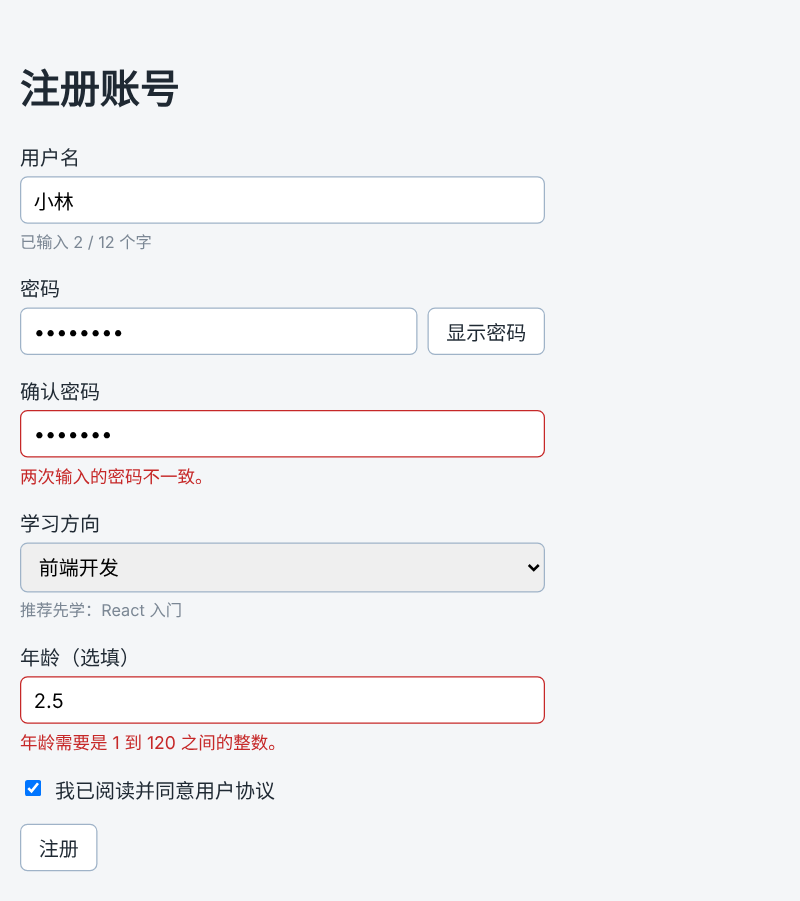

# 第 35 章：如何让输入框的内容与 state 保持同步？

前置：[第 34 章：【组合】如何让标签页切换时显示对应的问题列表？](第034章-如何让标签页切换时显示对应的问题列表.md)

## 一、本章要解决的问题

从本章开始做一个注册表单页。用户在输入框中填写用户名，页面要能“读到”用户输入的内容，用于显示提示、检查格式、提交给服务器。

本章先做一个用户名输入框，下方实时显示“已输入 N / 12 个字”，每输入或删除一个字，数字立刻变化。完成后，输入框中的内容随时保存在 React 的 state 中。

本章是第 5 部分的起点。学完第 5 部分（第 35—44 章）时，注册页会变成下图的样子：填写不完整就提交时，每个出错的输入框下方都有红色提示。



## 二、必要原理

### 输入框的值由谁保管

普通 HTML 中，输入框自己保管输入的内容，要读取时再去找这个元素取值。在 React 中，更常见的做法是让 **state 保管输入框的值**：

```tsx
const [username, setUsername] = useState('');

<input value={username} onChange={(event) => setUsername(event.target.value)} />
```

这两个属性一起工作：

- `value={username}`：输入框显示的内容永远等于 state 的值。
- `onChange`：用户每输入或删除一个字，React 都会调用它。我们从事件中取出输入框的新内容，存进 state。

state 改变后组件重新渲染，`value` 读到新值，输入框显示新的内容。这样，页面上的输入框和 state 始终保持一致，任何时候读取 `username` 就是用户当前输入的内容。这种由 state 控制的输入框叫**受控输入框**。

### 事件对象 event

React 调用 `onChange` 时，会传入一个参数，叫做**事件对象**，习惯命名为 `event`。它包含这次事件的信息：

- `event.target`：触发事件的元素，这里就是这个输入框；
- `event.target.value`：输入框此刻的内容，是一个字符串。

第 24 章的 `onClick` 也会收到事件对象，只是那时不需要它，所以没有写参数。

### 只写 value 不写 onChange 会怎样

如果只写了 `value={username}`，没有 `onChange`，用户输入时 state 不会变化，输入框又必须显示 state 的值，结果就是**无论怎么按键盘，输入框都不变**。React 也会在控制台警告。受控输入框的 `value` 和 `onChange` 总是成对出现。

### label 与输入框

`<label htmlFor="username">` 与 `<input id="username">` 通过相同的名字关联起来：点击文字“用户名”，光标会进入输入框；读屏软件读到输入框时，会读出“用户名”。HTML 中的 `for` 属性在 JSX 中写作 `htmlFor`，原因与第 4 章的 `className` 相同。

## 三、动手实现

### 第 1 步：添加表单样式

在 `src/pages` 中新建 `RegisterPage.module.css`：

```css
.form {
  display: flex;
  flex-direction: column;
  gap: 16px;
  max-width: 420px;
}

.field {
  display: flex;
  flex-direction: column;
  gap: 4px;
}

.field input,
.field select {
  padding: 8px 10px;
  border: 1px solid #9fb3c8;
  border-radius: 6px;
  font: inherit;
}

.hint {
  margin: 0;
  color: #7b8794;
  font-size: 13px;
}
```

`flex-direction: column` 让 Flex 容器中的元素从上到下排列，再用 `gap` 统一间距。`.field select` 是给后面章节的下拉框准备的。

### 第 2 步：新建注册页

在 `src/pages` 中新建 `RegisterPage.tsx`：

```tsx
import { useState } from 'react';
import styles from './RegisterPage.module.css';

export default function RegisterPage() {
  const [username, setUsername] = useState('');

  return (
    <main className="page">
      <h1>注册账号</h1>
      <div className={styles.form}>
        <div className={styles.field}>
          <label htmlFor="username">用户名</label>
          <input
            id="username"
            value={username}
            onChange={(event) => setUsername(event.target.value)}
          />
          <p className={styles.hint}>已输入 {username.length} / 12 个字</p>
        </div>
      </div>
    </main>
  );
}
```

- `useState('')`：初始值是空字符串，输入框一开始是空的。
- `username.length`：字符串的长度，也就是输入了几个字。
- 外层暂时用 `div` 而不是 `form`。表单的提交要到第 40 章才处理。

### 第 3 步：让 App 显示注册页

修改 `src/App.tsx`：

```tsx
import './App.css';
import RegisterPage from './pages/RegisterPage';

export default function App() {
  return <RegisterPage />;
}
```

## 四、运行与检查

保持开发服务器运行（`npm.cmd run dev`），保存文件后在浏览器中查看。

1. 页面显示“注册账号”标题、“用户名”和输入框，下方是“已输入 0 / 12 个字”。
2. 输入“xiaolin”，提示变成“已输入 7 / 12 个字”；删除两个字母，变成 5。数字随每次按键立刻变化。
3. 点击文字“用户名”，光标进入输入框。
4. 打开 React 开发者工具（第 33 章），选中 `RegisterPage`，它的 `State` 与输入框的内容完全一致。
5. 把 `onChange={...}` 这一段临时删掉，保存后试着输入，输入框中什么也打不进去，控制台出现警告。检查后恢复。

最后运行检查，应没有错误：

```powershell
npm.cmd run check
```

**小练习**：在提示的后面加上一句：超过 12 个字时显示“已超出字数”。（提示：用第 21 章的 `&&`，条件是 `username.length > 12`。）练习后恢复本章代码。

## 五、常见错误

| 现象 | 原因 | 怎么改 |
| --- | --- | --- |
| 输入框中打不进任何文字 | 写了 `value`，却没写 `onChange`，或 `onChange` 中没有调用 `setUsername` | `value` 和 `onChange` 成对出现 |
| 编辑器提示 `event` 上没有 `value` | 写成了 `event.value` | 输入框的内容在 `event.target.value` |
| 点击“用户名”文字，光标没有进入输入框 | `htmlFor` 和 `id` 的值不一样，或写成了 `for` | 两处写相同的名字，并使用 `htmlFor` |
| 控制台警告从非受控变为受控 | `useState()` 没有写初始值，开始时 `value` 是“没有值” | 初始值写空字符串 `useState('')` |
| 输入中文时，拼音还没选字，数字就在变化 | 输入法输入拼音的过程中，输入框里暂时放着拼音字母 | 正常现象，选完字后数字就正确了 |

## 六、本章完整代码

### `src/pages/RegisterPage.module.css`

内容同第三节第 1 步。

### `src/pages/RegisterPage.tsx`

内容同第三节第 2 步。

### `src/App.tsx`

内容同第三节第 3 步。

## 七、本章改动小结

新增 `src/pages/RegisterPage.tsx` 和 `src/pages/RegisterPage.module.css`；修改 `src/App.tsx`，改为显示注册页。

---

下一章：[第 36 章：如何为输入框事件写 TypeScript 类型？](第036章-如何为输入框事件写TypeScript类型.md)
