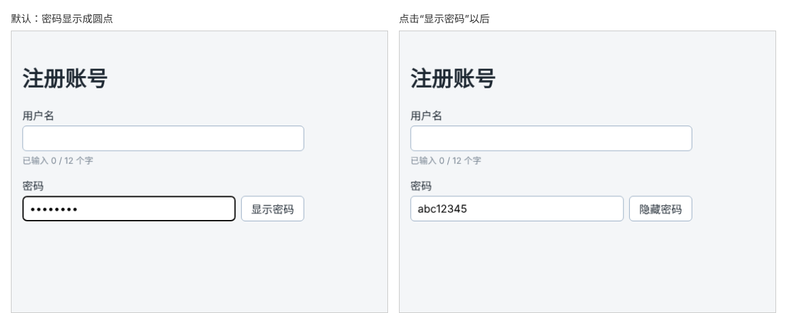

# 第 37 章：如何切换密码的显示与隐藏？

前置：[第 36 章：如何为输入框事件写 TypeScript 类型？](第036章-如何为输入框事件写TypeScript类型.md)

## 一、本章要解决的问题

密码显示成圆点，旁边的人看不到，但用户自己也看不到，输错了很难发现，在手机上尤其如此。很多网站在密码框旁边放一个“显示密码”按钮，点击后密码以明文显示，再点击恢复成圆点。

本章在密码框右边加上这个按钮。完成后，点击“显示密码”，密码框中的内容变为明文，按钮文字变成“隐藏密码”；再点击恢复。

下图左边是输入密码后的默认样子，右边是点击“显示密码”以后的样子：



## 二、必要原理

### 用 state 决定 type 属性

输入框显示为圆点还是明文，取决于它的 `type` 属性：`'password'` 显示圆点，`'text'` 显示明文。用一个布尔值 state 记住“是否显示密码”，再根据它决定 `type`：

```tsx
const [showPassword, setShowPassword] = useState(false);

<input type={showPassword ? 'text' : 'password'} ... />
```

这和第 27 章的展开收起是同一个思路：state 决定页面怎样显示，点击按钮只修改 state。属性的值也可以用条件运算符来选择。

### 切换 type 不会丢失已输入的内容

输入框的内容保存在 `password` 这个 state 中，`type` 改变只是换了一种显示方式，React 会保留同一个输入框，`value` 仍然是原来的密码。

### 切换按钮必须写 type="button"

第 24 章提到，表单中的按钮默认会提交表单。第 40 章会把整个表单放进 `<form>` 中，到那时，没写 `type="button"` 的“显示密码”按钮一点击就会提交表单。从现在起就写好 `type="button"`。

### 让输入框和按钮并排

密码框和按钮放进一个 `div`，用 Flex 横向排列。输入框设置 `flex: 1`，占满按钮以外的剩余宽度（第 12 章）。再加上 `min-width: 0`：输入框默认有一个最小宽度，窄屏时可能和按钮一起超出容器，设为 0 才允许它继续缩窄。

## 三、动手实现

### 第 1 步：添加并排的样式

在 `src/pages/RegisterPage.module.css` 末尾加入：

```css
.passwordRow {
  display: flex;
  gap: 8px;
}

.passwordRow input {
  flex: 1;
  min-width: 0;
}
```

### 第 2 步：增加“是否显示密码”的 state

打开 `src/pages/RegisterPage.tsx`，在 `password` 那一行的下面加入：

```tsx
  const [showPassword, setShowPassword] = useState(false);
```

### 第 3 步：密码框旁边加上切换按钮

把密码所在的整个 `<div className={styles.field}>` 改为：

```tsx
        <div className={styles.field}>
          <label htmlFor="password">密码</label>
          <div className={styles.passwordRow}>
            <input
              id="password"
              type={showPassword ? 'text' : 'password'}
              value={password}
              onChange={handlePasswordChange}
            />
            <button type="button" onClick={() => setShowPassword(!showPassword)}>
              {showPassword ? '隐藏密码' : '显示密码'}
            </button>
          </div>
        </div>
```

`label` 仍然通过 `htmlFor` 关联到输入框，加了一层 `div` 不影响。

## 四、运行与检查

保持开发服务器运行（`npm.cmd run dev`），保存文件后在浏览器中查看。

1. 密码框右边有“显示密码”按钮，两者在同一行。
2. 输入“abc123”，显示为圆点。点击“显示密码”，变成明文“abc123”，按钮变成“隐藏密码”。
3. 在明文状态下继续输入，再点击“隐藏密码”，内容不丢失，又变回圆点。
4. 按 F12 观察，输入框的 `type` 属性在 `password` 和 `text` 之间变化。
5. 打开手机模拟（第 13 章），宽度 320，输入框和按钮仍在同一行，没有超出页面。

最后运行检查，应没有错误：

```powershell
npm.cmd run check
```

**小练习**：给切换按钮加上 `aria-pressed={showPassword}`，然后按 F12 观察它的变化。想一想：按钮文字已经写明了“显示”或“隐藏”，还需要 `aria-pressed` 吗？练习后恢复本章代码。

## 五、常见错误

| 现象 | 原因 | 怎么改 |
| --- | --- | --- |
| 点击按钮后密码仍然是圆点 | `type` 仍是固定的 `"password"` | 写成 `type={showPassword ? 'text' : 'password'}` |
| 切换后显示与按钮文字相反 | 条件运算符两边写反了 | `showPassword` 为 `true` 时是 `'text'`，按钮显示“隐藏密码” |
| 第 40 章加入表单后，一点“显示密码”页面就刷新 | 按钮没有写 `type="button"`，被当成了提交按钮 | 加上 `type="button"` |
| 窄屏时按钮被挤到输入框下方或超出页面 | 输入框没有 `min-width: 0` | 按第三节第 1 步补上样式 |
| 切换后已输入的密码消失了 | 用了两个不同的输入框分别显示明文和圆点，各自没有绑定同一个 state | 只用一个输入框，切换它的 `type` |

## 六、本章完整代码

### `src/pages/RegisterPage.module.css`

```css
.form {
  display: flex;
  flex-direction: column;
  gap: 16px;
  max-width: 420px;
}

.field {
  display: flex;
  flex-direction: column;
  gap: 4px;
}

.field input,
.field select {
  padding: 8px 10px;
  border: 1px solid #9fb3c8;
  border-radius: 6px;
  font: inherit;
}

.hint {
  margin: 0;
  color: #7b8794;
  font-size: 13px;
}

.passwordRow {
  display: flex;
  gap: 8px;
}

.passwordRow input {
  flex: 1;
  min-width: 0;
}
```

### `src/pages/RegisterPage.tsx`

```tsx
import { useState } from 'react';
import type { ChangeEvent } from 'react';
import styles from './RegisterPage.module.css';

export default function RegisterPage() {
  const [username, setUsername] = useState('');
  const [password, setPassword] = useState('');
  const [showPassword, setShowPassword] = useState(false);

  function handleUsernameChange(event: ChangeEvent<HTMLInputElement>) {
    setUsername(event.target.value);
  }

  function handlePasswordChange(event: ChangeEvent<HTMLInputElement>) {
    setPassword(event.target.value);
  }

  return (
    <main className="page">
      <h1>注册账号</h1>
      <div className={styles.form}>
        <div className={styles.field}>
          <label htmlFor="username">用户名</label>
          <input
            id="username"
            value={username}
            onChange={handleUsernameChange}
          />
          <p className={styles.hint}>已输入 {username.length} / 12 个字</p>
        </div>
        <div className={styles.field}>
          <label htmlFor="password">密码</label>
          <div className={styles.passwordRow}>
            <input
              id="password"
              type={showPassword ? 'text' : 'password'}
              value={password}
              onChange={handlePasswordChange}
            />
            <button type="button" onClick={() => setShowPassword(!showPassword)}>
              {showPassword ? '隐藏密码' : '显示密码'}
            </button>
          </div>
        </div>
      </div>
    </main>
  );
}
```

## 七、本章改动小结

修改 `src/pages/RegisterPage.tsx`（新增 state `showPassword` 和切换按钮）和 `src/pages/RegisterPage.module.css`（新增 `.passwordRow`）。

---

下一章：[第 38 章：如何读取复选框是否被选中？](第038章-如何读取复选框是否被选中.md)
