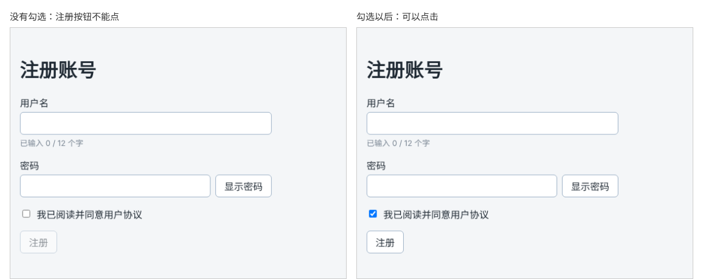

# 第 38 章：如何读取复选框是否被选中？

前置：[第 37 章：如何切换密码的显示与隐藏？](第037章-如何切换密码的显示与隐藏.md)

## 一、本章要解决的问题

注册前，用户必须勾选“我已阅读并同意用户协议”。没有勾选时，“注册”按钮是灰色的，不能点击；勾选后按钮才可以使用。

本章在表单底部加上这个复选框和“注册”按钮，并读取复选框是否被选中。完成后，勾选和取消勾选时，注册按钮在可用和不可用之间切换。

下图左边是没有勾选时的样子，右边是勾选以后的样子：



## 二、必要原理

### 复选框读取的是 checked，不是 value

文字输入框的内容在 `value` 中。复选框不一样：它只有“选中”和“未选中”两种状态，保存在 `checked` 属性中，是一个布尔值。

受控复选框的写法与第 35 章的输入框对应，只是把 `value` 换成 `checked`：

```tsx
const [agree, setAgree] = useState(false);

<input
  type="checkbox"
  checked={agree}
  onChange={(event) => setAgree(event.target.checked)}
/>
```

- `checked={agree}`：是否显示勾选，由 state 决定。
- `event.target.checked`：用户点击后复选框的新状态。

复选框也有 `value` 属性，但它是表单提交时附带的固定文字，不会随勾选变化。新手常犯的错误就是读成了 `event.target.value`。

### label 包住复选框

复选框很小，不容易点中。把复选框放进 `<label>` 里面，点击文字也能切换勾选：

```tsx
<label>
  <input type="checkbox" ... />
  我已阅读并同意用户协议
</label>
```

`label` 包住了输入框，二者自动关联，不需要 `htmlFor` 和 `id`。

### disabled：根据条件禁用按钮

按钮的 `disabled` 属性为 `true` 时，按钮不能点击、不能用 Tab 选中。写成 `disabled={!agree}`：没有同意时禁用，同意后可用。这又是“由 state 决定页面状态”。

禁用的按钮在样式上应该让用户一眼看出不可用。本章在 `App.css` 中加一条全站通用的规则，让禁用的按钮变浅，鼠标移上去显示“禁止”的光标。

## 三、动手实现

### 第 1 步：添加样式

在 `src/App.css` 末尾加入禁用按钮的通用样式：

```css
button:disabled {
  cursor: not-allowed;
  opacity: 0.5;
}
```

`opacity: 0.5` 让元素半透明。

在 `src/pages/RegisterPage.module.css` 末尾加入：

```css
.checkbox {
  display: flex;
  align-items: center;
  gap: 8px;
}

.submit {
  align-self: flex-start;
}
```

`.checkbox` 让复选框和文字在同一行、垂直居中。表单是纵向的 Flex 容器，按钮默认会被拉伸到和表单一样宽，`align-self: flex-start` 让按钮保持自己的宽度、靠左对齐。

### 第 2 步：增加“是否同意”的 state

打开 `src/pages/RegisterPage.tsx`，在 `showPassword` 那一行的下面加入：

```tsx
  const [agree, setAgree] = useState(false);
```

### 第 3 步：添加复选框和注册按钮

在密码所在的 `<div className={styles.field}>……</div>` 后面加入：

```tsx
        <label className={styles.checkbox}>
          <input
            type="checkbox"
            checked={agree}
            onChange={(event) => setAgree(event.target.checked)}
          />
          我已阅读并同意用户协议
        </label>
        <button type="button" className={styles.submit} disabled={!agree}>
          注册
        </button>
```

按钮暂时写 `type="button"`，点击后什么也不做。第 40 章处理表单提交时再把它改成提交按钮。

## 四、运行与检查

保持开发服务器运行（`npm.cmd run dev`），保存文件后在浏览器中查看。

1. 表单底部有复选框“我已阅读并同意用户协议”和半透明的“注册”按钮。鼠标移到按钮上，光标变成禁止符号。
2. 点击文字“我已阅读并同意用户协议”（不点复选框本身），复选框被勾选，“注册”按钮变为正常颜色。
3. 再点一次，取消勾选，按钮又变成半透明。
4. 未勾选时按 Tab 键在表单中移动焦点，焦点会跳过“注册”按钮。
5. 打开 React 开发者工具，勾选时 `RegisterPage` 中对应的 `State` 在 `false` 和 `true` 之间变化。

最后运行检查，应没有错误：

```powershell
npm.cmd run check
```

**小练习**：再加一个复选框“订阅每周学习提醒”，用一个新的 state 保存它。它不影响注册按钮，只在下方显示一行“将每周给你发送学习提醒”或“不会给你发送邮件”。练习后恢复本章代码。

## 五、常见错误

| 现象 | 原因 | 怎么改 |
| --- | --- | --- |
| 勾选后按钮仍然不可用 | 读取了 `event.target.value`，得到的是固定文字 `"on"`，state 并没有变成 `true` | 读取 `event.target.checked` |
| 点击复选框没有反应，控制台有警告 | 写了 `checked`，没有写 `onChange` | 受控复选框的 `checked` 和 `onChange` 成对出现 |
| 写成 `value={agree}` 后，勾选状态不变 | 复选框的勾选由 `checked` 控制 | 改为 `checked={agree}` |
| 点击文字不能切换勾选 | 复选框没有放在 `label` 里面 | 用 `label` 包住复选框和文字 |
| 勾选后按钮反而不可用 | 写成了 `disabled={agree}` | 写成 `disabled={!agree}` |

## 六、本章完整代码

### `src/App.css`

```css
body {
  margin: 0;
  font-family: system-ui, sans-serif;
  background: #f4f6f8;
  color: #1f2933;
}

.page {
  max-width: 960px;
  margin: 0 auto;
  padding: 24px 16px;
}

.page-header p {
  color: #52606d;
}

.page-footer {
  margin-top: 24px;
  padding-top: 16px;
  border-top: 1px solid #d9e2ec;
  color: #52606d;
}

.card-list {
  display: flex;
  flex-wrap: wrap;
  gap: 16px;
  margin-top: 16px;
}

.card-list > * {
  flex: 1 1 200px;
}

button {
  padding: 6px 14px;
  border: 1px solid #9fb3c8;
  border-radius: 6px;
  background: #ffffff;
  color: #1f2933;
  font: inherit;
  cursor: pointer;
}

button:hover {
  background: #f0f4f8;
}

button:disabled {
  cursor: not-allowed;
  opacity: 0.5;
}
```

### `src/pages/RegisterPage.module.css`

```css
.form {
  display: flex;
  flex-direction: column;
  gap: 16px;
  max-width: 420px;
}

.field {
  display: flex;
  flex-direction: column;
  gap: 4px;
}

.field input,
.field select {
  padding: 8px 10px;
  border: 1px solid #9fb3c8;
  border-radius: 6px;
  font: inherit;
}

.hint {
  margin: 0;
  color: #7b8794;
  font-size: 13px;
}

.passwordRow {
  display: flex;
  gap: 8px;
}

.passwordRow input {
  flex: 1;
  min-width: 0;
}

.checkbox {
  display: flex;
  align-items: center;
  gap: 8px;
}

.submit {
  align-self: flex-start;
}
```

### `src/pages/RegisterPage.tsx`

```tsx
import { useState } from 'react';
import type { ChangeEvent } from 'react';
import styles from './RegisterPage.module.css';

export default function RegisterPage() {
  const [username, setUsername] = useState('');
  const [password, setPassword] = useState('');
  const [showPassword, setShowPassword] = useState(false);
  const [agree, setAgree] = useState(false);

  function handleUsernameChange(event: ChangeEvent<HTMLInputElement>) {
    setUsername(event.target.value);
  }

  function handlePasswordChange(event: ChangeEvent<HTMLInputElement>) {
    setPassword(event.target.value);
  }

  return (
    <main className="page">
      <h1>注册账号</h1>
      <div className={styles.form}>
        <div className={styles.field}>
          <label htmlFor="username">用户名</label>
          <input
            id="username"
            value={username}
            onChange={handleUsernameChange}
          />
          <p className={styles.hint}>已输入 {username.length} / 12 个字</p>
        </div>
        <div className={styles.field}>
          <label htmlFor="password">密码</label>
          <div className={styles.passwordRow}>
            <input
              id="password"
              type={showPassword ? 'text' : 'password'}
              value={password}
              onChange={handlePasswordChange}
            />
            <button type="button" onClick={() => setShowPassword(!showPassword)}>
              {showPassword ? '隐藏密码' : '显示密码'}
            </button>
          </div>
        </div>
        <label className={styles.checkbox}>
          <input
            type="checkbox"
            checked={agree}
            onChange={(event) => setAgree(event.target.checked)}
          />
          我已阅读并同意用户协议
        </label>
        <button type="button" className={styles.submit} disabled={!agree}>
          注册
        </button>
      </div>
    </main>
  );
}
```

## 七、本章改动小结

修改 `src/App.css`（新增禁用按钮样式）、`src/pages/RegisterPage.module.css`（新增 `.checkbox`、`.submit`）和 `src/pages/RegisterPage.tsx`（新增 state `agree`、复选框和注册按钮）。

---

下一章：[第 39 章：如何读取下拉选择框中的选项？](第039章-如何读取下拉选择框中的选项.md)
