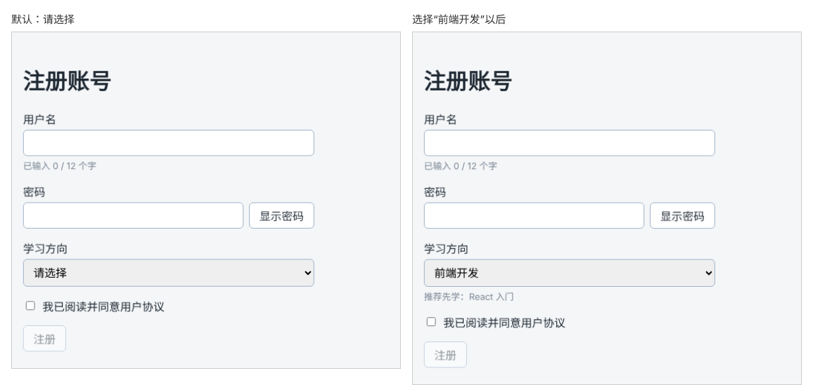

# 第 39 章：如何读取下拉选择框中的选项？

前置：[第 38 章：如何读取复选框是否被选中？](第038章-如何读取复选框是否被选中.md)

## 一、本章要解决的问题

注册时要选择一个学习方向：前端开发、后端开发或界面设计。选项固定、只能选一个，适合用下拉选择框。选择之后，页面还要根据方向显示一门推荐的入门课程。

本章在密码下方加一个“学习方向”下拉框。完成后，默认显示“请选择”；选择“前端开发”，下方出现“推荐先学：React 入门”，换成其他方向，推荐随之变化。

下图左边是打开页面时的样子，右边是选择“前端开发”以后的样子：



## 二、必要原理

### select 和 option

下拉框由 `<select>` 和若干 `<option>` 组成：

```tsx
<select value={direction} onChange={handleDirectionChange}>
  <option value="">请选择</option>
  <option value="frontend">前端开发</option>
  <option value="backend">后端开发</option>
</select>
```

每个 `option` 有两部分：标签中间的文字是给用户看的，`value` 是程序使用的值。用户选中“前端开发”时，下拉框的值是 `'frontend'`。显示文字以后可以随意修改，程序中使用的值保持不变。

### 受控下拉框

写法和受控输入框完全一样：`value` 决定选中哪一项，`onChange` 中读取 `event.target.value` 更新 state。

HTML 中常用在 `option` 上写 `selected` 来指定默认选项。在 React 中不这样做，而是由 `select` 的 `value` 决定，初始选项就是 state 的初始值。

### 用空值表示“还没选”

第一个选项 `<option value="">请选择</option>` 的值是空字符串。state 的初始值也设为 `''`，打开页面时就显示“请选择”。之后判断用户有没有选，只需看值是不是空字符串，第 41 章会用到。

### 下拉框的事件类型

单独定义处理函数时，元素类型换成下拉框的 `HTMLSelectElement`：

```tsx
function handleDirectionChange(event: ChangeEvent<HTMLSelectElement>) {
  setDirection(event.target.value);
}
```

这正是第 36 章说的：尖括号中写触发事件的元素类型。

### 推荐课程是派生数据

推荐哪门课程，完全由所选方向决定，不需要另存一个 state（第 32 章）。用第 30 章的写法，按方向显示不同的提示即可。

## 三、动手实现

### 第 1 步：增加方向的 state 和处理函数

打开 `src/pages/RegisterPage.tsx`，在 `showPassword` 那一行的下面加入：

```tsx
  const [direction, setDirection] = useState('');
```

在 `handlePasswordChange` 的下面加入：

```tsx
  function handleDirectionChange(event: ChangeEvent<HTMLSelectElement>) {
    setDirection(event.target.value);
  }
```

### 第 2 步：添加下拉框和推荐

在密码所在的 `<div className={styles.field}>……</div>` 后面、复选框的前面加入：

```tsx
        <div className={styles.field}>
          <label htmlFor="direction">学习方向</label>
          <select
            id="direction"
            value={direction}
            onChange={handleDirectionChange}
          >
            <option value="">请选择</option>
            <option value="frontend">前端开发</option>
            <option value="backend">后端开发</option>
            <option value="design">界面设计</option>
          </select>
          {direction === 'frontend' && <p className={styles.hint}>推荐先学：React 入门</p>}
          {direction === 'backend' && <p className={styles.hint}>推荐先学：Node.js 基础</p>}
          {direction === 'design' && <p className={styles.hint}>推荐先学：网页布局实战</p>}
        </div>
```

第 35 章写好的 `.field select` 样式现在用上了。

## 四、运行与检查

保持开发服务器运行（`npm.cmd run dev`），保存文件后在浏览器中查看。

1. 密码下方有“学习方向”下拉框，默认显示“请选择”，没有推荐。
2. 选择“前端开发”，下方出现“推荐先学：React 入门”；换成“界面设计”，推荐变成“网页布局实战”。
3. 选回“请选择”，推荐消失。
4. 按 F12 观察：页面上的 `select` 元素中，选中项对应的是 `value="frontend"` 这类英文值；React 开发者工具中，对应的 `State` 也是英文值。
5. 用 Tab 把焦点移到下拉框，按上下方向键也能切换选项，推荐随之变化。

最后运行检查，应没有错误：

```powershell
npm.cmd run check
```

**小练习**：增加第四个方向“数据分析”（值为 `data`），推荐“Python 入门”。再把“前端开发”的显示文字改成“Web 前端”，观察推荐是否仍然正常。练习后恢复本章代码。

## 五、常见错误

| 现象 | 原因 | 怎么改 |
| --- | --- | --- |
| 选择后又跳回“请选择” | 写了 `value`，没有写 `onChange`，或 `onChange` 中没有更新 state | `value` 和 `onChange` 成对出现 |
| 编辑器提示 `HTMLInputElement` 与下拉框不匹配 | 处理函数的类型照抄了输入框的 | 下拉框写 `ChangeEvent<HTMLSelectElement>` |
| 推荐一直不出现 | 判断时写的是显示文字，例如 `direction === '前端开发'` | 判断 `option` 的 `value`，即 `'frontend'` |
| 控制台警告不要在 `option` 上使用 `selected` | 照搬了 HTML 的写法 | 删掉 `selected`，由 `select` 的 `value` 决定 |
| 页面打开时默认选中了“前端开发” | state 的初始值写成了 `'frontend'` | 初始值写 `''`，对应“请选择” |

## 六、本章完整代码

### `src/pages/RegisterPage.tsx`

```tsx
import { useState } from 'react';
import type { ChangeEvent } from 'react';
import styles from './RegisterPage.module.css';

export default function RegisterPage() {
  const [username, setUsername] = useState('');
  const [password, setPassword] = useState('');
  const [showPassword, setShowPassword] = useState(false);
  const [direction, setDirection] = useState('');
  const [agree, setAgree] = useState(false);

  function handleUsernameChange(event: ChangeEvent<HTMLInputElement>) {
    setUsername(event.target.value);
  }

  function handlePasswordChange(event: ChangeEvent<HTMLInputElement>) {
    setPassword(event.target.value);
  }

  function handleDirectionChange(event: ChangeEvent<HTMLSelectElement>) {
    setDirection(event.target.value);
  }

  return (
    <main className="page">
      <h1>注册账号</h1>
      <div className={styles.form}>
        <div className={styles.field}>
          <label htmlFor="username">用户名</label>
          <input
            id="username"
            value={username}
            onChange={handleUsernameChange}
          />
          <p className={styles.hint}>已输入 {username.length} / 12 个字</p>
        </div>
        <div className={styles.field}>
          <label htmlFor="password">密码</label>
          <div className={styles.passwordRow}>
            <input
              id="password"
              type={showPassword ? 'text' : 'password'}
              value={password}
              onChange={handlePasswordChange}
            />
            <button type="button" onClick={() => setShowPassword(!showPassword)}>
              {showPassword ? '隐藏密码' : '显示密码'}
            </button>
          </div>
        </div>
        <div className={styles.field}>
          <label htmlFor="direction">学习方向</label>
          <select
            id="direction"
            value={direction}
            onChange={handleDirectionChange}
          >
            <option value="">请选择</option>
            <option value="frontend">前端开发</option>
            <option value="backend">后端开发</option>
            <option value="design">界面设计</option>
          </select>
          {direction === 'frontend' && <p className={styles.hint}>推荐先学：React 入门</p>}
          {direction === 'backend' && <p className={styles.hint}>推荐先学：Node.js 基础</p>}
          {direction === 'design' && <p className={styles.hint}>推荐先学：网页布局实战</p>}
        </div>
        <label className={styles.checkbox}>
          <input
            type="checkbox"
            checked={agree}
            onChange={(event) => setAgree(event.target.checked)}
          />
          我已阅读并同意用户协议
        </label>
        <button type="button" className={styles.submit} disabled={!agree}>
          注册
        </button>
      </div>
    </main>
  );
}
```

## 七、本章改动小结

修改 `src/pages/RegisterPage.tsx`：新增 state `direction`、处理函数 `handleDirectionChange`、学习方向下拉框和推荐课程提示。

---

下一章：[第 40 章：如何阻止提交表单时刷新整个页面？](第040章-如何阻止提交表单时刷新整个页面.md)
