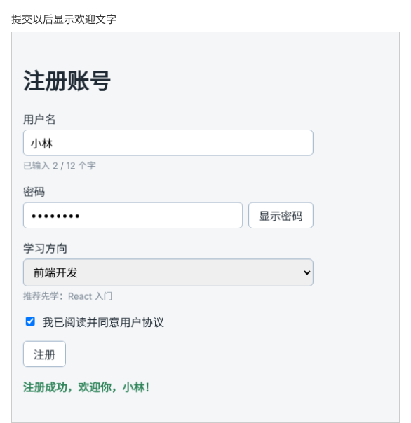

# 第 40 章：如何阻止提交表单时刷新整个页面？

前置：[第 39 章：如何读取下拉选择框中的选项？](第039章-如何读取下拉选择框中的选项.md)

## 一、本章要解决的问题

现在的“注册”按钮点了没有任何反应。注册表单应该在用户点击按钮，或在输入框中按 Enter 时提交，然后显示结果。

本章把表单的外层改为真正的 `<form>`，处理提交事件，提交后在表单下方显示“注册成功，欢迎你，小林！”。直接用 `<form>` 时有一个大坑：提交会让整个页面刷新，所有输入都会消失。本章阻止这种默认行为。完成后，点击注册或在输入框中按 Enter，页面不刷新，表单内容保留，下方出现欢迎信息。

本章完成后，填写用户名并点击“注册”，页面显示的结果如下图：



## 二、必要原理

### 为什么要用 form

用 `div` 加按钮的 `onClick` 也能做“提交”，但 `<form>` 有几个免费的好处：

- 在任何一个输入框中按 Enter，都会提交表单，用户不必去点按钮；
- 读屏软件能识别这是一个表单；
- 浏览器的自动填充、密码管理器能更好地工作。

所以表单都应该放在 `<form>` 中，在 `form` 的 `onSubmit` 上处理提交，而不是在按钮的 `onClick` 上。

### 浏览器的默认行为：提交后刷新页面

HTML 表单诞生时，提交的意思是“把数据发送到服务器，然后打开服务器返回的新页面”。所以浏览器提交表单时，默认会跳转或刷新页面。在 React 应用中，我们要自己处理数据，页面一刷新，所有 state 都回到初始值，用户输入的内容全部丢失。

事件对象的 `preventDefault()` 方法用来**阻止浏览器的默认行为**。在提交处理函数的第一行调用它，浏览器就不会刷新页面了：

```tsx
function handleSubmit(event: SubmitEvent<HTMLFormElement>) {
  event.preventDefault();
  // 接下来处理提交
}
```

### 提交事件的类型

表单提交事件的类型是 React 提供的 `SubmitEvent`，尖括号中是表单元素的类型 `HTMLFormElement`。浏览器中也有一个同名的全局类型 `SubmitEvent`，两者不是一回事，所以要从 `react` 中明确导入。

在网上查资料时，你会经常看到 `FormEvent<HTMLFormElement>` 的写法。那是旧写法：React 的类型定义（`@types/react`）在 19.2 系列的更新中把 `FormEvent` 标记为“已弃用”，表单提交改用 `SubmitEvent`。本教程使用的版本已经包含这个变化，用 `FormEvent` 时编辑器会把它显示为带删除线的样式。两者在本教程中的用法完全相同，看到旧资料时换成 `SubmitEvent` 即可。

### 哪个按钮会提交表单

`form` 中 `type="submit"` 的按钮会提交表单。第 37 章的“显示密码”按钮写了 `type="button"`，点击它不会提交，这正是当时提前写好它的原因。

### 用 role="status" 显示结果

提交结果显示在表单下方，加上 `role="status"`，读屏软件会在这段文字出现或变化时读出来，看不到页面的用户也能知道提交成功了。

## 三、动手实现

### 第 1 步：添加结果样式

在 `src/pages/RegisterPage.module.css` 末尾加入：

```css
.success {
  margin-top: 16px;
  color: #2f855a;
  font-weight: bold;
}
```

### 第 2 步：导入提交事件类型，增加结果的 state

打开 `src/pages/RegisterPage.tsx`，把类型导入改为：

```tsx
import type { ChangeEvent, SubmitEvent } from 'react';
```

在 `agree` 那一行的下面加入：

```tsx
  const [message, setMessage] = useState('');
```

### 第 3 步：编写提交处理函数

在 `handleDirectionChange` 的下面加入：

```tsx
  function handleSubmit(event: SubmitEvent<HTMLFormElement>) {
    event.preventDefault();
    setMessage('注册成功，欢迎你，' + username.trim() + '！');
  }
```

`trim()` 去掉用户名首尾不小心输入的空格。

### 第 4 步：把外层改为 form

把外层的 `<div className={styles.form}>` 改为：

```tsx
      <form className={styles.form} onSubmit={handleSubmit}>
```

对应的结束标签 `</div>` 改为 `</form>`。把注册按钮的 `type` 改为 `"submit"`：

```tsx
        <button type="submit" className={styles.submit} disabled={!agree}>
```

在 `</form>` 的后面、`</main>` 的前面加入结果：

```tsx
      {message && (
        <p role="status" className={styles.success}>
          {message}
        </p>
      )}
```

## 四、运行与检查

保持开发服务器运行（`npm.cmd run dev`），保存文件后在浏览器中查看。

1. 输入用户名“小林”，勾选同意，点击“注册”。表单下方出现绿色的“注册成功，欢迎你，小林！”，页面没有刷新，输入框中的内容都还在。
2. 把光标放在用户名输入框中按 Enter，同样提交并显示欢迎信息。如果取消勾选“同意”，再按 Enter 就不会提交：表单的提交按钮被禁用时，浏览器也不允许用 Enter 提交。
3. 点击“显示密码”，只切换密码的显示，不会出现欢迎信息。
4. 把 `event.preventDefault();` 临时删掉，保存后再点击“注册”。页面闪了一下，所有输入都清空了，欢迎信息也没有出现。地址栏的网址后面多了一个 `?`。这就是浏览器默认的提交行为。检查后恢复这一行。

最后运行检查，应没有错误：

```powershell
npm.cmd run check
```

**小练习**：把欢迎信息改为同时显示学习方向，例如“注册成功，欢迎你，小林！学习方向：frontend”。再想一想：怎样显示成中文的“前端开发”？练习后恢复本章代码。

## 五、常见错误

| 现象 | 原因 | 怎么改 |
| --- | --- | --- |
| 点击注册后页面刷新，输入全部消失 | 没有调用 `event.preventDefault()` | 在 `handleSubmit` 第一行调用 |
| 编辑器提示 `SubmitEvent` 不是泛型，或没有 `preventDefault` | 没有从 `react` 导入，用到了浏览器的全局同名类型 | `import type { ChangeEvent, SubmitEvent } from 'react';` |
| 点击“显示密码”也会显示欢迎信息 | 切换按钮没有写 `type="button"` | 普通按钮都写 `type="button"` |
| 点击注册没有反应 | `onSubmit` 写在了按钮上，或按钮仍是 `type="button"` | `onSubmit` 写在 `form` 上，按钮写 `type="submit"` |
| 欢迎信息一直显示在页面上 | 结果的段落没有放在 `{message && ...}` 中 | 只在 `message` 不为空时显示 |

## 六、本章完整代码

### `src/pages/RegisterPage.module.css`

```css
.form {
  display: flex;
  flex-direction: column;
  gap: 16px;
  max-width: 420px;
}

.field {
  display: flex;
  flex-direction: column;
  gap: 4px;
}

.field input,
.field select {
  padding: 8px 10px;
  border: 1px solid #9fb3c8;
  border-radius: 6px;
  font: inherit;
}

.hint {
  margin: 0;
  color: #7b8794;
  font-size: 13px;
}

.passwordRow {
  display: flex;
  gap: 8px;
}

.passwordRow input {
  flex: 1;
  min-width: 0;
}

.checkbox {
  display: flex;
  align-items: center;
  gap: 8px;
}

.submit {
  align-self: flex-start;
}

.success {
  margin-top: 16px;
  color: #2f855a;
  font-weight: bold;
}
```

### `src/pages/RegisterPage.tsx`

```tsx
import { useState } from 'react';
import type { ChangeEvent, SubmitEvent } from 'react';
import styles from './RegisterPage.module.css';

export default function RegisterPage() {
  const [username, setUsername] = useState('');
  const [password, setPassword] = useState('');
  const [showPassword, setShowPassword] = useState(false);
  const [direction, setDirection] = useState('');
  const [agree, setAgree] = useState(false);
  const [message, setMessage] = useState('');

  function handleUsernameChange(event: ChangeEvent<HTMLInputElement>) {
    setUsername(event.target.value);
  }

  function handlePasswordChange(event: ChangeEvent<HTMLInputElement>) {
    setPassword(event.target.value);
  }

  function handleDirectionChange(event: ChangeEvent<HTMLSelectElement>) {
    setDirection(event.target.value);
  }

  function handleSubmit(event: SubmitEvent<HTMLFormElement>) {
    event.preventDefault();
    setMessage('注册成功，欢迎你，' + username.trim() + '！');
  }

  return (
    <main className="page">
      <h1>注册账号</h1>
      <form className={styles.form} onSubmit={handleSubmit}>
        <div className={styles.field}>
          <label htmlFor="username">用户名</label>
          <input
            id="username"
            value={username}
            onChange={handleUsernameChange}
          />
          <p className={styles.hint}>已输入 {username.length} / 12 个字</p>
        </div>
        <div className={styles.field}>
          <label htmlFor="password">密码</label>
          <div className={styles.passwordRow}>
            <input
              id="password"
              type={showPassword ? 'text' : 'password'}
              value={password}
              onChange={handlePasswordChange}
            />
            <button type="button" onClick={() => setShowPassword(!showPassword)}>
              {showPassword ? '隐藏密码' : '显示密码'}
            </button>
          </div>
        </div>
        <div className={styles.field}>
          <label htmlFor="direction">学习方向</label>
          <select
            id="direction"
            value={direction}
            onChange={handleDirectionChange}
          >
            <option value="">请选择</option>
            <option value="frontend">前端开发</option>
            <option value="backend">后端开发</option>
            <option value="design">界面设计</option>
          </select>
          {direction === 'frontend' && <p className={styles.hint}>推荐先学：React 入门</p>}
          {direction === 'backend' && <p className={styles.hint}>推荐先学：Node.js 基础</p>}
          {direction === 'design' && <p className={styles.hint}>推荐先学：网页布局实战</p>}
        </div>
        <label className={styles.checkbox}>
          <input
            type="checkbox"
            checked={agree}
            onChange={(event) => setAgree(event.target.checked)}
          />
          我已阅读并同意用户协议
        </label>
        <button type="submit" className={styles.submit} disabled={!agree}>
          注册
        </button>
      </form>
      {message && (
        <p role="status" className={styles.success}>
          {message}
        </p>
      )}
    </main>
  );
}
```

## 七、本章改动小结

修改 `src/pages/RegisterPage.tsx`（外层改为 `form`，新增提交处理函数和结果 state，注册按钮改为提交按钮）和 `src/pages/RegisterPage.module.css`（新增 `.success`）。

---

下一章：[第 41 章：必填内容为空时，如何显示错误提示？](第041章-必填内容为空时，如何显示错误提示.md)
