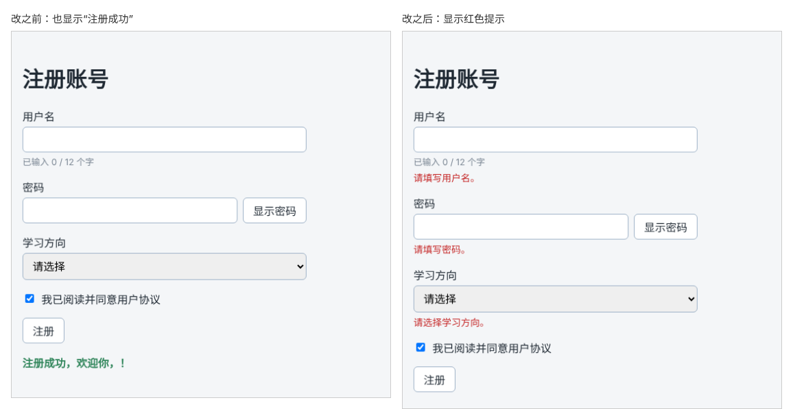

# 第 41 章：必填内容为空时，如何显示错误提示？

前置：[第 40 章：如何阻止提交表单时刷新整个页面？](第040章-如何阻止提交表单时刷新整个页面.md)

## 一、本章要解决的问题

现在什么都不填，勾选同意后点击注册，也会显示“注册成功，欢迎你，！”。用户名、密码、学习方向都是必填的，提交时应该检查，空着的项在输入框下方显示红色的提示，并且不显示成功信息。

本章在提交时检查三个必填项。完成后，什么都不填就提交，三个位置分别显示“请填写用户名。”“请填写密码。”“请选择学习方向。”；全部填好再提交，错误消失，显示欢迎信息。

下图都是什么都不填、只勾选同意就点击“注册”的结果，左边是现在的样子，右边是本章完成后的样子：



## 二、必要原理

### 用一个对象保存所有错误

每个字段可能有一条错误提示，也可能没有。用一个对象保存全部错误，属性名对应字段，值是提示文字：

```ts
type FormErrors = {
  username?: string;
  password?: string;
  direction?: string;
};
```

每个属性都是可选的（第 10 章）：没有错误的字段，对象中就没有这个属性。没有任何错误时，就是一个空对象 `{}`。

```tsx
const [errors, setErrors] = useState<FormErrors>({});
```

显示错误时，第 21 章的写法正好合适：`{errors.username && <p>{errors.username}</p>}`，有这个属性才显示。

### 在提交时检查

检查放在 `handleSubmit` 中：

1. 先建一个空的 `nextErrors` 对象；
2. 逐个检查字段，有问题就给 `nextErrors` 添加对应的属性；
3. 用 `setErrors(nextErrors)` 一次性更新错误；
4. 如果有错误，清空成功信息并结束，不再往下执行。

为什么不在每个检查中直接调用 `setErrors`？因为 state 要到下一次渲染才更新（第 26 章），在同一个函数中无法马上读到刚设置的错误，也就没法判断“到底有没有错误”。先把结果收集在普通变量 `nextErrors` 中，判断和更新都用它。

用户名用 `trim()` 去掉首尾空格后再判断，只输入几个空格也算没填。密码不用 `trim()`，因为空格也可能是密码的一部分。

### 判断对象中有没有属性

`Object.keys(对象)` 返回对象所有属性名组成的数组。数组长度大于 0，说明至少有一条错误：

```ts
if (Object.keys(nextErrors).length > 0) { …… }
```

### 每次提交都重新检查

每次提交都从一个空对象开始重新检查，所以用户补填了用户名再提交，用户名的错误就不会再出现。检查规则只写在一个地方，结果总是和当前输入一致。

## 三、动手实现

### 第 1 步：添加错误样式

在 `src/pages/RegisterPage.module.css` 末尾加入：

```css
.error {
  margin: 0;
  color: #c62828;
  font-size: 14px;
}
```

### 第 2 步：定义错误类型和 state

打开 `src/pages/RegisterPage.tsx`，在导入语句和组件函数之间加入：

```tsx
type FormErrors = {
  username?: string;
  password?: string;
  direction?: string;
};
```

在 `agree` 那一行的下面加入：

```tsx
  const [errors, setErrors] = useState<FormErrors>({});
```

### 第 3 步：在提交时检查

把 `handleSubmit` 改为：

```tsx
  function handleSubmit(event: SubmitEvent<HTMLFormElement>) {
    event.preventDefault();
    const nextErrors: FormErrors = {};
    if (username.trim() === '') {
      nextErrors.username = '请填写用户名。';
    }
    if (password === '') {
      nextErrors.password = '请填写密码。';
    }
    if (direction === '') {
      nextErrors.direction = '请选择学习方向。';
    }

    setErrors(nextErrors);
    if (Object.keys(nextErrors).length > 0) {
      setMessage('');
      return;
    }
    setMessage('注册成功，欢迎你，' + username.trim() + '！');
  }
```

### 第 4 步：在每个字段下方显示错误

在用户名的字数提示下面加入：

```tsx
          {errors.username && <p className={styles.error}>{errors.username}</p>}
```

在密码的 `</div>`（即 `passwordRow` 的结束标签）后面加入：

```tsx
          {errors.password && <p className={styles.error}>{errors.password}</p>}
```

在三行推荐课程的下面加入：

```tsx
          {errors.direction && <p className={styles.error}>{errors.direction}</p>}
```

## 四、运行与检查

保持开发服务器运行（`npm.cmd run dev`），保存文件后在浏览器中查看。

1. 什么都不填，勾选同意后点击“注册”。用户名、密码、学习方向下方分别出现红色提示，没有成功信息。
2. 在用户名中只输入几个空格，再提交，仍提示“请填写用户名。”。
3. 填好用户名，再提交：用户名的错误消失，另外两条还在。
4. 全部填好提交，所有错误消失，显示欢迎信息。
5. 先成功提交一次，再清空密码提交：欢迎信息消失，密码下方出现错误。

最后运行检查，应没有错误：

```powershell
npm.cmd run check
```

**小练习**：现在的错误要等到再次提交才会消失。改一改 `handleUsernameChange`：用户修改用户名时，顺便清除用户名的错误。（提示：`setErrors({ ...errors, username: undefined })`，其中 `...errors` 表示“复制原来所有的错误”，第 45 章会详细讲这种写法。）练习后恢复本章代码。

## 五、常见错误

| 现象 | 原因 | 怎么改 |
| --- | --- | --- |
| 有错误时仍然显示欢迎信息 | 有错误时没有 `return` | 有错误就清空信息并 `return` |
| 第一次提交检查不出错误，第二次才正确 | 在检查过程中调用 `setErrors` 后立刻读取 `errors`，读到的是旧值 | 先收集到 `nextErrors`，再用它判断 |
| 补填后错误仍然显示 | 每次检查时没有从空对象开始，而是在旧错误上修改 | 每次都 `const nextErrors: FormErrors = {}` |
| 编辑器提示 `nextErrors` 上没有 `username` 属性 | 写成了 `const nextErrors = {}`，没有标注类型 | 写成 `const nextErrors: FormErrors = {}` |
| 只输入空格也能通过检查 | 判断用户名时没有 `trim()` | 写成 `username.trim() === ''` |

## 六、本章完整代码

### `src/pages/RegisterPage.module.css`

```css
.form {
  display: flex;
  flex-direction: column;
  gap: 16px;
  max-width: 420px;
}

.field {
  display: flex;
  flex-direction: column;
  gap: 4px;
}

.field input,
.field select {
  padding: 8px 10px;
  border: 1px solid #9fb3c8;
  border-radius: 6px;
  font: inherit;
}

.hint {
  margin: 0;
  color: #7b8794;
  font-size: 13px;
}

.passwordRow {
  display: flex;
  gap: 8px;
}

.passwordRow input {
  flex: 1;
  min-width: 0;
}

.checkbox {
  display: flex;
  align-items: center;
  gap: 8px;
}

.submit {
  align-self: flex-start;
}

.success {
  margin-top: 16px;
  color: #2f855a;
  font-weight: bold;
}

.error {
  margin: 0;
  color: #c62828;
  font-size: 14px;
}
```

### `src/pages/RegisterPage.tsx`

```tsx
import { useState } from 'react';
import type { ChangeEvent, SubmitEvent } from 'react';
import styles from './RegisterPage.module.css';

type FormErrors = {
  username?: string;
  password?: string;
  direction?: string;
};

export default function RegisterPage() {
  const [username, setUsername] = useState('');
  const [password, setPassword] = useState('');
  const [showPassword, setShowPassword] = useState(false);
  const [direction, setDirection] = useState('');
  const [agree, setAgree] = useState(false);
  const [errors, setErrors] = useState<FormErrors>({});
  const [message, setMessage] = useState('');

  function handleUsernameChange(event: ChangeEvent<HTMLInputElement>) {
    setUsername(event.target.value);
  }

  function handlePasswordChange(event: ChangeEvent<HTMLInputElement>) {
    setPassword(event.target.value);
  }

  function handleDirectionChange(event: ChangeEvent<HTMLSelectElement>) {
    setDirection(event.target.value);
  }

  function handleSubmit(event: SubmitEvent<HTMLFormElement>) {
    event.preventDefault();
    const nextErrors: FormErrors = {};
    if (username.trim() === '') {
      nextErrors.username = '请填写用户名。';
    }
    if (password === '') {
      nextErrors.password = '请填写密码。';
    }
    if (direction === '') {
      nextErrors.direction = '请选择学习方向。';
    }

    setErrors(nextErrors);
    if (Object.keys(nextErrors).length > 0) {
      setMessage('');
      return;
    }
    setMessage('注册成功，欢迎你，' + username.trim() + '！');
  }

  return (
    <main className="page">
      <h1>注册账号</h1>
      <form className={styles.form} onSubmit={handleSubmit}>
        <div className={styles.field}>
          <label htmlFor="username">用户名</label>
          <input
            id="username"
            value={username}
            onChange={handleUsernameChange}
          />
          <p className={styles.hint}>已输入 {username.length} / 12 个字</p>
          {errors.username && <p className={styles.error}>{errors.username}</p>}
        </div>
        <div className={styles.field}>
          <label htmlFor="password">密码</label>
          <div className={styles.passwordRow}>
            <input
              id="password"
              type={showPassword ? 'text' : 'password'}
              value={password}
              onChange={handlePasswordChange}
            />
            <button type="button" onClick={() => setShowPassword(!showPassword)}>
              {showPassword ? '隐藏密码' : '显示密码'}
            </button>
          </div>
          {errors.password && <p className={styles.error}>{errors.password}</p>}
        </div>
        <div className={styles.field}>
          <label htmlFor="direction">学习方向</label>
          <select
            id="direction"
            value={direction}
            onChange={handleDirectionChange}
          >
            <option value="">请选择</option>
            <option value="frontend">前端开发</option>
            <option value="backend">后端开发</option>
            <option value="design">界面设计</option>
          </select>
          {direction === 'frontend' && <p className={styles.hint}>推荐先学：React 入门</p>}
          {direction === 'backend' && <p className={styles.hint}>推荐先学：Node.js 基础</p>}
          {direction === 'design' && <p className={styles.hint}>推荐先学：网页布局实战</p>}
          {errors.direction && <p className={styles.error}>{errors.direction}</p>}
        </div>
        <label className={styles.checkbox}>
          <input
            type="checkbox"
            checked={agree}
            onChange={(event) => setAgree(event.target.checked)}
          />
          我已阅读并同意用户协议
        </label>
        <button type="submit" className={styles.submit} disabled={!agree}>
          注册
        </button>
      </form>
      {message && (
        <p role="status" className={styles.success}>
          {message}
        </p>
      )}
    </main>
  );
}
```

## 七、本章改动小结

修改 `src/pages/RegisterPage.tsx`（新增 `FormErrors` 类型和 state `errors`，提交时检查三个必填项，在字段下方显示错误）和 `src/pages/RegisterPage.module.css`（新增 `.error`）。

---

下一章：[第 42 章：【组合】如何检查两次输入的密码是否一致？](第042章-如何检查两次输入的密码是否一致.md)
