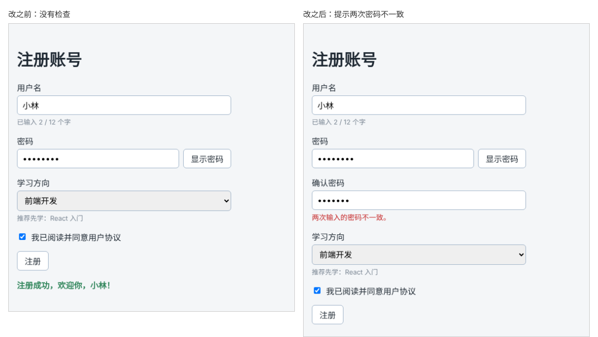

# 第 42 章：【组合】如何检查两次输入的密码是否一致？

前置：[第 41 章：必填内容为空时，如何显示错误提示？](第041章-必填内容为空时，如何显示错误提示.md)

## 一、本章要解决的问题

密码显示为圆点，用户可能输错了一个字母自己却不知道，下次登录就进不去了。注册表单通常会要求再输入一次密码，两次一致才能注册。

本章在密码下方增加“确认密码”输入框。完成后：确认密码为空时提示“请再次输入密码。”；两次不一致时提示“两次输入的密码不一致。”；“显示密码”按钮同时控制两个密码框的显示方式。

本章不引入新技术，组合使用的是：

- 第 35、36 章：受控输入框和命名的处理函数；
- 第 37 章：用 state 决定输入框的 `type`；
- 第 41 章：在提交时收集错误并显示。

下图都是两次密码输入不一致时点击“注册”的结果，左边是现在的样子，右边是本章完成后的样子：



## 二、必要原理

### 确认密码也是一个受控输入框

确认密码和密码一样，需要一个 state `confirmPassword` 和一个处理函数，写法与第 36 章完全相同。

### 检查顺序：先检查是否为空，再检查是否一致

确认密码有两种可能的错误，但同一时间只显示一条：

```tsx
if (confirmPassword === '') {
  nextErrors.confirmPassword = '请再次输入密码。';
} else if (confirmPassword !== password) {
  nextErrors.confirmPassword = '两次输入的密码不一致。';
}
```

`else if` 表示“前一个条件不成立时，再检查这个条件”。没填时只提示“请再次输入密码”，填了但不一致时才提示“不一致”。如果分成两个独立的 `if`，没填时两条都成立，后一条会覆盖前一条，用户看到“不一致”会感到奇怪：我还什么都没输呢。

`!==` 是“不相等”，与 `===` 相反。

### 一个开关控制两个输入框

“显示密码”是为了让用户看清自己输入的内容，两个密码框应该一起切换。确认密码框的 `type` 也使用同一个 `showPassword`，不需要新的 state。一份 state 决定两处显示，两处永远一致。

### 错误类型中加入新字段

`FormErrors` 类型中加入 `confirmPassword?: string`。如果忘了加，给 `nextErrors.confirmPassword` 赋值时编辑器会报错，提醒你同步修改类型。

## 三、动手实现

### 第 1 步：增加类型、state 和处理函数

打开 `src/pages/RegisterPage.tsx`，在 `FormErrors` 类型的 `password` 下面加一行：

```tsx
  confirmPassword?: string;
```

在 `password` 那一行的下面加入：

```tsx
  const [confirmPassword, setConfirmPassword] = useState('');
```

在 `handlePasswordChange` 的下面加入：

```tsx
  function handleConfirmPasswordChange(event: ChangeEvent<HTMLInputElement>) {
    setConfirmPassword(event.target.value);
  }
```

### 第 2 步：在提交时检查

在 `handleSubmit` 中检查密码的 `if` 后面加入：

```tsx
    if (confirmPassword === '') {
      nextErrors.confirmPassword = '请再次输入密码。';
    } else if (confirmPassword !== password) {
      nextErrors.confirmPassword = '两次输入的密码不一致。';
    }
```

### 第 3 步：添加确认密码输入框

在密码所在的 `<div className={styles.field}>……</div>` 后面、学习方向的前面加入：

```tsx
        <div className={styles.field}>
          <label htmlFor="confirm-password">确认密码</label>
          <input
            id="confirm-password"
            type={showPassword ? 'text' : 'password'}
            value={confirmPassword}
            onChange={handleConfirmPasswordChange}
          />
          {errors.confirmPassword && <p className={styles.error}>{errors.confirmPassword}</p>}
        </div>
```

## 四、运行与检查

保持开发服务器运行（`npm.cmd run dev`），保存文件后在浏览器中查看。

1. 密码下方出现“确认密码”输入框。
2. 密码输入“abc12345”，确认密码不填，其余填好后提交，确认密码下方提示“请再次输入密码。”。
3. 确认密码输入“abc1234”（少一位），提交，提示“两次输入的密码不一致。”，没有成功信息。
4. 确认密码改成“abc12345”，提交成功。
5. 点击“显示密码”，两个密码框同时变成明文；再点击，同时变回圆点。
6. 先让两次密码一致，再只修改第一个密码框，提交时又提示不一致。

最后运行检查，应没有错误：

```powershell
npm.cmd run check
```

**小练习**：增加一条规则：密码至少 8 位，否则在密码下方提示“密码至少需要 8 位。”。想一想：这条检查应该和“请填写密码”是什么关系，用 `if` 还是 `else if`？练习后恢复本章代码。

## 五、常见错误

| 现象 | 原因 | 怎么改 |
| --- | --- | --- |
| 确认密码没填时，提示的却是“不一致” | 两个检查写成了独立的 `if`，后一条覆盖了前一条 | 第二个检查用 `else if` |
| 两次输入相同，仍提示不一致 | 比较时用了 `trim()` 后的密码和原密码，或者比较错了变量 | 直接比较 `confirmPassword !== password` |
| 点击“显示密码”，只有第一个框变成明文 | 确认密码框的 `type` 写成了固定的 `"password"` | 写成 `type={showPassword ? 'text' : 'password'}` |
| 编辑器提示 `FormErrors` 上没有 `confirmPassword` | 类型中漏加了新字段 | 在 `FormErrors` 中加入 `confirmPassword?: string` |
| 点击“确认密码”文字，光标进入了密码框 | `htmlFor` 写成了 `"password"` | 两处都写 `"confirm-password"` |

## 六、本章完整代码

### `src/pages/RegisterPage.tsx`

```tsx
import { useState } from 'react';
import type { ChangeEvent, SubmitEvent } from 'react';
import styles from './RegisterPage.module.css';

type FormErrors = {
  username?: string;
  password?: string;
  confirmPassword?: string;
  direction?: string;
};

export default function RegisterPage() {
  const [username, setUsername] = useState('');
  const [password, setPassword] = useState('');
  const [confirmPassword, setConfirmPassword] = useState('');
  const [showPassword, setShowPassword] = useState(false);
  const [direction, setDirection] = useState('');
  const [agree, setAgree] = useState(false);
  const [errors, setErrors] = useState<FormErrors>({});
  const [message, setMessage] = useState('');

  function handleUsernameChange(event: ChangeEvent<HTMLInputElement>) {
    setUsername(event.target.value);
  }

  function handlePasswordChange(event: ChangeEvent<HTMLInputElement>) {
    setPassword(event.target.value);
  }

  function handleConfirmPasswordChange(event: ChangeEvent<HTMLInputElement>) {
    setConfirmPassword(event.target.value);
  }

  function handleDirectionChange(event: ChangeEvent<HTMLSelectElement>) {
    setDirection(event.target.value);
  }

  function handleSubmit(event: SubmitEvent<HTMLFormElement>) {
    event.preventDefault();
    const nextErrors: FormErrors = {};
    if (username.trim() === '') {
      nextErrors.username = '请填写用户名。';
    }
    if (password === '') {
      nextErrors.password = '请填写密码。';
    }
    if (confirmPassword === '') {
      nextErrors.confirmPassword = '请再次输入密码。';
    } else if (confirmPassword !== password) {
      nextErrors.confirmPassword = '两次输入的密码不一致。';
    }
    if (direction === '') {
      nextErrors.direction = '请选择学习方向。';
    }

    setErrors(nextErrors);
    if (Object.keys(nextErrors).length > 0) {
      setMessage('');
      return;
    }
    setMessage('注册成功，欢迎你，' + username.trim() + '！');
  }

  return (
    <main className="page">
      <h1>注册账号</h1>
      <form className={styles.form} onSubmit={handleSubmit}>
        <div className={styles.field}>
          <label htmlFor="username">用户名</label>
          <input
            id="username"
            value={username}
            onChange={handleUsernameChange}
          />
          <p className={styles.hint}>已输入 {username.length} / 12 个字</p>
          {errors.username && <p className={styles.error}>{errors.username}</p>}
        </div>
        <div className={styles.field}>
          <label htmlFor="password">密码</label>
          <div className={styles.passwordRow}>
            <input
              id="password"
              type={showPassword ? 'text' : 'password'}
              value={password}
              onChange={handlePasswordChange}
            />
            <button type="button" onClick={() => setShowPassword(!showPassword)}>
              {showPassword ? '隐藏密码' : '显示密码'}
            </button>
          </div>
          {errors.password && <p className={styles.error}>{errors.password}</p>}
        </div>
        <div className={styles.field}>
          <label htmlFor="confirm-password">确认密码</label>
          <input
            id="confirm-password"
            type={showPassword ? 'text' : 'password'}
            value={confirmPassword}
            onChange={handleConfirmPasswordChange}
          />
          {errors.confirmPassword && <p className={styles.error}>{errors.confirmPassword}</p>}
        </div>
        <div className={styles.field}>
          <label htmlFor="direction">学习方向</label>
          <select
            id="direction"
            value={direction}
            onChange={handleDirectionChange}
          >
            <option value="">请选择</option>
            <option value="frontend">前端开发</option>
            <option value="backend">后端开发</option>
            <option value="design">界面设计</option>
          </select>
          {direction === 'frontend' && <p className={styles.hint}>推荐先学：React 入门</p>}
          {direction === 'backend' && <p className={styles.hint}>推荐先学：Node.js 基础</p>}
          {direction === 'design' && <p className={styles.hint}>推荐先学：网页布局实战</p>}
          {errors.direction && <p className={styles.error}>{errors.direction}</p>}
        </div>
        <label className={styles.checkbox}>
          <input
            type="checkbox"
            checked={agree}
            onChange={(event) => setAgree(event.target.checked)}
          />
          我已阅读并同意用户协议
        </label>
        <button type="submit" className={styles.submit} disabled={!agree}>
          注册
        </button>
      </form>
      {message && (
        <p role="status" className={styles.success}>
          {message}
        </p>
      )}
    </main>
  );
}
```

## 七、本章改动小结

修改 `src/pages/RegisterPage.tsx`：新增确认密码的 state、处理函数和输入框，提交时检查确认密码是否为空、是否与密码一致。

---

下一章：[第 43 章：如何让错误提示与对应的输入框关联？](第043章-如何让错误提示与对应的输入框关联.md)
