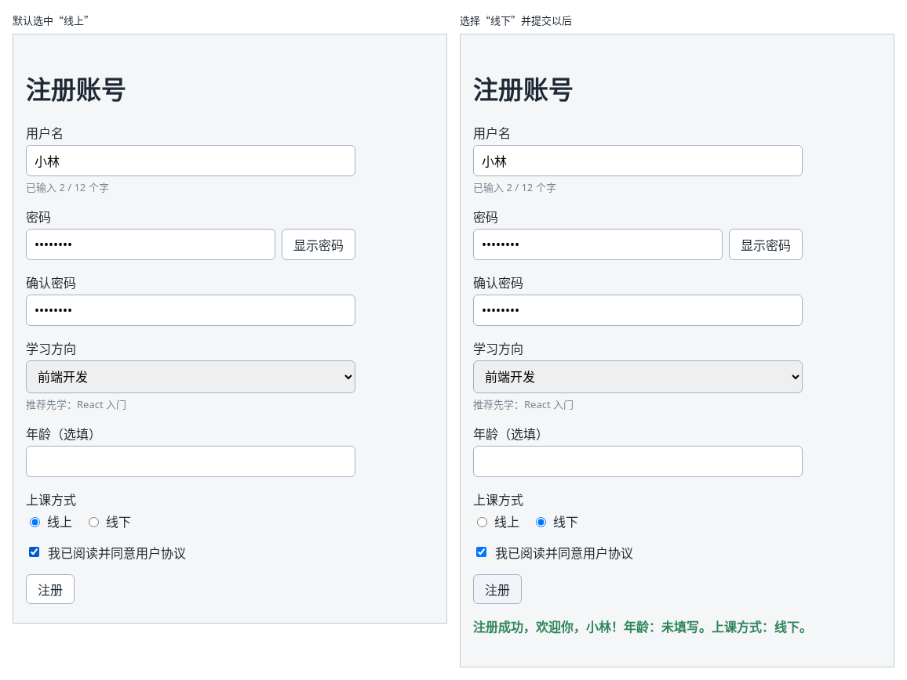

# 第 44A 章：如何读取一组单选按钮中选中的项？

前置：[第 44 章：如何处理可以暂时留空的数字输入框？](第044章-如何处理可以暂时留空的数字输入框.md)

## 一、本章要解决的问题

注册时还要选择上课方式：线上或线下。只有两三个选项、又希望用户一眼看到全部选项时，常用一组单选按钮，而不是下拉框。

本章在年龄下方加一组“上课方式”单选按钮。完成后，打开页面时默认选中“线上”；点击“线下”，选中的圆点移到“线下”；提交成功后，成功信息的末尾显示“上课方式：线下。”。

下图左边是打开页面时的样子，右边是选择“线下”并提交以后的样子：



## 二、必要原理

### 单选按钮和复选框的区别

单选按钮也是 `<input>`，写成 `type="radio"`。它和第 38 章的复选框外观相近，用法不同：

| | 复选框 `checkbox` | 单选按钮 `radio` |
| --- | --- | --- |
| 数量 | 一个就能用 | 一组至少两个 |
| 能选几个 | 每个各自勾选或不勾选 | 一组中只能选一个 |
| state 保存什么 | 是否勾选，`true` 或 `false` | 选中的是哪一项，例如 `'online'` |

所以一组单选按钮只用**一个**字符串 state，记住选中项的值：

```tsx
const [studyMode, setStudyMode] = useState('online');
```

### value 是这一项的值，checked 决定是否选中

每个单选按钮都要写三个属性：

```tsx
<input
  type="radio"
  name="studyMode"
  value="offline"
  checked={studyMode === 'offline'}
  onChange={handleStudyModeChange}
/>
```

- `value`：这一项代表的值，写成固定的字符串，和第 39 章 `option` 的 `value` 一样，是给程序用的。
- `checked`：这一项现在是否选中。state 等于自己的值时为 `true`。这就是受控的单选按钮：选中哪一项完全由 state 决定。
- `onChange`：用户点击某一项时触发。这时 `event.target` 是被点击的那个单选按钮，`event.target.value` 就是它的值，存进 state 即可。

同一组的单选按钮共用一个处理函数，因为它们做的事情一样：把被点击那一项的值存进 state。

### name 把单选按钮编成一组

同一组的单选按钮写相同的 `name`。浏览器据此知道它们是一组：按 Tab 键时，焦点只停在这一组中选中的那一项上，再按一次 Tab 就离开这一组，组内用方向键切换。没写 `name` 时，每个单选按钮都会单独停一次。

### 给一组选项加一个总标题：fieldset 和 legend

“上课方式”这几个字是整组选项的标题，不属于其中某一个选项，所以不能用 `<label htmlFor>` 关联到某一个输入框。HTML 为这种情况准备了 `<fieldset>`（一组表单控件）和 `<legend>`（这一组的标题）：

```tsx
<fieldset>
  <legend>上课方式</legend>
  （单选按钮放在这里）
</fieldset>
```

读屏软件读到组中任意一个选项时，会先读出“上课方式”。每个选项自己的文字，仍然像第 38 章的复选框那样，用 `<label>` 把输入框和文字包在一起，点击文字也能选中。

`fieldset` 默认带一圈边框和内边距，本章用 CSS 去掉，让它和其他字段看起来一致。

### 为什么默认选中一项

下拉框可以用“请选择”表示还没选。单选按钮一旦选中，用户就无法再回到“一个都没选”的状态。所以单选按钮通常默认选中最常用的一项，本章默认“线上”，提交时也就不需要检查是否已选择。

## 三、动手实现

### 第 1 步：增加 state 和处理函数

打开 `src/pages/RegisterPage.tsx`，在 `ageText` 那一行的下面加入：

```tsx
  const [studyMode, setStudyMode] = useState('online');
```

在 `handleAgeChange` 的下面加入：

```tsx
  function handleStudyModeChange(event: ChangeEvent<HTMLInputElement>) {
    setStudyMode(event.target.value);
  }
```

单选按钮也是 `<input>`，所以事件类型和输入框一样，是 `ChangeEvent<HTMLInputElement>`。

### 第 2 步：在成功信息中显示上课方式

把 `handleSubmit` 最后的 `setMessage(...)` 一行替换为：

```tsx
    const studyModeNote = studyMode === 'online' ? '线上' : '线下';
    setMessage(
      '注册成功，欢迎你，' + username.trim() + '！年龄：' + ageNote + '。上课方式：' + studyModeNote + '。',
    );
```

state 中保存的是 `'online'` 这样的值，显示给用户时换成中文。这一行太长，所以把参数分到单独的一行。

### 第 3 步：添加单选按钮组

在年龄所在的 `<div className={styles.field}>……</div>` 后面、复选框的前面加入：

```tsx
        <fieldset className={styles.radioGroup}>
          <legend>上课方式</legend>
          <label className={styles.radio}>
            <input
              type="radio"
              name="studyMode"
              value="online"
              checked={studyMode === 'online'}
              onChange={handleStudyModeChange}
            />
            线上
          </label>
          <label className={styles.radio}>
            <input
              type="radio"
              name="studyMode"
              value="offline"
              checked={studyMode === 'offline'}
              onChange={handleStudyModeChange}
            />
            线下
          </label>
        </fieldset>
```

两个单选按钮只有 `value` 和 `checked` 中比较的值不同，其余完全一样。

### 第 4 步：添加样式

打开 `src/pages/RegisterPage.module.css`，在 `.checkbox` 规则的前面加入：

```css
.radioGroup {
  display: flex;
  gap: 16px;
  margin: 0;
  padding: 0;
  border: 0;
}

.radioGroup legend {
  margin-bottom: 4px;
  padding: 0;
}

.radio {
  display: flex;
  align-items: center;
  gap: 6px;
}
```

- `.radioGroup` 去掉 `fieldset` 自带的边框、外边距和内边距，让两个选项排成一行。`legend` 会单独显示在这一行的上方。
- `.radio` 让圆点和文字对齐，写法与第 38 章的 `.checkbox` 相同。

## 四、运行与检查

保持开发服务器运行（`npm.cmd run dev`），保存文件后在浏览器中查看。先把用户名、两次密码、学习方向都填好，并勾选同意。

1. 年龄下方出现“上课方式”，下面一行是“线上”“线下”两个选项，默认选中“线上”。
2. 直接提交，成功信息的末尾是“上课方式：线上。”。
3. 点击“线下”的圆点，选中的圆点移到“线下”，“线上”自动取消。再提交，成功信息变成“上课方式：线下。”。
4. 点击文字“线上”而不是圆点，也能选中“线上”。
5. 点击年龄输入框，按一次 Tab，焦点停在选中的那个单选按钮上；按方向键可以在两项之间切换；再按一次 Tab，焦点直接到“我已阅读并同意用户协议”，不会在另一个单选按钮上停留。
6. 在 React 开发者工具中选中 `RegisterPage`，切换选项时，其中一个 State 的值在 `"online"` 和 `"offline"` 之间变化。

最后运行检查，应没有错误：

```powershell
npm.cmd run check
```

**小练习**：增加第三个选项“都可以”（值为 `either`），成功信息中显示“上课方式：都可以。”。提示：`studyModeNote` 需要能处理三种值，可以用第 42 章检查两次密码时用过的 `if`……`else if` 写法。练习后恢复本章代码。

## 五、常见错误

| 现象 | 原因 | 怎么改 |
| --- | --- | --- |
| 点击“线下”没有反应，控制台提示 ``You provided a `checked` prop to a form field without an `onChange` handler`` | 写了 `checked`，没有写 `onChange` | 每个单选按钮都加上 `onChange={handleStudyModeChange}` |
| 选了“线下”，提交后显示的仍是“线上” | 把 `value` 写成了 `value={studyMode}`，两个选项的值都跟着 state 变，点击哪一项存进去的都是原来的值 | `value` 写成这一项固定的值，例如 `value="offline"`；用 `checked` 和 state 比较 |
| 检查命令报 `Argument of type 'boolean' is not assignable to parameter of type 'SetStateAction<string>'` | 照抄了复选框的写法，读取的是 `event.target.checked` | 单选按钮读取 `event.target.value` |
| 按 Tab 时，焦点在每个单选按钮上都停一次 | 两个单选按钮没有写相同的 `name` | 同一组都写 `name="studyMode"` |

## 六、本章完整代码

### `src/pages/RegisterPage.tsx`

```tsx
import { useState } from 'react';
import type { ChangeEvent, SubmitEvent } from 'react';
import styles from './RegisterPage.module.css';

type FormErrors = {
  username?: string;
  password?: string;
  confirmPassword?: string;
  direction?: string;
  age?: string;
};

export default function RegisterPage() {
  const [username, setUsername] = useState('');
  const [password, setPassword] = useState('');
  const [confirmPassword, setConfirmPassword] = useState('');
  const [showPassword, setShowPassword] = useState(false);
  const [direction, setDirection] = useState('');
  const [ageText, setAgeText] = useState('');
  const [studyMode, setStudyMode] = useState('online');
  const [agree, setAgree] = useState(false);
  const [errors, setErrors] = useState<FormErrors>({});
  const [message, setMessage] = useState('');

  function handleUsernameChange(event: ChangeEvent<HTMLInputElement>) {
    setUsername(event.target.value);
  }

  function handlePasswordChange(event: ChangeEvent<HTMLInputElement>) {
    setPassword(event.target.value);
  }

  function handleConfirmPasswordChange(event: ChangeEvent<HTMLInputElement>) {
    setConfirmPassword(event.target.value);
  }

  function handleDirectionChange(event: ChangeEvent<HTMLSelectElement>) {
    setDirection(event.target.value);
  }

  function handleAgeChange(event: ChangeEvent<HTMLInputElement>) {
    setAgeText(event.target.value);
  }

  function handleStudyModeChange(event: ChangeEvent<HTMLInputElement>) {
    setStudyMode(event.target.value);
  }

  function handleSubmit(event: SubmitEvent<HTMLFormElement>) {
    event.preventDefault();
    const nextErrors: FormErrors = {};
    if (username.trim() === '') {
      nextErrors.username = '请填写用户名。';
    }
    if (password === '') {
      nextErrors.password = '请填写密码。';
    }
    if (confirmPassword === '') {
      nextErrors.confirmPassword = '请再次输入密码。';
    } else if (confirmPassword !== password) {
      nextErrors.confirmPassword = '两次输入的密码不一致。';
    }
    if (direction === '') {
      nextErrors.direction = '请选择学习方向。';
    }
    let ageNote = '未填写';
    if (ageText.trim() !== '') {
      const age = Number(ageText);
      if (!Number.isInteger(age) || age < 1 || age > 120) {
        nextErrors.age = '年龄需要是 1 到 120 之间的整数。';
      } else {
        ageNote = age + ' 岁';
      }
    }

    setErrors(nextErrors);
    if (Object.keys(nextErrors).length > 0) {
      setMessage('');
      return;
    }
    const studyModeNote = studyMode === 'online' ? '线上' : '线下';
    setMessage(
      '注册成功，欢迎你，' + username.trim() + '！年龄：' + ageNote + '。上课方式：' + studyModeNote + '。',
    );
  }

  return (
    <main className="page">
      <h1>注册账号</h1>
      <form className={styles.form} onSubmit={handleSubmit}>
        <div className={styles.field}>
          <label htmlFor="username">用户名</label>
          <input
            id="username"
            value={username}
            onChange={handleUsernameChange}
            aria-invalid={errors.username !== undefined}
            aria-describedby={errors.username ? 'username-error' : undefined}
          />
          <p className={styles.hint}>已输入 {username.length} / 12 个字</p>
          {errors.username && (
            <p id="username-error" className={styles.error}>
              {errors.username}
            </p>
          )}
        </div>
        <div className={styles.field}>
          <label htmlFor="password">密码</label>
          <div className={styles.passwordRow}>
            <input
              id="password"
              type={showPassword ? 'text' : 'password'}
              value={password}
              onChange={handlePasswordChange}
              aria-invalid={errors.password !== undefined}
              aria-describedby={errors.password ? 'password-error' : undefined}
            />
            <button type="button" onClick={() => setShowPassword(!showPassword)}>
              {showPassword ? '隐藏密码' : '显示密码'}
            </button>
          </div>
          {errors.password && (
            <p id="password-error" className={styles.error}>
              {errors.password}
            </p>
          )}
        </div>
        <div className={styles.field}>
          <label htmlFor="confirm-password">确认密码</label>
          <input
            id="confirm-password"
            type={showPassword ? 'text' : 'password'}
            value={confirmPassword}
            onChange={handleConfirmPasswordChange}
            aria-invalid={errors.confirmPassword !== undefined}
            aria-describedby={errors.confirmPassword ? 'confirm-password-error' : undefined}
          />
          {errors.confirmPassword && (
            <p id="confirm-password-error" className={styles.error}>
              {errors.confirmPassword}
            </p>
          )}
        </div>
        <div className={styles.field}>
          <label htmlFor="direction">学习方向</label>
          <select
            id="direction"
            value={direction}
            onChange={handleDirectionChange}
            aria-invalid={errors.direction !== undefined}
            aria-describedby={errors.direction ? 'direction-error' : undefined}
          >
            <option value="">请选择</option>
            <option value="frontend">前端开发</option>
            <option value="backend">后端开发</option>
            <option value="design">界面设计</option>
          </select>
          {direction === 'frontend' && <p className={styles.hint}>推荐先学：React 入门</p>}
          {direction === 'backend' && <p className={styles.hint}>推荐先学：Node.js 基础</p>}
          {direction === 'design' && <p className={styles.hint}>推荐先学：网页布局实战</p>}
          {errors.direction && (
            <p id="direction-error" className={styles.error}>
              {errors.direction}
            </p>
          )}
        </div>
        <div className={styles.field}>
          <label htmlFor="age">年龄（选填）</label>
          <input
            id="age"
            inputMode="numeric"
            value={ageText}
            onChange={handleAgeChange}
            aria-invalid={errors.age !== undefined}
            aria-describedby={errors.age ? 'age-error' : undefined}
          />
          {errors.age && (
            <p id="age-error" className={styles.error}>
              {errors.age}
            </p>
          )}
        </div>
        <fieldset className={styles.radioGroup}>
          <legend>上课方式</legend>
          <label className={styles.radio}>
            <input
              type="radio"
              name="studyMode"
              value="online"
              checked={studyMode === 'online'}
              onChange={handleStudyModeChange}
            />
            线上
          </label>
          <label className={styles.radio}>
            <input
              type="radio"
              name="studyMode"
              value="offline"
              checked={studyMode === 'offline'}
              onChange={handleStudyModeChange}
            />
            线下
          </label>
        </fieldset>
        <label className={styles.checkbox}>
          <input
            type="checkbox"
            checked={agree}
            onChange={(event) => setAgree(event.target.checked)}
          />
          我已阅读并同意用户协议
        </label>
        <button type="submit" className={styles.submit} disabled={!agree}>
          注册
        </button>
      </form>
      {message && (
        <p role="status" className={styles.success}>
          {message}
        </p>
      )}
    </main>
  );
}
```

### `src/pages/RegisterPage.module.css`

```css
.form {
  display: flex;
  flex-direction: column;
  gap: 16px;
  max-width: 420px;
}

.field {
  display: flex;
  flex-direction: column;
  gap: 4px;
}

.field input,
.field select {
  padding: 8px 10px;
  border: 1px solid #9fb3c8;
  border-radius: 6px;
  font: inherit;
}

.hint {
  margin: 0;
  color: #7b8794;
  font-size: 13px;
}

.passwordRow {
  display: flex;
  gap: 8px;
}

.passwordRow input {
  flex: 1;
  min-width: 0;
}

.radioGroup {
  display: flex;
  gap: 16px;
  margin: 0;
  padding: 0;
  border: 0;
}

.radioGroup legend {
  margin-bottom: 4px;
  padding: 0;
}

.radio {
  display: flex;
  align-items: center;
  gap: 6px;
}

.checkbox {
  display: flex;
  align-items: center;
  gap: 8px;
}

.submit {
  align-self: flex-start;
}

.success {
  margin-top: 16px;
  color: #2f855a;
  font-weight: bold;
}

.error {
  margin: 0;
  color: #c62828;
  font-size: 14px;
}

.field [aria-invalid='true'] {
  border-color: #c62828;
}
```

## 七、本章改动小结

修改 `src/pages/RegisterPage.tsx`：新增 state `studyMode`、处理函数和“上课方式”单选按钮组，成功信息中显示上课方式；修改 `src/pages/RegisterPage.module.css`：新增 `.radioGroup` 和 `.radio` 样式。

---

下一章：[第 44B 章：如何读取多行文本框中的内容？](第044B章-如何读取多行文本框中的内容.md)
