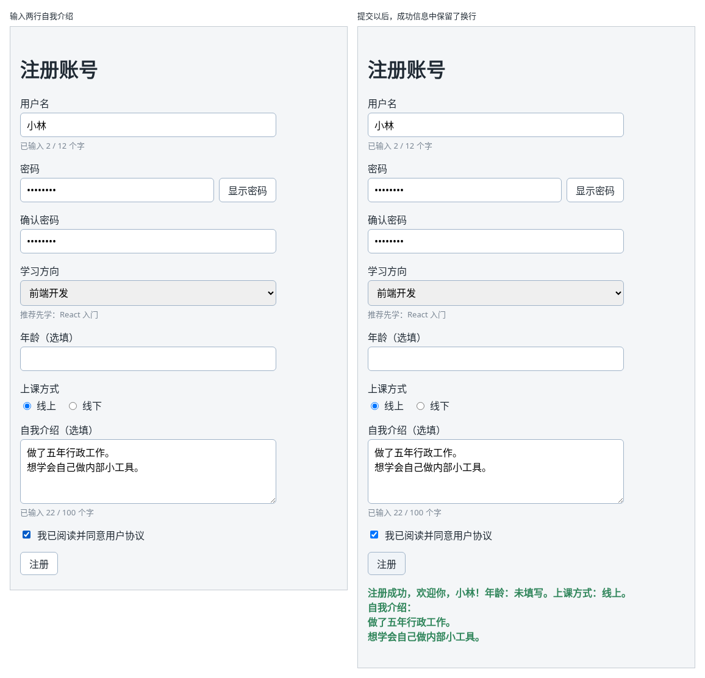

# 第 44B 章：如何读取多行文本框中的内容？

前置：[第 44A 章：如何读取一组单选按钮中选中的项？](第044A章-如何读取一组单选按钮中选中的项.md)

## 一、本章要解决的问题

注册表单要加一栏“自我介绍（选填）”。自我介绍可能有好几句话，用户还会按回车分段，普通的单行输入框放不下，也不能换行，要用多行文本框。

本章在上课方式下方加一个多行文本框。完成后：输入框有四行高，可以按回车换行；下方实时显示“已输入 22 / 100 个字”；超过 100 个字时提交，提示“自我介绍最多 100 个字。”；提交成功后，成功信息中原样显示自我介绍，换行也保留。

下图左边是输入两行自我介绍的样子，右边是提交以后的样子：



## 二、必要原理

### textarea：多行文本框

多行文本框是 `<textarea>` 元素。在 React 中，它的用法和第 35 章的输入框完全一样，也用 `value` 和 `onChange` 受控：

```tsx
<textarea id="intro" rows={4} value={intro} onChange={handleIntroChange} />
```

和 HTML 有两处不同：

- HTML 把初始内容写在开始标签和结束标签之间，例如 `<textarea>你好</textarea>`。React 中不这样写，内容由 `value` 决定，标签写成自闭合的 `<textarea />`。
- `rows={4}` 让文本框显示四行的高度。`rows` 要的是数字，所以写在花括号里，和第 5 章在属性中使用花括号的写法一样。

### 多行文本框的事件类型

触发事件的元素换成了 `textarea`，所以类型写 `HTMLTextAreaElement`：

```tsx
function handleIntroChange(event: ChangeEvent<HTMLTextAreaElement>) {
  setIntro(event.target.value);
}
```

这又一次用到第 36 章的规律：尖括号中写触发事件的元素类型。输入框是 `HTMLInputElement`，下拉框是 `HTMLSelectElement`，多行文本框是 `HTMLTextAreaElement`。

### 内容中的换行：\n

用户在文本框中按回车，`value` 里就多了一个**换行符**。在 JavaScript 字符串中，换行符写作 `'\n'`：反斜杠加字母 n，表示“这里换一行”，它算一个字符。所以字数统计时，换行也算一个字。

自己拼字符串时也可以用 `'\n'` 换行，本章在成功信息中用它把“自我介绍”放到新的一行。

### 页面上显示换行：white-space: pre-line

字符串中有换行符，显示到页面上却不一定换行。浏览器显示文字时，默认把换行符当成一个空格，几行文字会挤成一行。

给显示文字的元素加上 CSS `white-space: pre-line;`，浏览器就会按文字中的换行符换行，同时仍然把连续的多个空格合并成一个，适合显示用户输入的段落。

### 用 += 拼接字符串

`a += b` 是 `a = a + b` 的简写：在 `a` 原来的内容后面接上 `b`，再存回 `a`。本章先用 `let` 声明成功信息，填写了自我介绍时再接上一段：

```tsx
let nextMessage = '注册成功……';
if (intro.trim() !== '') {
  nextMessage += '\n自我介绍：\n' + intro.trim();
}
```

`let` 声明的变量可以重新赋值，第 44 章的 `ageNote` 也是这样写的。

## 三、动手实现

### 第 1 步：增加类型、state 和处理函数

打开 `src/pages/RegisterPage.tsx`，在 `FormErrors` 类型的最后加一行：

```tsx
  intro?: string;
```

在 `studyMode` 那一行的下面加入：

```tsx
  const [intro, setIntro] = useState('');
```

在 `handleStudyModeChange` 的下面加入：

```tsx
  function handleIntroChange(event: ChangeEvent<HTMLTextAreaElement>) {
    setIntro(event.target.value);
  }
```

### 第 2 步：提交时检查字数

在 `handleSubmit` 中检查年龄的代码后面、`setErrors(nextErrors);` 的前面加入：

```tsx
    if (intro.trim().length > 100) {
      nextErrors.intro = '自我介绍最多 100 个字。';
    }
```

先用 `trim()` 去掉首尾的空格和空行，再数字数，用户在末尾多按几次回车不会被算进去。

### 第 3 步：在成功信息中显示自我介绍

把 `handleSubmit` 最后的 `setMessage(...)` 替换为：

```tsx
    let nextMessage =
      '注册成功，欢迎你，' + username.trim() + '！年龄：' + ageNote + '。上课方式：' + studyModeNote + '。';
    if (intro.trim() !== '') {
      nextMessage += '\n自我介绍：\n' + intro.trim();
    }
    setMessage(nextMessage);
```

没有填写自我介绍时，成功信息和第 44A 章一样。

### 第 4 步：添加多行文本框

在上课方式的 `</fieldset>` 后面、复选框的前面加入：

```tsx
        <div className={styles.field}>
          <label htmlFor="intro">自我介绍（选填）</label>
          <textarea
            id="intro"
            rows={4}
            value={intro}
            onChange={handleIntroChange}
            aria-invalid={errors.intro !== undefined}
            aria-describedby={errors.intro ? 'intro-error' : undefined}
          />
          <p className={styles.hint}>已输入 {intro.trim().length} / 100 个字</p>
          {errors.intro && (
            <p id="intro-error" className={styles.error}>
              {errors.intro}
            </p>
          )}
        </div>
```

字数提示和第 35 章用户名下方的提示写法相同；错误提示的关联方式和第 43 章相同。

### 第 5 步：修改样式

打开 `src/pages/RegisterPage.module.css`，做三处修改。

第一处，让多行文本框和输入框使用同样的边框和字体。把文件开头的 `.field input, .field select {` 改为：

```css
.field input,
.field select,
.field textarea {
```

第二处，在 `.hint` 规则的前面加入：

```css
.field textarea {
  resize: vertical;
}
```

多行文本框右下角有一个可以拖动的小三角，用户能拖动改变大小。`resize: vertical` 只允许上下拖动，避免把文本框拖得比表单还宽。

第三处，在 `.success` 规则的最后加一行：

```css
  white-space: pre-line;
```

## 四、运行与检查

保持开发服务器运行（`npm.cmd run dev`），保存文件后在浏览器中查看。先把用户名、两次密码、学习方向都填好，并勾选同意。

1. 上课方式下方出现“自我介绍（选填）”，文本框有四行高，下方显示“已输入 0 / 100 个字”。
2. 输入“做了五年行政工作。”，按回车，再输入“想学会自己做内部小工具。”。文本框中分成两行，下方显示“已输入 22 / 100 个字”：两句话共 21 个字，加上一个换行符。
3. 提交。成功信息分成四行：第一行是原来的成功信息，然后是“自我介绍：”，再是你输入的两行。
4. 把自我介绍删光，再提交，成功信息只有第一行。
5. 输入超过 100 个字，提交，文本框变成红色边框，下方提示“自我介绍最多 100 个字。”，没有成功信息。
6. 拖动文本框右下角，只能改变高度，不能改变宽度。

最后运行检查，应没有错误：

```powershell
npm.cmd run check
```

**小练习**：字数超过 100 时，让“已输入 …… 个字”这一行提示也变成红色。提示：像第 37 章切换密码框 `type` 那样，在 `className` 中用 `? :` 按字数选择 `styles.hint` 或 `styles.error`。练习后恢复本章代码。

## 五、常见错误

| 现象 | 原因 | 怎么改 |
| --- | --- | --- |
| 控制台提示 ``Use the `defaultValue` or `value` props instead of setting children on <textarea>.`` | 照搬 HTML，把内容写在了标签中间：`<textarea>{intro}</textarea>` | 写成自闭合的 `<textarea value={intro} onChange={...} />` |
| 检查命令报 `Type 'HTMLTextAreaElement' is missing the following properties from type 'HTMLInputElement'` | 处理函数的类型照抄了输入框的 `ChangeEvent<HTMLInputElement>` | 改为 `ChangeEvent<HTMLTextAreaElement>` |
| 输入时分了行，提交后成功信息中的几行挤成了一行 | 浏览器默认把换行符显示成空格 | 给 `.success` 加上 `white-space: pre-line;` |
| 文本框的边框、字体和其他输入框不一样 | 样式只写了 `.field input` 和 `.field select` | 选择器中加上 `.field textarea` |
| 文本框被拖得比表单还宽 | 文本框默认可以向两个方向拖动 | 加上 `resize: vertical;` |

## 六、本章完整代码

### `src/pages/RegisterPage.tsx`

```tsx
import { useState } from 'react';
import type { ChangeEvent, SubmitEvent } from 'react';
import styles from './RegisterPage.module.css';

type FormErrors = {
  username?: string;
  password?: string;
  confirmPassword?: string;
  direction?: string;
  age?: string;
  intro?: string;
};

export default function RegisterPage() {
  const [username, setUsername] = useState('');
  const [password, setPassword] = useState('');
  const [confirmPassword, setConfirmPassword] = useState('');
  const [showPassword, setShowPassword] = useState(false);
  const [direction, setDirection] = useState('');
  const [ageText, setAgeText] = useState('');
  const [studyMode, setStudyMode] = useState('online');
  const [intro, setIntro] = useState('');
  const [agree, setAgree] = useState(false);
  const [errors, setErrors] = useState<FormErrors>({});
  const [message, setMessage] = useState('');

  function handleUsernameChange(event: ChangeEvent<HTMLInputElement>) {
    setUsername(event.target.value);
  }

  function handlePasswordChange(event: ChangeEvent<HTMLInputElement>) {
    setPassword(event.target.value);
  }

  function handleConfirmPasswordChange(event: ChangeEvent<HTMLInputElement>) {
    setConfirmPassword(event.target.value);
  }

  function handleDirectionChange(event: ChangeEvent<HTMLSelectElement>) {
    setDirection(event.target.value);
  }

  function handleAgeChange(event: ChangeEvent<HTMLInputElement>) {
    setAgeText(event.target.value);
  }

  function handleStudyModeChange(event: ChangeEvent<HTMLInputElement>) {
    setStudyMode(event.target.value);
  }

  function handleIntroChange(event: ChangeEvent<HTMLTextAreaElement>) {
    setIntro(event.target.value);
  }

  function handleSubmit(event: SubmitEvent<HTMLFormElement>) {
    event.preventDefault();
    const nextErrors: FormErrors = {};
    if (username.trim() === '') {
      nextErrors.username = '请填写用户名。';
    }
    if (password === '') {
      nextErrors.password = '请填写密码。';
    }
    if (confirmPassword === '') {
      nextErrors.confirmPassword = '请再次输入密码。';
    } else if (confirmPassword !== password) {
      nextErrors.confirmPassword = '两次输入的密码不一致。';
    }
    if (direction === '') {
      nextErrors.direction = '请选择学习方向。';
    }
    let ageNote = '未填写';
    if (ageText.trim() !== '') {
      const age = Number(ageText);
      if (!Number.isInteger(age) || age < 1 || age > 120) {
        nextErrors.age = '年龄需要是 1 到 120 之间的整数。';
      } else {
        ageNote = age + ' 岁';
      }
    }
    if (intro.trim().length > 100) {
      nextErrors.intro = '自我介绍最多 100 个字。';
    }

    setErrors(nextErrors);
    if (Object.keys(nextErrors).length > 0) {
      setMessage('');
      return;
    }
    const studyModeNote = studyMode === 'online' ? '线上' : '线下';
    let nextMessage =
      '注册成功，欢迎你，' + username.trim() + '！年龄：' + ageNote + '。上课方式：' + studyModeNote + '。';
    if (intro.trim() !== '') {
      nextMessage += '\n自我介绍：\n' + intro.trim();
    }
    setMessage(nextMessage);
  }

  return (
    <main className="page">
      <h1>注册账号</h1>
      <form className={styles.form} onSubmit={handleSubmit}>
        <div className={styles.field}>
          <label htmlFor="username">用户名</label>
          <input
            id="username"
            value={username}
            onChange={handleUsernameChange}
            aria-invalid={errors.username !== undefined}
            aria-describedby={errors.username ? 'username-error' : undefined}
          />
          <p className={styles.hint}>已输入 {username.length} / 12 个字</p>
          {errors.username && (
            <p id="username-error" className={styles.error}>
              {errors.username}
            </p>
          )}
        </div>
        <div className={styles.field}>
          <label htmlFor="password">密码</label>
          <div className={styles.passwordRow}>
            <input
              id="password"
              type={showPassword ? 'text' : 'password'}
              value={password}
              onChange={handlePasswordChange}
              aria-invalid={errors.password !== undefined}
              aria-describedby={errors.password ? 'password-error' : undefined}
            />
            <button type="button" onClick={() => setShowPassword(!showPassword)}>
              {showPassword ? '隐藏密码' : '显示密码'}
            </button>
          </div>
          {errors.password && (
            <p id="password-error" className={styles.error}>
              {errors.password}
            </p>
          )}
        </div>
        <div className={styles.field}>
          <label htmlFor="confirm-password">确认密码</label>
          <input
            id="confirm-password"
            type={showPassword ? 'text' : 'password'}
            value={confirmPassword}
            onChange={handleConfirmPasswordChange}
            aria-invalid={errors.confirmPassword !== undefined}
            aria-describedby={errors.confirmPassword ? 'confirm-password-error' : undefined}
          />
          {errors.confirmPassword && (
            <p id="confirm-password-error" className={styles.error}>
              {errors.confirmPassword}
            </p>
          )}
        </div>
        <div className={styles.field}>
          <label htmlFor="direction">学习方向</label>
          <select
            id="direction"
            value={direction}
            onChange={handleDirectionChange}
            aria-invalid={errors.direction !== undefined}
            aria-describedby={errors.direction ? 'direction-error' : undefined}
          >
            <option value="">请选择</option>
            <option value="frontend">前端开发</option>
            <option value="backend">后端开发</option>
            <option value="design">界面设计</option>
          </select>
          {direction === 'frontend' && <p className={styles.hint}>推荐先学：React 入门</p>}
          {direction === 'backend' && <p className={styles.hint}>推荐先学：Node.js 基础</p>}
          {direction === 'design' && <p className={styles.hint}>推荐先学：网页布局实战</p>}
          {errors.direction && (
            <p id="direction-error" className={styles.error}>
              {errors.direction}
            </p>
          )}
        </div>
        <div className={styles.field}>
          <label htmlFor="age">年龄（选填）</label>
          <input
            id="age"
            inputMode="numeric"
            value={ageText}
            onChange={handleAgeChange}
            aria-invalid={errors.age !== undefined}
            aria-describedby={errors.age ? 'age-error' : undefined}
          />
          {errors.age && (
            <p id="age-error" className={styles.error}>
              {errors.age}
            </p>
          )}
        </div>
        <fieldset className={styles.radioGroup}>
          <legend>上课方式</legend>
          <label className={styles.radio}>
            <input
              type="radio"
              name="studyMode"
              value="online"
              checked={studyMode === 'online'}
              onChange={handleStudyModeChange}
            />
            线上
          </label>
          <label className={styles.radio}>
            <input
              type="radio"
              name="studyMode"
              value="offline"
              checked={studyMode === 'offline'}
              onChange={handleStudyModeChange}
            />
            线下
          </label>
        </fieldset>
        <div className={styles.field}>
          <label htmlFor="intro">自我介绍（选填）</label>
          <textarea
            id="intro"
            rows={4}
            value={intro}
            onChange={handleIntroChange}
            aria-invalid={errors.intro !== undefined}
            aria-describedby={errors.intro ? 'intro-error' : undefined}
          />
          <p className={styles.hint}>已输入 {intro.trim().length} / 100 个字</p>
          {errors.intro && (
            <p id="intro-error" className={styles.error}>
              {errors.intro}
            </p>
          )}
        </div>
        <label className={styles.checkbox}>
          <input
            type="checkbox"
            checked={agree}
            onChange={(event) => setAgree(event.target.checked)}
          />
          我已阅读并同意用户协议
        </label>
        <button type="submit" className={styles.submit} disabled={!agree}>
          注册
        </button>
      </form>
      {message && (
        <p role="status" className={styles.success}>
          {message}
        </p>
      )}
    </main>
  );
}
```

### `src/pages/RegisterPage.module.css`

```css
.form {
  display: flex;
  flex-direction: column;
  gap: 16px;
  max-width: 420px;
}

.field {
  display: flex;
  flex-direction: column;
  gap: 4px;
}

.field input,
.field select,
.field textarea {
  padding: 8px 10px;
  border: 1px solid #9fb3c8;
  border-radius: 6px;
  font: inherit;
}

.field textarea {
  resize: vertical;
}

.hint {
  margin: 0;
  color: #7b8794;
  font-size: 13px;
}

.passwordRow {
  display: flex;
  gap: 8px;
}

.passwordRow input {
  flex: 1;
  min-width: 0;
}

.radioGroup {
  display: flex;
  gap: 16px;
  margin: 0;
  padding: 0;
  border: 0;
}

.radioGroup legend {
  margin-bottom: 4px;
  padding: 0;
}

.radio {
  display: flex;
  align-items: center;
  gap: 6px;
}

.checkbox {
  display: flex;
  align-items: center;
  gap: 8px;
}

.submit {
  align-self: flex-start;
}

.success {
  margin-top: 16px;
  color: #2f855a;
  font-weight: bold;
  white-space: pre-line;
}

.error {
  margin: 0;
  color: #c62828;
  font-size: 14px;
}

.field [aria-invalid='true'] {
  border-color: #c62828;
}
```

## 七、本章改动小结

修改 `src/pages/RegisterPage.tsx`：新增 state `intro`、处理函数和“自我介绍”多行文本框，提交时检查字数，成功信息中显示自我介绍；修改 `src/pages/RegisterPage.module.css`：多行文本框使用输入框的样式、只允许上下拖动，成功信息按换行符换行。

---

下一章：[第 44C 章：如何读取日期输入框中的日期？](第044C章-如何读取日期输入框中的日期.md)
