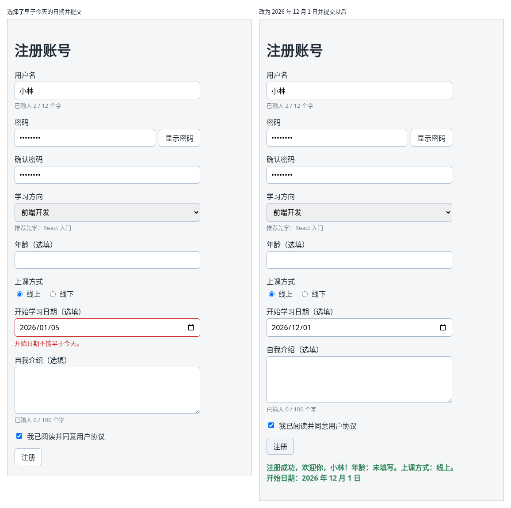

# 第 44C 章：如何读取日期输入框中的日期？

前置：[第 44B 章：如何读取多行文本框中的内容？](第044B章-如何读取多行文本框中的内容.md)

## 一、本章要解决的问题

注册时可以选一个“开始学习日期”。日期让用户手动输入，格式五花八门；用浏览器自带的日期输入框，用户点一下就能从日历中选择。选好以后，程序还要检查日期不能早于今天。

本章在上课方式下方加一个日期输入框。完成后：可以从日历中选日期，也可以不选；选了早于今天的日期并提交，提示“开始日期不能早于今天。”；提交成功后，成功信息中显示“开始日期：2026 年 12 月 1 日”这样的文字。

下图左边是选了早于今天的日期并提交的样子，右边是改为 2026 年 12 月 1 日并提交以后的样子：



## 二、必要原理

### 日期输入框的值是“年-月-日”字符串

日期输入框写成 `<input type="date">`。点击右侧的日历图标，会弹出浏览器自带的日历。它的用法仍然和第 35 章的输入框一样，用 `value` 和 `onChange` 受控，事件类型也是 `ChangeEvent<HTMLInputElement>`。

需要记住的是它的**值**：

| 情况 | `event.target.value` |
| --- | --- |
| 没有选择 | 空字符串 `''` |
| 选了 2026 年 12 月 1 日 | `'2026-12-01'` |

值固定是“四位年-两位月-两位日”的字符串，月和日不足两位时前面补 0。输入框里**显示**成什么样子由浏览器和操作系统的语言决定，中文 Windows 上一般显示“2026/12/01”，但程序读到的值始终是 `'2026-12-01'`。

所以 state 用字符串保存，初始值 `''` 表示没选，和第 44 章的年龄一样：

```tsx
const [startDate, setStartDate] = useState('');
```

### 比较两个日期：直接比较字符串

“年-月-日”格式长度固定，从左到右依次是年、月、日，所以两个这种格式的字符串可以直接用 `<` 比较先后：

```tsx
'2026-01-05' < '2026-11-10' // true，1 月在 11 月前面
```

字符串比较是从第一个字符开始逐个比较，第一个不同的字符决定大小。前面补 0 就是为了让这种比较成立：如果写成 `'2026-1-5'`，它和 `'2026-11-10'` 比较的结果就不对了。

### 今天的日期怎样写成同样的格式

要和用户选的日期比较，今天的日期也要写成“年-月-日”。用 `new Date()` 得到现在的时间，再分别取出年、月、日：

```tsx
function getTodayText() {
  const now = new Date();
  const month = String(now.getMonth() + 1).padStart(2, '0');
  const day = String(now.getDate()).padStart(2, '0');
  return now.getFullYear() + '-' + month + '-' + day;
}
```

- `getFullYear()`、`getMonth()`、`getDate()` 按电脑的本地时间取出年、月、日。注意 `getMonth()` 从 0 开始计数，1 月是 0，所以要加 1。
- `String(数字)` 把数字变成字符串。
- `padStart(2, '0')` 是字符串的方法：长度不足 2 时，在前面补 `'0'`，`'5'` 变成 `'05'`，`'11'` 不变。

这个函数不读取 state，写在组件函数的外面。

### 不要用 toISOString 取今天的日期

网上常见一种更短的写法：`new Date().toISOString().slice(0, 10)`。它取的是**世界标准时间**（UTC）的日期，比北京时间晚 8 小时。每天 0 点到 8 点之间，它得到的是**昨天**的日期。

日期输入框的值是用户所在地的本地日期，今天的日期也要按本地时间取，两者才能比较。

### 把“年-月-日”显示成中文日期

`split('-')` 按 `-` 把字符串切成一个数组：`'2026-12-01'.split('-')` 得到 `['2026', '12', '01']`。再用和 `useState` 一样的方括号写法，一次取出三个值：

```tsx
const [year, month, day] = startDate.split('-');
```

这种方括号写法叫数组解构，左边的变量依次对应数组中的每一项。`month` 和 `day` 是 `'12'`、`'01'` 这样的字符串，用第 44 章的 `Number` 转成数字，前面补的 0 就去掉了。

第 22 章用 `Intl.DateTimeFormat` 显示新闻的发布时间，那里的值是带时区的完整时间。这里只有年月日，没有时间，直接拆开显示更简单，也不会因为时区差一天。

## 三、动手实现

### 第 1 步：写一个取今天日期的函数

打开 `src/pages/RegisterPage.tsx`，在 `export default function RegisterPage()` 的上面加入：

```tsx
// 日期输入框的值是本地日期，今天的日期也要按本地时间取
function getTodayText() {
  const now = new Date();
  const month = String(now.getMonth() + 1).padStart(2, '0');
  const day = String(now.getDate()).padStart(2, '0');
  return now.getFullYear() + '-' + month + '-' + day;
}
```

### 第 2 步：增加类型、state 和处理函数

在 `FormErrors` 类型中 `age?: string;` 的下面加一行：

```tsx
  startDate?: string;
```

在 `studyMode` 那一行的下面加入：

```tsx
  const [startDate, setStartDate] = useState('');
```

在 `message` 那一行的下面加入：

```tsx
  const today = getTodayText();
```

在 `handleIntroChange` 的上面加入：

```tsx
  function handleStartDateChange(event: ChangeEvent<HTMLInputElement>) {
    setStartDate(event.target.value);
  }
```

### 第 3 步：提交时检查日期

在 `handleSubmit` 中检查自我介绍字数的 `if` 前面加入：

```tsx
    if (startDate !== '' && startDate < today) {
      nextErrors.startDate = '开始日期不能早于今天。';
    }
```

没选日期时不检查。`&&` 是“并且”：两个条件都成立才是错误。

### 第 4 步：在成功信息中显示开始日期

在拼接成功信息的地方，`if (intro.trim() !== '')` 的前面加入：

```tsx
    if (startDate !== '') {
      const [year, month, day] = startDate.split('-');
      nextMessage += '\n开始日期：' + year + ' 年 ' + Number(month) + ' 月 ' + Number(day) + ' 日';
    }
```

开始日期显示在第二行，自我介绍仍在最后。

### 第 5 步：添加日期输入框

在上课方式的 `</fieldset>` 后面、自我介绍的 `<div className={styles.field}>` 前面加入：

```tsx
        <div className={styles.field}>
          <label htmlFor="start-date">开始学习日期（选填）</label>
          <input
            id="start-date"
            type="date"
            value={startDate}
            onChange={handleStartDateChange}
            aria-invalid={errors.startDate !== undefined}
            aria-describedby={errors.startDate ? 'start-date-error' : undefined}
          />
          {errors.startDate && (
            <p id="start-date-error" className={styles.error}>
              {errors.startDate}
            </p>
          )}
        </div>
```

日期输入框也是 `input`，第 35 章写好的 `.field input` 样式直接用上了，不需要改 CSS。

## 四、运行与检查

保持开发服务器运行（`npm.cmd run dev`），保存文件后在浏览器中查看。先把用户名、两次密码、学习方向都填好，并勾选同意。

1. 上课方式下方出现“开始学习日期（选填）”，输入框中是灰色的日期格式提示，右侧有一个日历图标。
2. 不选日期直接提交，成功信息中没有“开始日期”这一行。
3. 点击日历图标，选择下个月的 1 日，提交。成功信息的第二行是“开始日期：2026 年 12 月 1 日”这样的文字，月和日前面没有 0。
4. 选择今天，提交成功，没有错误提示。
5. 选择上个月的某一天，提交。输入框变成红色边框，下方提示“开始日期不能早于今天。”，没有成功信息。
6. 点击输入框中的月份，按键盘的上下方向键，月份随之加减。在 React 开发者工具中选中 `RegisterPage`，可以看到其中一个 State 的值是 `"2026-12-01"` 这样的字符串，和输入框中显示的格式不同。

最后运行检查，应没有错误：

```powershell
npm.cmd run check
```

**小练习**：再加一条检查：开始日期不能晚于 2027 年 12 月 31 日，超出时提示“开始日期不能晚于 2027 年底。”。只需要和字符串 `'2027-12-31'` 比较。练习后恢复本章代码。

### 阶段回顾

第 5 部分的注册表单完成了：受控输入框、事件类型、密码显示切换、复选框、下拉框、表单提交、必填检查、两次密码一致、错误提示关联、数字输入、单选按钮、多行文本框和日期输入。下一部分开始做待办事项页，学习怎样正确地增加、删除、修改数组中的数据。

## 五、常见错误

| 现象 | 原因 | 怎么改 |
| --- | --- | --- |
| 每天早上 8 点以前，选择今天也提示“开始日期不能早于今天” | 今天的日期用 `new Date().toISOString().slice(0, 10)` 取，得到的是世界标准时间的日期，比北京时间晚 8 小时 | 用 `getFullYear`、`getMonth`、`getDate` 按本地时间取年月日 |
| 选择今天提交，提示“开始日期不能早于今天” | 用 `new Date(startDate) < new Date()` 比较。`new Date('2026-11-10')` 是这一天北京时间 8 点，和“现在”比较时，过了 8 点就算早于现在 | 两边都用“年-月-日”字符串比较 |
| 检查命令报 `Argument of type 'string' is not assignable to parameter of type 'SetStateAction<Date>'` | state 的初始值写成了 `new Date()`，state 的类型变成了日期对象，而输入框的值是字符串 | 初始值写 `''`，用字符串保存 |
| 成功信息显示“2026 年 01 月 05 日” | 直接拼接了 `month` 和 `day`，没有去掉前面补的 0 | 用 `Number(month)`、`Number(day)` 转成数字 |
| 加上 `min={today}` 后，选了早于今天的日期点“注册”，页面上没有错误提示，也没有成功信息 | `min` 让浏览器自己检查日期，不合格时浏览器直接拦下提交，`handleSubmit` 根本没有执行 | 本章由程序统一检查，不写 `min` |

## 六、本章完整代码

### `src/pages/RegisterPage.tsx`

```tsx
import { useState } from 'react';
import type { ChangeEvent, SubmitEvent } from 'react';
import styles from './RegisterPage.module.css';

type FormErrors = {
  username?: string;
  password?: string;
  confirmPassword?: string;
  direction?: string;
  age?: string;
  startDate?: string;
  intro?: string;
};

// 日期输入框的值是本地日期，今天的日期也要按本地时间取
function getTodayText() {
  const now = new Date();
  const month = String(now.getMonth() + 1).padStart(2, '0');
  const day = String(now.getDate()).padStart(2, '0');
  return now.getFullYear() + '-' + month + '-' + day;
}

export default function RegisterPage() {
  const [username, setUsername] = useState('');
  const [password, setPassword] = useState('');
  const [confirmPassword, setConfirmPassword] = useState('');
  const [showPassword, setShowPassword] = useState(false);
  const [direction, setDirection] = useState('');
  const [ageText, setAgeText] = useState('');
  const [studyMode, setStudyMode] = useState('online');
  const [startDate, setStartDate] = useState('');
  const [intro, setIntro] = useState('');
  const [agree, setAgree] = useState(false);
  const [errors, setErrors] = useState<FormErrors>({});
  const [message, setMessage] = useState('');
  const today = getTodayText();

  function handleUsernameChange(event: ChangeEvent<HTMLInputElement>) {
    setUsername(event.target.value);
  }

  function handlePasswordChange(event: ChangeEvent<HTMLInputElement>) {
    setPassword(event.target.value);
  }

  function handleConfirmPasswordChange(event: ChangeEvent<HTMLInputElement>) {
    setConfirmPassword(event.target.value);
  }

  function handleDirectionChange(event: ChangeEvent<HTMLSelectElement>) {
    setDirection(event.target.value);
  }

  function handleAgeChange(event: ChangeEvent<HTMLInputElement>) {
    setAgeText(event.target.value);
  }

  function handleStudyModeChange(event: ChangeEvent<HTMLInputElement>) {
    setStudyMode(event.target.value);
  }

  function handleStartDateChange(event: ChangeEvent<HTMLInputElement>) {
    setStartDate(event.target.value);
  }

  function handleIntroChange(event: ChangeEvent<HTMLTextAreaElement>) {
    setIntro(event.target.value);
  }

  function handleSubmit(event: SubmitEvent<HTMLFormElement>) {
    event.preventDefault();
    const nextErrors: FormErrors = {};
    if (username.trim() === '') {
      nextErrors.username = '请填写用户名。';
    }
    if (password === '') {
      nextErrors.password = '请填写密码。';
    }
    if (confirmPassword === '') {
      nextErrors.confirmPassword = '请再次输入密码。';
    } else if (confirmPassword !== password) {
      nextErrors.confirmPassword = '两次输入的密码不一致。';
    }
    if (direction === '') {
      nextErrors.direction = '请选择学习方向。';
    }
    let ageNote = '未填写';
    if (ageText.trim() !== '') {
      const age = Number(ageText);
      if (!Number.isInteger(age) || age < 1 || age > 120) {
        nextErrors.age = '年龄需要是 1 到 120 之间的整数。';
      } else {
        ageNote = age + ' 岁';
      }
    }
    if (startDate !== '' && startDate < today) {
      nextErrors.startDate = '开始日期不能早于今天。';
    }
    if (intro.trim().length > 100) {
      nextErrors.intro = '自我介绍最多 100 个字。';
    }

    setErrors(nextErrors);
    if (Object.keys(nextErrors).length > 0) {
      setMessage('');
      return;
    }
    const studyModeNote = studyMode === 'online' ? '线上' : '线下';
    let nextMessage =
      '注册成功，欢迎你，' + username.trim() + '！年龄：' + ageNote + '。上课方式：' + studyModeNote + '。';
    if (startDate !== '') {
      const [year, month, day] = startDate.split('-');
      nextMessage += '\n开始日期：' + year + ' 年 ' + Number(month) + ' 月 ' + Number(day) + ' 日';
    }
    if (intro.trim() !== '') {
      nextMessage += '\n自我介绍：\n' + intro.trim();
    }
    setMessage(nextMessage);
  }

  return (
    <main className="page">
      <h1>注册账号</h1>
      <form className={styles.form} onSubmit={handleSubmit}>
        <div className={styles.field}>
          <label htmlFor="username">用户名</label>
          <input
            id="username"
            value={username}
            onChange={handleUsernameChange}
            aria-invalid={errors.username !== undefined}
            aria-describedby={errors.username ? 'username-error' : undefined}
          />
          <p className={styles.hint}>已输入 {username.length} / 12 个字</p>
          {errors.username && (
            <p id="username-error" className={styles.error}>
              {errors.username}
            </p>
          )}
        </div>
        <div className={styles.field}>
          <label htmlFor="password">密码</label>
          <div className={styles.passwordRow}>
            <input
              id="password"
              type={showPassword ? 'text' : 'password'}
              value={password}
              onChange={handlePasswordChange}
              aria-invalid={errors.password !== undefined}
              aria-describedby={errors.password ? 'password-error' : undefined}
            />
            <button type="button" onClick={() => setShowPassword(!showPassword)}>
              {showPassword ? '隐藏密码' : '显示密码'}
            </button>
          </div>
          {errors.password && (
            <p id="password-error" className={styles.error}>
              {errors.password}
            </p>
          )}
        </div>
        <div className={styles.field}>
          <label htmlFor="confirm-password">确认密码</label>
          <input
            id="confirm-password"
            type={showPassword ? 'text' : 'password'}
            value={confirmPassword}
            onChange={handleConfirmPasswordChange}
            aria-invalid={errors.confirmPassword !== undefined}
            aria-describedby={errors.confirmPassword ? 'confirm-password-error' : undefined}
          />
          {errors.confirmPassword && (
            <p id="confirm-password-error" className={styles.error}>
              {errors.confirmPassword}
            </p>
          )}
        </div>
        <div className={styles.field}>
          <label htmlFor="direction">学习方向</label>
          <select
            id="direction"
            value={direction}
            onChange={handleDirectionChange}
            aria-invalid={errors.direction !== undefined}
            aria-describedby={errors.direction ? 'direction-error' : undefined}
          >
            <option value="">请选择</option>
            <option value="frontend">前端开发</option>
            <option value="backend">后端开发</option>
            <option value="design">界面设计</option>
          </select>
          {direction === 'frontend' && <p className={styles.hint}>推荐先学：React 入门</p>}
          {direction === 'backend' && <p className={styles.hint}>推荐先学：Node.js 基础</p>}
          {direction === 'design' && <p className={styles.hint}>推荐先学：网页布局实战</p>}
          {errors.direction && (
            <p id="direction-error" className={styles.error}>
              {errors.direction}
            </p>
          )}
        </div>
        <div className={styles.field}>
          <label htmlFor="age">年龄（选填）</label>
          <input
            id="age"
            inputMode="numeric"
            value={ageText}
            onChange={handleAgeChange}
            aria-invalid={errors.age !== undefined}
            aria-describedby={errors.age ? 'age-error' : undefined}
          />
          {errors.age && (
            <p id="age-error" className={styles.error}>
              {errors.age}
            </p>
          )}
        </div>
        <fieldset className={styles.radioGroup}>
          <legend>上课方式</legend>
          <label className={styles.radio}>
            <input
              type="radio"
              name="studyMode"
              value="online"
              checked={studyMode === 'online'}
              onChange={handleStudyModeChange}
            />
            线上
          </label>
          <label className={styles.radio}>
            <input
              type="radio"
              name="studyMode"
              value="offline"
              checked={studyMode === 'offline'}
              onChange={handleStudyModeChange}
            />
            线下
          </label>
        </fieldset>
        <div className={styles.field}>
          <label htmlFor="start-date">开始学习日期（选填）</label>
          <input
            id="start-date"
            type="date"
            value={startDate}
            onChange={handleStartDateChange}
            aria-invalid={errors.startDate !== undefined}
            aria-describedby={errors.startDate ? 'start-date-error' : undefined}
          />
          {errors.startDate && (
            <p id="start-date-error" className={styles.error}>
              {errors.startDate}
            </p>
          )}
        </div>
        <div className={styles.field}>
          <label htmlFor="intro">自我介绍（选填）</label>
          <textarea
            id="intro"
            rows={4}
            value={intro}
            onChange={handleIntroChange}
            aria-invalid={errors.intro !== undefined}
            aria-describedby={errors.intro ? 'intro-error' : undefined}
          />
          <p className={styles.hint}>已输入 {intro.trim().length} / 100 个字</p>
          {errors.intro && (
            <p id="intro-error" className={styles.error}>
              {errors.intro}
            </p>
          )}
        </div>
        <label className={styles.checkbox}>
          <input
            type="checkbox"
            checked={agree}
            onChange={(event) => setAgree(event.target.checked)}
          />
          我已阅读并同意用户协议
        </label>
        <button type="submit" className={styles.submit} disabled={!agree}>
          注册
        </button>
      </form>
      {message && (
        <p role="status" className={styles.success}>
          {message}
        </p>
      )}
    </main>
  );
}
```

## 七、本章改动小结

修改 `src/pages/RegisterPage.tsx`：新增函数 `getTodayText`、state `startDate`、处理函数和“开始学习日期”输入框，提交时检查日期不早于今天，成功信息中显示开始日期。

---

下一章：[第 45 章：如何向列表添加一条任务？](第045章-如何向列表添加一条任务.md)
