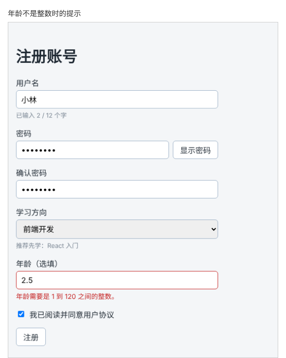

# 第 44 章：如何处理可以暂时留空的数字输入框？

前置：[第 43 章：如何让错误提示与对应的输入框关联？](第043章-如何让错误提示与对应的输入框关联.md)

## 一、本章要解决的问题

注册表单要加一个“年龄（选填）”。年龄是数字，可以不填；填了的话，必须是 1 到 120 之间的整数。

看起来只要 `useState(0)` 再把输入转成数字就行，但会遇到几个问题：输入框一开始就显示一个 0，用户还得先删掉它；删光内容时数字变成了 0，分不清“没填”和“填了 0”；输入到一半的“1.”无法保存成数字。

本章用字符串保存输入框的内容，提交时再转换和检查。完成后：年龄可以空着提交，成功信息中显示“年龄：未填写”；填写“20”，显示“年龄：20 岁”；填写“abc”“2.5”或“200”，提示“年龄需要是 1 到 120 之间的整数。”。

本章完成后，年龄填写“2.5”并提交时，页面显示的提示如下图：



## 二、必要原理

### 输入框的内容永远是字符串

`event.target.value` 永远是字符串，即使用户输入的是数字，得到的也是 `'20'` 而不是 `20`。输入框中显示的也是字符串。

所以**用字符串 state 保存输入框的内容**：

```tsx
const [ageText, setAgeText] = useState('');
```

- 空字符串 `''` 就表示“没填”，输入框一开始是空的；
- 输入过程中的任何中间状态（例如“1.”）都能原样保存，用户的输入不会被程序改掉。

变量名用 `ageText`，提醒自己这是文字，不是真正的年龄数字。

### 提交时再转换成数字

`Number('20')` 把字符串转换成数字 20。转换不了的内容，例如 `Number('abc')`，结果是 `NaN`（Not a Number，“不是一个数字”）。

`Number.isInteger(值)` 判断一个值是否是整数：`20` 是，`2.5`、`NaN` 都不是。所以一个条件就能同时排除“不是数字”和“有小数”：

```tsx
const age = Number(ageText);
if (!Number.isInteger(age) || age < 1 || age > 120) {
  nextErrors.age = '年龄需要是 1 到 120 之间的整数。';
}
```

`||` 是“或”：三个条件中有一个成立，就是错误。

检查之前先判断是否为空：`ageText.trim() === ''` 时不检查，记为“未填写”。注意：`Number('')` 的结果是 0，如果不先判断，空着就会被当成“填了 0”。

### 为什么不用 type="number"

HTML 有专门的数字输入框 `<input type="number">`，但它有几个让新手困惑的行为：输入“1e”这类不完整的内容时，它报告的值是空字符串，程序无法区分“没填”和“填错了”；在输入框上滚动鼠标滚轮会意外改变数字；浏览器还会自己弹出校验提示，和页面上的错误提示重复。

本章改用普通输入框加上 `inputMode="numeric"`：在手机上，弹出的是数字键盘，方便输入；输入什么都原样交给程序，由我们统一检查。

## 三、动手实现

### 第 1 步：增加类型、state 和处理函数

打开 `src/pages/RegisterPage.tsx`，在 `FormErrors` 类型的最后加一行：

```tsx
  age?: string;
```

在 `direction` 那一行的下面加入：

```tsx
  const [ageText, setAgeText] = useState('');
```

在 `handleDirectionChange` 的下面加入：

```tsx
  function handleAgeChange(event: ChangeEvent<HTMLInputElement>) {
    setAgeText(event.target.value);
  }
```

### 第 2 步：在提交时检查年龄

在 `handleSubmit` 中检查学习方向的 `if` 后面加入：

```tsx
    let ageNote = '未填写';
    if (ageText.trim() !== '') {
      const age = Number(ageText);
      if (!Number.isInteger(age) || age < 1 || age > 120) {
        nextErrors.age = '年龄需要是 1 到 120 之间的整数。';
      } else {
        ageNote = age + ' 岁';
      }
    }
```

`ageNote` 记录要在成功信息中显示的文字，默认“未填写”，填写正确时改为“20 岁”这样的文字。

把最后一行成功信息改为：

```tsx
    setMessage('注册成功，欢迎你，' + username.trim() + '！年龄：' + ageNote + '。');
```

### 第 3 步：添加年龄输入框

在学习方向所在的 `<div className={styles.field}>……</div>` 后面、复选框的前面加入：

```tsx
        <div className={styles.field}>
          <label htmlFor="age">年龄（选填）</label>
          <input
            id="age"
            inputMode="numeric"
            value={ageText}
            onChange={handleAgeChange}
            aria-invalid={errors.age !== undefined}
            aria-describedby={errors.age ? 'age-error' : undefined}
          />
          {errors.age && (
            <p id="age-error" className={styles.error}>
              {errors.age}
            </p>
          )}
        </div>
```

和第 43 章一样，错误提示与输入框关联。

## 四、运行与检查

保持开发服务器运行（`npm.cmd run dev`），保存文件后在浏览器中查看。先把用户名、两次密码、学习方向都填好，并勾选同意。

1. 年龄空着，提交，成功信息为“注册成功，欢迎你，小林！年龄：未填写。”。
2. 年龄填“20”，提交，成功信息中是“年龄：20 岁”。
3. 分别填“abc”“2.5”“0”“200”，每次提交都提示“年龄需要是 1 到 120 之间的整数。”，边框变红，没有成功信息。
4. 填“ 25 ”（前后带空格），提交成功，显示“25 岁”。`Number` 会忽略首尾的空格。
5. 删光年龄的内容，输入框是空的，没有出现 0。
6. 在开发者工具的 Elements（元素）面板中选中年龄输入框，可以看到 `inputmode="numeric"`。数字键盘只在手机上才会弹出，电脑上（包括开发者工具的手机模式）看不到，这一项看到属性即可。

最后运行检查，应没有错误：

```powershell
npm.cmd run check
```

**小练习**：把年龄改成必填：空着时提示“请填写年龄。”。只需要修改 `handleSubmit` 中的一处判断。再把“（选填）”从标签中去掉。练习后恢复本章代码。

## 五、常见错误

| 现象 | 原因 | 怎么改 |
| --- | --- | --- |
| 输入框一开始显示 0，删不掉 | 用了 `useState(0)`，并把输入转成数字存进 state | 用字符串保存：`useState('')` |
| 年龄空着也提示错误 | 没有先判断是否为空，`Number('')` 得到 0，不在 1 到 120 之间 | 先判断 `ageText.trim() !== ''` |
| 输入“abc”也能通过检查 | 只检查了范围，`NaN < 1` 和 `NaN > 120` 都是 `false` | 加上 `!Number.isInteger(age)` |
| 输入“2.5”也能通过检查 | 用了 `Number.isNaN` 只排除了非数字 | 用 `Number.isInteger` 同时排除小数 |
| 成功信息显示“年龄：20 岁”，但输入的是“020” | `Number('020')` 得到 20，这是正常的转换结果 | 这是预期行为，按数字理解输入 |

## 六、本章完整代码

### `src/pages/RegisterPage.tsx`

```tsx
import { useState } from 'react';
import type { ChangeEvent, SubmitEvent } from 'react';
import styles from './RegisterPage.module.css';

type FormErrors = {
  username?: string;
  password?: string;
  confirmPassword?: string;
  direction?: string;
  age?: string;
};

export default function RegisterPage() {
  const [username, setUsername] = useState('');
  const [password, setPassword] = useState('');
  const [confirmPassword, setConfirmPassword] = useState('');
  const [showPassword, setShowPassword] = useState(false);
  const [direction, setDirection] = useState('');
  const [ageText, setAgeText] = useState('');
  const [agree, setAgree] = useState(false);
  const [errors, setErrors] = useState<FormErrors>({});
  const [message, setMessage] = useState('');

  function handleUsernameChange(event: ChangeEvent<HTMLInputElement>) {
    setUsername(event.target.value);
  }

  function handlePasswordChange(event: ChangeEvent<HTMLInputElement>) {
    setPassword(event.target.value);
  }

  function handleConfirmPasswordChange(event: ChangeEvent<HTMLInputElement>) {
    setConfirmPassword(event.target.value);
  }

  function handleDirectionChange(event: ChangeEvent<HTMLSelectElement>) {
    setDirection(event.target.value);
  }

  function handleAgeChange(event: ChangeEvent<HTMLInputElement>) {
    setAgeText(event.target.value);
  }

  function handleSubmit(event: SubmitEvent<HTMLFormElement>) {
    event.preventDefault();
    const nextErrors: FormErrors = {};
    if (username.trim() === '') {
      nextErrors.username = '请填写用户名。';
    }
    if (password === '') {
      nextErrors.password = '请填写密码。';
    }
    if (confirmPassword === '') {
      nextErrors.confirmPassword = '请再次输入密码。';
    } else if (confirmPassword !== password) {
      nextErrors.confirmPassword = '两次输入的密码不一致。';
    }
    if (direction === '') {
      nextErrors.direction = '请选择学习方向。';
    }
    let ageNote = '未填写';
    if (ageText.trim() !== '') {
      const age = Number(ageText);
      if (!Number.isInteger(age) || age < 1 || age > 120) {
        nextErrors.age = '年龄需要是 1 到 120 之间的整数。';
      } else {
        ageNote = age + ' 岁';
      }
    }

    setErrors(nextErrors);
    if (Object.keys(nextErrors).length > 0) {
      setMessage('');
      return;
    }
    setMessage('注册成功，欢迎你，' + username.trim() + '！年龄：' + ageNote + '。');
  }

  return (
    <main className="page">
      <h1>注册账号</h1>
      <form className={styles.form} onSubmit={handleSubmit}>
        <div className={styles.field}>
          <label htmlFor="username">用户名</label>
          <input
            id="username"
            value={username}
            onChange={handleUsernameChange}
            aria-invalid={errors.username !== undefined}
            aria-describedby={errors.username ? 'username-error' : undefined}
          />
          <p className={styles.hint}>已输入 {username.length} / 12 个字</p>
          {errors.username && (
            <p id="username-error" className={styles.error}>
              {errors.username}
            </p>
          )}
        </div>
        <div className={styles.field}>
          <label htmlFor="password">密码</label>
          <div className={styles.passwordRow}>
            <input
              id="password"
              type={showPassword ? 'text' : 'password'}
              value={password}
              onChange={handlePasswordChange}
              aria-invalid={errors.password !== undefined}
              aria-describedby={errors.password ? 'password-error' : undefined}
            />
            <button type="button" onClick={() => setShowPassword(!showPassword)}>
              {showPassword ? '隐藏密码' : '显示密码'}
            </button>
          </div>
          {errors.password && (
            <p id="password-error" className={styles.error}>
              {errors.password}
            </p>
          )}
        </div>
        <div className={styles.field}>
          <label htmlFor="confirm-password">确认密码</label>
          <input
            id="confirm-password"
            type={showPassword ? 'text' : 'password'}
            value={confirmPassword}
            onChange={handleConfirmPasswordChange}
            aria-invalid={errors.confirmPassword !== undefined}
            aria-describedby={errors.confirmPassword ? 'confirm-password-error' : undefined}
          />
          {errors.confirmPassword && (
            <p id="confirm-password-error" className={styles.error}>
              {errors.confirmPassword}
            </p>
          )}
        </div>
        <div className={styles.field}>
          <label htmlFor="direction">学习方向</label>
          <select
            id="direction"
            value={direction}
            onChange={handleDirectionChange}
            aria-invalid={errors.direction !== undefined}
            aria-describedby={errors.direction ? 'direction-error' : undefined}
          >
            <option value="">请选择</option>
            <option value="frontend">前端开发</option>
            <option value="backend">后端开发</option>
            <option value="design">界面设计</option>
          </select>
          {direction === 'frontend' && <p className={styles.hint}>推荐先学：React 入门</p>}
          {direction === 'backend' && <p className={styles.hint}>推荐先学：Node.js 基础</p>}
          {direction === 'design' && <p className={styles.hint}>推荐先学：网页布局实战</p>}
          {errors.direction && (
            <p id="direction-error" className={styles.error}>
              {errors.direction}
            </p>
          )}
        </div>
        <div className={styles.field}>
          <label htmlFor="age">年龄（选填）</label>
          <input
            id="age"
            inputMode="numeric"
            value={ageText}
            onChange={handleAgeChange}
            aria-invalid={errors.age !== undefined}
            aria-describedby={errors.age ? 'age-error' : undefined}
          />
          {errors.age && (
            <p id="age-error" className={styles.error}>
              {errors.age}
            </p>
          )}
        </div>
        <label className={styles.checkbox}>
          <input
            type="checkbox"
            checked={agree}
            onChange={(event) => setAgree(event.target.checked)}
          />
          我已阅读并同意用户协议
        </label>
        <button type="submit" className={styles.submit} disabled={!agree}>
          注册
        </button>
      </form>
      {message && (
        <p role="status" className={styles.success}>
          {message}
        </p>
      )}
    </main>
  );
}
```

## 七、本章改动小结

修改 `src/pages/RegisterPage.tsx`：新增 state `ageText`、处理函数和年龄输入框，提交时把年龄转换为数字并检查范围，成功信息中显示年龄。

---

下一章：[第 44A 章：如何读取一组单选按钮中选中的项？](第044A章-如何读取一组单选按钮中选中的项.md)
