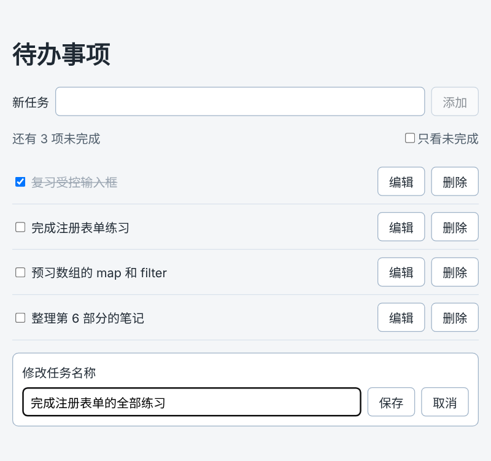

# 第 45 章：如何向列表添加一条任务？

前置：[第 44C 章：如何读取日期输入框中的日期？](第044C章-如何读取日期输入框中的日期.md)

## 一、本章要解决的问题

从本章开始做待办事项页。第 17 章的新闻列表只能看，数据写死在文件中；待办事项要能增加、删除、修改，数据会随用户的操作不断变化。

本章先做“添加”：输入一条任务，点击“添加”或按 Enter，它出现在列表的末尾，输入框随即清空。完成后，页面开始时有两条任务，可以一条一条地加上去。

本章是第 6 部分的起点。学完第 6 部分（第 45—54 章）时，待办事项页会变成下图的样子：可以添加、删除、改名、勾选完成、只看未完成，并显示未完成的数量。



## 二、必要原理

### 列表数据放进 state

任务会随操作变化，变化后页面要更新，所以任务数组要放进 state：

```tsx
const [tasks, setTasks] = useState<Task[]>(initialTasks);
```

初始值是数据文件中的两条任务。`useState<Task[]>` 写明 state 是任务数组，以后添加的新任务也必须符合 `Task` 类型。

### 不要修改原数组，而是创建一个新数组

往数组末尾加一项，JavaScript 有现成的 `push` 方法。但在 React 中，**不能对 state 中的数组使用 `push`**。

第 26 章说过，修改 state 必须调用 set 函数，React 才会重新渲染。React 判断“state 有没有变”的方法是：看新值和旧值**是不是同一个东西**。`push` 是在原数组上添加，数组还是原来那个数组，把它交给 `setTasks`，React 会认为“没有变化”，可能不更新页面。第 51 章会用实验演示这个问题。

正确的做法是创建一个**新数组**，包含原来的所有任务，再加上新任务：

```tsx
setTasks([...tasks, newTask]);
```

`...tasks` 叫**展开语法**：把 `tasks` 中的每一项依次取出来，放进新的方括号中。整句的意思是“一个新数组：先是原来的所有任务，最后是 `newTask`”。原来的 `tasks` 数组没有被修改。

### 每条任务需要一个唯一的 id

列表的 `key` 需要稳定且唯一的值（第 18 章）。用户可能添加两条同名的任务，标题不能当 `id`。浏览器自带的 `crypto.randomUUID()` 每次调用都会生成一个几乎不可能重复的随机字符串，例如 `'3b241101-e2bb-4255-8caf-4136c566a962'`，适合作为新数据的 `id`。

`id` 要在**创建任务时**生成一次并保存在任务中。不要在 `map` 中写 `key={crypto.randomUUID()}`，那样每次渲染都会得到新的 key，等于第 18 章说过的“随机数当 key”。

`crypto.randomUUID()` 只能在安全的网页环境中使用：`https` 网站，以及开发服务器的 `127.0.0.1`、`localhost` 地址都可以。

### 对象属性的简写

```tsx
const newTask: Task = { id: crypto.randomUUID(), title };
```

`title` 是 `title: title` 的简写：属性名和变量名相同时，可以只写一次。

## 三、动手实现

### 第 1 步：准备任务数据

新建 `src/data/tasks.ts`：

```ts
export type Task = {
  id: string;
  title: string;
};

export const initialTasks: Task[] = [
  { id: 'task-1', title: '复习受控输入框' },
  { id: 'task-2', title: '完成注册表单练习' },
];
```

初始数据的 `id` 是手写的固定值，新添加的任务再用 `crypto.randomUUID()` 生成。

### 第 2 步：添加样式

在 `src/pages` 中新建 `TaskPage.module.css`：

```css
.addForm {
  display: flex;
  flex-wrap: wrap;
  align-items: center;
  gap: 8px;
}

.addForm input,
.editor input {
  flex: 1;
  min-width: 0;
  padding: 8px 10px;
  border: 1px solid #9fb3c8;
  border-radius: 6px;
  font: inherit;
}

.list {
  margin: 16px 0 0;
  padding: 0;
  list-style: none;
}

.item {
  display: flex;
  align-items: center;
  gap: 8px;
  padding: 10px 0;
  border-bottom: 1px solid #d9e2ec;
}

.title {
  flex: 1;
  overflow-wrap: anywhere;
}
```

`.editor input` 是给第 47 章的编辑区准备的。每条任务（`.item`）用 Flex 横向排列，标题（`.title`）占满剩余宽度，以后的按钮排在右边。

### 第 3 步：新建待办事项页

在 `src/pages` 中新建 `TaskPage.tsx`：

```tsx
import { useState } from 'react';
import type { ChangeEvent, SubmitEvent } from 'react';
import { initialTasks } from '../data/tasks';
import type { Task } from '../data/tasks';
import styles from './TaskPage.module.css';

export default function TaskPage() {
  const [tasks, setTasks] = useState<Task[]>(initialTasks);
  const [newTitle, setNewTitle] = useState('');

  function handleNewTitleChange(event: ChangeEvent<HTMLInputElement>) {
    setNewTitle(event.target.value);
  }

  function handleAdd(event: SubmitEvent<HTMLFormElement>) {
    event.preventDefault();
    const title = newTitle.trim();
    if (title === '') {
      return;
    }
    const newTask: Task = { id: crypto.randomUUID(), title };
    setTasks([...tasks, newTask]);
    setNewTitle('');
  }

  return (
    <main className="page">
      <h1>待办事项</h1>
      <form className={styles.addForm} onSubmit={handleAdd}>
        <label htmlFor="new-task">新任务</label>
        <input id="new-task" value={newTitle} onChange={handleNewTitleChange} />
        <button type="submit" disabled={newTitle.trim() === ''}>
          添加
        </button>
      </form>
      <ul className={styles.list}>
        {tasks.map((task) => (
          <li key={task.id} className={styles.item}>
            <span className={styles.title}>{task.title}</span>
          </li>
        ))}
      </ul>
    </main>
  );
}
```

这里用到的都是前面学过的写法：输入框是受控的（第 35 章），添加用表单提交（第 40 章），输入为空时禁用按钮（第 38 章）。`handleAdd` 中也检查了一次空值，这样即使以后去掉了按钮的禁用，也不会添加空任务。

新的内容只有 `setTasks([...tasks, newTask])` 这一行。

### 第 4 步：让 App 显示待办事项页

修改 `src/App.tsx`：

```tsx
import './App.css';
import TaskPage from './pages/TaskPage';

export default function App() {
  return <TaskPage />;
}
```

## 四、运行与检查

保持开发服务器运行（`npm.cmd run dev`），保存文件后在浏览器中查看。

1. 页面显示“待办事项”，下方有两条任务。“添加”按钮是半透明的，因为输入框为空。
2. 输入“写第 45 章的练习”，点击“添加”，这条任务出现在列表最后，输入框被清空。
3. 再输入一条，按 Enter，同样添加成功。
4. 输入一条和已有任务同名的任务并添加，两条同名任务都显示，没有警告。它们的 `id` 不同。
5. 打开 React 开发者工具（第 33 章），选中 `TaskPage`，第一个 `State` 是任务数组，展开后可以看到新任务的 `id` 是一长串随机字符。
6. 刷新页面，又只剩开始的两条任务。数据只保存在浏览器内存中，保存到服务器要到第 86 章。

最后运行检查，应没有错误：

```powershell
npm.cmd run check
```

**小练习**：把新任务添加到列表的**最前面**。（提示：只需要调整展开语法中两部分的顺序。）练习后恢复本章代码。

## 五、常见错误

| 现象 | 原因 | 怎么改 |
| --- | --- | --- |
| 写成 `tasks.push(newTask); setTasks(tasks);` 后看起来也能用 | 列表能显示出来，是因为同时清空输入框引起了重新渲染，只是巧合；换一种写法就可能不更新（第 51 章） | 创建新数组：`setTasks([...tasks, newTask])` |
| 列表变成只有新添加的一条 | 写成了 `setTasks([newTask])`，漏了原来的任务 | 用 `...tasks` 带上原来的任务 |
| 页面空白，控制台报 `crypto.randomUUID is not a function` | 页面不是通过开发服务器的地址打开的，不在安全环境中 | 用 `http://127.0.0.1:5173/` 打开页面 |
| 编辑器提示新任务缺少属性 | `newTask` 中漏写了 `Task` 类型要求的属性 | 对照 `Task` 类型补全 |

## 六、本章完整代码

### `src/data/tasks.ts`

内容同第三节第 1 步。

### `src/pages/TaskPage.module.css`

内容同第三节第 2 步。

### `src/pages/TaskPage.tsx`

内容同第三节第 3 步。

### `src/App.tsx`

内容同第三节第 4 步。

## 七、本章改动小结

新增 `src/data/tasks.ts`、`src/pages/TaskPage.tsx`、`src/pages/TaskPage.module.css`；修改 `src/App.tsx`，改为显示待办事项页。

---

下一章：[第 46 章：如何删除指定的任务？](第046章-如何删除指定的任务.md)
