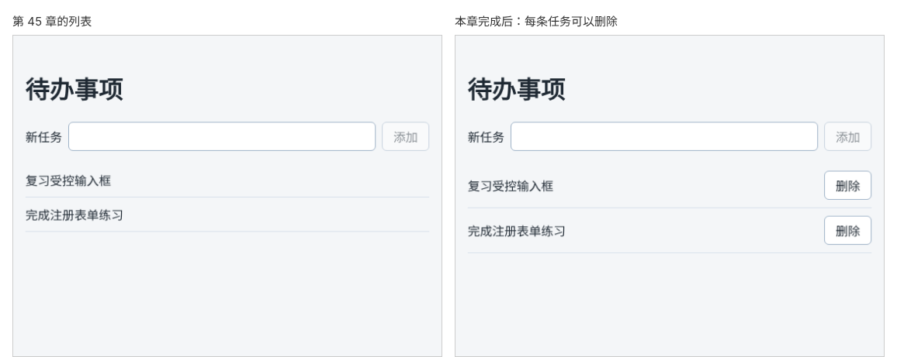

# 第 46 章：如何删除指定的任务？

前置：[第 45 章：如何向列表添加一条任务？](第045章-如何向列表添加一条任务.md)

## 一、本章要解决的问题

上一章的待办事项页只能添加，不能删除。加错了一条、或者某件事不用做了，都没有办法把它去掉。

本章在每条任务的右边放一个“删除”按钮，点击后只删掉这一条，其他任务保持原来的顺序。

下图左边是现在的列表，右边是本章完成后的列表：



## 二、必要原理

### 删除也是创建新数组

上一章说过，不能直接修改 state 中的数组，要给 set 函数一个新数组。删除也一样：不要在原数组上删，而是创建一个“除了要删的那一条，其他都在”的新数组。

数组的 `filter` 方法正好做这件事。它逐项检查数组，回调函数返回 `true` 的项留下，返回 `false` 的项去掉，最后返回一个**新数组**，原数组不变：

```tsx
setTasks(tasks.filter((task) => task.id !== id));
```

读作：“留下 id 不等于要删除的 id 的任务”。要删的那条返回 `false`，被去掉；其他任务都返回 `true`，按原来的顺序留下。

JavaScript 还有一个 `splice` 方法可以从数组中删除元素，但它会修改原数组，和 `push` 一样不能用在 state 上。

### 按 id 删除，不按位置删除

为什么用 `id` 判断，而不是用第几条？以后加入“只看未完成”（第 49 章）后，页面上看到的第 2 条，在完整数组中可能是第 3 条。用位置删除很容易删错；`id` 唯一且不会变，不会出这种问题。

### 给按钮传参数

`onClick` 需要一个函数。每个删除按钮要删的任务不同，所以写成箭头函数，在点击时再调用 `handleDelete` 并传入这条任务的 `id`：

```tsx
onClick={() => handleDelete(task.id)}
```

第 29 章给问题按钮传 `faq.id` 用的也是这种写法。注意不能写成 `onClick={handleDelete(task.id)}`，那会在渲染时立刻执行删除。

### 让读屏软件分得清每个按钮

每条任务的按钮文字都是“删除”，使用读屏软件的人按 Tab 键逐个听到的都是“删除，按钮”，不知道删的是哪一条。`aria-label` 可以给按钮一个更完整的名称：

```tsx
aria-label={'删除：' + task.title}
```

页面上看到的还是“删除”，读屏软件读出的是“删除：复习受控输入框”。

## 三、动手实现

### 第 1 步：写删除函数

在 `src/pages/TaskPage.tsx` 的 `handleAdd` 函数后面加入：

```tsx
  function handleDelete(id: string) {
    setTasks(tasks.filter((task) => task.id !== id));
  }
```

### 第 2 步：在每条任务后面放删除按钮

在 `<li>` 中、标题 `<span>` 的后面加入按钮：

```tsx
            <span className={styles.title}>{task.title}</span>
            <button
              type="button"
              aria-label={'删除：' + task.title}
              onClick={() => handleDelete(task.id)}
            >
              删除
            </button>
```

`.item` 是 Flex 布局，标题占满剩余宽度，按钮自然排在最右边。按钮不在表单中，写 `type="button"` 是为了以后即使把它放进表单，也不会意外提交（第 40 章）。

## 四、运行与检查

保持开发服务器运行（`npm.cmd run dev`），保存文件后在浏览器中查看。

1. 每条任务右边有一个“删除”按钮。
2. 点击第 1 条“复习受控输入框”的删除按钮，只有这一条消失，“完成注册表单练习”变成第 1 条。
3. 添加两条新任务，删除中间那一条，前后两条都还在，顺序不变。
4. 把所有任务都删掉，列表变空。这时页面上只剩输入框，第 49 章会给空列表加上提示。
5. 打开 React 开发者工具，删除一条任务后查看 `TaskPage` 的第一个 `State`，数组少了一项。
6. 在浏览器开发者工具的 Elements（元素）面板中选中一个删除按钮，在右侧的 Accessibility 中查看 Name，应为“删除：”加上这条任务的标题。

最后运行检查，应没有错误：

```powershell
npm.cmd run check
```

**小练习**：在任务标题后面再放一个“置顶”按钮，点击后把这条任务移到列表最前面。（提示：写一个 `handlePin(task: Task)`，先用 `filter` 得到去掉这条任务的数组，再用展开语法把 `task` 放在新数组的最前面。）练习后恢复本章代码。

## 五、常见错误

| 现象 | 原因 | 怎么改 |
| --- | --- | --- |
| 页面一打开任务就全没了 | 写成了 `onClick={handleDelete(task.id)}`，渲染时就执行了删除 | 写成 `onClick={() => handleDelete(task.id)}` |
| 点击删除后只剩被点击的那一条 | 判断写反了：`task.id === id` | 留下的是 id **不相等**的任务：`task.id !== id` |
| 编辑器提示 `handleDelete` 缺少参数 | 写成了 `onClick={handleDelete}` | 用箭头函数传入 `task.id` |
| 用 `splice` 删除后页面有时不更新 | `splice` 修改了原数组，没有产生新数组 | 改用 `filter` |

## 六、本章完整代码

### `src/pages/TaskPage.tsx`

```tsx
import { useState } from 'react';
import type { ChangeEvent, SubmitEvent } from 'react';
import { initialTasks } from '../data/tasks';
import type { Task } from '../data/tasks';
import styles from './TaskPage.module.css';

export default function TaskPage() {
  const [tasks, setTasks] = useState<Task[]>(initialTasks);
  const [newTitle, setNewTitle] = useState('');

  function handleNewTitleChange(event: ChangeEvent<HTMLInputElement>) {
    setNewTitle(event.target.value);
  }

  function handleAdd(event: SubmitEvent<HTMLFormElement>) {
    event.preventDefault();
    const title = newTitle.trim();
    if (title === '') {
      return;
    }
    const newTask: Task = { id: crypto.randomUUID(), title };
    setTasks([...tasks, newTask]);
    setNewTitle('');
  }

  function handleDelete(id: string) {
    setTasks(tasks.filter((task) => task.id !== id));
  }

  return (
    <main className="page">
      <h1>待办事项</h1>
      <form className={styles.addForm} onSubmit={handleAdd}>
        <label htmlFor="new-task">新任务</label>
        <input id="new-task" value={newTitle} onChange={handleNewTitleChange} />
        <button type="submit" disabled={newTitle.trim() === ''}>
          添加
        </button>
      </form>
      <ul className={styles.list}>
        {tasks.map((task) => (
          <li key={task.id} className={styles.item}>
            <span className={styles.title}>{task.title}</span>
            <button
              type="button"
              aria-label={'删除：' + task.title}
              onClick={() => handleDelete(task.id)}
            >
              删除
            </button>
          </li>
        ))}
      </ul>
    </main>
  );
}
```

## 七、本章改动小结

修改 `src/pages/TaskPage.tsx`：加入 `handleDelete` 和每条任务的删除按钮。

---

下一章：[第 47 章：如何修改任务名称？](第047章-如何修改任务名称.md)
