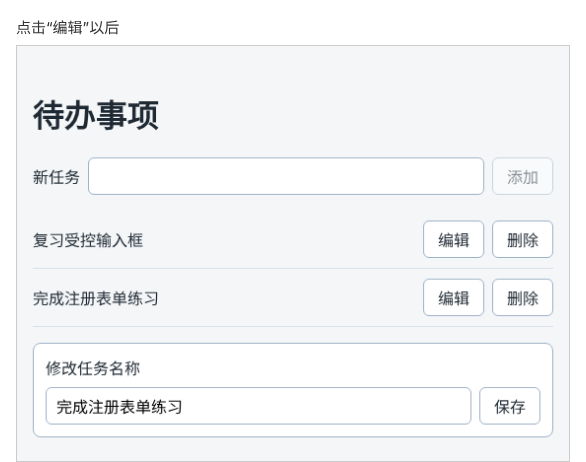

# 第 47 章：如何修改任务名称？

前置：[第 46 章：如何删除指定的任务？](第046章-如何删除指定的任务.md)

## 一、本章要解决的问题

任务名称写错了一个字，现在只能删掉重新添加，原来的位置也丢了。

本章给每条任务加一个“编辑”按钮。点击后，列表下方出现一个编辑框，里面是这条任务的当前名称；修改后点击“保存”或按 Enter，列表中这条任务的名称随之改变，位置不变，编辑框关闭。

本章完成后，点击某条任务的“编辑”，下方出现的编辑框如下图：



## 二、必要原理

### 需要记住哪些东西

编辑功能要多记两件事：

- **正在编辑哪一条**：`editingId`，没有在编辑时是 `null`，所以类型写成 `string | null`（第 29 章学过的联合类型）。
- **编辑框中正在输入的内容**：`editDraft`，一个普通的受控输入框的值。

为什么不直接在输入时修改 `tasks` 中的标题？因为用户可能输入到一半就不想改了。输入期间只改 `editDraft`，点击保存时才把它写回任务，列表在保存前保持原样。第 52 章加“取消”按钮时，这种分开存放的好处就会体现出来。

点击“编辑”时，把这条任务的 `id` 和当前标题分别放进这两个 state：

```tsx
setEditingId(task.id);
setEditDraft(task.title);
```

### 修改一项：`map` 加对象展开

要改的是数组中某一个对象的某一个属性。和添加、删除一样，不能直接改原来的对象，要创建新数组，并为被修改的那一项创建新对象。

`map` 逐项处理并返回新数组：不是要改的那一条，原样返回；是要改的那一条，返回一个新对象：

```tsx
tasks.map((task) => (task.id === editingId ? { ...task, title } : task))
```

`{ ...task, title }` 是**对象展开**：先把 `task` 的所有属性复制到新对象中，再用后面的 `title` 覆盖同名属性。结果是一个新对象，`id` 不变，`title` 换成新值，原来的 `task` 对象没有被修改。以后任务加了别的属性（下一章会加 `completed`），这句也不用改，展开时会一起复制过去。

这一行用了条件运算符（第 21 章），外面包一层圆括号，是为了在箭头函数中直接返回它的结果。

### 删除正在编辑的任务

如果正在编辑某条任务时把它删除了，编辑框就没有对应的任务了。所以在 `handleDelete` 中加一个判断：删除的正好是正在编辑的那条，就把 `editingId` 设回 `null`，关闭编辑框。

## 三、动手实现

### 第 1 步：添加编辑框的样式

在 `src/pages/TaskPage.module.css` 末尾加入：

```css
.editor {
  display: flex;
  flex-wrap: wrap;
  align-items: center;
  gap: 8px;
  margin-top: 16px;
  padding: 12px;
  border: 1px solid #9fb3c8;
  border-radius: 8px;
  background: #ffffff;
}

.editor label {
  flex-basis: 100%;
}
```

输入框的样式在第 45 章已经写在 `.editor input` 中。`flex-basis: 100%` 让标签单独占一行。

### 第 2 步：加入两个 state

在 `src/pages/TaskPage.tsx` 中 `newTitle` 的下面加入：

```tsx
  const [editingId, setEditingId] = useState<string | null>(null);
  const [editDraft, setEditDraft] = useState('');
```

### 第 3 步：编写开始编辑和保存的函数

把 `handleDelete` 改为下面的内容，并在它后面加入三个函数：

```tsx
  function handleDelete(id: string) {
    setTasks(tasks.filter((task) => task.id !== id));
    if (id === editingId) {
      setEditingId(null);
    }
  }

  function handleStartEdit(task: Task) {
    setEditingId(task.id);
    setEditDraft(task.title);
  }

  function handleEditDraftChange(event: ChangeEvent<HTMLInputElement>) {
    setEditDraft(event.target.value);
  }

  function handleSaveEdit(event: SubmitEvent<HTMLFormElement>) {
    event.preventDefault();
    const title = editDraft.trim();
    if (title === '') {
      return;
    }
    setTasks(tasks.map((task) => (task.id === editingId ? { ...task, title } : task)));
    setEditingId(null);
  }
```

保存前同样去掉首尾空格，并拒绝空名称，和添加时的规则一致。

### 第 4 步：加入编辑按钮和编辑框

在删除按钮的前面加入编辑按钮：

```tsx
            <button type="button" onClick={() => handleStartEdit(task)}>
              编辑
            </button>
```

在 `</ul>` 的后面、`</main>` 的前面加入编辑框：

```tsx
      {editingId !== null && (
        <form className={styles.editor} onSubmit={handleSaveEdit}>
          <label htmlFor="edit-task">修改任务名称</label>
          <input id="edit-task" value={editDraft} onChange={handleEditDraftChange} />
          <button type="submit" disabled={editDraft.trim() === ''}>
            保存
          </button>
        </form>
      )}
```

只有 `editingId` 不是 `null` 时才显示编辑框（第 21 章的 `&&`）。

## 四、运行与检查

保持开发服务器运行（`npm.cmd run dev`），保存文件后在浏览器中查看。

1. 每条任务右边有“编辑”和“删除”两个按钮，页面下方没有编辑框。
2. 点击“完成注册表单练习”的“编辑”，下方出现编辑框，输入框中是“完成注册表单练习”。
3. 把它改成“完成注册表单的全部练习”，按 Enter。列表中第 2 条的名称变了，仍在第 2 位，编辑框消失。
4. 再次编辑同一条，清空输入框，“保存”按钮变成半透明，不能保存。
5. 点击编辑后，在编辑框中输入几个字但不保存，列表中的名称保持不变。
6. 点击某条任务的“编辑”，再点击这条任务的“删除”，编辑框随之消失。
7. 在 React 开发者工具中查看 `TaskPage` 的 state：点击编辑后，`editingId` 对应的 `State` 变成这条任务的 `id`。

最后运行检查，应没有错误：

```powershell
npm.cmd run check
```

**小练习**：把 `{ ...task, title }` 改成 `{ title, ...task }`，保存后运行 `npm.cmd run check`，TypeScript 会提示 `title` 被指定了多次、会被覆盖。不管这个提示，回到页面修改一次名称，名称还会变吗？想想为什么。练习后恢复本章代码。

## 五、常见错误

| 现象 | 原因 | 怎么改 |
| --- | --- | --- |
| 保存后名称没有变 | 展开写在了后面：`{ title, ...task }`，原来的标题又把新标题覆盖了 | 先展开，再写要覆盖的属性：`{ ...task, title }` |
| 保存后其他任务全变成了 `undefined` | `map` 的回调中，不需要修改的任务没有返回 | 条件运算符的另一边返回 `task` |
| 保存后所有任务的名称都变成一样的 | 判断条件写错，例如 `task.id !== editingId` 或漏了判断 | 只有 `task.id === editingId` 的那一条返回新对象 |
| 编辑框中输入一个字，列表中的名称跟着变 | 在输入时直接修改了 `tasks` | 输入时只改 `editDraft`，保存时再写回 |
| 编辑器在 `setEditingId(task.id)` 处提示 `string` 类型的参数不能赋给 `null` | 写成了 `useState(null)`，TypeScript 推断它只能是 `null` | 写明类型：`useState<string \| null>(null)` |

## 六、本章完整代码

### `src/pages/TaskPage.module.css`

```css
.addForm {
  display: flex;
  flex-wrap: wrap;
  align-items: center;
  gap: 8px;
}

.addForm input,
.editor input {
  flex: 1;
  min-width: 0;
  padding: 8px 10px;
  border: 1px solid #9fb3c8;
  border-radius: 6px;
  font: inherit;
}

.list {
  margin: 16px 0 0;
  padding: 0;
  list-style: none;
}

.item {
  display: flex;
  align-items: center;
  gap: 8px;
  padding: 10px 0;
  border-bottom: 1px solid #d9e2ec;
}

.title {
  flex: 1;
  overflow-wrap: anywhere;
}

.editor {
  display: flex;
  flex-wrap: wrap;
  align-items: center;
  gap: 8px;
  margin-top: 16px;
  padding: 12px;
  border: 1px solid #9fb3c8;
  border-radius: 8px;
  background: #ffffff;
}

.editor label {
  flex-basis: 100%;
}
```

### `src/pages/TaskPage.tsx`

```tsx
import { useState } from 'react';
import type { ChangeEvent, SubmitEvent } from 'react';
import { initialTasks } from '../data/tasks';
import type { Task } from '../data/tasks';
import styles from './TaskPage.module.css';

export default function TaskPage() {
  const [tasks, setTasks] = useState<Task[]>(initialTasks);
  const [newTitle, setNewTitle] = useState('');
  const [editingId, setEditingId] = useState<string | null>(null);
  const [editDraft, setEditDraft] = useState('');

  function handleNewTitleChange(event: ChangeEvent<HTMLInputElement>) {
    setNewTitle(event.target.value);
  }

  function handleAdd(event: SubmitEvent<HTMLFormElement>) {
    event.preventDefault();
    const title = newTitle.trim();
    if (title === '') {
      return;
    }
    const newTask: Task = { id: crypto.randomUUID(), title };
    setTasks([...tasks, newTask]);
    setNewTitle('');
  }

  function handleDelete(id: string) {
    setTasks(tasks.filter((task) => task.id !== id));
    if (id === editingId) {
      setEditingId(null);
    }
  }

  function handleStartEdit(task: Task) {
    setEditingId(task.id);
    setEditDraft(task.title);
  }

  function handleEditDraftChange(event: ChangeEvent<HTMLInputElement>) {
    setEditDraft(event.target.value);
  }

  function handleSaveEdit(event: SubmitEvent<HTMLFormElement>) {
    event.preventDefault();
    const title = editDraft.trim();
    if (title === '') {
      return;
    }
    setTasks(tasks.map((task) => (task.id === editingId ? { ...task, title } : task)));
    setEditingId(null);
  }

  return (
    <main className="page">
      <h1>待办事项</h1>
      <form className={styles.addForm} onSubmit={handleAdd}>
        <label htmlFor="new-task">新任务</label>
        <input id="new-task" value={newTitle} onChange={handleNewTitleChange} />
        <button type="submit" disabled={newTitle.trim() === ''}>
          添加
        </button>
      </form>
      <ul className={styles.list}>
        {tasks.map((task) => (
          <li key={task.id} className={styles.item}>
            <span className={styles.title}>{task.title}</span>
            <button type="button" onClick={() => handleStartEdit(task)}>
              编辑
            </button>
            <button
              type="button"
              aria-label={'删除：' + task.title}
              onClick={() => handleDelete(task.id)}
            >
              删除
            </button>
          </li>
        ))}
      </ul>
      {editingId !== null && (
        <form className={styles.editor} onSubmit={handleSaveEdit}>
          <label htmlFor="edit-task">修改任务名称</label>
          <input id="edit-task" value={editDraft} onChange={handleEditDraftChange} />
          <button type="submit" disabled={editDraft.trim() === ''}>
            保存
          </button>
        </form>
      )}
    </main>
  );
}
```

## 七、本章改动小结

修改 `src/pages/TaskPage.tsx`：加入 `editingId`、`editDraft` 两个 state，编辑按钮、编辑框和保存逻辑；修改 `src/pages/TaskPage.module.css`：加入编辑框样式。

---

下一章：[第 48 章：如何切换任务的完成状态？](第048章-如何切换任务的完成状态.md)
