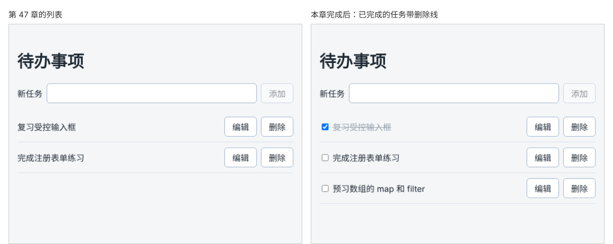

# 第 48 章：如何切换任务的完成状态？

前置：[第 47 章：如何修改任务名称？](第047章-如何修改任务名称.md)

## 一、本章要解决的问题

做完一件事，现在只能把它删掉，看不出哪些已经完成、哪些还没做。

本章给每条任务加一个复选框。勾选后任务名称变成灰色并加删除线，再点一次恢复。点击任务名称的文字也能勾选，不必瞄准那个小方框。

下图左边是现在的列表，右边是本章完成后的列表：



## 二、必要原理

### 给任务加一个字段

“是否完成”是每条任务自己的信息，应当放在任务对象中，作为新字段 `completed`：

```ts
export type Task = {
  id: string;
  title: string;
  completed: boolean;
};
```

类型改了之后，所有创建 `Task` 的地方都必须写上 `completed`，否则 TypeScript 会报错。这正好帮我们找出要改的地方：初始数据和 `handleAdd` 中的新任务。新添加的任务当然是未完成的，写 `completed: false`。

### 切换：和上一章的修改是同一种写法

切换完成状态，就是把某一条任务的 `completed` 改成相反的值。和上一章修改标题一样，用 `map` 找到这一条，返回展开后覆盖了属性的新对象：

```tsx
tasks.map((task) => (task.id === id ? { ...task, completed: !task.completed } : task))
```

`!task.completed` 取反：原来是 `true` 得到 `false`，原来是 `false` 得到 `true`。注意这里要写成 `completed: 值` 的完整形式，因为没有一个叫 `completed` 的变量可以简写。

添加、删除、修改三种操作，到这里都学全了：

| 操作 | 写法 |
| --- | --- |
| 添加 | `[...tasks, newTask]` |
| 删除 | `tasks.filter((task) => task.id !== id)` |
| 修改一项 | `tasks.map((task) => (task.id === id ? { ...task, 要改的属性 } : task))` |

它们都返回新数组，原来的 `tasks` 保持不变。这张表在第 10 部分把数据保存到服务器时还会用到。

### 复选框写在 label 里面

第 38 章的复选框用 `htmlFor` 和 `id` 与标签关联。每条任务都要一个复选框，一个个起 `id` 比较麻烦。另一种关联方式是把输入框直接写在 `<label>` 里面：

```tsx
<label>
  <input type="checkbox" ... />
  {task.title}
</label>
```

这样点击标签中的文字，等于点击复选框，读屏软件也会把任务名称读作复选框的名称。

### 同时使用两个类名

完成的任务要同时有 `.title`（占满剩余宽度）和 `.done`（灰色、删除线）两个样式。`className` 中写多个类名时用空格分开，所以把两个类名拼成一个字符串：

```tsx
className={task.completed ? styles.title + ' ' + styles.done : styles.title}
```

中间的 `' '` 不能少，否则两个类名会连成一个不存在的类名。

## 三、动手实现

### 第 1 步：给任务数据加上完成状态

把 `src/data/tasks.ts` 改为：

```ts
export type Task = {
  id: string;
  title: string;
  completed: boolean;
};

export const initialTasks: Task[] = [
  { id: 'task-1', title: '复习受控输入框', completed: true },
  { id: 'task-2', title: '完成注册表单练习', completed: false },
  { id: 'task-3', title: '预习数组的 map 和 filter', completed: false },
];
```

多加了第 3 条任务，并让第 1 条一开始就是已完成的，方便后面几章检查效果。

### 第 2 步：添加完成状态的样式

在 `src/pages/TaskPage.module.css` 末尾加入：

```css
.title input {
  margin-right: 8px;
}

.done {
  color: #9aa5b1;
  text-decoration: line-through;
}
```

### 第 3 步：新任务默认未完成

在 `src/pages/TaskPage.tsx` 的 `handleAdd` 中，把创建新任务的一行改为：

```tsx
    const newTask: Task = { id: crypto.randomUUID(), title, completed: false };
```

### 第 4 步：编写切换函数

在 `handleDelete` 函数的后面加入：

```tsx
  function handleToggle(id: string) {
    setTasks(
      tasks.map((task) => (task.id === id ? { ...task, completed: !task.completed } : task)),
    );
  }
```

### 第 5 步：把标题换成带复选框的标签

把 `<li>` 中的 `<span className={styles.title}>{task.title}</span>` 替换为：

```tsx
            <label className={task.completed ? styles.title + ' ' + styles.done : styles.title}>
              <input
                type="checkbox"
                checked={task.completed}
                onChange={() => handleToggle(task.id)}
              />
              {task.title}
            </label>
```

复选框是受控的：勾没勾由 `task.completed` 决定（第 38 章）。这里不需要读取 `event.target.checked`，因为 `handleToggle` 直接把当前值取反。

## 四、运行与检查

保持开发服务器运行（`npm.cmd run dev`），保存文件后在浏览器中查看。

1. 列表有三条任务，第 1 条“复习受控输入框”已勾选，文字是灰色并带删除线。
2. 点击第 2 条的复选框，它变成已完成的样式；再点一次恢复。
3. 点击第 3 条的**文字**，复选框同样被勾选。
4. 添加一条新任务，它是未勾选的。
5. 勾选第 2 条后点击它的“编辑”，把名称改掉并保存，它仍然是已完成的。这是因为 `{ ...task, title }` 复制了原来的 `completed`。
6. 用 Tab 键移到某个复选框，按空格键也能切换。

最后运行检查，应没有错误：

```powershell
npm.cmd run check
```

**小练习**：暂时删掉第 3 步中的 `completed: false`，运行 `npm.cmd run check`，读一读 TypeScript 的提示。练习后恢复本章代码。

## 五、常见错误

| 现象 | 原因 | 怎么改 |
| --- | --- | --- |
| `check` 报错：属性 `completed` 缺失 | 修改了 `Task` 类型，但创建任务的地方没有加上 `completed` | 初始数据和 `handleAdd` 中都加上 `completed` |
| 已完成的任务没有占满宽度，按钮挤到了文字旁边 | 写成了 `className={styles.done}`，丢了 `.title` | 两个类名用空格拼在一起 |
| 已完成的任务没有任何样式 | 拼接时漏了空格：`styles.title + styles.done` | 中间加上 `' '` |
| 点击复选框没有反应，控制台提示 `checked` 没有 `onChange` | 只写了 `checked`，忘了写 `onChange` | 加上 `onChange={() => handleToggle(task.id)}` |
| 保存名称的那一行报错：缺少属性 `completed` | 修改标题时写成了 `{ id: task.id, title }`，丢了其他属性 | 用 `{ ...task, title }` 复制全部属性 |

## 六、本章完整代码

### `src/data/tasks.ts`

内容同第三节第 1 步。

### `src/pages/TaskPage.module.css`

```css
.addForm {
  display: flex;
  flex-wrap: wrap;
  align-items: center;
  gap: 8px;
}

.addForm input,
.editor input {
  flex: 1;
  min-width: 0;
  padding: 8px 10px;
  border: 1px solid #9fb3c8;
  border-radius: 6px;
  font: inherit;
}

.list {
  margin: 16px 0 0;
  padding: 0;
  list-style: none;
}

.item {
  display: flex;
  align-items: center;
  gap: 8px;
  padding: 10px 0;
  border-bottom: 1px solid #d9e2ec;
}

.title {
  flex: 1;
  overflow-wrap: anywhere;
}

.editor {
  display: flex;
  flex-wrap: wrap;
  align-items: center;
  gap: 8px;
  margin-top: 16px;
  padding: 12px;
  border: 1px solid #9fb3c8;
  border-radius: 8px;
  background: #ffffff;
}

.editor label {
  flex-basis: 100%;
}

.title input {
  margin-right: 8px;
}

.done {
  color: #9aa5b1;
  text-decoration: line-through;
}
```

### `src/pages/TaskPage.tsx`

```tsx
import { useState } from 'react';
import type { ChangeEvent, SubmitEvent } from 'react';
import { initialTasks } from '../data/tasks';
import type { Task } from '../data/tasks';
import styles from './TaskPage.module.css';

export default function TaskPage() {
  const [tasks, setTasks] = useState<Task[]>(initialTasks);
  const [newTitle, setNewTitle] = useState('');
  const [editingId, setEditingId] = useState<string | null>(null);
  const [editDraft, setEditDraft] = useState('');

  function handleNewTitleChange(event: ChangeEvent<HTMLInputElement>) {
    setNewTitle(event.target.value);
  }

  function handleAdd(event: SubmitEvent<HTMLFormElement>) {
    event.preventDefault();
    const title = newTitle.trim();
    if (title === '') {
      return;
    }
    const newTask: Task = { id: crypto.randomUUID(), title, completed: false };
    setTasks([...tasks, newTask]);
    setNewTitle('');
  }

  function handleDelete(id: string) {
    setTasks(tasks.filter((task) => task.id !== id));
    if (id === editingId) {
      setEditingId(null);
    }
  }

  function handleToggle(id: string) {
    setTasks(
      tasks.map((task) => (task.id === id ? { ...task, completed: !task.completed } : task)),
    );
  }

  function handleStartEdit(task: Task) {
    setEditingId(task.id);
    setEditDraft(task.title);
  }

  function handleEditDraftChange(event: ChangeEvent<HTMLInputElement>) {
    setEditDraft(event.target.value);
  }

  function handleSaveEdit(event: SubmitEvent<HTMLFormElement>) {
    event.preventDefault();
    const title = editDraft.trim();
    if (title === '') {
      return;
    }
    setTasks(tasks.map((task) => (task.id === editingId ? { ...task, title } : task)));
    setEditingId(null);
  }

  return (
    <main className="page">
      <h1>待办事项</h1>
      <form className={styles.addForm} onSubmit={handleAdd}>
        <label htmlFor="new-task">新任务</label>
        <input id="new-task" value={newTitle} onChange={handleNewTitleChange} />
        <button type="submit" disabled={newTitle.trim() === ''}>
          添加
        </button>
      </form>
      <ul className={styles.list}>
        {tasks.map((task) => (
          <li key={task.id} className={styles.item}>
            <label className={task.completed ? styles.title + ' ' + styles.done : styles.title}>
              <input
                type="checkbox"
                checked={task.completed}
                onChange={() => handleToggle(task.id)}
              />
              {task.title}
            </label>
            <button type="button" onClick={() => handleStartEdit(task)}>
              编辑
            </button>
            <button
              type="button"
              aria-label={'删除：' + task.title}
              onClick={() => handleDelete(task.id)}
            >
              删除
            </button>
          </li>
        ))}
      </ul>
      {editingId !== null && (
        <form className={styles.editor} onSubmit={handleSaveEdit}>
          <label htmlFor="edit-task">修改任务名称</label>
          <input id="edit-task" value={editDraft} onChange={handleEditDraftChange} />
          <button type="submit" disabled={editDraft.trim() === ''}>
            保存
          </button>
        </form>
      )}
    </main>
  );
}
```

## 七、本章改动小结

修改 `src/data/tasks.ts`：`Task` 加入 `completed` 字段，初始数据增加一条；修改 `src/pages/TaskPage.tsx`：加入 `handleToggle` 和复选框；修改 `src/pages/TaskPage.module.css`：加入已完成样式。

---

下一章：[第 49 章：如何只显示尚未完成的任务？](第049章-如何只显示尚未完成的任务.md)
