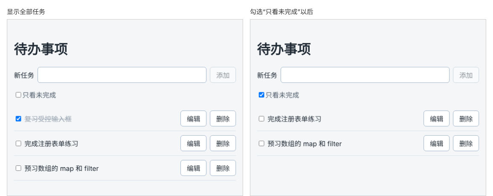

# 第 49 章：如何只显示尚未完成的任务？

前置：[第 48 章：如何切换任务的完成状态？](第048章-如何切换任务的完成状态.md)

## 一、本章要解决的问题

任务越来越多时，已完成的任务夹在中间，干扰查找还没做的事。

本章在列表上方加一个“只看未完成”复选框。勾选后列表中只剩未完成的任务，取消勾选又全部显示。如果没有需要显示的任务，显示一句“没有需要显示的任务。”，而不是一片空白。

下图左边是全部任务，右边是勾选“只看未完成”以后的样子：



## 二、必要原理

### 筛选不能改掉原来的数据

最容易想到的写法是：勾选时调用 `setTasks(tasks.filter(...))`，把已完成的任务从 state 中去掉。但这样已完成的任务就真的被删除了，取消勾选也回不来。

“只看未完成”只是**换一种方式查看**，数据本身没有变化。所以 `tasks` 保持不动，另外用一个 state 记住“是否只看未完成”：

```tsx
const [hideCompleted, setHideCompleted] = useState(false);
```

### 要显示的列表可以直接算出来

页面上要显示哪些任务，完全由 `tasks` 和 `hideCompleted` 决定。第 32 章说过，能从已有 state 计算出来的值，不要再放进 state，直接在渲染时计算：

```tsx
const visibleTasks = hideCompleted ? tasks.filter((task) => !task.completed) : tasks;
```

只看未完成时，用 `filter` 得到一个新数组；否则就是全部任务。`filter` 不会修改 `tasks`。

然后列表改为用 `visibleTasks.map(...)` 显示。勾选、编辑、删除时仍然修改 `tasks`，`visibleTasks` 在下一次渲染时自动重新计算。比如在“只看未完成”时勾选一条任务，它的 `completed` 变成 `true`，重新渲染时就被筛掉了，不需要另写代码。

如果把 `visibleTasks` 也放进 state，每次添加、删除、勾选都得记得同时更新两个 state，漏掉一处页面就会显示错误。

### 空列表显示提示

第 19 章学过列表为空时显示提示。这里判断的是**要显示的**列表 `visibleTasks`，而不是 `tasks`：全部任务都完成并勾选了“只看未完成”时，`tasks` 不为空，但页面上没有要显示的任务。

### 复选框的事件可以直接写在 JSX 中

“只看未完成”复选框的处理只有一行，可以直接写成箭头函数：

```tsx
onChange={(event) => setHideCompleted(event.target.checked)}
```

写在 JSX 中时，TypeScript 能自动推断出 `event` 的类型，不用像第 36 章那样写 `ChangeEvent<HTMLInputElement>`。处理逻辑超过一两行时，还是单独写成函数更清楚。

## 三、动手实现

### 第 1 步：添加工具栏和空提示的样式

在 `src/pages/TaskPage.module.css` 末尾加入：

```css
.toolbar {
  display: flex;
  flex-wrap: wrap;
  justify-content: space-between;
  gap: 8px;
  margin-top: 16px;
  color: #52606d;
}

.empty {
  color: #52606d;
}
```

`justify-content: space-between` 是给下一章准备的：工具栏左边放未完成数量，右边放这个复选框。

### 第 2 步：加入 state 和计算结果

在 `src/pages/TaskPage.tsx` 中 `editDraft` 的下面加入：

```tsx
  const [hideCompleted, setHideCompleted] = useState(false);
  const visibleTasks = hideCompleted ? tasks.filter((task) => !task.completed) : tasks;
```

### 第 3 步：加入工具栏，并改用 visibleTasks 显示

在添加表单的 `</form>` 后面加入工具栏：

```tsx
      <div className={styles.toolbar}>
        <label>
          <input
            type="checkbox"
            checked={hideCompleted}
            onChange={(event) => setHideCompleted(event.target.checked)}
          />
          只看未完成
        </label>
      </div>
```

再把原来整个 `<ul className={styles.list}>……</ul>` 改为下面的结构，`<li>` 中的内容不变：

```tsx
      {visibleTasks.length === 0 ? (
        <p className={styles.empty}>没有需要显示的任务。</p>
      ) : (
        <ul className={styles.list}>
          {visibleTasks.map((task) => (
            <li key={task.id} className={styles.item}>
              ……
            </li>
          ))}
        </ul>
      )}
```

改动有两处：外面套了一层条件运算符，`tasks.map` 换成了 `visibleTasks.map`。

## 四、运行与检查

保持开发服务器运行（`npm.cmd run dev`），保存文件后在浏览器中查看。

1. 列表上方有“只看未完成”复选框，三条任务都显示。
2. 勾选“只看未完成”，第 1 条“复习受控输入框”消失，剩下两条。
3. 保持勾选，点击“完成注册表单练习”的复选框，它立刻从列表中消失。
4. 取消勾选“只看未完成”，三条任务都回来了，前两条是已完成的样式。
5. 把第 3 条也勾选完成，再勾选“只看未完成”，列表位置显示“没有需要显示的任务。”。
6. 保持“只看未完成”，添加一条新任务，它显示出来，提示消失。
7. 取消勾选“只看未完成”，删除全部任务，同样显示提示。

最后运行检查，应没有错误：

```powershell
npm.cmd run check
```

**小练习**：再加一个“只看已完成”的效果：把 `hideCompleted` 换成一个三选一的下拉框（全部、未完成、已完成），用第 39 章的方法读取选项。练习后恢复本章代码。

## 五、常见错误

| 现象 | 原因 | 怎么改 |
| --- | --- | --- |
| 取消勾选后已完成的任务回不来了 | 勾选时用 `setTasks(tasks.filter(...))` 删掉了数据 | `tasks` 不动，只在显示时计算 `visibleTasks` |
| 勾选“只看未完成”后列表没有变化 | 列表仍在用 `tasks.map` | 改为 `visibleTasks.map` |
| 筛掉全部任务后页面空白，没有提示 | 判断的是 `tasks.length === 0` | 判断 `visibleTasks.length === 0` |
| 只看未完成时，列表中反而只剩已完成的 | `filter` 条件写反：`task.completed` | 未完成是 `!task.completed` |

## 六、本章完整代码

### `src/pages/TaskPage.module.css`

```css
.addForm {
  display: flex;
  flex-wrap: wrap;
  align-items: center;
  gap: 8px;
}

.addForm input,
.editor input {
  flex: 1;
  min-width: 0;
  padding: 8px 10px;
  border: 1px solid #9fb3c8;
  border-radius: 6px;
  font: inherit;
}

.list {
  margin: 16px 0 0;
  padding: 0;
  list-style: none;
}

.item {
  display: flex;
  align-items: center;
  gap: 8px;
  padding: 10px 0;
  border-bottom: 1px solid #d9e2ec;
}

.title {
  flex: 1;
  overflow-wrap: anywhere;
}

.editor {
  display: flex;
  flex-wrap: wrap;
  align-items: center;
  gap: 8px;
  margin-top: 16px;
  padding: 12px;
  border: 1px solid #9fb3c8;
  border-radius: 8px;
  background: #ffffff;
}

.editor label {
  flex-basis: 100%;
}

.title input {
  margin-right: 8px;
}

.done {
  color: #9aa5b1;
  text-decoration: line-through;
}

.toolbar {
  display: flex;
  flex-wrap: wrap;
  justify-content: space-between;
  gap: 8px;
  margin-top: 16px;
  color: #52606d;
}

.empty {
  color: #52606d;
}
```

### `src/pages/TaskPage.tsx`

```tsx
import { useState } from 'react';
import type { ChangeEvent, SubmitEvent } from 'react';
import { initialTasks } from '../data/tasks';
import type { Task } from '../data/tasks';
import styles from './TaskPage.module.css';

export default function TaskPage() {
  const [tasks, setTasks] = useState<Task[]>(initialTasks);
  const [newTitle, setNewTitle] = useState('');
  const [editingId, setEditingId] = useState<string | null>(null);
  const [editDraft, setEditDraft] = useState('');
  const [hideCompleted, setHideCompleted] = useState(false);
  const visibleTasks = hideCompleted ? tasks.filter((task) => !task.completed) : tasks;

  function handleNewTitleChange(event: ChangeEvent<HTMLInputElement>) {
    setNewTitle(event.target.value);
  }

  function handleAdd(event: SubmitEvent<HTMLFormElement>) {
    event.preventDefault();
    const title = newTitle.trim();
    if (title === '') {
      return;
    }
    const newTask: Task = { id: crypto.randomUUID(), title, completed: false };
    setTasks([...tasks, newTask]);
    setNewTitle('');
  }

  function handleDelete(id: string) {
    setTasks(tasks.filter((task) => task.id !== id));
    if (id === editingId) {
      setEditingId(null);
    }
  }

  function handleToggle(id: string) {
    setTasks(
      tasks.map((task) => (task.id === id ? { ...task, completed: !task.completed } : task)),
    );
  }

  function handleStartEdit(task: Task) {
    setEditingId(task.id);
    setEditDraft(task.title);
  }

  function handleEditDraftChange(event: ChangeEvent<HTMLInputElement>) {
    setEditDraft(event.target.value);
  }

  function handleSaveEdit(event: SubmitEvent<HTMLFormElement>) {
    event.preventDefault();
    const title = editDraft.trim();
    if (title === '') {
      return;
    }
    setTasks(tasks.map((task) => (task.id === editingId ? { ...task, title } : task)));
    setEditingId(null);
  }

  return (
    <main className="page">
      <h1>待办事项</h1>
      <form className={styles.addForm} onSubmit={handleAdd}>
        <label htmlFor="new-task">新任务</label>
        <input id="new-task" value={newTitle} onChange={handleNewTitleChange} />
        <button type="submit" disabled={newTitle.trim() === ''}>
          添加
        </button>
      </form>
      <div className={styles.toolbar}>
        <label>
          <input
            type="checkbox"
            checked={hideCompleted}
            onChange={(event) => setHideCompleted(event.target.checked)}
          />
          只看未完成
        </label>
      </div>
      {visibleTasks.length === 0 ? (
        <p className={styles.empty}>没有需要显示的任务。</p>
      ) : (
        <ul className={styles.list}>
          {visibleTasks.map((task) => (
            <li key={task.id} className={styles.item}>
              <label className={task.completed ? styles.title + ' ' + styles.done : styles.title}>
                <input
                  type="checkbox"
                  checked={task.completed}
                  onChange={() => handleToggle(task.id)}
                />
                {task.title}
              </label>
              <button type="button" onClick={() => handleStartEdit(task)}>
                编辑
              </button>
              <button
                type="button"
                aria-label={'删除：' + task.title}
                onClick={() => handleDelete(task.id)}
              >
                删除
              </button>
            </li>
          ))}
        </ul>
      )}
      {editingId !== null && (
        <form className={styles.editor} onSubmit={handleSaveEdit}>
          <label htmlFor="edit-task">修改任务名称</label>
          <input id="edit-task" value={editDraft} onChange={handleEditDraftChange} />
          <button type="submit" disabled={editDraft.trim() === ''}>
            保存
          </button>
        </form>
      )}
    </main>
  );
}
```

## 七、本章改动小结

修改 `src/pages/TaskPage.tsx`：加入 `hideCompleted` 和 `visibleTasks`，加入工具栏与空列表提示；修改 `src/pages/TaskPage.module.css`：加入工具栏和提示样式。

---

下一章：[第 50 章：如何根据现有任务计算未完成数量？](第050章-如何根据现有任务计算未完成数量.md)
