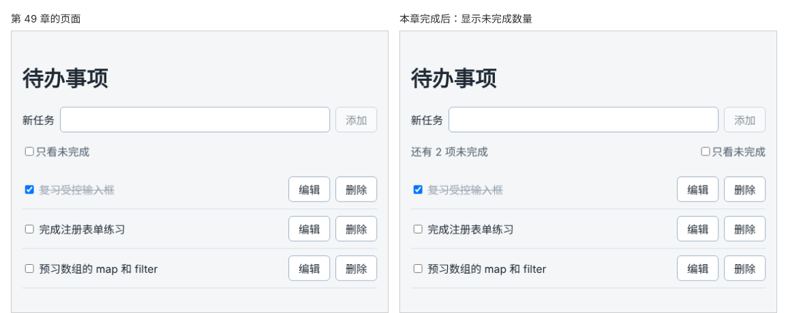

# 第 50 章：如何根据现有任务计算未完成数量？

前置：[第 49 章：如何只显示尚未完成的任务？](第049章-如何只显示尚未完成的任务.md)

## 一、本章要解决的问题

列表很长时，想知道还剩几件事没做，只能一条条数。

本章在工具栏左边显示“还有 N 项未完成”。添加、删除、勾选任务后，数字立即更新；全部完成时，改为显示“全部完成了！”。

下图左边是现在的工具栏，右边是本章完成后的样子：



## 二、必要原理

### 数量不放进 state

最直接的想法是用一个 state 存数量：添加时加 1，删除时减 1，勾选时加 1 或减 1……但这样要在四五个函数中分别维护这个数字，而且删除的任务是否已完成、编辑的任务是否改变了状态，每种情况都要单独判断，漏掉一处数字就不准了。

和上一章的 `visibleTasks` 一样，未完成的数量完全可以从 `tasks` 算出来。第 32 章的问题分类计数用的就是这种方法：

```tsx
const remainingCount = tasks.filter((task) => !task.completed).length;
```

先用 `filter` 挑出未完成的任务，再取新数组的 `length`。每次渲染都重新算一次，`tasks` 怎么变，数字就怎么变，不会和列表对不上。

判断一个值是否应该放进 state，可以问自己：**它能不能由已有的 state 或 props 算出来？** 能算出来的，就直接计算。到这里，待办事项页的 state 是这些：

| state | 为什么需要 |
| --- | --- |
| `tasks` | 任务数据本身 |
| `newTitle` | 添加框中正在输入的内容 |
| `editingId`、`editDraft` | 正在编辑哪一条、编辑框中的内容 |
| `hideCompleted` | 用户选择的查看方式 |

`visibleTasks` 和 `remainingCount` 都不在表中，它们是算出来的。

### 统计全部任务，而不是显示的任务

注意这里用的是 `tasks`，不是 `visibleTasks`。“还有几项未完成”说的是全部任务的情况，不应随“只看未完成”的勾选而变化。只看未完成时，`visibleTasks` 中的任务恰好都是未完成的，所以两种写法算出的数字暂时一样；如果还要显示“共 N 项”，用错数组就会出错，下面的小练习可以验证这一点。

### 显示两种文字

数量为 0 时显示另一句话，用条件运算符：

```tsx
remainingCount === 0 ? '全部完成了！' : '还有 ' + remainingCount + ' 项未完成'
```

数字和字符串用 `+` 连接，结果是字符串。注意“还有”后面和“项”前面各留了一个空格。

## 三、动手实现

### 第 1 步：计算未完成数量

在 `src/pages/TaskPage.tsx` 中 `visibleTasks` 的下面加入：

```tsx
  const remainingCount = tasks.filter((task) => !task.completed).length;
```

### 第 2 步：在工具栏中显示

在工具栏 `<div className={styles.toolbar}>` 中、“只看未完成”标签的前面加入：

```tsx
        <span>{remainingCount === 0 ? '全部完成了！' : '还有 ' + remainingCount + ' 项未完成'}</span>
```

工具栏在上一章已经设置了 `justify-content: space-between`，数量在左，复选框在右。

## 四、运行与检查

保持开发服务器运行（`npm.cmd run dev`），保存文件后在浏览器中查看。

1. 工具栏左边显示“还有 2 项未完成”。
2. 勾选第 2 条任务，变成“还有 1 项未完成”；取消勾选，又变回 2。
3. 添加一条任务，数字加 1。
4. 删除一条未完成的任务，数字减 1；删除一条已完成的任务，数字不变。
5. 把所有任务都勾选完成，显示“全部完成了！”。
6. 删除全部任务，同样显示“全部完成了！”。
7. 打开 React 开发者工具，`TaskPage` 的 state 中没有数量，只有前面表中列出的那些。

最后运行检查，应没有错误：

```powershell
npm.cmd run check
```

**小练习**：在数量后面再显示“共 N 项”。然后试着把 `remainingCount` 和总数都改用 `visibleTasks` 计算，勾选“只看未完成”，看看哪个数字变得不对了。练习后恢复本章代码。

## 五、常见错误

| 现象 | 原因 | 怎么改 |
| --- | --- | --- |
| 数字在某些操作后不对 | 用 state 存数量，在某个函数中忘了更新 | 删除这个 state，从 `tasks` 直接计算 |
| 显示的是总数而不是未完成数 | 写成了 `tasks.length` | 先 `filter` 出未完成的，再取 `length` |
| 显示“还有 2项未完成”，数字和文字贴在一起 | 拼接的字符串中漏了空格 | 写成 `'还有 ' + remainingCount + ' 项未完成'` |
| 全部完成后显示“还有 0 项未完成” | 没有单独处理数量为 0 的情况 | 用条件运算符，数量为 0 时显示另一句话 |

## 六、本章完整代码

### `src/pages/TaskPage.tsx`

```tsx
import { useState } from 'react';
import type { ChangeEvent, SubmitEvent } from 'react';
import { initialTasks } from '../data/tasks';
import type { Task } from '../data/tasks';
import styles from './TaskPage.module.css';

export default function TaskPage() {
  const [tasks, setTasks] = useState<Task[]>(initialTasks);
  const [newTitle, setNewTitle] = useState('');
  const [editingId, setEditingId] = useState<string | null>(null);
  const [editDraft, setEditDraft] = useState('');
  const [hideCompleted, setHideCompleted] = useState(false);
  const visibleTasks = hideCompleted ? tasks.filter((task) => !task.completed) : tasks;
  const remainingCount = tasks.filter((task) => !task.completed).length;

  function handleNewTitleChange(event: ChangeEvent<HTMLInputElement>) {
    setNewTitle(event.target.value);
  }

  function handleAdd(event: SubmitEvent<HTMLFormElement>) {
    event.preventDefault();
    const title = newTitle.trim();
    if (title === '') {
      return;
    }
    const newTask: Task = { id: crypto.randomUUID(), title, completed: false };
    setTasks([...tasks, newTask]);
    setNewTitle('');
  }

  function handleDelete(id: string) {
    setTasks(tasks.filter((task) => task.id !== id));
    if (id === editingId) {
      setEditingId(null);
    }
  }

  function handleToggle(id: string) {
    setTasks(
      tasks.map((task) => (task.id === id ? { ...task, completed: !task.completed } : task)),
    );
  }

  function handleStartEdit(task: Task) {
    setEditingId(task.id);
    setEditDraft(task.title);
  }

  function handleEditDraftChange(event: ChangeEvent<HTMLInputElement>) {
    setEditDraft(event.target.value);
  }

  function handleSaveEdit(event: SubmitEvent<HTMLFormElement>) {
    event.preventDefault();
    const title = editDraft.trim();
    if (title === '') {
      return;
    }
    setTasks(tasks.map((task) => (task.id === editingId ? { ...task, title } : task)));
    setEditingId(null);
  }

  return (
    <main className="page">
      <h1>待办事项</h1>
      <form className={styles.addForm} onSubmit={handleAdd}>
        <label htmlFor="new-task">新任务</label>
        <input id="new-task" value={newTitle} onChange={handleNewTitleChange} />
        <button type="submit" disabled={newTitle.trim() === ''}>
          添加
        </button>
      </form>
      <div className={styles.toolbar}>
        <span>{remainingCount === 0 ? '全部完成了！' : '还有 ' + remainingCount + ' 项未完成'}</span>
        <label>
          <input
            type="checkbox"
            checked={hideCompleted}
            onChange={(event) => setHideCompleted(event.target.checked)}
          />
          只看未完成
        </label>
      </div>
      {visibleTasks.length === 0 ? (
        <p className={styles.empty}>没有需要显示的任务。</p>
      ) : (
        <ul className={styles.list}>
          {visibleTasks.map((task) => (
            <li key={task.id} className={styles.item}>
              <label className={task.completed ? styles.title + ' ' + styles.done : styles.title}>
                <input
                  type="checkbox"
                  checked={task.completed}
                  onChange={() => handleToggle(task.id)}
                />
                {task.title}
              </label>
              <button type="button" onClick={() => handleStartEdit(task)}>
                编辑
              </button>
              <button
                type="button"
                aria-label={'删除：' + task.title}
                onClick={() => handleDelete(task.id)}
              >
                删除
              </button>
            </li>
          ))}
        </ul>
      )}
      {editingId !== null && (
        <form className={styles.editor} onSubmit={handleSaveEdit}>
          <label htmlFor="edit-task">修改任务名称</label>
          <input id="edit-task" value={editDraft} onChange={handleEditDraftChange} />
          <button type="submit" disabled={editDraft.trim() === ''}>
            保存
          </button>
        </form>
      )}
    </main>
  );
}
```

## 七、本章改动小结

修改 `src/pages/TaskPage.tsx`：计算 `remainingCount`，在工具栏中显示未完成数量。

---

下一章：[第 51 章：为什么直接修改数组中的任务，页面有时不会更新？](第051章-为什么直接修改数组中的任务，页面有时不会更新.md)
