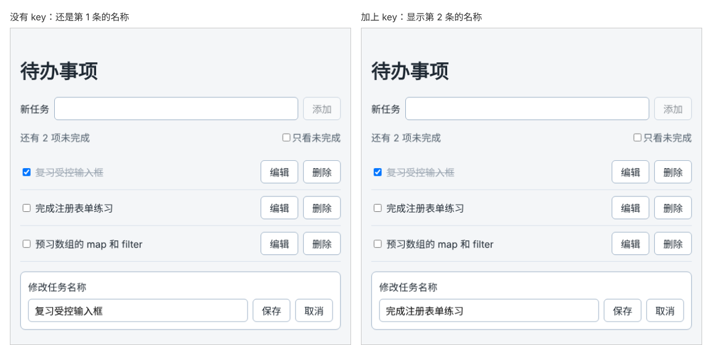

# 第 53 章：切换正在编辑的任务后，如何避免保留上一条的输入？

前置：[第 52A 章：如何把编辑框提取成一个独立的组件？](第052A章-如何把编辑框提取成一个独立的组件.md)

## 一、本章要解决的问题

第 52A 章把编辑框提取成了 `TaskEditor` 组件，留下了一个问题：编辑框开着时点击另一条任务的“编辑”，编辑框中还是上一条任务的名称。这时点击保存，会把上一条的名称写到这一条上。

本章找出原因，并用一个 `key` 解决它。

下图都是先点击第 1 条任务的“编辑”、再点击第 2 条任务的“编辑”以后的样子，左边是没有 key 的样子，右边是加上 key 以后的样子：



## 二、必要原理

### 为什么会保留上一条的输入

`useState(task.title)` 中的初始值**只在组件第一次出现时使用一次**。之后即使 `task` 换成了另一条任务，`draft` 也不会自动改变。

从任务 A 的编辑切换到任务 B 的编辑时，编辑框始终显示在同一个位置，组件类型也相同，React 认为它还是原来那个 `TaskEditor`，只是 props 变了。于是组件被保留下来，`draft` 仍然是 A 的名称。

第 47 章的写法没有这个问题，因为点击编辑时 `handleStartEdit` 会主动执行 `setEditDraft(task.title)`。第 52A 章把草稿移进了子组件，父组件就改不到它了。

### 用 key 让 React 换一个新组件

第 18 章说过，`key` 告诉 React 哪一项是哪一项。`key` 不只能用在列表中：给任何组件加上 `key`，`key` 改变时，React 会把它当作**另一个组件**，丢掉旧的（连同其中的 state），重新创建一个新的。

```tsx
<TaskEditor key={editingTask.id} task={editingTask} ... />
```

切换到另一条任务时，`key` 从 A 的 `id` 变成 B 的 `id`，React 创建一个新的 `TaskEditor`，`useState(task.title)` 重新使用 B 的名称作为初始值。

## 三、动手实现

### 第 1 步：重现问题

在浏览器中点击“复习受控输入框”的“编辑”，然后不关闭编辑框，直接点击“完成注册表单练习”的“编辑”：编辑框中仍是“复习受控输入框”。这时点击“保存”，第 2 条任务的名称被改成了“复习受控输入框”。

刷新页面，让任务恢复原样。

### 第 2 步：加上 key

在 `src/pages/TaskPage.tsx` 中，`<TaskEditor` 的下一行加入：

```tsx
      {editingTask && (
        <TaskEditor
          key={editingTask.id}
          task={editingTask}
          onSave={handleSaveEdit}
          onCancel={() => setEditingId(null)}
        />
      )}
```

## 四、运行与检查

保持开发服务器运行（`npm.cmd run dev`），保存文件后在浏览器中查看。

1. 编辑、保存、取消都和第 52A 章一样正常。
2. 点击“复习受控输入框”的“编辑”，再直接点击“完成注册表单练习”的“编辑”，编辑框中变成“完成注册表单练习”。
3. 在第 2 步的状态下修改名称并保存，被修改的是第 2 条任务，第 1 条不受影响。
4. 编辑一条任务，输入几个字后切换到另一条，再切换回来，编辑框中是原来的名称，没有刚才输入的内容。

最后运行检查，应没有错误：

```powershell
npm.cmd run check
```

**小练习**：暂时去掉 `key`，改为在 `TaskEditor` 中用 `task.title` 直接作为输入框的 `value`，不使用 `draft`，看看还能不能输入，想一想为什么。练习后恢复本章代码。

## 五、常见错误

| 现象 | 原因 | 怎么改 |
| --- | --- | --- |
| 切换编辑的任务后，编辑框中还是上一条的名称，保存时改错了任务 | `useState` 的初始值只在组件第一次出现时使用，组件被 React 保留了 | 给 `TaskEditor` 加上 `key={editingTask.id}` |
| 加了 `key`，切换后仍然是上一条的名称 | `key` 写在了 `TaskEditor.tsx` 内部的 `<form>` 上。这样只会换掉表单标签，`TaskEditor` 组件和它的 `draft` 仍被保留 | `key` 写在 `TaskPage` 中使用 `<TaskEditor>` 的地方 |

## 六、本章完整代码

### `src/pages/TaskPage.tsx`

```tsx
import { useState } from 'react';
import type { ChangeEvent, SubmitEvent } from 'react';
import TaskEditor from '../components/TaskEditor';
import { initialTasks } from '../data/tasks';
import type { Task } from '../data/tasks';
import styles from './TaskPage.module.css';

export default function TaskPage() {
  const [tasks, setTasks] = useState<Task[]>(initialTasks);
  const [newTitle, setNewTitle] = useState('');
  const [editingId, setEditingId] = useState<string | null>(null);
  const [hideCompleted, setHideCompleted] = useState(false);
  const visibleTasks = hideCompleted ? tasks.filter((task) => !task.completed) : tasks;
  const remainingCount = tasks.filter((task) => !task.completed).length;
  const editingTask = tasks.find((task) => task.id === editingId);

  function handleNewTitleChange(event: ChangeEvent<HTMLInputElement>) {
    setNewTitle(event.target.value);
  }

  function handleAdd(event: SubmitEvent<HTMLFormElement>) {
    event.preventDefault();
    const title = newTitle.trim();
    if (title === '') {
      return;
    }
    const newTask: Task = { id: crypto.randomUUID(), title, completed: false };
    setTasks([...tasks, newTask]);
    setNewTitle('');
  }

  function handleDelete(id: string) {
    setTasks(tasks.filter((task) => task.id !== id));
    if (id === editingId) {
      setEditingId(null);
    }
  }

  function handleToggle(id: string) {
    setTasks(
      tasks.map((task) => (task.id === id ? { ...task, completed: !task.completed } : task)),
    );
  }

  function handleSaveEdit(title: string) {
    setTasks(tasks.map((task) => (task.id === editingId ? { ...task, title } : task)));
    setEditingId(null);
  }

  return (
    <main className="page">
      <h1>待办事项</h1>
      <form className={styles.addForm} onSubmit={handleAdd}>
        <label htmlFor="new-task">新任务</label>
        <input id="new-task" value={newTitle} onChange={handleNewTitleChange} />
        <button type="submit" disabled={newTitle.trim() === ''}>
          添加
        </button>
      </form>
      <div className={styles.toolbar}>
        <span>{remainingCount === 0 ? '全部完成了！' : '还有 ' + remainingCount + ' 项未完成'}</span>
        <label>
          <input
            type="checkbox"
            checked={hideCompleted}
            onChange={(event) => setHideCompleted(event.target.checked)}
          />
          只看未完成
        </label>
      </div>
      {visibleTasks.length === 0 ? (
        <p className={styles.empty}>没有需要显示的任务。</p>
      ) : (
        <ul className={styles.list}>
          {visibleTasks.map((task) => (
            <li key={task.id} className={styles.item}>
              <label className={task.completed ? styles.title + ' ' + styles.done : styles.title}>
                <input
                  type="checkbox"
                  checked={task.completed}
                  onChange={() => handleToggle(task.id)}
                />
                {task.title}
              </label>
              <button type="button" onClick={() => setEditingId(task.id)}>
                编辑
              </button>
              <button
                type="button"
                aria-label={'删除：' + task.title}
                onClick={() => handleDelete(task.id)}
              >
                删除
              </button>
            </li>
          ))}
        </ul>
      )}
      {editingTask && (
        <TaskEditor
          key={editingTask.id}
          task={editingTask}
          onSave={handleSaveEdit}
          onCancel={() => setEditingId(null)}
        />
      )}
    </main>
  );
}
```

## 七、本章改动小结

修改 `src/pages/TaskPage.tsx`：给 `TaskEditor` 加上 `key={editingTask.id}`。

---

下一章：[第 54 章：【组合】如何添加和删除多组联系人输入项？](第054章-如何添加和删除多组联系人输入项.md)
