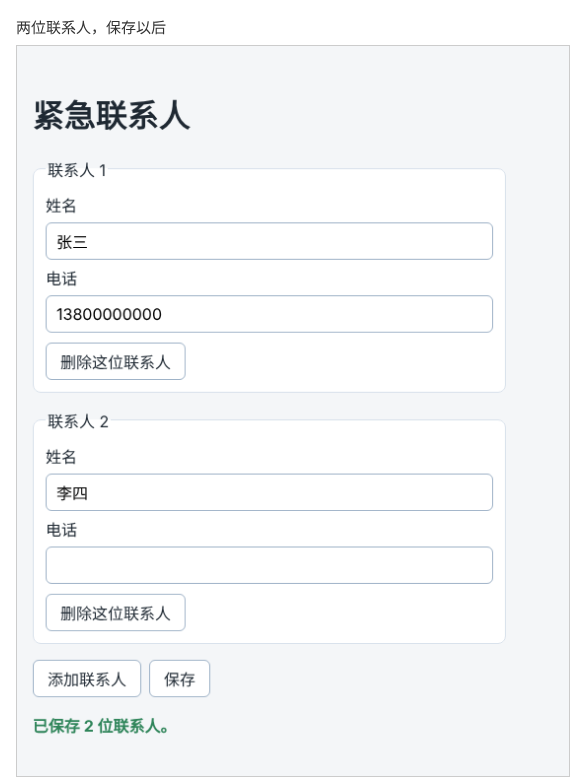

# 第 54 章：【组合】如何添加和删除多组联系人输入项？

前置：[第 53 章：切换正在编辑的任务后，如何避免保留上一条的输入？](第053章-切换正在编辑的任务后，如何避免保留上一条的输入.md)

## 一、本章要解决的问题

很多表单中，同一组输入项需要填写的数量不固定。比如填写紧急联系人：有人只填一位，有人要填三位。

本章新建一个“紧急联系人”页：开始时有一组“姓名、电话”输入框；点击“添加联系人”多出一组，每组都有“删除这位联系人”按钮；最多 5 组，至少保留 1 组。点击“保存”后显示保存了几位联系人。

本章是一个组合练习：前几章对任务列表的添加、删除、修改，这次用在一组输入框上。

本章完成后，添加一位联系人、填写并保存后的页面如下图：



## 二、必要原理

### 每组输入框就是数组中的一项

把每位联系人看成一个对象，所有联系人就是一个数组：

```tsx
type Contact = {
  id: string;
  name: string;
  phone: string;
};
```

添加一组，就是向数组添加一个空联系人；删除一组，就是用 `filter` 去掉它，和第 45、46 章的任务列表一样。

### 修改某一组中的某一个输入框

在某一组的姓名框中输入时，要修改的是“某个联系人的 `name` 属性”。这就是第 47 章的写法：

```tsx
contacts.map((contact) => (contact.id === id ? { ...contact, name } : contact))
```

每个输入框都是受控的，值来自 `contact.name`，输入时调用 `handleNameChange(contact.id, event.target.value)`。

### 每一组都要有稳定的 key 和不重复的 id

`key` 使用联系人的 `id`，新增的联系人用 `crypto.randomUUID()` 生成（第 45 章）。

输入框的 `id` 在整个页面中不能重复，否则点击第二组的“姓名”标签，光标会跳到第一组的输入框。所以用联系人的 `id` 拼出输入框的 `id`：`'name-' + contact.id`。

### 用 fieldset 把一组输入框包起来

`<fieldset>` 是表单中专门用来给输入项分组的元素，`<legend>` 是这一组的标题。读屏软件进入某一组时，会先读出“联系人 2”，用户就知道当前填写的是第几位。标题中的序号用 `map` 的第二个参数 `index` 计算：`index + 1`。序号只用来显示，`key` 仍然用 `id`。

### 数量限制直接从数组算出来

“至少 1 组、最多 5 组”不需要额外的 state，直接看 `contacts.length`：只剩 1 组时禁用删除按钮，达到 5 组时禁用添加按钮（第 38 章的 `disabled`）。

## 三、动手实现

### 第 1 步：添加样式

在 `src/pages` 中新建 `ContactsPage.module.css`：

```css
.form {
  display: flex;
  flex-direction: column;
  gap: 16px;
  max-width: 480px;
}

.contact {
  display: flex;
  flex-direction: column;
  gap: 6px;
  margin: 0;
  padding: 12px;
  border: 1px solid #d9e2ec;
  border-radius: 8px;
  background: #ffffff;
}

.contact input {
  padding: 8px 10px;
  border: 1px solid #9fb3c8;
  border-radius: 6px;
  font: inherit;
}

.contact button {
  align-self: flex-start;
  margin-top: 4px;
}

.actions {
  display: flex;
  gap: 8px;
}

.message {
  color: #2f855a;
  font-weight: bold;
}
```

`margin: 0` 去掉 `fieldset` 的默认外边距；`align-self: flex-start` 让删除按钮不被拉满。

### 第 2 步：新建紧急联系人页

在 `src/pages` 中新建 `ContactsPage.tsx`：

```tsx
import { useState } from 'react';
import type { SubmitEvent } from 'react';
import styles from './ContactsPage.module.css';

type Contact = {
  id: string;
  name: string;
  phone: string;
};

export default function ContactsPage() {
  const [contacts, setContacts] = useState<Contact[]>([{ id: 'contact-1', name: '', phone: '' }]);
  const [message, setMessage] = useState('');

  function handleAdd() {
    setContacts([...contacts, { id: crypto.randomUUID(), name: '', phone: '' }]);
  }

  function handleRemove(id: string) {
    setContacts(contacts.filter((contact) => contact.id !== id));
  }

  function handleNameChange(id: string, name: string) {
    setContacts(contacts.map((contact) => (contact.id === id ? { ...contact, name } : contact)));
  }

  function handlePhoneChange(id: string, phone: string) {
    setContacts(contacts.map((contact) => (contact.id === id ? { ...contact, phone } : contact)));
  }

  function handleSubmit(event: SubmitEvent<HTMLFormElement>) {
    event.preventDefault();
    const filled = contacts.filter((contact) => contact.name.trim() !== '');
    setMessage('已保存 ' + filled.length + ' 位联系人。');
  }

  return (
    <main className="page">
      <h1>紧急联系人</h1>
      <form className={styles.form} onSubmit={handleSubmit}>
        {contacts.map((contact, index) => (
          <fieldset key={contact.id} className={styles.contact}>
            <legend>联系人 {index + 1}</legend>
            <label htmlFor={'name-' + contact.id}>姓名</label>
            <input
              id={'name-' + contact.id}
              value={contact.name}
              onChange={(event) => handleNameChange(contact.id, event.target.value)}
            />
            <label htmlFor={'phone-' + contact.id}>电话</label>
            <input
              id={'phone-' + contact.id}
              inputMode="tel"
              value={contact.phone}
              onChange={(event) => handlePhoneChange(contact.id, event.target.value)}
            />
            <button
              type="button"
              disabled={contacts.length === 1}
              onClick={() => handleRemove(contact.id)}
            >
              删除这位联系人
            </button>
          </fieldset>
        ))}
        <div className={styles.actions}>
          <button type="button" disabled={contacts.length >= 5} onClick={handleAdd}>
            添加联系人
          </button>
          <button type="submit">保存</button>
        </div>
      </form>
      {message && (
        <p role="status" className={styles.message}>
          {message}
        </p>
      )}
    </main>
  );
}
```

`handleSubmit` 只统计填写了姓名的联系人。保存到服务器的写法在第 10 部分学习，这里只显示一句提示。

### 第 3 步：让 App 显示紧急联系人页

修改 `src/App.tsx`：

```tsx
import './App.css';
import ContactsPage from './pages/ContactsPage';

export default function App() {
  return <ContactsPage />;
}
```

`TaskPage` 保留在 `src/pages` 中，以后的章节还会用到它。

## 四、运行与检查

保持开发服务器运行（`npm.cmd run dev`），保存文件后在浏览器中查看。

1. 页面显示“紧急联系人”和一组“联系人 1”，它的“删除这位联系人”按钮是半透明的。
2. 点击“添加联系人”，出现“联系人 2”，两组的删除按钮都可以点击。
3. 在两组中分别填写姓名和电话，再点击“联系人 1”的删除按钮。剩下的一组标题变成“联系人 1”，里面是原来第二组填写的内容。
4. 连续添加到 5 组，“添加联系人”按钮变成半透明。
5. 点击第 3 组的“姓名”标签，光标进入第 3 组的姓名框，而不是第 1 组。
6. 填写两位联系人的姓名，留一组姓名为空，点击“保存”，显示“已保存 2 位联系人。”。
7. 在 Elements（元素）面板中选中电话输入框，可以看到 `inputmode="tel"`。在手机上点击它会弹出拨号键盘，电脑上（包括开发者工具的手机模式）看不到键盘，看到属性即可。

最后运行检查，应没有错误：

```powershell
npm.cmd run check
```

**小练习**：把 `fieldset` 的 `key` 暂时改为 `index`，重复第 3 项检查。你会发现页面看起来仍然正确。想一想为什么这里没有出错：每个输入框显示的内容都来自 state，`fieldset` 自己没有保存任何东西。再对照第 18 章想一想：如果列表中的组件自己保存了内容（例如第 53 章的 `TaskEditor` 保存了草稿），用下标作 key 会怎样？练习后恢复本章代码。

### 阶段练习：自己做一个购物清单

学到这里，你已经能做出可以增删改数据的交互页面。下面的练习请**不看教程代码**，独立完成。参考答案见[附录 A](附录A-阶段练习参考答案.md)，完成后再对照。

**需求**：新建一个“购物清单”页，在 `App` 中切换为显示它。

- 每件物品有编号、名称、是否已买三项数据。开始时有两件物品，其中一件已买。
- 可以输入名称添加物品，名称为空时不能添加。
- 每件物品前有复选框，勾选表示已买，已买的物品显示删除线。
- 每件物品可以删除，也可以修改名称。修改时出现编辑框，可以保存，也可以取消；取消后名称不变。

**验收标准**：

1. 添加、删除、勾选、修改名称都能正常工作，其他物品不受影响。
2. 修改名称时点击“取消”，名称不变；再次编辑时，编辑框中是原来的名称。
3. 正在编辑的物品被删除后，编辑框随之关闭。
4. 代码中没有 `push`、`splice`，也没有直接给物品对象的属性赋值。
5. `npm.cmd run check` 没有错误，控制台没有警告。

练习完成后，把 `App` 换回 `ContactsPage`，后面的章节从本章的完整代码继续。

## 五、常见错误

| 现象 | 原因 | 怎么改 |
| --- | --- | --- |
| 在一组中输入，所有组的姓名都跟着变 | `map` 中没有判断 `contact.id === id`，每一项都返回了新姓名 | 只有 id 相同的那一项返回 `{ ...contact, name }` |
| 点击第 2 组的标签，光标跳到第 1 组 | 每组输入框的 `id` 都写成了固定的 `"name"` | 用 `'name-' + contact.id` 拼出不重复的 `id` |
| 一直删除，最后页面上一组输入框也没有了 | 没有限制最少数量 | `contacts.length === 1` 时禁用删除按钮 |
| 点击“添加联系人”或“删除这位联系人”时，显示了保存提示 | 按钮没写 `type="button"`，默认提交了表单 | 表单中除了“保存”，其他按钮都写 `type="button"` |

## 六、本章完整代码

### `src/pages/ContactsPage.module.css`

内容同第三节第 1 步。

### `src/pages/ContactsPage.tsx`

内容同第三节第 2 步。

### `src/App.tsx`

内容同第三节第 3 步。

## 七、本章改动小结

新增 `src/pages/ContactsPage.tsx`、`src/pages/ContactsPage.module.css`；修改 `src/App.tsx`，改为显示紧急联系人页。

---

下一章：[第 55 章：如何根据输入的关键词筛选商品？](第055章-如何根据输入的关键词筛选商品.md)
