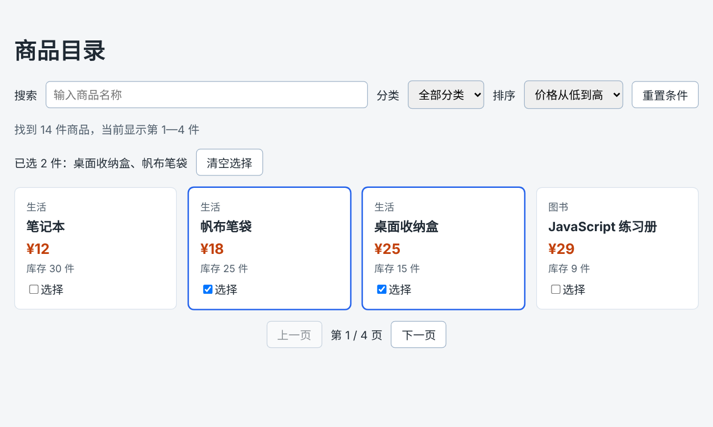

# 第 55 章：如何根据输入的关键词筛选商品？

前置：[第 54 章：【组合】如何添加和删除多组联系人输入项？](第054章-如何添加和删除多组联系人输入项.md)

## 一、本章要解决的问题

从本章开始做商品目录页。商品有十几件，想找“键盘”时一件件往下看太慢了。

本章在列表上方放一个搜索框：输入关键词，列表立即只剩名称中包含这个词的商品；搜索时不区分大小写，输入 `react` 也能找到“React 入门书”；关键词前后多打的空格不影响结果；一件都找不到时显示提示。

本章是第 7 部分的起点。学完第 7 部分（第 55—61 章）时，商品目录页会变成下图的样子：可以搜索、按分类筛选、按价格排序、分页浏览，并且可以勾选商品。



## 二、必要原理

### 搜索结果是算出来的

用户输入的关键词会变化，变化后页面要更新，所以关键词放进 state。搜索结果则不需要放进 state：它完全由“全部商品”和“关键词”决定，每次渲染时用 `filter` 算一遍即可。这和第 49 章（只显示尚未完成的任务）中 `visibleTasks` 的思路一样。

商品数据本身也不放进 state。本部分只查看商品，不修改它们，直接使用数据文件中的数组就可以。

### 用 includes 判断是否包含关键词

字符串的 `includes` 方法判断一个字符串中是否包含另一段文字，返回 `true` 或 `false`：

```tsx
'机械键盘'.includes('键盘'); // true
'机械键盘'.includes('鼠标'); // false
'机械键盘'.includes('');     // true
```

注意最后一行：任何字符串都“包含”空字符串。所以搜索框为空时，每件商品都符合条件，列表显示全部商品，不需要单独判断。

### 不区分大小写

`'React 入门书'.includes('react')` 的结果是 `false`，因为大写的 `R` 和小写的 `r` 是不同的字符。解决办法是比较前把两边都转成小写：`toLowerCase()` 返回一个全部字母变成小写的新字符串，中文不受影响。

### 去掉首尾空格

第 40 章（阻止提交表单时刷新页面）用过 `trim()`。这里同样先去掉关键词首尾的空格，否则输入“ 键盘”时，开头的空格会让所有商品都匹配不上。

关键词处理后存进一个变量，在 `filter` 中反复使用：

```tsx
const normalizedKeyword = keyword.trim().toLowerCase();
```

几个方法可以连着写：`keyword.trim()` 得到去掉空格的新字符串，再对它调用 `toLowerCase()`。

### 箭头函数的返回值太长时

`filter` 的回调函数只有一个表达式，但一行写不下。这时可以在 `=>` 后面换行，回调函数仍然直接返回这个表达式的结果。

## 三、动手实现

### 第 1 步：准备商品数据

新建 `src/data/products.ts`：

```ts
export type Product = {
  id: number;
  name: string;
  category: string;
  price: number;
  stock: number;
};

export const products: Product[] = [
  { id: 1, name: 'React 入门书', category: '图书', price: 38, stock: 12 },
  { id: 2, name: '机械键盘', category: '数码', price: 299, stock: 5 },
  { id: 3, name: 'TypeScript 手册', category: '图书', price: 45, stock: 0 },
  { id: 4, name: '无线鼠标', category: '数码', price: 89, stock: 20 },
  { id: 5, name: '保温杯', category: '生活', price: 59, stock: 8 },
  { id: 6, name: '笔记本', category: '生活', price: 12, stock: 30 },
  { id: 7, name: 'CSS 布局图解', category: '图书', price: 52, stock: 7 },
  { id: 8, name: '降噪耳机', category: '数码', price: 499, stock: 3 },
  { id: 9, name: '桌面收纳盒', category: '生活', price: 25, stock: 15 },
  { id: 10, name: 'JavaScript 练习册', category: '图书', price: 29, stock: 9 },
  { id: 11, name: '显示器支架', category: '数码', price: 129, stock: 0 },
  { id: 12, name: '护眼台灯', category: '生活', price: 149, stock: 6 },
  { id: 13, name: '移动硬盘', category: '数码', price: 359, stock: 4 },
  { id: 14, name: '帆布笔袋', category: '生活', price: 18, stock: 25 },
];
```

`stock` 是库存数量，为 0 表示缺货。

### 第 2 步：添加样式

在 `src/pages` 中新建 `ProductPage.module.css`：

```css
.filters {
  display: flex;
  flex-wrap: wrap;
  align-items: center;
  gap: 8px 12px;
}

.filters input,
.filters select {
  padding: 8px 10px;
  border: 1px solid #9fb3c8;
  border-radius: 6px;
  font: inherit;
}

.filters input {
  flex: 1;
  min-width: 160px;
}

.summary,
.empty {
  color: #52606d;
}

.list {
  display: flex;
  flex-wrap: wrap;
  gap: 16px;
  margin: 0;
  padding: 0;
  list-style: none;
}

.item {
  flex: 1 1 160px;
  padding: 16px;
  border: 1px solid #d9e2ec;
  border-radius: 8px;
  background: #ffffff;
}

.category,
.stock {
  margin: 0;
  color: #52606d;
  font-size: 14px;
}

.name {
  margin: 4px 0 8px;
  font-size: 18px;
}

.price {
  margin: 0 0 4px;
  color: #c2410c;
  font-size: 20px;
  font-weight: bold;
}
```

商品列表沿用第 13 章（让卡片在手机窄屏上自动换行）的做法：`flex-wrap: wrap` 加上 `flex: 1 1 160px`。`flex-basis` 不包含内边距和边框，每张卡片实际约 194 像素宽，电脑上一行正好放下四件，手机上一行一件。

### 第 3 步：新建商品目录页

在 `src/pages` 中新建 `ProductPage.tsx`：

```tsx
import { useState } from 'react';
import type { ChangeEvent } from 'react';
import { products } from '../data/products';
import styles from './ProductPage.module.css';

export default function ProductPage() {
  const [keyword, setKeyword] = useState('');
  const normalizedKeyword = keyword.trim().toLowerCase();
  const visibleProducts = products.filter((product) =>
    product.name.toLowerCase().includes(normalizedKeyword),
  );

  function handleKeywordChange(event: ChangeEvent<HTMLInputElement>) {
    setKeyword(event.target.value);
  }

  return (
    <main className="page">
      <h1>商品目录</h1>
      <div className={styles.filters}>
        <label htmlFor="keyword">搜索</label>
        <input
          id="keyword"
          type="search"
          placeholder="输入商品名称"
          value={keyword}
          onChange={handleKeywordChange}
        />
      </div>
      <p className={styles.summary}>找到 {visibleProducts.length} 件商品</p>
      {visibleProducts.length === 0 ? (
        <p className={styles.empty}>没有找到符合条件的商品。</p>
      ) : (
        <ul className={styles.list}>
          {visibleProducts.map((product) => (
            <li key={product.id} className={styles.item}>
              <p className={styles.category}>{product.category}</p>
              <h2 className={styles.name}>{product.name}</h2>
              <p className={styles.price}>¥{product.price}</p>
              <p className={styles.stock}>
                {product.stock === 0 ? '缺货' : '库存 ' + product.stock + ' 件'}
              </p>
            </li>
          ))}
        </ul>
      )}
    </main>
  );
}
```

`type="search"` 是专门用于搜索的输入框，在 Chrome 中输入内容后，右侧会出现一个清除按钮。`placeholder` 是输入框为空时显示的灰色提示文字，它不能代替 `label`。

### 第 4 步：让 App 显示商品目录页

修改 `src/App.tsx`：

```tsx
import './App.css';
import ProductPage from './pages/ProductPage';

export default function App() {
  return <ProductPage />;
}
```

## 四、运行与检查

保持开发服务器运行（`npm.cmd run dev`），保存文件后在浏览器中查看。

1. 页面显示“商品目录”、搜索框、“找到 14 件商品”和商品卡片。“TypeScript 手册”和“显示器支架”显示“缺货”。
2. 输入“键盘”，只剩“机械键盘”，提示变成“找到 1 件商品”。
3. 输入小写的 `react`，找到“React 入门书”。
4. 输入“ 键盘 ”（前后各有一个空格），仍然找到“机械键盘”。
5. 输入“电脑”，显示“没有找到符合条件的商品。”。
6. 点击搜索框右侧的清除按钮（或删掉全部文字），14 件商品全部回来。
7. 把浏览器窗口缩窄到手机宽度，卡片一行一张，页面不能左右滑动。

最后运行检查，应没有错误：

```powershell
npm.cmd run check
```

**小练习**：让搜索同时匹配分类，例如输入“数码”时显示所有数码商品。（提示：在 `filter` 中用 `||` 连接两个 `includes` 判断。）练习后恢复本章代码。

## 五、常见错误

| 现象 | 原因 | 怎么改 |
| --- | --- | --- |
| 输入 `react` 找不到“React 入门书” | 只把关键词转成了小写，商品名称没有转 | 两边都调用 `toLowerCase()` |
| 关键词前面多一个空格就什么都找不到 | 没有 `trim()` | 用 `keyword.trim()` 处理后再比较 |
| 删掉关键词后，商品没有全部回来 | 把筛选结果用 `setState` 存了起来，每次在上一次的结果中继续筛选 | 不存筛选结果，每次从完整的 `products` 计算 |
| 搜索框中打不进字 | 写了 `value={keyword}`，但没有写 `onChange` | 加上 `onChange={handleKeywordChange}`（第 35 章） |

## 六、本章完整代码

### `src/data/products.ts`

内容同第三节第 1 步。

### `src/pages/ProductPage.module.css`

内容同第三节第 2 步。

### `src/pages/ProductPage.tsx`

内容同第三节第 3 步。

### `src/App.tsx`

内容同第三节第 4 步。

## 七、本章改动小结

新增 `src/data/products.ts`、`src/pages/ProductPage.tsx`、`src/pages/ProductPage.module.css`；修改 `src/App.tsx`，改为显示商品目录页。

---

下一章：[第 56 章：如何根据分类筛选商品？](第056章-如何根据分类筛选商品.md)
