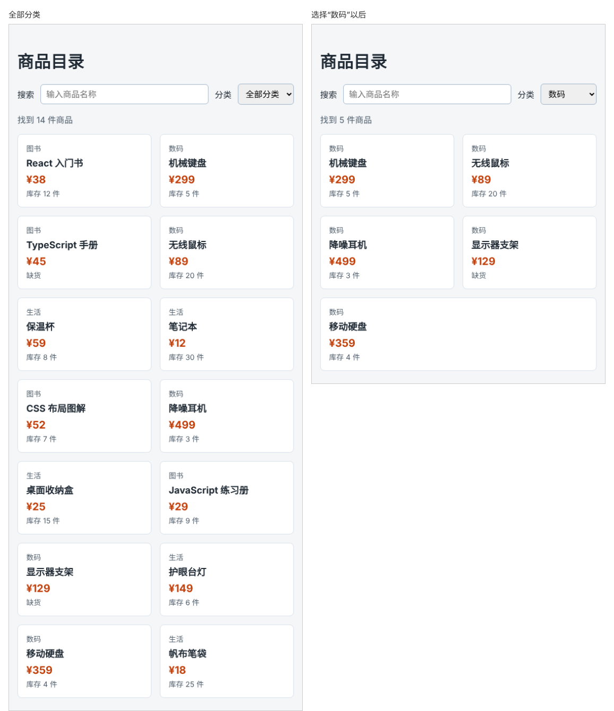

# 第 56 章：如何根据分类筛选商品？

前置：[第 55 章：如何根据输入的关键词筛选商品？](第055章-如何根据输入的关键词筛选商品.md)

## 一、本章要解决的问题

想看所有数码产品时，搜索框帮不上忙：商品名称中通常不带“数码”两个字。

本章在搜索框后面加一个“分类”下拉框，可以选择“全部分类”“图书”“数码”“生活”。选中某个分类后，列表只显示这个分类的商品；分类和关键词可以同时使用，例如在“生活”分类中搜索“笔”。

下图左边是“全部分类”，右边是选择“数码”以后的样子：



## 二、必要原理

### 用一个特殊值表示“全部”

分类也放进 state。除了三个真实的分类，还需要一个表示“不限分类”的值。这里用字符串 `'all'`：

```tsx
const [category, setCategory] = useState('all');
```

下拉框的写法和第 39 章（读取下拉选择框中的选项）完全一样，第一个选项 `<option value="all">全部分类</option>` 就是初始选中的项。

### 分类列表放在数据文件中

下拉框中的分类选项不手写三遍，而是在 `products.ts` 中导出一个分类数组，再用 `map` 生成 `<option>`。以后增加分类，只改数据文件一处。分类名称本身是唯一的，可以直接作为 `key`。

### 两个条件同时满足

现在一件商品要同时满足两个条件才显示：名称包含关键词，并且属于所选分类。

`filter` 的回调函数可以写成带花括号的函数体，先分别算出每个条件，最后用 `&&` 连起来返回：

```tsx
products.filter((product) => {
  const matchesKeyword = product.name.toLowerCase().includes(normalizedKeyword);
  const matchesCategory = category === 'all' || product.category === category;
  return matchesKeyword && matchesCategory;
});
```

写成花括号时必须写 `return`，这一点在第 29 章（让多个问题中同时只展开一个）中说过。

`matchesCategory` 这一行用 `||` 表示“或者”：选的是“全部分类”，或者商品的分类等于所选分类，两种情况都算符合。选“全部分类”时，`category === 'all'` 已经是 `true`，后面就不用再比较了。

### 给每个条件起名字

把条件先存进 `matchesKeyword`、`matchesCategory` 这样的变量，比把所有判断挤在一行中好读得多。下一章、下下章还会继续加条件，这种写法也容易扩展。

## 三、动手实现

### 第 1 步：导出分类列表

在 `src/data/products.ts` 中、`products` 数组的前面加入：

```ts
export const categories = ['图书', '数码', '生活'];
```

### 第 2 步：加入分类 state，并修改筛选条件

在 `src/pages/ProductPage.tsx` 中，把导入商品数据的一行改为：

```tsx
import { categories, products } from '../data/products';
```

在 `keyword` 的下面加入：

```tsx
  const [category, setCategory] = useState('all');
```

把原来的 `visibleProducts` 改为：

```tsx
  const visibleProducts = products.filter((product) => {
    const matchesKeyword = product.name.toLowerCase().includes(normalizedKeyword);
    const matchesCategory = category === 'all' || product.category === category;
    return matchesKeyword && matchesCategory;
  });
```

### 第 3 步：编写处理函数

在 `handleKeywordChange` 的后面加入：

```tsx
  function handleCategoryChange(event: ChangeEvent<HTMLSelectElement>) {
    setCategory(event.target.value);
  }
```

### 第 4 步：加入分类下拉框

在搜索框 `<input … />` 的后面、`</div>` 的前面加入：

```tsx
        <label htmlFor="category">分类</label>
        <select id="category" value={category} onChange={handleCategoryChange}>
          <option value="all">全部分类</option>
          {categories.map((item) => (
            <option key={item} value={item}>
              {item}
            </option>
          ))}
        </select>
```

回调函数的参数叫 `item` 而不叫 `category`，是为了不和 state 中的 `category` 重名。

## 四、运行与检查

保持开发服务器运行（`npm.cmd run dev`），保存文件后在浏览器中查看。

1. 搜索框后面有“分类”下拉框，默认是“全部分类”，显示 14 件商品。
2. 选择“数码”，只显示 5 件数码商品，“找到 5 件商品”。
3. 选择“图书”，显示 4 件图书。
4. 选择“生活”，再在搜索框中输入“笔”，显示“笔记本”和“帆布笔袋”两件。
5. 保持“笔”，改选“图书”，显示“没有找到符合条件的商品。”。
6. 改回“全部分类”并清空搜索框，14 件商品全部回来。
7. 窗口缩窄时，搜索框和下拉框自动换行，页面不能左右滑动。

最后运行检查，应没有错误：

```powershell
npm.cmd run check
```

**小练习**：再加一个“只看有货”复选框，勾选后不显示库存为 0 的商品。（提示：用第 38 章读取复选框的方法，在 `filter` 中再加一个 `matchesStock` 条件。）练习后恢复本章代码。

## 五、常见错误

| 现象 | 原因 | 怎么改 |
| --- | --- | --- |
| 选“全部分类”时一件商品都没有 | 漏了 `category === 'all' \|\|`，没有商品的分类是 `'all'` | 用 `\|\|` 加上“全部”的情况 |
| 选了分类后，搜索框不起作用了 | 两个条件用了 `\|\|` 连接，满足一个就显示 | 两个条件之间用 `&&` |
| 列表总是空的，控制台没有报错 | 花括号函数体中忘了写 `return` | 最后一行写 `return matchesKeyword && matchesCategory;` |
| 编辑器在 `onChange={handleCategoryChange}` 处报类型错误 | 处理函数的参数写成了 `ChangeEvent<HTMLInputElement>` | 下拉框的元素类型是 `HTMLSelectElement`（第 39 章） |

## 六、本章完整代码

### `src/data/products.ts`

```ts
export type Product = {
  id: number;
  name: string;
  category: string;
  price: number;
  stock: number;
};

export const categories = ['图书', '数码', '生活'];

export const products: Product[] = [
  { id: 1, name: 'React 入门书', category: '图书', price: 38, stock: 12 },
  { id: 2, name: '机械键盘', category: '数码', price: 299, stock: 5 },
  { id: 3, name: 'TypeScript 手册', category: '图书', price: 45, stock: 0 },
  { id: 4, name: '无线鼠标', category: '数码', price: 89, stock: 20 },
  { id: 5, name: '保温杯', category: '生活', price: 59, stock: 8 },
  { id: 6, name: '笔记本', category: '生活', price: 12, stock: 30 },
  { id: 7, name: 'CSS 布局图解', category: '图书', price: 52, stock: 7 },
  { id: 8, name: '降噪耳机', category: '数码', price: 499, stock: 3 },
  { id: 9, name: '桌面收纳盒', category: '生活', price: 25, stock: 15 },
  { id: 10, name: 'JavaScript 练习册', category: '图书', price: 29, stock: 9 },
  { id: 11, name: '显示器支架', category: '数码', price: 129, stock: 0 },
  { id: 12, name: '护眼台灯', category: '生活', price: 149, stock: 6 },
  { id: 13, name: '移动硬盘', category: '数码', price: 359, stock: 4 },
  { id: 14, name: '帆布笔袋', category: '生活', price: 18, stock: 25 },
];
```

### `src/pages/ProductPage.tsx`

```tsx
import { useState } from 'react';
import type { ChangeEvent } from 'react';
import { categories, products } from '../data/products';
import styles from './ProductPage.module.css';

export default function ProductPage() {
  const [keyword, setKeyword] = useState('');
  const [category, setCategory] = useState('all');
  const normalizedKeyword = keyword.trim().toLowerCase();
  const visibleProducts = products.filter((product) => {
    const matchesKeyword = product.name.toLowerCase().includes(normalizedKeyword);
    const matchesCategory = category === 'all' || product.category === category;
    return matchesKeyword && matchesCategory;
  });

  function handleKeywordChange(event: ChangeEvent<HTMLInputElement>) {
    setKeyword(event.target.value);
  }

  function handleCategoryChange(event: ChangeEvent<HTMLSelectElement>) {
    setCategory(event.target.value);
  }

  return (
    <main className="page">
      <h1>商品目录</h1>
      <div className={styles.filters}>
        <label htmlFor="keyword">搜索</label>
        <input
          id="keyword"
          type="search"
          placeholder="输入商品名称"
          value={keyword}
          onChange={handleKeywordChange}
        />
        <label htmlFor="category">分类</label>
        <select id="category" value={category} onChange={handleCategoryChange}>
          <option value="all">全部分类</option>
          {categories.map((item) => (
            <option key={item} value={item}>
              {item}
            </option>
          ))}
        </select>
      </div>
      <p className={styles.summary}>找到 {visibleProducts.length} 件商品</p>
      {visibleProducts.length === 0 ? (
        <p className={styles.empty}>没有找到符合条件的商品。</p>
      ) : (
        <ul className={styles.list}>
          {visibleProducts.map((product) => (
            <li key={product.id} className={styles.item}>
              <p className={styles.category}>{product.category}</p>
              <h2 className={styles.name}>{product.name}</h2>
              <p className={styles.price}>¥{product.price}</p>
              <p className={styles.stock}>
                {product.stock === 0 ? '缺货' : '库存 ' + product.stock + ' 件'}
              </p>
            </li>
          ))}
        </ul>
      )}
    </main>
  );
}
```

## 七、本章改动小结

修改 `src/data/products.ts`：导出分类列表；修改 `src/pages/ProductPage.tsx`：加入分类下拉框，筛选同时检查关键词和分类。

---

下一章：[第 57 章：如何按价格排序商品？](第057章-如何按价格排序商品.md)
