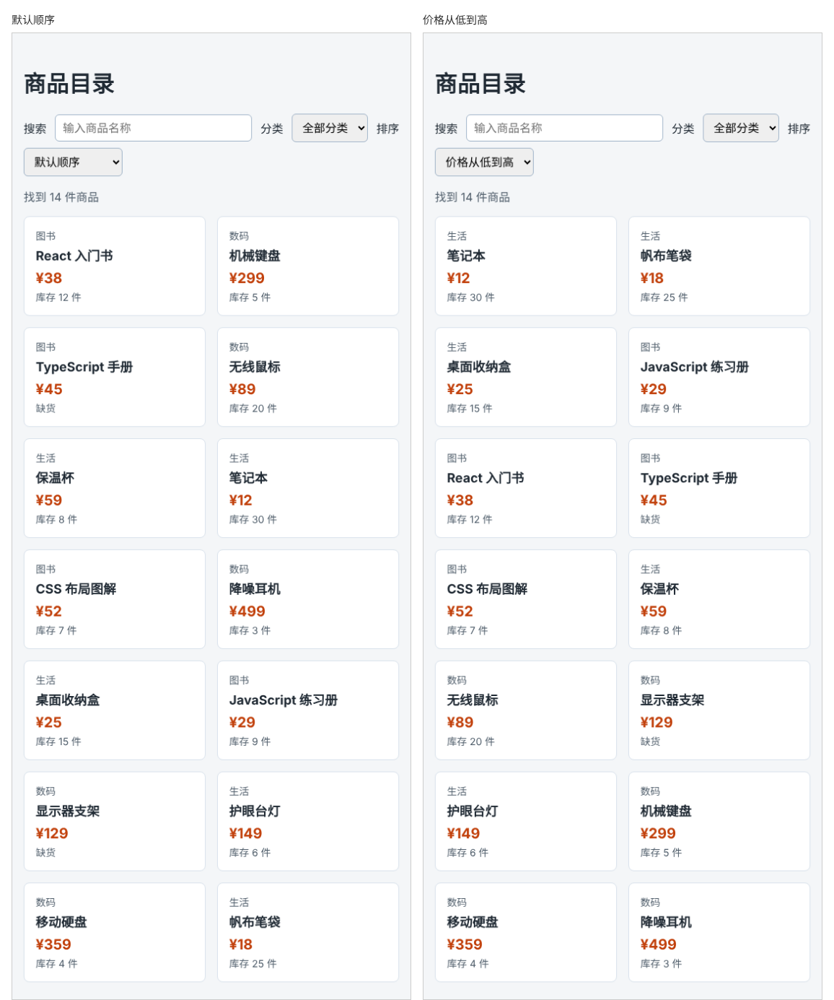

# 第 57 章：如何按价格排序商品？

前置：[第 56 章：如何根据分类筛选商品？](第056章-如何根据分类筛选商品.md)

## 一、本章要解决的问题

想买便宜一点的东西时，最方便的是让商品按价格从低到高排好；想看最贵的几件时，则要从高到低。

本章加一个“排序”下拉框，有“默认顺序”“价格从低到高”“价格从高到低”三个选项。排序和前两章的搜索、分类同时生效；选回“默认顺序”时，商品恢复原来的顺序。

下图左边是默认顺序，右边是选择“价格从低到高”以后的样子：



## 二、必要原理

### sort 和比较函数

数组的 `sort` 方法给数组排序。给数字排序时，要传入一个**比较函数**，告诉它两件商品谁在前：

```tsx
list.sort((a, b) => a.price - b.price);
```

`sort` 会反复取出两件商品 `a`、`b` 交给比较函数，根据返回值决定顺序：

- 返回负数：`a` 排在 `b` 前面；
- 返回正数：`b` 排在 `a` 前面；
- 返回 0：两者顺序不变。

`a.price - b.price`：`a` 更便宜时结果是负数，`a` 排前面，所以是从低到高。反过来写成 `b.price - a.price`，就是从高到低。

不传比较函数时，`sort` 会把每个元素转成文字再比较：数字数组 `[129, 18, 45]` 排完还是 `[129, 18, 45]`，因为按文字比较时 `'129'` 排在 `'18'` 前面；商品对象转成的文字全都一样，顺序根本不会变。

### sort 会修改原数组

`map`、`filter` 都返回新数组，原数组不变。`sort` 不一样：它**直接修改原数组**，把原数组中的元素重新排列。

如果直接对数据文件中的 `products` 调用 `sort`，这个数组的顺序就被永久改掉了，选回“默认顺序”时再也回不到原来的顺序。第 51 章（直接修改数组为什么会出问题）说过，不能修改 state 中的数组；props 中的数组、从其他文件导入的数据也一样，都不要在原地修改。

所以先用展开语法复制出一个新数组，再对副本排序：

```tsx
const visibleProducts = [...filteredProducts];
visibleProducts.sort((a, b) => a.price - b.price);
```

副本是这次渲染中新建的，只在这里使用，修改它不会影响任何别的数据。（严格说，`filter` 返回的已经是一个新数组，直接排序也不会出错。但先复制再排序是一个好习惯，代码以后改动时不容易出问题。）

### 先筛选，再排序

筛选的结果改名为 `filteredProducts`，排序后的结果仍叫 `visibleProducts`，这样下面显示列表的 JSX 不用改。先筛选再排序，要排序的商品更少；结果和先排序再筛选是一样的。

## 三、动手实现

### 第 1 步：加入排序 state

在 `src/pages/ProductPage.tsx` 中 `category` 的下面加入：

```tsx
  const [sortOrder, setSortOrder] = useState('default');
```

### 第 2 步：筛选后再排序

把 `const visibleProducts = products.filter((product) => {` 这一行中的 `visibleProducts` 改名为 `filteredProducts`：

```tsx
  const filteredProducts = products.filter((product) => {
```

在这个 `filter` 结束的 `});` 后面加入：

```tsx
  const visibleProducts = [...filteredProducts];
  if (sortOrder === 'price-asc') {
    visibleProducts.sort((a, b) => a.price - b.price);
  } else if (sortOrder === 'price-desc') {
    visibleProducts.sort((a, b) => b.price - a.price);
  }
```

选“默认顺序”时两个条件都不成立，`visibleProducts` 保持数据文件中的顺序。

### 第 3 步：编写处理函数

在 `handleCategoryChange` 的后面加入：

```tsx
  function handleSortChange(event: ChangeEvent<HTMLSelectElement>) {
    setSortOrder(event.target.value);
  }
```

### 第 4 步：加入排序下拉框

在分类下拉框的 `</select>` 后面加入：

```tsx
        <label htmlFor="sort">排序</label>
        <select id="sort" value={sortOrder} onChange={handleSortChange}>
          <option value="default">默认顺序</option>
          <option value="price-asc">价格从低到高</option>
          <option value="price-desc">价格从高到低</option>
        </select>
```

## 四、运行与检查

保持开发服务器运行（`npm.cmd run dev`），保存文件后在浏览器中查看。

1. 默认顺序下，第一件是“React 入门书”，第二件是“机械键盘”。
2. 选“价格从低到高”，第一件是 ¥12 的“笔记本”，最后一件是 ¥499 的“降噪耳机”。
3. 选“价格从高到低”，顺序正好相反。
4. 保持从高到低，分类选“图书”，显示的 4 本书按 52、45、38、29 的价格排列。
5. 选回“默认顺序”，商品恢复原来的顺序，第一件仍是“React 入门书”。
6. 在搜索框中输入关键词，排序同样生效。

最后运行检查，应没有错误：

```powershell
npm.cmd run check
```

**小练习**：再加一个“库存从多到少”的选项。练习后恢复本章代码。

## 五、常见错误

| 现象 | 原因 | 怎么改 |
| --- | --- | --- |
| 排过一次后，选“默认顺序”回不到原来的顺序 | 直接对 `products` 调用了 `sort`，数据文件中的数组被改了 | 复制出新数组再排序 |
| 从低到高变成了从高到低 | 比较函数写反了 | 从低到高是 `a.price - b.price` |
| 选了排序但顺序没有任何变化 | 写成了 `visibleProducts.sort()`，没有传比较函数 | 传入 `(a, b) => a.price - b.price` |
| 选了某一种排序后顺序没有变化 | 下拉框的 `value` 和代码中判断的值不一致，例如一处写 `price-asc`，一处写 `priceAsc` | 两处使用完全相同的字符串 |
| 编辑器提示 `filteredProducts` 找不到 | 只加了排序代码，没有把筛选结果改名 | 把 `filter` 那一行改为 `const filteredProducts = …` |

## 六、本章完整代码

### `src/pages/ProductPage.tsx`

```tsx
import { useState } from 'react';
import type { ChangeEvent } from 'react';
import { categories, products } from '../data/products';
import styles from './ProductPage.module.css';

export default function ProductPage() {
  const [keyword, setKeyword] = useState('');
  const [category, setCategory] = useState('all');
  const [sortOrder, setSortOrder] = useState('default');
  const normalizedKeyword = keyword.trim().toLowerCase();
  const filteredProducts = products.filter((product) => {
    const matchesKeyword = product.name.toLowerCase().includes(normalizedKeyword);
    const matchesCategory = category === 'all' || product.category === category;
    return matchesKeyword && matchesCategory;
  });
  const visibleProducts = [...filteredProducts];
  if (sortOrder === 'price-asc') {
    visibleProducts.sort((a, b) => a.price - b.price);
  } else if (sortOrder === 'price-desc') {
    visibleProducts.sort((a, b) => b.price - a.price);
  }

  function handleKeywordChange(event: ChangeEvent<HTMLInputElement>) {
    setKeyword(event.target.value);
  }

  function handleCategoryChange(event: ChangeEvent<HTMLSelectElement>) {
    setCategory(event.target.value);
  }

  function handleSortChange(event: ChangeEvent<HTMLSelectElement>) {
    setSortOrder(event.target.value);
  }

  return (
    <main className="page">
      <h1>商品目录</h1>
      <div className={styles.filters}>
        <label htmlFor="keyword">搜索</label>
        <input
          id="keyword"
          type="search"
          placeholder="输入商品名称"
          value={keyword}
          onChange={handleKeywordChange}
        />
        <label htmlFor="category">分类</label>
        <select id="category" value={category} onChange={handleCategoryChange}>
          <option value="all">全部分类</option>
          {categories.map((item) => (
            <option key={item} value={item}>
              {item}
            </option>
          ))}
        </select>
        <label htmlFor="sort">排序</label>
        <select id="sort" value={sortOrder} onChange={handleSortChange}>
          <option value="default">默认顺序</option>
          <option value="price-asc">价格从低到高</option>
          <option value="price-desc">价格从高到低</option>
        </select>
      </div>
      <p className={styles.summary}>找到 {visibleProducts.length} 件商品</p>
      {visibleProducts.length === 0 ? (
        <p className={styles.empty}>没有找到符合条件的商品。</p>
      ) : (
        <ul className={styles.list}>
          {visibleProducts.map((product) => (
            <li key={product.id} className={styles.item}>
              <p className={styles.category}>{product.category}</p>
              <h2 className={styles.name}>{product.name}</h2>
              <p className={styles.price}>¥{product.price}</p>
              <p className={styles.stock}>
                {product.stock === 0 ? '缺货' : '库存 ' + product.stock + ' 件'}
              </p>
            </li>
          ))}
        </ul>
      )}
    </main>
  );
}
```

## 七、本章改动小结

修改 `src/pages/ProductPage.tsx`：加入排序下拉框，筛选结果复制后按价格排序。

---

下一章：[第 58 章：如何让商品列表每页只显示固定数量？](第058章-如何让商品列表每页只显示固定数量.md)
