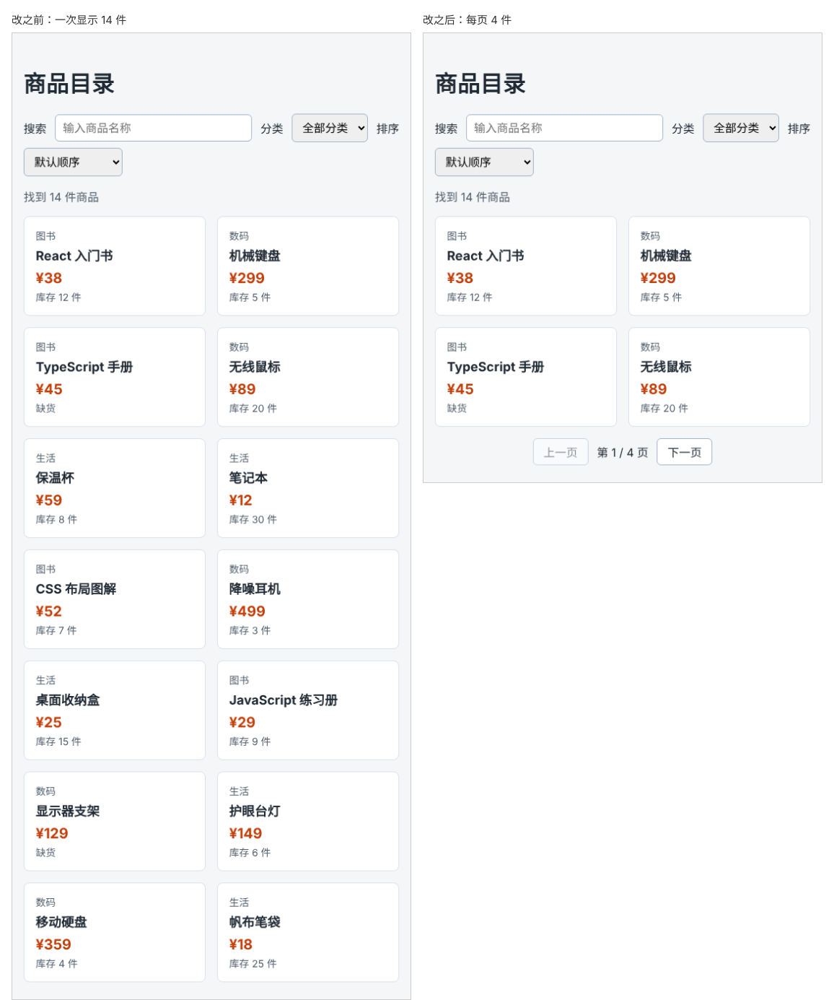

# 第 58 章：如何让商品列表每页只显示固定数量？

前置：[第 57 章：如何按价格排序商品？](第057章-如何按价格排序商品.md)

## 一、本章要解决的问题

商品多了以后，一次全部显示，页面会拉得很长，用户要一直往下滚动。

本章让列表每页只显示 4 件商品，下方有“上一页”“下一页”按钮和“第 1 / 4 页”的提示。在第一页时“上一页”不能点，在最后一页时“下一页”不能点。分页对筛选、排序后的结果生效。

下图左边是现在一次显示全部商品的样子，右边是本章完成后每页显示 4 件的样子：



## 二、必要原理

### 只需要记住“当前第几页”

分页需要的东西中，只有“当前第几页”是用户操作改变的，放进 state：

```tsx
const [page, setPage] = useState(1);
```

页码从 1 开始，和页面上显示的一致。一共有几页、这一页显示哪几件商品，都可以从 `visibleProducts` 和 `page` 算出来（第 32 章：能算出来的不放进 state）。

每页的数量是固定的，写成组件外面的常量：

```tsx
const PAGE_SIZE = 4;
```

常量名用全大写加下划线，是一种常见的习惯，表示“这是一个固定的设置，不会变”。它写在组件外面，不会在每次渲染时重新创建。

### 一共有几页

14 件商品，每页 4 件，需要 4 页：最后一页只有 2 件。`Math.ceil` 把小数**向上**取整：

```tsx
Math.ceil(14 / 4); // 3.5 向上取整，得到 4
```

如果一件商品都没找到，`Math.ceil(0 / 4)` 是 0，页面会显示“第 1 / 0 页”。所以用 `Math.max` 保证至少有 1 页：`Math.max(1, …)` 返回两个数中较大的那个。

### 取出当前页的商品

数组的 `slice(开始位置, 结束位置)` 返回一个新数组，包含从开始位置到结束位置**之前**的元素，不包含结束位置本身，原数组不变：

```tsx
['a', 'b', 'c', 'd', 'e'].slice(1, 3); // ['b', 'c']
```

位置从 0 开始数。第 `page` 页从 `(page - 1) * PAGE_SIZE` 开始，到 `page * PAGE_SIZE` 之前结束：第 1 页是 0 到 4 之前（第 0—3 件），第 2 页是 4 到 8 之前。最后一页不满 4 件时，`slice` 取到数组末尾就停止，不会出错。

### 翻页按钮

点击“下一页”时 `setPage(page + 1)`，点击“上一页”时 `setPage(page - 1)`。用第 38 章的 `disabled` 防止翻出范围：第 1 页时禁用“上一页”，最后一页时禁用“下一页”。

分页按钮放在 `<nav>` 中，并用 `aria-label="分页"` 说明这组按钮的用途，读屏软件可以直接跳到这里。

## 三、动手实现

### 第 1 步：添加分页样式

在 `src/pages/ProductPage.module.css` 末尾加入：

```css
.pagination {
  display: flex;
  align-items: center;
  justify-content: center;
  gap: 12px;
  margin-top: 16px;
}
```

### 第 2 步：加入页码 state 和计算

在 `src/pages/ProductPage.tsx` 中，`import styles …` 的下面加入常量：

```tsx
const PAGE_SIZE = 4;
```

在 `sortOrder` 的下面加入：

```tsx
  const [page, setPage] = useState(1);
```

在排序的 `if … else if` 结束后加入：

```tsx
  const pageCount = Math.max(1, Math.ceil(visibleProducts.length / PAGE_SIZE));
  const pageProducts = visibleProducts.slice((page - 1) * PAGE_SIZE, page * PAGE_SIZE);
```

### 第 3 步：只显示当前页，并加入翻页按钮

把列表中的 `visibleProducts.map` 改为 `pageProducts.map`：

```tsx
          {pageProducts.map((product) => (
```

“找到 N 件商品”和空提示仍然用 `visibleProducts`，因为它们说的是全部结果。

在列表的条件判断结束（`)}`）后面、`</main>` 的前面加入：

```tsx
      <nav className={styles.pagination} aria-label="分页">
        <button type="button" disabled={page === 1} onClick={() => setPage(page - 1)}>
          上一页
        </button>
        <span>
          第 {page} / {pageCount} 页
        </span>
        <button type="button" disabled={page === pageCount} onClick={() => setPage(page + 1)}>
          下一页
        </button>
      </nav>
```

## 四、运行与检查

保持开发服务器运行（`npm.cmd run dev`），保存文件后在浏览器中查看。

1. 页面只显示 4 件商品，下方显示“第 1 / 4 页”，“上一页”是半透明的。
2. 点击“下一页”，显示第 5—8 件商品（从“保温杯”开始），“第 2 / 4 页”。
3. 一直点到“第 4 / 4 页”，只显示“移动硬盘”和“帆布笔袋”两件商品，“下一页”变成半透明。
4. 回到第 1 页，选“价格从低到高”，第 1 页是最便宜的 4 件。
5. 选择“图书”分类，显示“第 1 / 1 页”，两个按钮都不能点。
6. 上面“找到 N 件商品”显示的是全部结果的数量，不是当前页的数量。

最后运行检查，应没有错误：

```powershell
npm.cmd run check
```

**小练习**：把 `PAGE_SIZE` 改成 5，数一数一共几页、最后一页几件，和页面对照。练习后恢复本章代码。

## 五、常见错误

| 现象 | 原因 | 怎么改 |
| --- | --- | --- |
| 第 1 页从第 2 件商品开始 | 起始位置写成了 `page * PAGE_SIZE` | 起始位置是 `(page - 1) * PAGE_SIZE` |
| 每页少显示一件，或者相邻两页有一件重复 | 不清楚 `slice` 不包含结束位置，结束位置多减或多加了 1 | 结束位置写 `page * PAGE_SIZE`，不要加减 1 |
| 只有 14 件却显示“共 3 页”，最后 2 件看不到 | 用了 `Math.floor` 或 `Math.round` | 用 `Math.ceil` 向上取整 |
| 什么都没找到时显示“第 1 / 0 页” | 没有用 `Math.max(1, …)` 保证至少 1 页 | 加上 `Math.max` |
| 翻页后列表没有变化 | 列表仍在用 `visibleProducts.map` | 改为 `pageProducts.map` |

## 六、本章完整代码

### `src/pages/ProductPage.module.css`

```css
.filters {
  display: flex;
  flex-wrap: wrap;
  align-items: center;
  gap: 8px 12px;
}

.filters input,
.filters select {
  padding: 8px 10px;
  border: 1px solid #9fb3c8;
  border-radius: 6px;
  font: inherit;
}

.filters input {
  flex: 1;
  min-width: 160px;
}

.summary,
.empty {
  color: #52606d;
}

.list {
  display: flex;
  flex-wrap: wrap;
  gap: 16px;
  margin: 0;
  padding: 0;
  list-style: none;
}

.item {
  flex: 1 1 160px;
  padding: 16px;
  border: 1px solid #d9e2ec;
  border-radius: 8px;
  background: #ffffff;
}

.category,
.stock {
  margin: 0;
  color: #52606d;
  font-size: 14px;
}

.name {
  margin: 4px 0 8px;
  font-size: 18px;
}

.price {
  margin: 0 0 4px;
  color: #c2410c;
  font-size: 20px;
  font-weight: bold;
}

.pagination {
  display: flex;
  align-items: center;
  justify-content: center;
  gap: 12px;
  margin-top: 16px;
}
```

### `src/pages/ProductPage.tsx`

```tsx
import { useState } from 'react';
import type { ChangeEvent } from 'react';
import { categories, products } from '../data/products';
import styles from './ProductPage.module.css';

const PAGE_SIZE = 4;

export default function ProductPage() {
  const [keyword, setKeyword] = useState('');
  const [category, setCategory] = useState('all');
  const [sortOrder, setSortOrder] = useState('default');
  const [page, setPage] = useState(1);
  const normalizedKeyword = keyword.trim().toLowerCase();
  const filteredProducts = products.filter((product) => {
    const matchesKeyword = product.name.toLowerCase().includes(normalizedKeyword);
    const matchesCategory = category === 'all' || product.category === category;
    return matchesKeyword && matchesCategory;
  });
  const visibleProducts = [...filteredProducts];
  if (sortOrder === 'price-asc') {
    visibleProducts.sort((a, b) => a.price - b.price);
  } else if (sortOrder === 'price-desc') {
    visibleProducts.sort((a, b) => b.price - a.price);
  }
  const pageCount = Math.max(1, Math.ceil(visibleProducts.length / PAGE_SIZE));
  const pageProducts = visibleProducts.slice((page - 1) * PAGE_SIZE, page * PAGE_SIZE);

  function handleKeywordChange(event: ChangeEvent<HTMLInputElement>) {
    setKeyword(event.target.value);
  }

  function handleCategoryChange(event: ChangeEvent<HTMLSelectElement>) {
    setCategory(event.target.value);
  }

  function handleSortChange(event: ChangeEvent<HTMLSelectElement>) {
    setSortOrder(event.target.value);
  }

  return (
    <main className="page">
      <h1>商品目录</h1>
      <div className={styles.filters}>
        <label htmlFor="keyword">搜索</label>
        <input
          id="keyword"
          type="search"
          placeholder="输入商品名称"
          value={keyword}
          onChange={handleKeywordChange}
        />
        <label htmlFor="category">分类</label>
        <select id="category" value={category} onChange={handleCategoryChange}>
          <option value="all">全部分类</option>
          {categories.map((item) => (
            <option key={item} value={item}>
              {item}
            </option>
          ))}
        </select>
        <label htmlFor="sort">排序</label>
        <select id="sort" value={sortOrder} onChange={handleSortChange}>
          <option value="default">默认顺序</option>
          <option value="price-asc">价格从低到高</option>
          <option value="price-desc">价格从高到低</option>
        </select>
      </div>
      <p className={styles.summary}>找到 {visibleProducts.length} 件商品</p>
      {visibleProducts.length === 0 ? (
        <p className={styles.empty}>没有找到符合条件的商品。</p>
      ) : (
        <ul className={styles.list}>
          {pageProducts.map((product) => (
            <li key={product.id} className={styles.item}>
              <p className={styles.category}>{product.category}</p>
              <h2 className={styles.name}>{product.name}</h2>
              <p className={styles.price}>¥{product.price}</p>
              <p className={styles.stock}>
                {product.stock === 0 ? '缺货' : '库存 ' + product.stock + ' 件'}
              </p>
            </li>
          ))}
        </ul>
      )}
      <nav className={styles.pagination} aria-label="分页">
        <button type="button" disabled={page === 1} onClick={() => setPage(page - 1)}>
          上一页
        </button>
        <span>
          第 {page} / {pageCount} 页
        </span>
        <button type="button" disabled={page === pageCount} onClick={() => setPage(page + 1)}>
          下一页
        </button>
      </nav>
    </main>
  );
}
```

## 七、本章改动小结

修改 `src/pages/ProductPage.tsx`：加入 `page` state，按页截取商品，加入翻页按钮；修改 `src/pages/ProductPage.module.css`：加入分页样式。

---

下一章：[第 59 章：改变筛选条件后，为什么要回到第一页？](第059章-改变筛选条件后，为什么要回到第一页.md)
