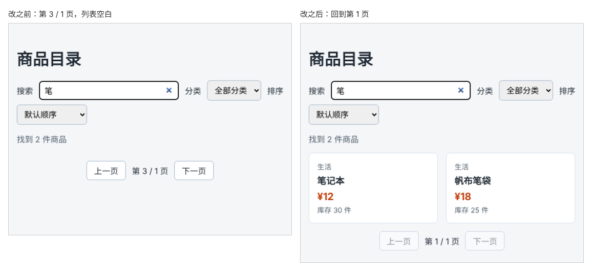

# 第 59 章：改变筛选条件后，为什么要回到第一页？

前置：[第 58 章：如何让商品列表每页只显示固定数量？](第058章-如何让商品列表每页只显示固定数量.md)

## 一、本章要解决的问题

上一章的分页有一个隐藏的问题。先翻到第 3 页，再在搜索框中输入“笔”：上面显示“找到 2 件商品”，下面却一件商品都没有，分页提示是奇怪的“第 3 / 1 页”，“下一页”按钮居然还能点。

本章先重现这个问题，弄清原因，然后让搜索、分类、排序改变时都自动回到第 1 页。

下图都是先翻到第 3 页、再搜索“笔”的结果，左边是现在的样子，右边是本章完成后的样子：



## 二、必要原理

### 问题出在哪里

`page` 是 state，筛选条件改变时，它不会自己变化。翻到第 3 页后输入“笔”：

- 筛选结果只有 2 件，`pageCount` 算出来是 1；
- `page` 仍然是 3，`slice(8, 12)` 从只有 2 件的数组中取第 8 件之后的商品，得到空数组；
- “下一页”的禁用条件是 `page === pageCount`，3 不等于 1，所以按钮可以点，点了会变成第 4 页。

每个值单独看都“没算错”，但组合在一起就不合理了：**页码是相对于某一组结果而言的**，结果变了，原来的页码就失去了意义。

### 在改变条件的同时重置页码

用户改变搜索词、分类或排序，就是在要求看一组新的结果。新结果自然应该从第 1 页看起。所以最直接的做法是：在处理这些操作的事件函数中，改完条件后顺手把页码设回 1：

```tsx
function handleKeywordChange(event: ChangeEvent<HTMLInputElement>) {
  setKeyword(event.target.value);
  setPage(1);
}
```

一个事件函数中调用多个 set 函数，React 会把它们合在一起，只重新渲染一次（第 28 章）。所以页面不会先出现一个“第 3 / 1 页”的中间状态。

排序也要重置。换了排序方式后，原来第 3 页上的商品已经变成了别的商品，停留在第 3 页没有意义。

### 为什么不在渲染时修正页码

另一种思路是渲染时把超出范围的页码“夹”回来，例如 `Math.min(page, pageCount)`。这能避免出现空页，但搜索后可能停在一个中间页上，用户不知道前面还有结果。而且 `page` state 中保存的仍然是一个不存在的页码。在事件中重置，state 始终是正确的值，也更符合用户的预期。

以后学到 Effect（第 9 部分）时，也不要写成“监视筛选条件变化，然后重置页码”。那样页面会先用错误的页码渲染一次，再修正一次。由用户操作引起的变化，就在处理这个操作的事件函数中一起完成。

## 三、动手实现

### 第 1 步：重现问题

打开页面，点击两次“下一页”到第 3 页，然后在搜索框中输入“笔”。确认看到“找到 2 件商品”、空白的列表和“第 3 / 1 页”。

### 第 2 步：在三个处理函数中重置页码

在 `src/pages/ProductPage.tsx` 中，在 `handleKeywordChange`、`handleCategoryChange`、`handleSortChange` 三个函数中各加一行 `setPage(1);`：

```tsx
  function handleKeywordChange(event: ChangeEvent<HTMLInputElement>) {
    setKeyword(event.target.value);
    setPage(1);
  }

  function handleCategoryChange(event: ChangeEvent<HTMLSelectElement>) {
    setCategory(event.target.value);
    setPage(1);
  }

  function handleSortChange(event: ChangeEvent<HTMLSelectElement>) {
    setSortOrder(event.target.value);
    setPage(1);
  }
```

## 四、运行与检查

保持开发服务器运行（`npm.cmd run dev`），保存文件后在浏览器中查看。

1. 翻到第 3 页，输入“笔”，立即显示“笔记本”和“帆布笔袋”，分页是“第 1 / 1 页”，两个按钮都不能点。
2. 清空搜索框，回到“第 1 / 4 页”，而不是第 3 页。
3. 翻到第 2 页，分类选“数码”，显示“第 1 / 2 页”，第一件是“机械键盘”。
4. 翻到第 2 页，排序选“价格从高到低”，回到第 1 页，第一件是“降噪耳机”。
5. 只点“上一页”“下一页”时，页码正常变化，不会被重置。

最后运行检查，应没有错误：

```powershell
npm.cmd run check
```

**小练习**：暂时只在 `handleKeywordChange` 中保留 `setPage(1)`，翻到第 3 页后选择“图书”分类，看看会出现什么情况。练习后恢复本章代码。

## 五、常见错误

| 现象 | 原因 | 怎么改 |
| --- | --- | --- |
| 搜索后列表是空的，但显示找到了商品 | 改变筛选条件时没有重置页码 | 在处理函数中加上 `setPage(1)` |
| 搜索没问题，换分类后又出现空页 | 只在一个处理函数中重置了页码 | 搜索、分类、排序三个处理函数都要重置 |
| 每次翻页都回到第 1 页 | 把 `setPage(1)` 也写进了翻页按钮的处理中 | 只在改变筛选条件的处理函数中重置 |
| 控制台报错“重新渲染次数过多” | 把 `setPage(1)` 直接写在了组件函数体中，每次渲染都调用 set 函数 | 放进事件处理函数 |

## 六、本章完整代码

### `src/pages/ProductPage.tsx`

```tsx
import { useState } from 'react';
import type { ChangeEvent } from 'react';
import { categories, products } from '../data/products';
import styles from './ProductPage.module.css';

const PAGE_SIZE = 4;

export default function ProductPage() {
  const [keyword, setKeyword] = useState('');
  const [category, setCategory] = useState('all');
  const [sortOrder, setSortOrder] = useState('default');
  const [page, setPage] = useState(1);
  const normalizedKeyword = keyword.trim().toLowerCase();
  const filteredProducts = products.filter((product) => {
    const matchesKeyword = product.name.toLowerCase().includes(normalizedKeyword);
    const matchesCategory = category === 'all' || product.category === category;
    return matchesKeyword && matchesCategory;
  });
  const visibleProducts = [...filteredProducts];
  if (sortOrder === 'price-asc') {
    visibleProducts.sort((a, b) => a.price - b.price);
  } else if (sortOrder === 'price-desc') {
    visibleProducts.sort((a, b) => b.price - a.price);
  }
  const pageCount = Math.max(1, Math.ceil(visibleProducts.length / PAGE_SIZE));
  const pageProducts = visibleProducts.slice((page - 1) * PAGE_SIZE, page * PAGE_SIZE);

  function handleKeywordChange(event: ChangeEvent<HTMLInputElement>) {
    setKeyword(event.target.value);
    setPage(1);
  }

  function handleCategoryChange(event: ChangeEvent<HTMLSelectElement>) {
    setCategory(event.target.value);
    setPage(1);
  }

  function handleSortChange(event: ChangeEvent<HTMLSelectElement>) {
    setSortOrder(event.target.value);
    setPage(1);
  }

  return (
    <main className="page">
      <h1>商品目录</h1>
      <div className={styles.filters}>
        <label htmlFor="keyword">搜索</label>
        <input
          id="keyword"
          type="search"
          placeholder="输入商品名称"
          value={keyword}
          onChange={handleKeywordChange}
        />
        <label htmlFor="category">分类</label>
        <select id="category" value={category} onChange={handleCategoryChange}>
          <option value="all">全部分类</option>
          {categories.map((item) => (
            <option key={item} value={item}>
              {item}
            </option>
          ))}
        </select>
        <label htmlFor="sort">排序</label>
        <select id="sort" value={sortOrder} onChange={handleSortChange}>
          <option value="default">默认顺序</option>
          <option value="price-asc">价格从低到高</option>
          <option value="price-desc">价格从高到低</option>
        </select>
      </div>
      <p className={styles.summary}>找到 {visibleProducts.length} 件商品</p>
      {visibleProducts.length === 0 ? (
        <p className={styles.empty}>没有找到符合条件的商品。</p>
      ) : (
        <ul className={styles.list}>
          {pageProducts.map((product) => (
            <li key={product.id} className={styles.item}>
              <p className={styles.category}>{product.category}</p>
              <h2 className={styles.name}>{product.name}</h2>
              <p className={styles.price}>¥{product.price}</p>
              <p className={styles.stock}>
                {product.stock === 0 ? '缺货' : '库存 ' + product.stock + ' 件'}
              </p>
            </li>
          ))}
        </ul>
      )}
      <nav className={styles.pagination} aria-label="分页">
        <button type="button" disabled={page === 1} onClick={() => setPage(page - 1)}>
          上一页
        </button>
        <span>
          第 {page} / {pageCount} 页
        </span>
        <button type="button" disabled={page === pageCount} onClick={() => setPage(page + 1)}>
          下一页
        </button>
      </nav>
    </main>
  );
}
```

## 七、本章改动小结

修改 `src/pages/ProductPage.tsx`：改变搜索词、分类、排序时，页码重置为 1。

---

下一章：[第 60 章：如何记录用户选中了哪些商品？](第060章-如何记录用户选中了哪些商品.md)
