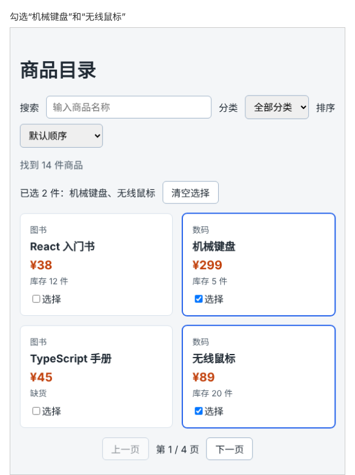

# 第 60 章：如何记录用户选中了哪些商品？

前置：[第 59 章：改变筛选条件后，为什么要回到第一页？](第059章-改变筛选条件后，为什么要回到第一页.md)

## 一、本章要解决的问题

逛商品目录时，用户常常想先把感兴趣的几件挑出来，再一起比较或购买。

本章给每张商品卡片加一个“选择”复选框。勾选后卡片出现蓝色边框，列表上方显示“已选 2 件：机械键盘、保温杯”；点击“清空选择”取消全部勾选。翻页、搜索、切换分类后，之前选中的商品仍然保持选中。

本章完成后，勾选两件商品时的页面如下图：



## 二、必要原理

### 记住 id，而不是记住商品

选中状态需要放进 state。存什么？存被选中商品的 **id 数组**：

```tsx
const [selectedIds, setSelectedIds] = useState<number[]>([]);
```

一开始一件都没选，是空数组。为什么不在每件商品对象上加一个 `selected` 字段？因为“选中”不是商品本身的信息，而是用户这一次浏览时的操作；商品数据来自数据文件，以后还会来自服务器，不应该为了页面上的勾选去改它。为什么不存整个商品对象？因为 id 已经足以找到商品，存一份对象的副本，商品信息变化时两边就可能不一致。

只存 id 还有一个好处：选中状态和“当前显示哪些商品”完全无关。翻到别的页、搜索别的关键词，`selectedIds` 都不受影响，回来时勾选还在。这正是第 46 章（删除指定的任务）强调按 id 而不是按位置操作的原因。

### 数组的 includes

第 55 章用过字符串的 `includes`，数组也有同名的方法，判断数组中是否有某个值：

```tsx
[2, 5].includes(5); // true
```

判断一件商品是否被选中，就是 `selectedIds.includes(product.id)`。页面中有三处要用到这个判断，所以写成一个小函数 `isSelected(id)`。

### 勾选和取消勾选

点击复选框时，已选中就从数组中去掉，没选中就加进去。仍然遵守第 45、46 章的规则：用 `filter` 和展开语法创建新数组，不用 `push`、`splice`。

```tsx
if (isSelected(id)) {
  setSelectedIds(selectedIds.filter((selectedId) => selectedId !== id));
} else {
  setSelectedIds([...selectedIds, id]);
}
```

清空选择更简单：`setSelectedIds([])`。

### 显示选中商品的名称

已选商品的名称从 `products` 中算出来：先 `filter` 出被选中的商品，再 `map` 成名称数组。数组的 `join('、')` 把所有元素用顿号连成一个字符串，例如 `['机械键盘', '保温杯'].join('、')` 得到 `'机械键盘、保温杯'`。

多个数组方法可以连着调用，每个方法都作用在上一个方法返回的新数组上。连写较长时，每个方法单独一行，以 `.` 开头，更容易看清处理顺序。

### 复选框的名称

每张卡片上的复选框文字都是“选择”，和第 46 章的删除按钮一样，用 `aria-label` 给读屏软件一个完整的名称，例如“选择：机械键盘”。

## 三、动手实现

### 第 1 步：添加选中样式

在 `src/pages/ProductPage.module.css` 中 `.item` 那一段的后面加入：

```css
.selected {
  border-color: #2563eb;
  box-shadow: 0 0 0 1px #2563eb;
}

.select {
  display: block;
  margin-top: 8px;
}

.selection {
  display: flex;
  align-items: center;
  gap: 12px;
  margin-bottom: 16px;
}
```

`box-shadow` 在边框外再画一圈同色的细线，让选中的卡片边框看起来更粗，而卡片大小不变。

### 第 2 步：加入 state 和计算

在 `src/pages/ProductPage.tsx` 中 `page` 的下面加入：

```tsx
  const [selectedIds, setSelectedIds] = useState<number[]>([]);
```

在 `pageProducts` 的下面加入：

```tsx
  const selectedNames = products
    .filter((product) => selectedIds.includes(product.id))
    .map((product) => product.name);
```

### 第 3 步：编写判断和切换函数

在 `handleSortChange` 的后面加入：

```tsx
  function isSelected(id: number) {
    return selectedIds.includes(id);
  }

  function handleSelectChange(id: number) {
    if (isSelected(id)) {
      setSelectedIds(selectedIds.filter((selectedId) => selectedId !== id));
    } else {
      setSelectedIds([...selectedIds, id]);
    }
  }
```

### 第 4 步：显示已选商品

在“找到 N 件商品”的 `<p>` 后面加入：

```tsx
      <div className={styles.selection}>
        <span>
          {selectedIds.length === 0
            ? '还没有选择商品'
            : '已选 ' + selectedIds.length + ' 件：' + selectedNames.join('、')}
        </span>
        <button
          type="button"
          disabled={selectedIds.length === 0}
          onClick={() => setSelectedIds([])}
        >
          清空选择
        </button>
      </div>
```

### 第 5 步：给商品卡片加上复选框

把 `<li key={product.id} className={styles.item}>` 改为：

```tsx
            <li
              key={product.id}
              className={isSelected(product.id) ? styles.item + ' ' + styles.selected : styles.item}
            >
```

在库存的 `</p>` 后面、`</li>` 的前面加入：

```tsx
              <label className={styles.select}>
                <input
                  type="checkbox"
                  aria-label={'选择：' + product.name}
                  checked={isSelected(product.id)}
                  onChange={() => handleSelectChange(product.id)}
                />
                选择
              </label>
```

## 四、运行与检查

保持开发服务器运行（`npm.cmd run dev`），保存文件后在浏览器中查看。

1. 列表上方显示“还没有选择商品”，“清空选择”是半透明的。
2. 勾选“机械键盘”，卡片出现蓝色边框，上方显示“已选 1 件：机械键盘”。
3. 翻到第 2 页，勾选“保温杯”，显示“已选 2 件：机械键盘、保温杯”。
4. 回到第 1 页，“机械键盘”仍是勾选状态。
5. 搜索“键盘”，“机械键盘”仍是勾选的；清空搜索后，两件商品都还是勾选的。
6. 再点一次“机械键盘”的复选框，它被取消，只剩“保温杯”。
7. 点击“清空选择”，所有勾选和蓝色边框都消失。
8. 点击复选框旁边的“选择”二字，同样可以勾选。

最后运行检查，应没有错误：

```powershell
npm.cmd run check
```

**小练习**：如果选中的商品中有缺货的，在已选名称后面提示“其中 N 件缺货”。（提示：先用 `filter` 得到选中的商品数组，再对它 `filter` 出 `stock` 为 0 的商品，取 `length`。）练习后恢复本章代码。

## 五、常见错误

| 现象 | 原因 | 怎么改 |
| --- | --- | --- |
| 翻页后，新的一页上有商品莫名其妙被勾选了 | 记录的是勾选项在当前页中的位置，而不是商品的 id | 记录 `product.id` |
| 勾选后页面没有变化，再做别的操作才显示 | 用 `selectedIds.push(id)` 修改了原数组 | 用 `[...selectedIds, id]` 创建新数组 |
| 编辑器提示 `number` 不能赋给 `never` | 写成了 `useState([])`，TypeScript 推断不出数组元素的类型 | 写明类型：`useState<number[]>([])` |
| 已选名称的顺序和勾选的顺序不同 | 名称是按 `products` 中的顺序算出来的 | 这是正常的；需要按勾选顺序时，改为对 `selectedIds` 调用 `map` 查找商品 |
| 搜索后之前勾选的商品被取消了 | 在搜索的处理函数中清空了 `selectedIds` | 选中状态和筛选条件互不影响，不要在筛选时清空 |

## 六、本章完整代码

### `src/pages/ProductPage.module.css`

```css
.filters {
  display: flex;
  flex-wrap: wrap;
  align-items: center;
  gap: 8px 12px;
}

.filters input,
.filters select {
  padding: 8px 10px;
  border: 1px solid #9fb3c8;
  border-radius: 6px;
  font: inherit;
}

.filters input {
  flex: 1;
  min-width: 160px;
}

.summary,
.empty {
  color: #52606d;
}

.list {
  display: flex;
  flex-wrap: wrap;
  gap: 16px;
  margin: 0;
  padding: 0;
  list-style: none;
}

.item {
  flex: 1 1 160px;
  padding: 16px;
  border: 1px solid #d9e2ec;
  border-radius: 8px;
  background: #ffffff;
}

.selected {
  border-color: #2563eb;
  box-shadow: 0 0 0 1px #2563eb;
}

.select {
  display: block;
  margin-top: 8px;
}

.selection {
  display: flex;
  align-items: center;
  gap: 12px;
  margin-bottom: 16px;
}

.category,
.stock {
  margin: 0;
  color: #52606d;
  font-size: 14px;
}

.name {
  margin: 4px 0 8px;
  font-size: 18px;
}

.price {
  margin: 0 0 4px;
  color: #c2410c;
  font-size: 20px;
  font-weight: bold;
}

.pagination {
  display: flex;
  align-items: center;
  justify-content: center;
  gap: 12px;
  margin-top: 16px;
}
```

### `src/pages/ProductPage.tsx`

```tsx
import { useState } from 'react';
import type { ChangeEvent } from 'react';
import { categories, products } from '../data/products';
import styles from './ProductPage.module.css';

const PAGE_SIZE = 4;

export default function ProductPage() {
  const [keyword, setKeyword] = useState('');
  const [category, setCategory] = useState('all');
  const [sortOrder, setSortOrder] = useState('default');
  const [page, setPage] = useState(1);
  const [selectedIds, setSelectedIds] = useState<number[]>([]);
  const normalizedKeyword = keyword.trim().toLowerCase();
  const filteredProducts = products.filter((product) => {
    const matchesKeyword = product.name.toLowerCase().includes(normalizedKeyword);
    const matchesCategory = category === 'all' || product.category === category;
    return matchesKeyword && matchesCategory;
  });
  const visibleProducts = [...filteredProducts];
  if (sortOrder === 'price-asc') {
    visibleProducts.sort((a, b) => a.price - b.price);
  } else if (sortOrder === 'price-desc') {
    visibleProducts.sort((a, b) => b.price - a.price);
  }
  const pageCount = Math.max(1, Math.ceil(visibleProducts.length / PAGE_SIZE));
  const pageProducts = visibleProducts.slice((page - 1) * PAGE_SIZE, page * PAGE_SIZE);
  const selectedNames = products
    .filter((product) => selectedIds.includes(product.id))
    .map((product) => product.name);

  function handleKeywordChange(event: ChangeEvent<HTMLInputElement>) {
    setKeyword(event.target.value);
    setPage(1);
  }

  function handleCategoryChange(event: ChangeEvent<HTMLSelectElement>) {
    setCategory(event.target.value);
    setPage(1);
  }

  function handleSortChange(event: ChangeEvent<HTMLSelectElement>) {
    setSortOrder(event.target.value);
    setPage(1);
  }

  function isSelected(id: number) {
    return selectedIds.includes(id);
  }

  function handleSelectChange(id: number) {
    if (isSelected(id)) {
      setSelectedIds(selectedIds.filter((selectedId) => selectedId !== id));
    } else {
      setSelectedIds([...selectedIds, id]);
    }
  }

  return (
    <main className="page">
      <h1>商品目录</h1>
      <div className={styles.filters}>
        <label htmlFor="keyword">搜索</label>
        <input
          id="keyword"
          type="search"
          placeholder="输入商品名称"
          value={keyword}
          onChange={handleKeywordChange}
        />
        <label htmlFor="category">分类</label>
        <select id="category" value={category} onChange={handleCategoryChange}>
          <option value="all">全部分类</option>
          {categories.map((item) => (
            <option key={item} value={item}>
              {item}
            </option>
          ))}
        </select>
        <label htmlFor="sort">排序</label>
        <select id="sort" value={sortOrder} onChange={handleSortChange}>
          <option value="default">默认顺序</option>
          <option value="price-asc">价格从低到高</option>
          <option value="price-desc">价格从高到低</option>
        </select>
      </div>
      <p className={styles.summary}>找到 {visibleProducts.length} 件商品</p>
      <div className={styles.selection}>
        <span>
          {selectedIds.length === 0
            ? '还没有选择商品'
            : '已选 ' + selectedIds.length + ' 件：' + selectedNames.join('、')}
        </span>
        <button
          type="button"
          disabled={selectedIds.length === 0}
          onClick={() => setSelectedIds([])}
        >
          清空选择
        </button>
      </div>
      {visibleProducts.length === 0 ? (
        <p className={styles.empty}>没有找到符合条件的商品。</p>
      ) : (
        <ul className={styles.list}>
          {pageProducts.map((product) => (
            <li
              key={product.id}
              className={isSelected(product.id) ? styles.item + ' ' + styles.selected : styles.item}
            >
              <p className={styles.category}>{product.category}</p>
              <h2 className={styles.name}>{product.name}</h2>
              <p className={styles.price}>¥{product.price}</p>
              <p className={styles.stock}>
                {product.stock === 0 ? '缺货' : '库存 ' + product.stock + ' 件'}
              </p>
              <label className={styles.select}>
                <input
                  type="checkbox"
                  aria-label={'选择：' + product.name}
                  checked={isSelected(product.id)}
                  onChange={() => handleSelectChange(product.id)}
                />
                选择
              </label>
            </li>
          ))}
        </ul>
      )}
      <nav className={styles.pagination} aria-label="分页">
        <button type="button" disabled={page === 1} onClick={() => setPage(page - 1)}>
          上一页
        </button>
        <span>
          第 {page} / {pageCount} 页
        </span>
        <button type="button" disabled={page === pageCount} onClick={() => setPage(page + 1)}>
          下一页
        </button>
      </nav>
    </main>
  );
}
```

## 七、本章改动小结

修改 `src/pages/ProductPage.tsx`：加入 `selectedIds`，每张卡片加复选框，列表上方显示已选商品；修改 `src/pages/ProductPage.module.css`：加入选中样式。

---

下一章：[第 61 章：【组合】如何让搜索、分类、排序和分页共同决定显示结果？](第061章-如何让搜索、分类、排序和分页共同决定显示结果.md)
