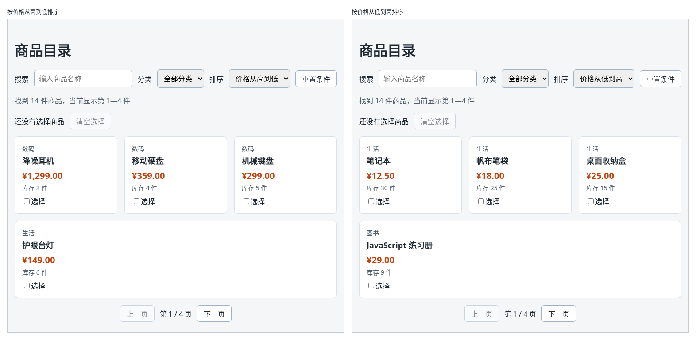

# 第 61A 章：如何把价格显示成带千分位和两位小数的格式？

前置：[第 61 章：【组合】如何让搜索、分类、排序和分页共同决定显示结果？](第061章-如何让搜索、分类、排序和分页共同决定显示结果.md)

## 一、本章要解决的问题

商品卡片上的价格现在直接显示数字：1299 元显示成“¥1299”，12.5 元显示成“¥12.5”。金额一般要求整数部分每三位加一个逗号，小数固定两位，例如“¥1,299.00”“¥12.50”，这样一眼就能看清是多少钱。

本章用浏览器自带的数字格式化功能统一显示价格。为了看到效果，先把两件商品的价格改成 1299 和 12.5。完成后，按价格从高到低排序，第一件显示“¥1,299.00”；从低到高排序，第一件显示“¥12.50”。

下图左边是按价格从高到低排序的样子，右边是从低到高排序的样子：



## 二、必要原理

### 数据保存数字，显示时再格式化

价格在数据中仍然保存成数字 `1299`、`12.5`，不改成 `'1,299.00'` 这样的字符串。排序、比较、计算都要用数字；“加逗号、补两位小数、加货币符号”只是显示的样子，在显示的那一刻再转换。

这和第 22 章显示日期的思路一样：数据保持原样，显示时交给格式化器。

### Intl.NumberFormat：按地区习惯格式化数字

第 22 章用过 `Intl.DateTimeFormat` 格式化日期。格式化数字用它的同类 `Intl.NumberFormat`：

```tsx
const priceFormatter = new Intl.NumberFormat('zh-CN', { style: 'currency', currency: 'CNY' });

priceFormatter.format(1299); // '¥1,299.00'
priceFormatter.format(12.5); // '¥12.50'
priceFormatter.format(38); // '¥38.00'
```

- 第一个参数 `'zh-CN'` 是地区，决定用什么符号、逗号加在哪里。
- `style: 'currency'` 表示按货币格式显示，`currency: 'CNY'` 指定是人民币。货币格式会自动加上货币符号，并固定显示两位小数。
- `format(数字)` 返回格式化后的字符串。

### 为什么不用 toFixed

数字有一个 `toFixed(2)` 方法，可以保留两位小数：`(1299).toFixed(2)` 得到 `'1299.00'`。但它不会加千分位的逗号，也不会加货币符号，还要自己拼上“¥”。显示金额时用 `Intl.NumberFormat` 一次处理好。

### 格式化器放在组件外面

`new Intl.NumberFormat(...)` 每次都创建一个新的格式化器。它的设置是固定的，和 state、props 都没有关系，所以在组件函数外面创建一次，放在 `PAGE_SIZE` 旁边，每次渲染直接使用。这和第 22 章 `dateFormatter` 的写法相同。

## 三、动手实现

### 第 1 步：修改两件商品的价格

打开 `src/data/products.ts`，把“降噪耳机”的价格从 `499` 改为 `1299`，把“笔记本”的价格从 `12` 改为 `12.5`：

```ts
  { id: 6, name: '笔记本', category: '生活', price: 12.5, stock: 30 },
```

```ts
  { id: 8, name: '降噪耳机', category: '数码', price: 1299, stock: 3 },
```

`Product` 类型中 `price` 是 `number`，整数和小数都可以。

### 第 2 步：创建价格格式化器

打开 `src/pages/ProductPage.tsx`，在 `const PAGE_SIZE = 4;` 的下面加入：

```tsx
// 格式化器只需要创建一次，放在组件外面，每次渲染直接使用
const priceFormatter = new Intl.NumberFormat('zh-CN', { style: 'currency', currency: 'CNY' });
```

### 第 3 步：用格式化器显示价格

找到商品卡片中显示价格的这一行：

```tsx
              <p className={styles.price}>¥{product.price}</p>
```

改为：

```tsx
              <p className={styles.price}>{priceFormatter.format(product.price)}</p>
```

原来手写的“¥”要删掉，格式化器会自己加上货币符号。

## 四、运行与检查

保持开发服务器运行（`npm.cmd run dev`），保存文件后在浏览器中查看。

1. 默认顺序下，第一件“React 入门书”的价格显示“¥38.00”。
2. 排序选择“价格从高到低”，第一件是“降噪耳机”，价格显示“¥1,299.00”；接着是“¥359.00”“¥299.00”“¥149.00”。
3. 排序选择“价格从低到高”，第一件是“笔记本”，价格显示“¥12.50”；接着是“¥18.00”“¥25.00”。
4. 排序结果和改价格之前一样正确：数据仍然是数字，排序比较的是数字，不受显示格式影响。
5. 搜索、分类、分页和选择商品都和第 61 章一样正常。

最后运行检查，应没有错误：

```powershell
npm.cmd run check
```

**小练习**：在“已选 2 件：……”后面再显示这几件商品的价格，例如“已选 2 件：机械键盘（¥299.00）、降噪耳机（¥1,299.00）”。提示：修改 `selectedNames` 中 `map` 返回的字符串。练习后恢复本章代码。

## 五、常见错误

| 现象 | 原因 | 怎么改 |
| --- | --- | --- |
| 价格显示成“¥¥38.00” | 格式化后忘了删掉原来手写的“¥” | 删掉 `{priceFormatter.format(...)}` 前面的“¥” |
| 价格显示成“CN¥38.00” | 地区写成了 `'en-US'` 等其他地区，人民币在这些地区显示为“CN¥” | 地区写 `'zh-CN'` |
| 页面一片空白，控制台显示 `TypeError: Currency code is required with currency style.` | 写了 `style: 'currency'`，没有写 `currency: 'CNY'` | 货币格式必须同时指定货币 |
| 价格显示“1299.00”，没有逗号和货币符号 | 用了 `toFixed(2)` | 改用 `Intl.NumberFormat` 的货币格式 |

## 六、本章完整代码

### `src/data/products.ts`

```ts
export type Product = {
  id: number;
  name: string;
  category: string;
  price: number;
  stock: number;
};

export const categories = ['图书', '数码', '生活'];

export const products: Product[] = [
  { id: 1, name: 'React 入门书', category: '图书', price: 38, stock: 12 },
  { id: 2, name: '机械键盘', category: '数码', price: 299, stock: 5 },
  { id: 3, name: 'TypeScript 手册', category: '图书', price: 45, stock: 0 },
  { id: 4, name: '无线鼠标', category: '数码', price: 89, stock: 20 },
  { id: 5, name: '保温杯', category: '生活', price: 59, stock: 8 },
  { id: 6, name: '笔记本', category: '生活', price: 12.5, stock: 30 },
  { id: 7, name: 'CSS 布局图解', category: '图书', price: 52, stock: 7 },
  { id: 8, name: '降噪耳机', category: '数码', price: 1299, stock: 3 },
  { id: 9, name: '桌面收纳盒', category: '生活', price: 25, stock: 15 },
  { id: 10, name: 'JavaScript 练习册', category: '图书', price: 29, stock: 9 },
  { id: 11, name: '显示器支架', category: '数码', price: 129, stock: 0 },
  { id: 12, name: '护眼台灯', category: '生活', price: 149, stock: 6 },
  { id: 13, name: '移动硬盘', category: '数码', price: 359, stock: 4 },
  { id: 14, name: '帆布笔袋', category: '生活', price: 18, stock: 25 },
];
```

### `src/pages/ProductPage.tsx`

```tsx
import { useState } from 'react';
import type { ChangeEvent } from 'react';
import { categories, products } from '../data/products';
import styles from './ProductPage.module.css';

const PAGE_SIZE = 4;
// 格式化器只需要创建一次，放在组件外面，每次渲染直接使用
const priceFormatter = new Intl.NumberFormat('zh-CN', { style: 'currency', currency: 'CNY' });

export default function ProductPage() {
  const [keyword, setKeyword] = useState('');
  const [category, setCategory] = useState('all');
  const [sortOrder, setSortOrder] = useState('default');
  const [page, setPage] = useState(1);
  const [selectedIds, setSelectedIds] = useState<number[]>([]);
  const normalizedKeyword = keyword.trim().toLowerCase();
  const filteredProducts = products.filter((product) => {
    const matchesKeyword = product.name.toLowerCase().includes(normalizedKeyword);
    const matchesCategory = category === 'all' || product.category === category;
    return matchesKeyword && matchesCategory;
  });
  const visibleProducts = [...filteredProducts];
  if (sortOrder === 'price-asc') {
    visibleProducts.sort((a, b) => a.price - b.price);
  } else if (sortOrder === 'price-desc') {
    visibleProducts.sort((a, b) => b.price - a.price);
  }
  const pageCount = Math.max(1, Math.ceil(visibleProducts.length / PAGE_SIZE));
  const startIndex = (page - 1) * PAGE_SIZE;
  const pageProducts = visibleProducts.slice(startIndex, startIndex + PAGE_SIZE);
  const hasConditions = keyword !== '' || category !== 'all' || sortOrder !== 'default';
  const selectedNames = products
    .filter((product) => selectedIds.includes(product.id))
    .map((product) => product.name);

  function handleKeywordChange(event: ChangeEvent<HTMLInputElement>) {
    setKeyword(event.target.value);
    setPage(1);
  }

  function handleCategoryChange(event: ChangeEvent<HTMLSelectElement>) {
    setCategory(event.target.value);
    setPage(1);
  }

  function handleSortChange(event: ChangeEvent<HTMLSelectElement>) {
    setSortOrder(event.target.value);
    setPage(1);
  }

  function isSelected(id: number) {
    return selectedIds.includes(id);
  }

  function handleReset() {
    setKeyword('');
    setCategory('all');
    setSortOrder('default');
    setPage(1);
  }

  function handleSelectChange(id: number) {
    if (isSelected(id)) {
      setSelectedIds(selectedIds.filter((selectedId) => selectedId !== id));
    } else {
      setSelectedIds([...selectedIds, id]);
    }
  }

  return (
    <main className="page">
      <h1>商品目录</h1>
      <div className={styles.filters}>
        <label htmlFor="keyword">搜索</label>
        <input
          id="keyword"
          type="search"
          placeholder="输入商品名称"
          value={keyword}
          onChange={handleKeywordChange}
        />
        <label htmlFor="category">分类</label>
        <select id="category" value={category} onChange={handleCategoryChange}>
          <option value="all">全部分类</option>
          {categories.map((item) => (
            <option key={item} value={item}>
              {item}
            </option>
          ))}
        </select>
        <label htmlFor="sort">排序</label>
        <select id="sort" value={sortOrder} onChange={handleSortChange}>
          <option value="default">默认顺序</option>
          <option value="price-asc">价格从低到高</option>
          <option value="price-desc">价格从高到低</option>
        </select>
        <button type="button" disabled={!hasConditions} onClick={handleReset}>
          重置条件
        </button>
      </div>
      <p className={styles.summary}>
        找到 {visibleProducts.length} 件商品
        {visibleProducts.length > 0 && (
          <span>
            ，当前显示第 {startIndex + 1}—{startIndex + pageProducts.length} 件
          </span>
        )}
      </p>
      <div className={styles.selection}>
        <span>
          {selectedIds.length === 0
            ? '还没有选择商品'
            : '已选 ' + selectedIds.length + ' 件：' + selectedNames.join('、')}
        </span>
        <button
          type="button"
          disabled={selectedIds.length === 0}
          onClick={() => setSelectedIds([])}
        >
          清空选择
        </button>
      </div>
      {visibleProducts.length === 0 ? (
        <p className={styles.empty}>没有找到符合条件的商品。</p>
      ) : (
        <ul className={styles.list}>
          {pageProducts.map((product) => (
            <li
              key={product.id}
              className={isSelected(product.id) ? styles.item + ' ' + styles.selected : styles.item}
            >
              <p className={styles.category}>{product.category}</p>
              <h2 className={styles.name}>{product.name}</h2>
              <p className={styles.price}>{priceFormatter.format(product.price)}</p>
              <p className={styles.stock}>
                {product.stock === 0 ? '缺货' : '库存 ' + product.stock + ' 件'}
              </p>
              <label className={styles.select}>
                <input
                  type="checkbox"
                  aria-label={'选择：' + product.name}
                  checked={isSelected(product.id)}
                  onChange={() => handleSelectChange(product.id)}
                />
                选择
              </label>
            </li>
          ))}
        </ul>
      )}
      <nav className={styles.pagination} aria-label="分页">
        <button type="button" disabled={page === 1} onClick={() => setPage(page - 1)}>
          上一页
        </button>
        <span>
          第 {page} / {pageCount} 页
        </span>
        <button type="button" disabled={page === pageCount} onClick={() => setPage(page + 1)}>
          下一页
        </button>
      </nav>
    </main>
  );
}
```

## 七、本章改动小结

修改 `src/data/products.ts`：降噪耳机的价格改为 1299，笔记本的价格改为 12.5；修改 `src/pages/ProductPage.tsx`：新增 `priceFormatter`，商品价格改用它显示。

---

下一章：[第 62 章：如何把接口返回的文章显示在页面上？](第062章-如何把接口返回的文章显示在页面上.md)
