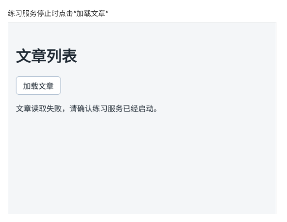

# 第 62A 章：请求失败时，如何在页面上显示错误提示？

前置：[第 62 章：如何把接口返回的文章显示在页面上？](第062章-如何把接口返回的文章显示在页面上.md)

## 一、本章要解决的问题

上一章最后停止了练习服务，再点击“加载文章”：页面上什么变化都没有，只在控制台里有一条红色错误。用户不会去看控制台，在他看来就是“按钮坏了”。

本章让请求失败时，页面上显示一条清楚的提示：“文章读取失败，请确认练习服务已经启动。”。重新启动练习服务后再点击，文章正常出现，提示消失。



## 二、必要原理

### 出错时，函数在出错的那一行停下

`await fetch(...)` 连不上服务器时，会**抛出一个错误**。抛出错误的意思是：这一行没法正常完成，函数从这里停下，后面的代码都不再执行。上一章 `setArticles(data)` 根本没有执行到，所以页面不变；没有代码处理这个错误，浏览器就把它显示在控制台里。

### try...catch：接住错误

把可能出错的代码放进 `try` 中，后面跟一个 `catch`：

```ts
try {
  // 可能出错的代码
} catch {
  // try 中任何一行出错，都会跳到这里
}
```

`try` 中的代码正常执行完，`catch` 就不执行；`try` 中某一行出错，从这一行直接跳到 `catch`，`try` 中剩下的代码不再执行。这样，我们就有机会在 `catch` 中把错误告诉用户，而不是让它悄悄地出现在控制台。

`catch` 后面可以写 `(error)` 来拿到错误的详细信息。本章只显示一条统一的提示，用不到详细信息，所以只写 `catch`。

### 用一个 state 保存错误提示

错误提示要显示在页面上，和文章列表一样用 state 保存：

```tsx
const [error, setError] = useState('');
```

空字符串表示没有错误。出错时 `setError('……')`，页面显示提示；每次开始加载前 `setError('')`，清掉上一次的提示。

### 服务器返回了错误状态，也要当作失败

还有一种失败：服务器收到了请求，但返回了错误的**状态码**。状态码是服务器对这次请求的结论，200 表示成功，404 表示找不到，500 表示服务器内部出错。这种情况下 `fetch` 并不会抛出错误，因为它确实拿到了服务器的回复。

响应对象的 `response.ok` 在状态码表示成功时为 `true`。本章在拿到响应后先检查它，不成功就**主动抛出一个错误**：

```ts
if (!response.ok) {
  throw new Error('接口返回状态 ' + response.status);
}
```

`throw` 就是“抛出”：`new Error('说明')` 创建一个错误对象，`throw` 把它抛出去。效果和 `fetch` 出错一样，程序直接跳到 `catch`。这样两种失败都在同一个地方处理。为什么 `fetch` 遇到 404 不算失败、怎样在页面上区分不同的失败，第 65 章会专门讲。

## 三、动手实现

本章只修改 `src/pages/ArticlePage.tsx`。

### 第 1 步：增加错误提示的 state

在 `articles` 的下面加入：

```tsx
  const [articles, setArticles] = useState<Article[]>([]);
  const [error, setError] = useState('');
```

### 第 2 步：用 try...catch 包住请求

把 `handleLoad` 改为：

```tsx
  async function handleLoad() {
    setError('');
    try {
      const response = await fetch('http://127.0.0.1:3001/api/articles');
      if (!response.ok) {
        throw new Error('接口返回状态 ' + response.status);
      }
      const data = (await response.json()) as Article[];
      setArticles(data);
    } catch {
      setError('文章读取失败，请确认练习服务已经启动。');
    }
  }
```

和上一章相比，原来的三行原样移进了 `try` 中，中间多了检查 `response.ok` 的三行；开头多了清除旧提示的 `setError('')`，末尾多了 `catch`。

### 第 3 步：显示错误提示

在按钮的下面、`<ul>` 的上面加入：

```tsx
      {error && <p role="alert">{error}</p>}
```

有错误时才显示这一段，写法和第 21 章（如何只给符合条件的项显示标记）相同。`role="alert"` 让读屏软件在提示出现时读出来。

## 四、运行与检查

保持开发服务器和练习服务都在运行（准备篇二）。

1. 点击“加载文章”，和上一章一样出现 4 篇文章，没有错误提示。
2. 在运行练习服务的终端按 Ctrl+C 停止它，再点击按钮，页面显示“文章读取失败，请确认练习服务已经启动。”。已经显示的文章还在，因为 `setArticles` 没有执行。
3. 打开控制台，这次没有红色的 `Uncaught` 错误了：错误被 `catch` 接住了。（控制台中可能还有一条浏览器自己打印的请求失败记录，那是正常的。）
4. 重新运行 `npm.cmd run api`，再点击按钮，文章重新出现，错误提示消失。
5. 把地址临时改为 `'http://127.0.0.1:3001/api/articles?fail=500'`，点击按钮，同样显示错误提示：服务器返回了状态 500，被 `response.ok` 的检查发现了。观察后改回。

最后运行检查，应没有错误：

```powershell
npm.cmd run check
```

**小练习**：暂时删掉检查 `response.ok` 的三行，重复第 5 项，看看页面和控制台有什么不同。想一想：为什么没有显示“文章读取失败”？练习后恢复本章代码，第 65 章会详细讲这个现象。

## 五、常见错误

| 现象 | 原因 | 怎么改 |
| --- | --- | --- |
| 练习服务停止后，页面仍然没有提示，控制台有红色错误 | `fetch` 那一行写在了 `try` 的外面 | 把发请求、读数据、存数据三行都放进 `try` |
| 练习服务恢复后，文章出现了，但错误提示还在 | 开始加载时没有清掉上一次的提示 | 在 `handleLoad` 开头写 `setError('')` |
| `?fail=500` 时页面没有提示，控制台出现 JSON 相关的错误或列表消失 | 漏写了 `response.ok` 的检查，错误的响应内容被当作文章数组使用 | 拿到响应后先检查 `response.ok` |
| 页面一打开就是空白，控制台出现 `Too many re-renders` 错误 | 写成了 `onClick={handleLoad()}`。页面显示时就调用了函数，函数开头的 `setError('')` 在显示过程中更新 state，React 发现停不下来，报错 | 只写函数名，不加括号 |
| 编辑器提示 `error` 已经声明过 | `catch (error)` 中的变量和 state 同名 | 本章不需要错误详情，写成 `catch {` 即可 |
| 学完本章后，页面一直显示错误提示 | 第 5 项临时加的 `?fail=500` 忘了删 | 运行 `git diff` 查看，删掉地址中的临时参数 |

## 六、本章完整代码

### `src/pages/ArticlePage.tsx`

```tsx
import { useState } from 'react';

type Article = {
  id: number;
  title: string;
};

export default function ArticlePage() {
  const [articles, setArticles] = useState<Article[]>([]);
  const [error, setError] = useState('');

  async function handleLoad() {
    setError('');
    try {
      const response = await fetch('http://127.0.0.1:3001/api/articles');
      if (!response.ok) {
        throw new Error('接口返回状态 ' + response.status);
      }
      const data = (await response.json()) as Article[];
      setArticles(data);
    } catch {
      setError('文章读取失败，请确认练习服务已经启动。');
    }
  }

  return (
    <main className="page">
      <h1>文章列表</h1>
      <button type="button" onClick={handleLoad}>
        加载文章
      </button>
      {error && <p role="alert">{error}</p>}
      <ul>
        {articles.map((article) => (
          <li key={article.id}>{article.title}</li>
        ))}
      </ul>
    </main>
  );
}
```

## 七、本章改动小结

修改 `src/pages/ArticlePage.tsx`：新增 `error` state，用 `try...catch` 包住请求，检查 `response.ok`，失败时显示错误提示。

---

下一章：[第 63 章：如何在浏览器中查看一次请求实际发送和返回了什么？](第063章-如何在浏览器中查看一次请求实际发送和返回了什么.md)
