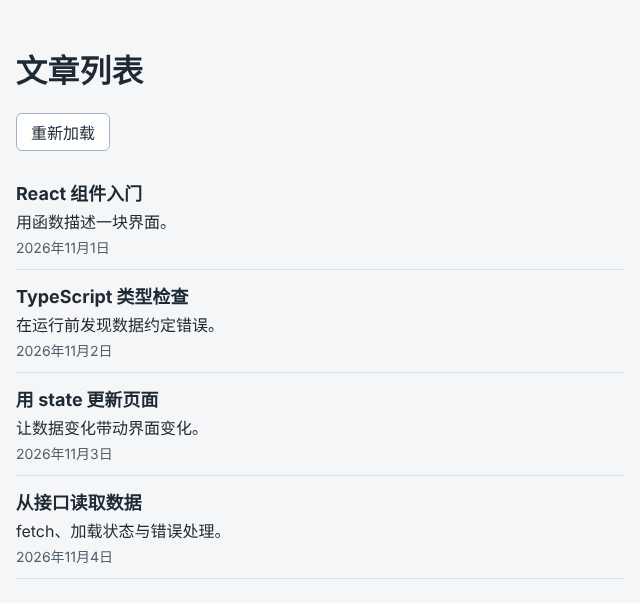

# 第 62 章：如何把接口返回的文章显示在页面上？

前置：[第 61 章：【组合】如何让搜索、分类、排序和分页共同决定显示结果？](第061章-如何让搜索、分类、排序和分页共同决定显示结果.md)，[准备篇二：怎样启动教程配套的练习服务？](准备篇二-怎样启动教程配套的练习服务.md)

## 一、本章要解决的问题

到目前为止，页面上的数据都写在项目的代码文件里。实际开发中，数据通常保存在服务器上，页面需要通过接口去读取。

本章新建一个文章列表页：点击“加载文章”按钮，页面向练习服务请求文章，把返回的文章标题显示成列表。本章只处理“请求成功”的情况，请求失败时怎样提示，下一章再做。

本章是第 8 部分的起点。学完第 8 部分（第 62—73 章）时，文章列表页会变成下图的样子：显示每篇文章的标题、摘要和发布日期；重新加载时保留原来的列表；读取失败时说明原因并可以重试；接口地址在开发和上线时自动切换。



## 二、必要原理

### 什么是接口

接口是服务器提供的一个网址，访问它得到的不是网页，而是数据。练习服务提供的文章接口是：

```text
http://127.0.0.1:3001/api/articles
```

启动练习服务后，在浏览器地址栏打开这个地址，能看到类似下面的内容：

```json
[
  {
    "id": 1,
    "title": "React 组件入门",
    "summary": "用函数描述一块界面。",
    "publishedAt": "2026-11-01T02:00:00Z"
  },
  {
    "id": 2,
    "title": "TypeScript 类型检查",
    "summary": "在运行前发现数据约定错误。",
    "publishedAt": "2026-11-02T03:30:00Z"
  }
]
```

这种格式叫 JSON，写法和 JavaScript 的数组、对象几乎一样。上面是一个数组，每一项是一篇文章。

### 用 fetch 发送请求

浏览器提供的 `fetch` 函数用来向一个网址发送请求：

```ts
const response = await fetch('http://127.0.0.1:3001/api/articles');
```

请求要经过网络，需要等一段时间才有结果。到目前为止写过的代码都是一行接一行立刻执行完的，请求却不行：结果要过一会儿才到。

`fetch` 的做法是：**立刻返回一个“将来才会有结果的对象”**，这个对象叫 **Promise**（承诺），意思是“结果还没到，到了会告诉你”。可以把它想成餐厅点餐后拿到的取餐号：号码马上就拿到了，饭要等一会儿。

拿到取餐号还不能吃饭。在 Promise 前面写 **`await`**，意思是“在这里等结果出来，再继续执行下一行”：

```ts
async function handleLoad() {
  console.log('1. 发出请求');
  const response = await fetch('...');
  console.log('2. 收到响应'); // 要等请求完成后才执行
}
```

`await` 只能写在用 **`async`** 标记的函数里。`async` 写在 `function` 前面，表示“这个函数里面有需要等待的步骤”。

`await` 只让**这个函数**停下来等，浏览器并没有卡住：等待期间，页面照样可以滚动、点击其他按钮。第三节第 3 步会用 `console.log` 亲眼看到这一点。

### 从响应中取出数据

`fetch` 等到的是一个响应对象 `response`，它包含状态码等信息，但还不是文章数组。要再调用 `response.json()`，把响应正文按 JSON 格式读成 JavaScript 数据。读取正文也需要等待，所以前面同样写 `await`：

```ts
const data = await response.json();
```

### 用 state 保存请求结果

请求结果要显示到页面上，而且点击按钮后页面需要更新，所以和第 26 章（如何用 state 记住数据并更新页面）一样，用 `useState` 保存文章数组。数据到达后调用 `setArticles`，React 重新显示页面，列表就出现了。

## 三、动手实现

先确认练习服务已经启动：一个终端运行 `npm.cmd run api`，并保持打开（准备篇二）。

### 第 1 步：新建文章页

新建文件 `src/pages/ArticlePage.tsx`，内容如下：

```tsx
import { useState } from 'react';

type Article = {
  id: number;
  title: string;
};

export default function ArticlePage() {
  const [articles, setArticles] = useState<Article[]>([]);

  async function handleLoad() {
    const response = await fetch('http://127.0.0.1:3001/api/articles');
    const data = (await response.json()) as Article[];
    setArticles(data);
  }

  return (
    <main className="page">
      <h1>文章列表</h1>
      <button type="button" onClick={handleLoad}>
        加载文章
      </button>
      <ul>
        {articles.map((article) => (
          <li key={article.id}>{article.title}</li>
        ))}
      </ul>
    </main>
  );
}
```

逐段说明：

- `type Article` 只写了本章用到的两个字段 `id` 和 `title`。接口还返回了摘要和发布时间，用不到的字段可以先不写。
- `useState<Article[]>([])` 保存文章数组，初始是空数组，所以刚打开页面时列表是空的。
- `handleLoad` 前面的 `async` 让函数里可以使用 `await`。它是按钮的点击处理函数，和第 24 章（如何在点击按钮时执行一段代码）的写法一样，只是多了等待请求的步骤。
- 函数中的三行依次是：发送请求并等待响应；把响应正文读成数据并等待；把数据存进 state。
- `as Article[]` 是**类型断言**，意思是“告诉 TypeScript，把这份数据当作文章数组来用”。`response.json()` 读出来的数据，TypeScript 并不知道是什么样子，断言之后才能当作文章数组使用。它不会真的检查数据对不对，第 68 章会讲怎样真正检查。
- 列表部分是第 17 章（如何把一个数组显示成列表）学过的 `map`，文章的 `id` 作为 key。

### 第 2 步：让 App 显示文章页

打开 `src/App.tsx`，把当前练习页换成文章页。第一行的样式导入保持不变，只改第二行的导入和返回的组件：

```tsx
import './App.css';
import ArticlePage from './pages/ArticlePage';

export default function App() {
  return <ArticlePage />;
}
```

之前的商品页文件 `src/pages/ProductPage.tsx` 保留不删，第 94 章接入路由后会重新用到。

### 第 3 步：用 console.log 观察等待（临时）

在 `handleLoad` 中临时加入三行 `console.log`：

```tsx
  async function handleLoad() {
    console.log('1. 点击了按钮，发出请求');
    const response = await fetch('http://127.0.0.1:3001/api/articles');
    console.log('2. 收到响应，状态码', response.status);
    const data = (await response.json()) as Article[];
    console.log('3. 读出了数据，共', data.length, '篇');
    setArticles(data);
  }
```

保存后打开控制台，点击“加载文章”。先立即出现第 1 行，大约半秒后才出现第 2、3 行，接着文章出现在页面上。这半秒就是在等服务器响应。

再试一次：点击“加载文章”后立刻滚动页面，或者选中页面上的文字，都可以正常操作。等待只发生在 `handleLoad` 函数内部，浏览器没有被卡住。

观察完后删掉这三行 `console.log`。

## 四、运行与检查

保持开发服务器和练习服务都在运行（准备篇二）。

1. 打开开发服务器地址（通常是 `http://127.0.0.1:5173/`），页面显示“文章列表”标题和“加载文章”按钮，下面没有文章。
2. 点击“加载文章”，大约半秒后出现 4 篇文章的标题。练习服务故意等待 500 毫秒再响应，这样你能感觉到请求需要时间。第 64 章会利用这段时间显示“加载中”。
3. 再点一次按钮，列表仍然是 4 篇，不会重复出现。因为 `setArticles(data)` 是用新数组替换旧数组，而不是追加。
4. 刷新浏览器页面，列表又变成空的。文章只在点击按钮后才读取，本章还没有做“打开页面就自动读取”，那是第 74 章的内容。
5. 在运行练习服务的终端按 Ctrl+C 停止它，再点击按钮。页面上什么变化都没有，控制台中出现红色错误 `Uncaught (in promise) TypeError: Failed to fetch`。请求失败了，但页面没有告诉用户，下一章解决这个问题。做完后重新运行 `npm.cmd run api`。

最后运行一次检查，应没有错误：

```powershell
npm.cmd run check
```

**小练习**：在第 3 步的实验中，把第 2 行 `console.log` 移到 `const response = await fetch(...)` 这一行的**上面**，再点击按钮，看看它打印出来的时间有什么变化。想一想为什么。练习后恢复本章代码。

## 五、常见错误

| 现象 | 原因 | 怎么改 |
| --- | --- | --- |
| 没有点击按钮，文章就出现了，练习服务的终端不停地滚动；控制台提示 `onClick` 应该是一个函数 | 把 `onClick={handleLoad}` 写成了 `onClick={handleLoad()}`。加了括号，页面每次显示时都会立即调用函数，数据到达后更新 state，页面再次显示，又调用一次，请求永远不停 | 只写函数名，不加括号 |
| 编辑器提示 `await` 只能用在 async 函数中 | `handleLoad` 前面漏写了 `async` | 写成 `async function handleLoad()` |
| 编辑器提示 `Promise<any>` 转换为 `Article[]` 可能是错误 | 漏写了 `response.json()` 前面的 `await`，得到的是还没有结果的 Promise | 写成 `(await response.json()) as Article[]` |
| 点击后没有反应，控制台出现 `Failed to fetch` | 练习服务没有启动，或地址写错（端口不是 3001、少了 `/api`） | 启动练习服务；把地址复制到浏览器地址栏打开，能看到 JSON 才说明地址正确 |
| 控制台出现含有 “CORS” 的红色错误 | 开发服务器的端口不是 5173。5173 被另一个开发服务器占用时，Vite 会自动改用 5174，练习服务不允许这个地址访问 | 关掉其他终端中的开发服务器，重新运行 `npm.cmd run dev`，确认打印的地址是 `http://127.0.0.1:5173/`。跨域错误的原理在第 71 章讲 |

## 六、本章完整代码

### `src/pages/ArticlePage.tsx`

内容同第三节第 1 步。

### `src/App.tsx`

```tsx
import './App.css';
import ArticlePage from './pages/ArticlePage';

export default function App() {
  return <ArticlePage />;
}
```

## 七、本章改动小结

新增 `src/pages/ArticlePage.tsx`；修改 `src/App.tsx`，当前练习页换成文章页。其他文件不变，练习服务不需要修改。第 3 步加的 `console.log` 是临时的，已经删掉。

---

下一章：[第 62A 章：请求失败时，如何在页面上显示错误提示？](第062A章-请求失败时，如何在页面上显示错误提示.md)
