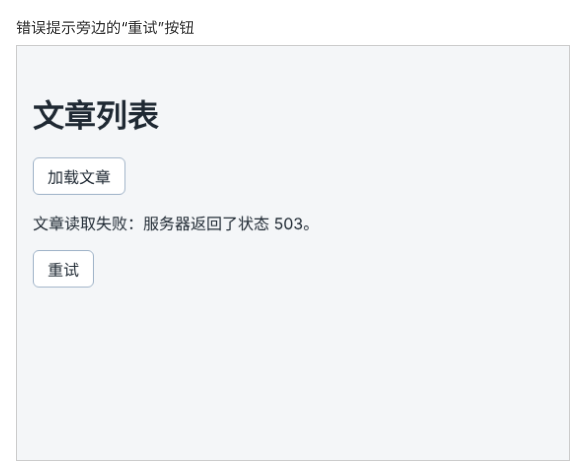

# 第 66 章：请求失败后，如何让用户点击重试？

前置：[第 65 章：为什么接口返回 404 时，fetch 不会进入 catch？](第065章-为什么接口返回404时，fetch不会进入catch.md)

## 一、本章要解决的问题

网络偶尔会出问题：服务器刚好在重启，或者 Wi-Fi 断了一下。这类失败往往过一会儿就好了，再试一次就能成功。

现在出错后，页面只显示一句错误提示，用户要自己想到再去点上面的“加载文章”。本章在错误提示的旁边放一个“重试”按钮，点击后重新发送请求；重试期间显示加载提示，成功后错误提示消失。

本章完成后，请求失败时的页面如下图：



## 二、必要原理

### 重试就是再调用一次同一个函数

“重试”要做的事和“加载文章”完全一样：清空错误、显示加载提示、发送请求、处理结果。所以不需要写新的函数，“重试”按钮直接使用 `handleLoad`：

```tsx
<button type="button" onClick={handleLoad}>
  重试
</button>
```

同一个函数可以交给多个按钮，就像第 29 章（让多个问题中同时只展开一个）中每个问题按钮都用同一个处理函数一样。

### 重试时，旧的错误提示会消失

`handleLoad` 一开始就执行 `setError('')`。点击“重试”后，错误提示连同“重试”按钮一起消失，页面显示“正在加载文章……”。如果这次又失败了，错误提示和“重试”按钮会再次出现，用户可以继续重试。

所以“重试”按钮不需要单独禁用：加载期间它根本不在页面上，不会被重复点击。

### 错误提示和按钮放在一起

重试按钮要紧挨着错误提示，用户看到出错时，下一步该做什么就在眼前。两者放进一个 `<div>` 中，一起显示、一起消失。`role="alert"` 只加在提示文字上，按钮不需要被当作提示朗读。

### 什么时候不适合提供重试

重试只适合“过一会儿可能自己好起来”的失败，例如连不上服务器、服务器暂时出错。如果是用户提交的数据不对，重试多少次结果都一样，应该告诉用户怎么改，第 90 章会处理这种情况。

## 三、动手实现

### 第 1 步：在错误提示旁边加入重试按钮

在 `src/pages/ArticlePage.tsx` 中，把：

```tsx
      {error && <p role="alert">{error}</p>}
```

改为：

```tsx
      {error && (
        <div>
          <p role="alert">{error}</p>
          <button type="button" onClick={handleLoad}>
            重试
          </button>
        </div>
      )}
```

## 四、运行与检查

保持开发服务器和练习服务都在运行（准备篇二）。

1. 正常加载时，页面上没有“重试”按钮。
2. 停止练习服务，点击“加载文章”，显示“无法连接练习服务，请确认它已经启动。”和“重试”按钮。
3. 不启动练习服务，直接点击“重试”：错误提示消失，短暂显示“正在加载文章……”，然后错误提示和“重试”按钮再次出现。
4. 启动练习服务（`npm.cmd run api`），点击“重试”，文章出现，错误提示和“重试”按钮都消失。
5. 用 Tab 键移到“重试”按钮上，按 Enter，同样可以重试。

最后运行检查，应没有错误：

```powershell
npm.cmd run check
```

**小练习**：在错误提示中显示这是第几次失败，例如“（已失败 2 次）”；加载成功后次数清零。（提示：再加一个数字 state，在设置错误提示的地方加 1。）练习后恢复本章代码。

## 五、常见错误

| 现象 | 原因 | 怎么改 |
| --- | --- | --- |
| 一出错，页面就一直显示“正在加载文章……”，Network（网络）中不停地出现新请求 | 写成了 `onClick={handleLoad()}`，每次显示错误提示时都会立即调用函数，再次请求、再次失败，循环不止 | 写成 `onClick={handleLoad}` |
| 点击“重试”后，错误提示一直不消失 | 为重试另写了一个函数，里面漏了 `setError('')` | 直接使用 `handleLoad` |
| 点击“重试”时页面刷新了 | 按钮放在了 `form` 中，又没有写 `type="button"` | 写上 `type="button"`（第 40 章） |
| 读屏软件把“重试”也当成警告读了出来 | `role="alert"` 加在了外层的 `div` 上 | 只给提示文字的 `p` 加 `role="alert"` |

## 六、本章完整代码

### `src/pages/ArticlePage.tsx`

```tsx
import { useState } from 'react';

type Article = {
  id: number;
  title: string;
};

export default function ArticlePage() {
  const [articles, setArticles] = useState<Article[]>([]);
  const [error, setError] = useState('');
  const [isLoading, setIsLoading] = useState(false);

  async function handleLoad() {
    setError('');
    setIsLoading(true);
    try {
      const response = await fetch('http://127.0.0.1:3001/api/articles');
      if (!response.ok) {
        setError('文章读取失败：服务器返回了状态 ' + response.status + '。');
        return;
      }
      const data = (await response.json()) as Article[];
      setArticles(data);
    } catch {
      setError('无法连接练习服务，请确认它已经启动。');
    } finally {
      setIsLoading(false);
    }
  }

  return (
    <main className="page">
      <h1>文章列表</h1>
      <button type="button" onClick={handleLoad} disabled={isLoading}>
        加载文章
      </button>
      {isLoading && <p role="status">正在加载文章……</p>}
      {error && (
        <div>
          <p role="alert">{error}</p>
          <button type="button" onClick={handleLoad}>
            重试
          </button>
        </div>
      )}
      <ul>
        {articles.map((article) => (
          <li key={article.id}>{article.title}</li>
        ))}
      </ul>
    </main>
  );
}
```

## 七、本章改动小结

修改 `src/pages/ArticlePage.tsx`：错误提示旁边加入“重试”按钮。

---

下一章：[第 67 章：如何让多个文件共用同一个数据类型？](第067章-如何让多个文件共用同一个数据类型.md)
