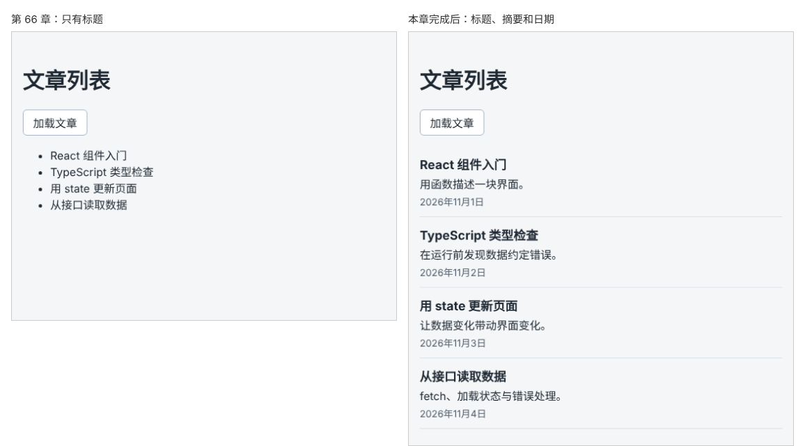

# 第 67 章：如何让多个文件共用同一个数据类型？

前置：[第 66 章：请求失败后，如何让用户点击重试？](第066章-请求失败后，如何让用户点击重试.md)

## 一、本章要解决的问题

文章列表现在只显示标题。本章把每篇文章的摘要和发布日期也显示出来，并把显示列表的部分提取成 `ArticleList` 组件，让 `ArticlePage` 只负责读取数据。

提取之后马上遇到一个问题：`ArticlePage` 要用 `Article` 类型声明 state，`ArticleList` 要用它声明 props。如果两个文件各写一份 `type Article`，以后接口加了字段，就得记得改两处，漏改一处就会出现两边对不上的情况。本章把 `Article` 类型放进一个单独的文件，两个组件都从那里导入。

下图左边是现在的文章列表，右边是本章完成后的样子：



## 二、必要原理

### 类型也可以导出和导入

第 8 章（把一段界面提取成组件）用 `export default` 导出组件，第 45 章（向列表添加一条任务）用 `export type` 从数据文件中导出过 `Task` 类型。类型和组件、数据一样，可以在一个文件中导出，在多个文件中导入：

```ts
// src/types/article.ts
export type Article = {
  id: number;
  title: string;
  summary: string;
  publishedAt: string;
};
```

```tsx
import type { Article } from '../types/article';
```

`import type` 表示“只导入类型”。类型只在写代码和检查时使用，转换成浏览器运行的代码时会被完全去掉，写成 `import type` 可以让这一点一目了然。

### 为什么放在 src/types 中

第 45 章的 `Task` 类型和任务数据写在同一个文件中，因为那些数据就在本地。文章不一样：数据来自接口，项目中没有文章数据文件，类型却会被页面、组件以及以后的请求代码共同使用。这种多个文件共用的类型，统一放在 `src/types` 文件夹中，一个文件对应一种数据，例如 `article.ts`。

### 类型要和接口返回的数据一致

在第 63 章（查看一次请求实际发送和返回了什么）的 Preview（预览）中能看到，接口返回的每篇文章有 `id`、`title`、`summary`、`publishedAt` 四个字段，类型就照着写这四个。`publishedAt` 是 `'2026-11-01T02:00:00Z'` 这样的字符串，所以类型是 `string`。

### 显示发布日期

日期的显示方式和第 22 章（把日期时间显示成容易阅读的格式）一样，用 `Intl.DateTimeFormat` 按北京时间格式化。日期放在 `<time>` 元素中，`dateTime` 属性写原始的时间字符串，方便浏览器和搜索引擎识别，页面上显示的是格式化后的文字。

## 三、动手实现

### 第 1 步：新建共用的文章类型

新建文件夹 `src/types`，在其中新建 `article.ts`：

```ts
export type Article = {
  id: number;
  title: string;
  summary: string;
  publishedAt: string;
};
```

### 第 2 步：添加列表样式

在 `src/components` 中新建 `ArticleList.module.css`：

```css
.list {
  margin: 16px 0 0;
  padding: 0;
  list-style: none;
}

.item {
  padding: 12px 0;
  border-bottom: 1px solid #d9e2ec;
}

.title {
  margin: 0 0 4px;
  font-size: 18px;
}

.summary {
  margin: 0 0 4px;
}

.date {
  color: #52606d;
  font-size: 14px;
}
```

### 第 3 步：新建文章列表组件

在 `src/components` 中新建 `ArticleList.tsx`：

```tsx
import type { Article } from '../types/article';
import styles from './ArticleList.module.css';

const dateFormatter = new Intl.DateTimeFormat('zh-CN', {
  year: 'numeric',
  month: 'long',
  day: 'numeric',
  timeZone: 'Asia/Shanghai',
});

type ArticleListProps = {
  articles: Article[];
};

export default function ArticleList({ articles }: ArticleListProps) {
  return (
    <ul className={styles.list}>
      {articles.map((article) => (
        <li key={article.id} className={styles.item}>
          <h2 className={styles.title}>{article.title}</h2>
          <p className={styles.summary}>{article.summary}</p>
          <time className={styles.date} dateTime={article.publishedAt}>
            {dateFormatter.format(new Date(article.publishedAt))}
          </time>
        </li>
      ))}
    </ul>
  );
}
```

`ArticleList` 只接收文章数组并显示出来，不关心数据是从哪里来的。props 类型的写法和第 10 章（用 TypeScript 检查组件收到的数据）一样，`Article[]` 来自共用的类型文件。

### 第 4 步：让文章页使用共用类型和列表组件

在 `src/pages/ArticlePage.tsx` 中，把开头的导入和 `type Article = { … };` 一段替换为：

```tsx
import { useState } from 'react';
import ArticleList from '../components/ArticleList';
import type { Article } from '../types/article';
```

再把整个 `<ul>……</ul>` 替换为：

```tsx
      <ArticleList articles={articles} />
```

## 四、运行与检查

保持开发服务器和练习服务都在运行（准备篇二）。

1. 点击“加载文章”，每篇文章显示标题、摘要和发布日期，例如“React 组件入门”下面是“用函数描述一块界面。”和“2026年11月1日”。
2. 文章之间有分隔线，列表前面没有圆点。
3. 加载提示、错误提示和“重试”都和第 66 章一样正常。
4. 在 `src/types/article.ts` 中临时把 `summary` 改名为 `description`，运行 `npm.cmd run check`，`ArticleList.tsx` 中出现错误。只改一处类型，用到它的地方都会被检查到。检查后改回 `summary`。

最后运行检查，应没有错误：

```powershell
npm.cmd run check
```

**小练习**：文章页标题下方显示“共 N 篇文章”。想一想：这句话写在 `ArticlePage` 中还是 `ArticleList` 中更合适？练习后恢复本章代码。

## 五、常见错误

| 现象 | 原因 | 怎么改 |
| --- | --- | --- |
| 编辑器提示找不到模块 `../types/article` | 文件夹或文件名写错，或者路径少了一层 `..` | 确认文件是 `src/types/article.ts`；组件和页面都在 `src` 的下一层，路径是 `../types/article` |
| 编辑器提示 `Article` 没有导出的成员 | 类型文件中漏写了 `export` | 写成 `export type Article = …` |
| 两个文件中的 `Article` 字段不一样，检查时报错 | `ArticlePage` 中旧的 `type Article` 没有删掉 | 删除页面中的类型声明，只从 `src/types/article.ts` 导入 |
| 编辑器提示 `Article` 上不存在属性 `publishAt` | 字段名写错，少了一个字母 | 对照类型文件中的字段名改正 |

## 六、本章完整代码

### `src/types/article.ts`

内容同第三节第 1 步。

### `src/components/ArticleList.module.css`

内容同第三节第 2 步。

### `src/components/ArticleList.tsx`

内容同第三节第 3 步。

### `src/pages/ArticlePage.tsx`

```tsx
import { useState } from 'react';
import ArticleList from '../components/ArticleList';
import type { Article } from '../types/article';

export default function ArticlePage() {
  const [articles, setArticles] = useState<Article[]>([]);
  const [error, setError] = useState('');
  const [isLoading, setIsLoading] = useState(false);

  async function handleLoad() {
    setError('');
    setIsLoading(true);
    try {
      const response = await fetch('http://127.0.0.1:3001/api/articles');
      if (!response.ok) {
        setError('文章读取失败：服务器返回了状态 ' + response.status + '。');
        return;
      }
      const data = (await response.json()) as Article[];
      setArticles(data);
    } catch {
      setError('无法连接练习服务，请确认它已经启动。');
    } finally {
      setIsLoading(false);
    }
  }

  return (
    <main className="page">
      <h1>文章列表</h1>
      <button type="button" onClick={handleLoad} disabled={isLoading}>
        加载文章
      </button>
      {isLoading && <p role="status">正在加载文章……</p>}
      {error && (
        <div>
          <p role="alert">{error}</p>
          <button type="button" onClick={handleLoad}>
            重试
          </button>
        </div>
      )}
      <ArticleList articles={articles} />
    </main>
  );
}
```

## 七、本章改动小结

新增 `src/types/article.ts`、`src/components/ArticleList.tsx`、`src/components/ArticleList.module.css`；修改 `src/pages/ArticlePage.tsx`：改用共用的 `Article` 类型和 `ArticleList` 组件。

---

下一章：[第 68 章：为什么写了类型声明，仍然需要检查接口数据？](第068章-为什么写了类型声明，仍然需要检查接口数据.md)
