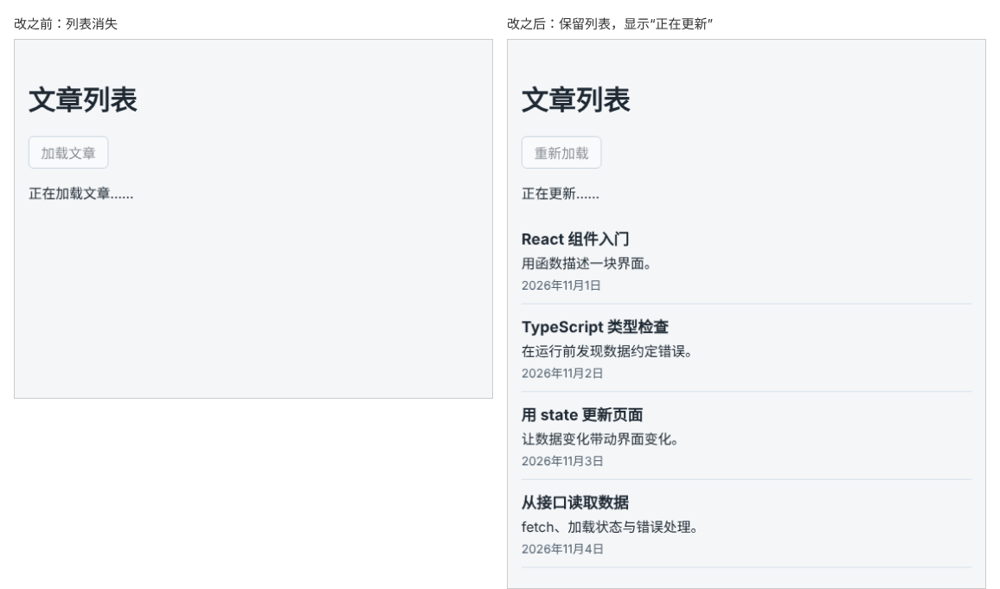

# 第 70 章：【组合】如何在重新加载时保留原有内容？

前置：[第 69 章：如何用联合类型区分加载中、成功和失败？](第069章-如何用联合类型区分加载中、成功和失败.md)

## 一、本章要解决的问题

文章已经显示出来后，再点一次“加载文章”，列表会先消失，变成“正在加载文章……”，半秒后再出现，页面明显闪了一下。如果这次加载失败，已经看到的文章也没了，只剩一句错误提示。

本章让重新加载时保留原来的列表：加载期间列表照常显示，上方提示“正在更新……”；加载失败时，错误提示和“重试”显示在列表上方，原来的文章仍然可以看。第一次加载成功后，按钮文字改为“重新加载”。

本章是一个组合练习，用到第 69 章的联合类型、第 32 章（哪些数据需要放进 state）的派生数据和第 21 章的条件显示。

下图都是文章加载完成后再次点击按钮、等待结果期间的页面，左边是现在的样子，右边是本章完成后的样子：



## 二、必要原理

### 问题出在哪里

第 69 章的状态类型中，只有成功状态带着文章。一进入加载中或失败状态，上一次的文章就丢掉了，页面当然无法再显示它们。

要保留原有内容，加载中和失败两种状态也要带上“目前已有的文章”：

```tsx
type LoadState =
  | { status: 'idle' }
  | { status: 'loading'; articles: Article[] }
  | { status: 'success'; articles: Article[] }
  | { status: 'error'; message: string; articles: Article[] };
```

只有“还没开始”的状态没有文章。

### 当前文章是算出来的

页面上要显示的文章，可以从 `loadState` 直接算出来：

```tsx
const articles = loadState.status === 'idle' ? [] : loadState.articles;
```

在条件运算符的 `:` 后面，TypeScript 已经知道状态不是 `idle`，剩下的三种都有 `articles`，所以可以直接读取。这也是第 69 章说的类型收窄。

### 进入新状态时带上已有的文章

开始加载时，把当前的 `articles` 放进加载状态；失败时同样带上它：

```tsx
setLoadState({ status: 'loading', articles });
setLoadState({ status: 'error', message: '……', articles });
```

`articles` 是 `{ articles: articles }` 的简写（第 45 章：向列表添加一条任务）。成功时则用新读取的数据，替换掉旧的文章。

`handleLoad` 中用到的 `articles` 是点击按钮那一次渲染中的值，也就是点击时页面上正在显示的文章，正是需要保留的内容。

### 根据有没有文章调整提示

有了 `articles`，页面上的几处显示都可以根据它决定：

- 列表：只要有文章就显示，不再只限于成功状态。
- 加载提示：没有文章时是“正在加载文章……”，有文章时是“正在更新……”。
- 按钮文字：成功加载过，或者手里已经有文章时，显示“重新加载”。这个判断存进 `hasLoaded`。
- “暂时还没有文章。”：只在成功并且确实没有文章时显示。

## 三、动手实现

### 第 1 步：让加载中和失败状态带上文章

在 `src/pages/ArticlePage.tsx` 中，把 `LoadState` 中的两行改为：

```tsx
  | { status: 'loading'; articles: Article[] }
```

```tsx
  | { status: 'error'; message: string; articles: Article[] };
```

### 第 2 步：计算当前文章

在 `loadState` 的下面加入：

```tsx
  const articles = loadState.status === 'idle' ? [] : loadState.articles;
  const hasLoaded = loadState.status === 'success' || articles.length > 0;
```

### 第 3 步：进入新状态时带上文章

在 `handleLoad` 中，开始加载的一行改为：

```tsx
    setLoadState({ status: 'loading', articles });
```

三处 `status: 'error'` 的对象末尾都加上 `articles`。第一处写成多行，在 `message` 的下一行加入：

```tsx
          articles,
```

另外两处改为：

```tsx
        setLoadState({ status: 'error', message: '文章数据格式不正确，暂时无法显示。', articles });
```

```tsx
      setLoadState({ status: 'error', message: '无法连接练习服务，请确认它已经启动。', articles });
```

### 第 4 步：调整页面显示

按钮文字改为：

```tsx
        {hasLoaded ? '重新加载' : '加载文章'}
```

加载提示改为：

```tsx
      {loadState.status === 'loading' && (
        <p role="status">{articles.length === 0 ? '正在加载文章……' : '正在更新……'}</p>
      )}
```

最后把成功状态的那一段显示替换为：

```tsx
      {loadState.status === 'success' && articles.length === 0 && <p>暂时还没有文章。</p>}
      {articles.length > 0 && <ArticleList articles={articles} />}
```

## 四、运行与检查

保持开发服务器和练习服务都在运行（准备篇二）。

1. 第一次点击“加载文章”，显示“正在加载文章……”，然后出现文章，按钮变成“重新加载”。
2. 点击“重新加载”，列表不消失，上方短暂显示“正在更新……”。
3. 停止练习服务，点击“重新加载”：上方显示错误提示和“重试”，下面的 4 篇文章仍然在。
4. 启动练习服务，点击“重试”，错误提示消失，文章保持显示。
5. 刷新页面，在练习服务停止的情况下点击“加载文章”：显示错误提示，没有文章，按钮仍是“加载文章”。
6. 地址临时加上 `?mode=empty`，第一次加载显示“暂时还没有文章。”，按钮变成“重新加载”。看完后去掉。

最后运行检查，应没有错误：

```powershell
npm.cmd run check
```

**小练习**：把练习服务的等待时间临时改长（地址加上 `?delay=3000`），重新加载期间让列表变成半透明，提示用户这些内容可能不是最新的。（提示：给 `ArticleList` 外面包一层 `div`，加载中时给它加一个设置了 `opacity: 0.5` 的 CSS 类。）练习后恢复本章代码。

## 五、常见错误

| 现象 | 原因 | 怎么改 |
| --- | --- | --- |
| 编辑器提示 `loading` 状态缺少属性 `articles` | 改了类型，但 `setLoadState({ status: 'loading' })` 没有带上文章 | 写成 `setLoadState({ status: 'loading', articles })` |
| 编辑器在 `loadState.articles` 处报错 | 没有先排除 `idle` 状态就读取了 `articles` | 用条件运算符先判断 `loadState.status === 'idle'` |
| 重新加载失败后，列表还是消失了 | 失败状态中写的是 `articles: []` | 带上当前的 `articles` |
| 重新加载成功后，列表中出现了重复的文章 | 成功时写成了 `[...articles, ...data]`，把新旧文章合在一起 | 成功时直接使用新数据 `articles: data` |
| 学完本章后，页面一直报错、一直显示空数据或加载很慢 | 步骤中临时加在请求地址上的 `?mode=`、`?fail=`、`?delay=`、`?cors=` 等参数忘了删 | 运行 `git diff` 查看本章改动，删掉地址中的临时参数 |

## 六、本章完整代码

### `src/pages/ArticlePage.tsx`

```tsx
import { useState } from 'react';
import ArticleList from '../components/ArticleList';
import { isArticle } from '../types/article';
import type { Article } from '../types/article';

type LoadState =
  | { status: 'idle' }
  | { status: 'loading'; articles: Article[] }
  | { status: 'success'; articles: Article[] }
  | { status: 'error'; message: string; articles: Article[] };

export default function ArticlePage() {
  const [loadState, setLoadState] = useState<LoadState>({ status: 'idle' });
  const articles = loadState.status === 'idle' ? [] : loadState.articles;
  const hasLoaded = loadState.status === 'success' || articles.length > 0;

  async function handleLoad() {
    setLoadState({ status: 'loading', articles });
    try {
      const response = await fetch('http://127.0.0.1:3001/api/articles');
      if (!response.ok) {
        setLoadState({
          status: 'error',
          message: '文章读取失败：服务器返回了状态 ' + response.status + '。',
          articles,
        });
        return;
      }
      const data: unknown = await response.json();
      if (!Array.isArray(data) || !data.every(isArticle)) {
        setLoadState({ status: 'error', message: '文章数据格式不正确，暂时无法显示。', articles });
        return;
      }
      setLoadState({ status: 'success', articles: data });
    } catch {
      setLoadState({ status: 'error', message: '无法连接练习服务，请确认它已经启动。', articles });
    }
  }

  return (
    <main className="page">
      <h1>文章列表</h1>
      <button type="button" onClick={handleLoad} disabled={loadState.status === 'loading'}>
        {hasLoaded ? '重新加载' : '加载文章'}
      </button>
      {loadState.status === 'loading' && (
        <p role="status">{articles.length === 0 ? '正在加载文章……' : '正在更新……'}</p>
      )}
      {loadState.status === 'error' && (
        <div>
          <p role="alert">{loadState.message}</p>
          <button type="button" onClick={handleLoad}>
            重试
          </button>
        </div>
      )}
      {loadState.status === 'success' && articles.length === 0 && <p>暂时还没有文章。</p>}
      {articles.length > 0 && <ArticleList articles={articles} />}
    </main>
  );
}
```

## 七、本章改动小结

修改 `src/pages/ArticlePage.tsx`：加载中和失败状态也保存文章，重新加载时保留原有列表，按钮和提示随状态变化。

---

下一章：[第 71 章：如何排查页面访问接口时的跨域错误？](第071章-如何排查页面访问接口时的跨域错误.md)
