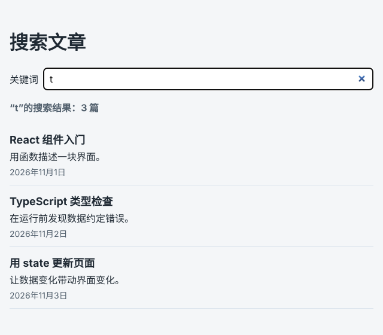

# 第 74 章：如何在打开页面时自动读取数据？

前置：[第 73A 章：如何把读取文章的代码提取成组件外面的函数？](第073A章-如何把读取文章的代码提取成组件外面的函数.md)

## 一、本章要解决的问题

文章页现在要先点一下“加载文章”才有内容。用户打开文章页，当然是想直接看到文章，多点一次按钮没有任何意义。

本章让文章页一打开就自动读取文章：页面先显示“正在加载文章……”，读取完成后显示列表。原来的按钮保留，改名为“重新加载”。

本章是第 9 部分的起点。学完第 9 部分（第 74—84 章）时，项目会多出一个实时搜索页，效果如下图：输入关键词，停顿片刻后自动搜索，结果总是对应最后输入的关键词；文章页还可以每隔 5 秒自动刷新。



## 二、必要原理

### 读取数据不是由某个操作引起的

到目前为止，请求都写在事件处理函数中，因为请求是用户点击引起的。“打开页面就读取”没有对应的点击，它是因为**组件显示到了页面上**才需要发生的。

也不能直接写在组件函数体中。组件函数每次渲染都会执行，读取完成后调用 set 函数又会引起渲染，于是不停地发请求。

### useEffect：在渲染完成之后执行

React 的 `useEffect` 用来写“组件显示到页面上之后要做的事”，这类代码叫 **Effect**：

```tsx
useEffect(() => {
  // 渲染完成、页面更新之后执行
}, []);
```

第一个参数是要执行的函数。第二个参数是**依赖数组**，告诉 React 什么时候需要再次执行：空数组 `[]` 表示没有依赖，只在组件第一次显示到页面上之后执行一次。第 76 章会用到非空的依赖数组。

Effect 的函数本身不能写成 `async`，要在里面另外定义一个 async 函数再调用它，就像本章的 `loadOnOpen`。

### Effect 和按钮调用同一个 fetchArticles

自动读取和“重新加载”按钮做的是同一件事。第 73A 章已经把请求提取成了组件外面的 `fetchArticles`，Effect 和按钮都调用它即可。

写在组件外面还有一个好处：它不使用任何 state 或 props，Effect 调用它时不需要把它写进依赖数组。代码检查中的 `react/exhaustive-deps` 规则会检查 Effect 用到的组件内的值是否都写进了依赖，第 80 章会专门讲。

### 不再需要“还没开始”的状态

页面一打开就开始读取，第 69 章的 `idle` 状态不会再出现，从类型中去掉，初始状态改为加载中。这样每种状态都带着 `articles`，直接读取即可。

## 三、动手实现

本章只修改 `src/pages/ArticlePage.tsx`。

### 第 1 步：导入 useEffect，去掉 idle 状态

把第一行改为：

```tsx
import { useEffect, useState } from 'react';
```

删除 `LoadState` 中 `{ status: 'idle' }` 这一行。

### 第 2 步：修改初始状态，加入 Effect

把组件开头的三行（`loadState`、`articles`、`hasLoaded`）替换为：

```tsx
  const [loadState, setLoadState] = useState<LoadState>({ status: 'loading', articles: [] });
  const articles = loadState.articles;

  useEffect(() => {
    async function loadOnOpen() {
      try {
        const data = await fetchArticles();
        setLoadState({ status: 'success', articles: data });
      } catch (error) {
        setLoadState({ status: 'error', message: getErrorMessage(error), articles: [] });
      }
    }

    loadOnOpen();
  }, []);
```

### 第 3 步：把 handleLoad 改名为 handleReload

按钮现在只用来“重新加载”，把函数名改为 `handleReload`。不再有 `idle` 状态，`articles` 也总是有值，函数内容不变：

```tsx
  async function handleReload() {
    setLoadState({ status: 'loading', articles });
    try {
      const data = await fetchArticles();
      setLoadState({ status: 'success', articles: data });
    } catch (error) {
      setLoadState({ status: 'error', message: getErrorMessage(error), articles });
    }
  }
```

### 第 4 步：修改按钮

把两处 `onClick={handleLoad}` 都改为 `onClick={handleReload}`，按钮文字改为固定的“重新加载”：

```tsx
      <button type="button" onClick={handleReload} disabled={loadState.status === 'loading'}>
        重新加载
      </button>
```

## 四、运行与检查

保持开发服务器和练习服务都在运行（准备篇二）。

1. 刷新文章页，不用点击任何按钮，先显示“正在加载文章……”，半秒后出现 4 篇文章。
2. 点击“重新加载”，列表保留，短暂显示“正在更新……”。
3. 停止练习服务，刷新页面，显示“文章读取失败：服务器返回了状态 500。”和“重试”。请求经过开发服务器的代理（第 72 章），练习服务停止时由开发服务器返回 500，所以不是“无法连接”的提示。“无法连接”只在浏览器连开发服务器也连不上时出现：例如保持页面打开，把开发服务器也停止，再点击“重试”。看完后重新启动开发服务器和练习服务，点击“重试”，文章出现。
4. 在 Network（网络）面板中刷新页面，能看到 `articles` 请求。你会发现它出现了**两次**，原因在下一章解释。

最后运行检查，应没有错误：

```powershell
npm.cmd run check
```

**小练习**：把依赖数组 `[]` 暂时删掉（只留下 Effect 的函数），刷新页面，在 Network 面板中观察请求的数量，然后立刻恢复。想一想为什么会这样。

## 五、常见错误

| 现象 | 原因 | 怎么改 |
| --- | --- | --- |
| Network 中请求不停地出现 | 漏写了依赖数组 `[]`，Effect 在每次渲染后都执行，读取完成后更新 state 又引起渲染 | 写上 `[]` |
| 编辑器提示 Effect 的函数不能返回 Promise | 把 Effect 的函数写成了 `async () => { … }` | 在 Effect 中另外定义 async 函数并调用 |
| 编辑器提示 `error.message` 不存在 | `error` 是 `unknown`，没有先确认它是错误对象 | 用 `error instanceof Error` 判断后再读取 |
| 页面一直显示“正在加载文章……” | 定义了 `loadOnOpen` 却忘了调用 | 在 Effect 中定义后，写一行 `loadOnOpen();` |
| `check` 提示 Effect 缺少依赖 `handleReload` | 在 Effect 中直接调用了组件内的 `handleReload` | Effect 中调用组件外的 `fetchArticles` |

## 六、本章完整代码

### `src/pages/ArticlePage.tsx`

```tsx
import { useEffect, useState } from 'react';
import ArticleList from '../components/ArticleList';
import { apiUrl } from '../lib/api';
import { isArticle } from '../types/article';
import type { Article } from '../types/article';

type LoadState =
  | { status: 'loading'; articles: Article[] }
  | { status: 'success'; articles: Article[] }
  | { status: 'error'; message: string; articles: Article[] };

async function fetchArticles(): Promise<Article[]> {
  let response: Response;
  try {
    response = await fetch(apiUrl('/articles'));
  } catch {
    throw new Error('无法连接练习服务，请确认它已经启动。');
  }
  if (!response.ok) {
    throw new Error('文章读取失败：服务器返回了状态 ' + response.status + '。');
  }
  const data: unknown = await response.json();
  if (!Array.isArray(data) || !data.every(isArticle)) {
    throw new Error('文章数据格式不正确，暂时无法显示。');
  }
  return data;
}

function getErrorMessage(error: unknown) {
  return error instanceof Error ? error.message : '文章读取失败。';
}

export default function ArticlePage() {
  const [loadState, setLoadState] = useState<LoadState>({ status: 'loading', articles: [] });
  const articles = loadState.articles;

  useEffect(() => {
    async function loadOnOpen() {
      try {
        const data = await fetchArticles();
        setLoadState({ status: 'success', articles: data });
      } catch (error) {
        setLoadState({ status: 'error', message: getErrorMessage(error), articles: [] });
      }
    }

    loadOnOpen();
  }, []);

  async function handleReload() {
    setLoadState({ status: 'loading', articles });
    try {
      const data = await fetchArticles();
      setLoadState({ status: 'success', articles: data });
    } catch (error) {
      setLoadState({ status: 'error', message: getErrorMessage(error), articles });
    }
  }

  return (
    <main className="page">
      <h1>文章列表</h1>
      <button type="button" onClick={handleReload} disabled={loadState.status === 'loading'}>
        重新加载
      </button>
      {loadState.status === 'loading' && (
        <p role="status">{articles.length === 0 ? '正在加载文章……' : '正在更新……'}</p>
      )}
      {loadState.status === 'error' && (
        <div>
          <p role="alert">{loadState.message}</p>
          <button type="button" onClick={handleReload}>
            重试
          </button>
        </div>
      )}
      {loadState.status === 'success' && articles.length === 0 && <p>暂时还没有文章。</p>}
      {articles.length > 0 && <ArticleList articles={articles} />}
    </main>
  );
}
```

## 七、本章改动小结

修改 `src/pages/ArticlePage.tsx`：请求提取为 `fetchArticles`，打开页面时用 Effect 自动读取，按钮改为“重新加载”。

---

下一章：[第 75 章：为什么开发环境中的 Effect 会执行两次？](第075章-为什么开发环境中的Effect会执行两次.md)
