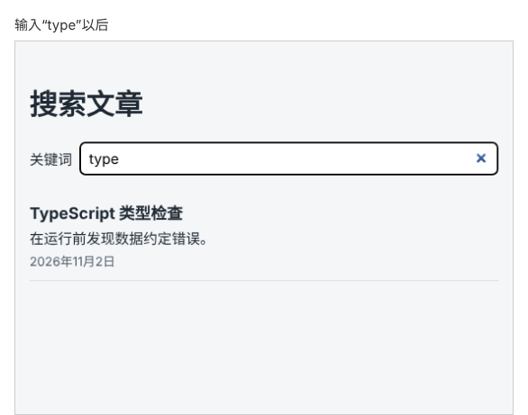

# 第 76 章：如何在搜索关键词变化后重新请求数据？

前置：[第 75 章：为什么开发环境中的 Effect 会执行两次？](第075章-为什么开发环境中的Effect会执行两次.md)

## 一、本章要解决的问题

文章多了以后，需要按标题搜索。和第 55 章（根据关键词筛选商品）不同，这次的数据在服务器上，搜索也要交给服务器做：每次关键词变化，就请求一次搜索接口。

本章新建一个搜索页：在输入框中输入关键词，页面显示“正在搜索……”，然后显示标题中包含关键词的文章；清空输入框时显示提示文字，不发送请求。

本章完成后，输入“type”时的搜索页如下图：



## 二、必要原理

### 练习服务的搜索接口

```text
GET /api/search?q=关键词
```

返回一个对象，`query` 是服务器收到的关键词，`items` 是找到的文章，每篇的字段和文章列表接口相同：

```json
{
  "query": "type",
  "items": [
    {
      "id": 2,
      "title": "TypeScript 类型检查",
      "summary": "在运行前发现数据约定错误。",
      "publishedAt": "2026-11-02T03:30:00Z"
    }
  ]
}
```

所以可以继续使用第 68 章的 `isArticle` 检查每一项，用 `ArticleList` 显示结果。

### 关键词放进网址前要编码

网址中的 `?`、`&`、`#`、空格等字符有特殊含义。用户输入的关键词可能包含它们，直接拼进网址会被误解。`encodeURIComponent(query)` 把这些字符转换成网址中安全的写法，例如空格变成 `%20`，中文也会被转换。服务器收到后会自动还原。

### 依赖数组：值变化时重新执行

第 74 章的 Effect 依赖数组是空的，只在页面打开时执行一次。把 `keyword` 写进依赖数组：

```tsx
useEffect(() => {
  // 按 keyword 搜索
}, [keyword]);
```

React 每次渲染后比较依赖数组中的值，和上一次不同时，先执行上一次的清理函数，再重新执行 Effect。于是关键词每变一次，就重新搜索一次。

Effect 中用到的组件内的值（state、props，以及由它们计算出的值），都要写进依赖数组，否则 Effect 读到的会是旧的值。代码检查的 `react/exhaustive-deps` 规则会检查这一点。

### 清理函数照样需要

关键词从“ty”变成“type”时，“ty”的请求可能还没回来。上一章的 `ignore` 在这里同样适用：关键词变化时，旧的 Effect 被清理，它的结果被丢弃。这一点在第 78 章还会专门验证。

### “正在搜索”在输入时设置

输入框的处理函数中，除了更新关键词，还根据新的关键词设置搜索状态：为空时回到 `idle`，不为空时进入 `loading`。这是用户输入直接引起的变化，写在事件处理函数中最直接。Effect 只负责请求和保存结果。

关键词为空时，Effect 直接 `return`，不发请求，页面显示提示文字。

## 三、动手实现

### 第 1 步：添加样式

在 `src/pages` 中新建 `SearchPage.module.css`：

```css
.searchBox {
  display: flex;
  align-items: center;
  gap: 8px;
}

.searchBox input {
  flex: 1;
  min-width: 0;
  padding: 8px 10px;
  border: 1px solid #9fb3c8;
  border-radius: 6px;
  font: inherit;
}

.hint {
  color: #52606d;
}
```

### 第 2 步：新建搜索页

在 `src/pages` 中新建 `SearchPage.tsx`：

```tsx
import { useEffect, useState } from 'react';
import type { ChangeEvent } from 'react';
import ArticleList from '../components/ArticleList';
import { apiUrl } from '../lib/api';
import { isArticle } from '../types/article';
import type { Article } from '../types/article';
import styles from './SearchPage.module.css';

type SearchState =
  | { status: 'idle' }
  | { status: 'loading' }
  | { status: 'success'; items: Article[] }
  | { status: 'error'; message: string };

async function fetchSearchResults(query: string): Promise<Article[]> {
  let response: Response;
  try {
    response = await fetch(apiUrl('/search?q=' + encodeURIComponent(query)));
  } catch {
    throw new Error('无法连接练习服务，请确认它已经启动。');
  }
  if (!response.ok) {
    throw new Error('搜索失败：服务器返回了状态 ' + response.status + '。');
  }
  const data: unknown = await response.json();
  if (
    typeof data !== 'object' ||
    data === null ||
    !('items' in data) ||
    !Array.isArray(data.items) ||
    !data.items.every(isArticle)
  ) {
    throw new Error('搜索结果格式不正确，暂时无法显示。');
  }
  return data.items;
}

export default function SearchPage() {
  const [keyword, setKeyword] = useState('');
  const [searchState, setSearchState] = useState<SearchState>({ status: 'idle' });

  useEffect(() => {
    const query = keyword.trim();
    if (query === '') {
      return;
    }
    let ignore = false;

    async function search() {
      try {
        const items = await fetchSearchResults(query);
        if (!ignore) {
          setSearchState({ status: 'success', items });
        }
      } catch (error) {
        if (!ignore) {
          const message = error instanceof Error ? error.message : '搜索失败。';
          setSearchState({ status: 'error', message });
        }
      }
    }

    search();
    return () => {
      ignore = true;
    };
  }, [keyword]);

  function handleKeywordChange(event: ChangeEvent<HTMLInputElement>) {
    const value = event.target.value;
    setKeyword(value);
    setSearchState(value.trim() === '' ? { status: 'idle' } : { status: 'loading' });
  }

  return (
    <main className="page">
      <h1>搜索文章</h1>
      <div className={styles.searchBox}>
        <label htmlFor="search-keyword">关键词</label>
        <input
          id="search-keyword"
          type="search"
          value={keyword}
          onChange={handleKeywordChange}
        />
      </div>
      {searchState.status === 'idle' && <p className={styles.hint}>输入关键词，搜索文章标题。</p>}
      {searchState.status === 'loading' && <p role="status">正在搜索……</p>}
      {searchState.status === 'error' && <p role="alert">{searchState.message}</p>}
      {searchState.status === 'success' &&
        (searchState.items.length === 0 ? (
          <p className={styles.hint}>没有找到相关文章。</p>
        ) : (
          <ArticleList articles={searchState.items} />
        ))}
    </main>
  );
}
```

`fetchSearchResults` 和第 74 章的 `fetchArticles` 写法相同，只是多检查了一层：先确认返回的是带 `items` 数组的对象，再检查数组中的每一项。

### 第 3 步：让 App 显示搜索页

修改 `src/App.tsx`：

```tsx
import './App.css';
import SearchPage from './pages/SearchPage';

export default function App() {
  return <SearchPage />;
}
```

`ArticlePage.tsx` 保留不删，第 81 章会回到文章页。

## 四、运行与检查

保持开发服务器和练习服务都在运行（准备篇二）。

1. 页面显示“搜索文章”和输入框，下方是“输入关键词，搜索文章标题。”。
2. 输入 `type`，显示“正在搜索……”，然后只剩“TypeScript 类型检查”。
3. 输入 `react`（小写），找到“React 组件入门”。
4. 输入 `电脑`，显示“没有找到相关文章。”。
5. 清空输入框，回到提示文字。
6. 在 Network（网络）面板中观察：逐个输入 `t`、`y`、`p`、`e`，发出了 4 个 `search` 请求，每输入一个字一个。点开最后一个，地址是 `/api/search?q=type`。
7. 输入 `用 state`，在 Network 中点开最后一个请求，Headers（标头）的 Request URL 中，空格和中文都被编码成了 `%` 开头的写法。

最后运行检查，应没有错误：

```powershell
npm.cmd run check
```

**小练习**：每输入一个字就发一个请求，你觉得有什么问题？在 Network 中留意前几个请求花了多长时间（练习服务对两个字以内的关键词故意响应得很慢）。下一章解决这个问题。

## 五、常见错误

| 现象 | 原因 | 怎么改 |
| --- | --- | --- |
| 输入关键词后结果不变，一直是第一次的结果 | 依赖数组写成了 `[]`，漏了 `keyword` | 写成 `[keyword]` |
| 输入 `a&b` 之类的关键词时结果不对 | 关键词直接拼进了网址，`&` 被当成了参数分隔符 | 用 `encodeURIComponent(query)` |
| 清空输入框后仍然显示“正在搜索……” | 处理函数中没有在关键词为空时回到 `idle` | 按 `value.trim() === ''` 分别设置状态 |
| 编辑器提示 `data` 上不存在属性 `items` | 读取 `data.items` 之前没有用 `'items' in data` 确认 | 按顺序检查：是对象、不是 `null`、有 `items`、是数组 |

## 六、本章完整代码

### `src/pages/SearchPage.module.css`

内容同第三节第 1 步。

### `src/pages/SearchPage.tsx`

内容同第三节第 2 步。

### `src/App.tsx`

内容同第三节第 3 步。

## 七、本章改动小结

新增 `src/pages/SearchPage.tsx`、`src/pages/SearchPage.module.css`；修改 `src/App.tsx`，改为显示搜索页。

---

下一章：[第 77 章：如何等用户停止输入后再发起搜索？](第077章-如何等用户停止输入后再发起搜索.md)
