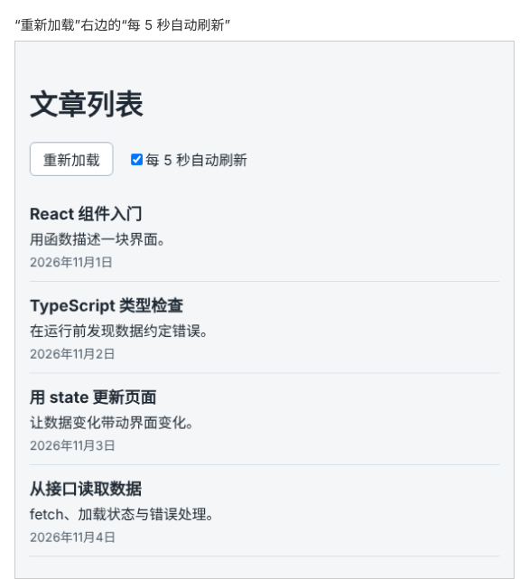

# 第 81 章：离开页面时，如何清理尚未完成的定时任务？

前置：[第 80 章：为什么某些 Effect 会反复执行，甚至不断发送请求？](第080章-为什么某些Effect会反复执行，甚至不断发送请求.md)

## 一、本章要解决的问题

文章可能随时有更新，本章给文章页加一个“每 5 秒自动刷新”复选框：勾选后，页面每隔 5 秒重新读取一次文章。

做这个功能时最容易漏掉的一步是：**停下来**。取消勾选、或者用户离开文章页之后，定时任务必须停止，否则它会在后台一直发请求，即使页面上已经看不到文章列表。

本章完成后的文章页如下图：



## 二、必要原理

### setInterval：每隔一段时间执行一次

第 77 章的 `setTimeout` 只执行一次。`setInterval(函数, 毫秒)` 则每隔指定的时间执行一次，一直重复，直到用 `clearInterval(编号)` 停止。

### 定时任务放在 Effect 中，清理函数负责停止

“勾选了自动刷新”这个状态决定定时任务是否存在，所以用 Effect 根据 `autoRefresh` 开始定时任务：

```tsx
useEffect(() => {
  if (!autoRefresh) {
    return;
  }
  const timerId = setInterval(() => { /* 刷新 */ }, 5000);
  return () => {
    clearInterval(timerId);
  };
}, [autoRefresh]);
```

清理函数在三种时候执行：

- 取消勾选时：`autoRefresh` 变了，React 先清理上一次的 Effect，定时任务停止；新的 Effect 发现没有勾选，直接返回。
- 组件离开页面时：React 执行最后一次清理，定时任务停止。
- 开发环境中 StrictMode 的检查（第 75 章）：如果页面打开时复选框就是勾选的，定时任务会先被清理一次再重新开始。

不写清理函数，`setInterval` 就会一直运行下去。组件已经不在页面上了，它仍然每 5 秒发一个请求，读回来的数据也没有地方显示。

### 定时任务中只做不依赖组件状态的事

本章的刷新直接调用组件外的 `fetchArticles`，成功后用新数据替换列表；失败时什么都不做，保留当前列表，等下一次刷新。它不读取任何 state，所以 Effect 只依赖 `autoRefresh`。下一章会让自动刷新也显示“正在更新……”，那时就需要读取 state 了。

### 怎样让文章页“离开”页面

在页面之间跳转要到第 94 章学习路由时才做。本章只需要验证“组件离开页面时定时任务会停止”，所以在第三节用一个临时的复选框：在 `App` 中用 `{showArticles && <ArticlePage />}` 显示文章页，取消勾选时，`ArticlePage` 就从页面上移除了，它的所有 Effect 都会被清理；再次勾选时，显示的是一个全新的组件，state 重新开始，Effect 重新执行。实验做完后，`App` 恢复为只显示文章页。

## 三、动手实现

### 第 1 步：添加样式

在 `src/pages` 中新建 `ArticlePage.module.css`：

```css
.toolbar {
  display: flex;
  flex-wrap: wrap;
  align-items: center;
  gap: 16px;
}
```

### 第 2 步：加入自动刷新的 state 和 Effect

在 `src/pages/ArticlePage.tsx` 中，在类型导入的下面加入：

```tsx
import styles from './ArticlePage.module.css';
```

在 `loadState` 的下面加入：

```tsx
  const [autoRefresh, setAutoRefresh] = useState(false);
```

在读取文章的 Effect 后面加入：

```tsx
  useEffect(() => {
    if (!autoRefresh) {
      return;
    }
    const timerId = setInterval(async () => {
      try {
        const data = await fetchArticles();
        setLoadState({ status: 'success', articles: data });
      } catch {
        // 自动刷新失败时保留当前列表，等下一次刷新
      }
    }, 5000);
    return () => {
      clearInterval(timerId);
    };
  }, [autoRefresh]);
```

### 第 3 步：加入复选框

把“重新加载”按钮替换为：

```tsx
      <div className={styles.toolbar}>
        <button type="button" onClick={handleReload} disabled={loadState.status === 'loading'}>
          重新加载
        </button>
        <label>
          <input
            type="checkbox"
            checked={autoRefresh}
            onChange={(event) => setAutoRefresh(event.target.checked)}
          />
          每 5 秒自动刷新
        </label>
      </div>
```

### 第 4 步：让 App 显示文章页

第 76 章起 `App` 显示的是搜索页。把 `src/App.tsx` 改为：

```tsx
import './App.css';
import ArticlePage from './pages/ArticlePage';

export default function App() {
  return <ArticlePage />;
}
```

### 第 5 步：临时实验，让文章页离开页面

把 `src/App.tsx` 临时改为：

```tsx
import { useState } from 'react';
import './App.css';
import ArticlePage from './pages/ArticlePage';

export default function App() {
  const [showArticles, setShowArticles] = useState(true);

  return (
    <div>
      <label>
        <input
          type="checkbox"
          checked={showArticles}
          onChange={(event) => setShowArticles(event.target.checked)}
        />
        显示文章页
      </label>
      {showArticles && <ArticlePage />}
    </div>
  );
}
```

按第四节第 4—6 项操作。做完后把 `App.tsx` 恢复为第 4 步的内容。

## 四、运行与检查

保持开发服务器和练习服务都在运行（准备篇二），打开 Network（网络）面板。

1. 文章页的“重新加载”按钮右边有“每 5 秒自动刷新”复选框，默认没有勾选。
2. 勾选“每 5 秒自动刷新”，Network 中每隔约 5 秒出现一个 `articles` 请求。
3. 取消勾选，不再出现新的请求。
4. 换成第三节第 5 步的临时 `App`，勾选“每 5 秒自动刷新”，再取消勾选上方的“显示文章页”，文章页消失。等 10 秒以上，Network 中不再出现 `articles` 请求，练习服务的终端中也没有。
5. 重新勾选“显示文章页”，文章重新读取，“每 5 秒自动刷新”恢复为未勾选。
6. 把第 2 步 Effect 中的 `return () => { … };` 三行临时删掉，重复第 4 项：文章页已经不见了，`articles` 请求仍然每 5 秒出现一次。确认后恢复清理函数，并把 `App.tsx` 恢复为第三节第 4 步的内容。

最后运行检查，应没有错误：

```powershell
npm.cmd run check
```

**小练习**：在实验的状态下（没有清理函数），反复勾选、取消勾选几次，再观察请求的频率。想一想为什么会越来越快。练习后恢复本章代码。

## 五、常见错误

| 现象 | 原因 | 怎么改 |
| --- | --- | --- |
| 离开文章页后，Network 中仍然每 5 秒出现请求 | 没有在清理函数中调用 `clearInterval` | 返回 `() => { clearInterval(timerId); }` |
| 取消勾选后仍在刷新 | 同上，或者 Effect 没有把 `autoRefresh` 写进依赖 | 依赖写 `[autoRefresh]`，并写好清理函数 |
| 勾选后要等 5 秒才第一次刷新 | `setInterval` 第一次执行也要等一个间隔，这是正常的 | 需要立即刷新时，在开始定时前先刷新一次 |
| 重新显示文章页后，“每 5 秒自动刷新”又变成了未勾选 | 离开页面的组件被移除，state 也随之消失 | 这是正常的；需要保留时，以后学习把 state 放到更高层的组件 |

## 六、本章完整代码

### `src/pages/ArticlePage.module.css`

内容同第三节第 1 步。

### `src/pages/ArticlePage.tsx`

```tsx
import { useEffect, useState } from 'react';
import ArticleList from '../components/ArticleList';
import { apiUrl } from '../lib/api';
import { isArticle } from '../types/article';
import type { Article } from '../types/article';
import styles from './ArticlePage.module.css';

type LoadState =
  | { status: 'loading'; articles: Article[] }
  | { status: 'success'; articles: Article[] }
  | { status: 'error'; message: string; articles: Article[] };

async function fetchArticles(): Promise<Article[]> {
  let response: Response;
  try {
    response = await fetch(apiUrl('/articles'));
  } catch {
    throw new Error('无法连接练习服务，请确认它已经启动。');
  }
  if (!response.ok) {
    throw new Error('文章读取失败：服务器返回了状态 ' + response.status + '。');
  }
  const data: unknown = await response.json();
  if (!Array.isArray(data) || !data.every(isArticle)) {
    throw new Error('文章数据格式不正确，暂时无法显示。');
  }
  return data;
}

function getErrorMessage(error: unknown) {
  return error instanceof Error ? error.message : '文章读取失败。';
}

export default function ArticlePage() {
  const [loadState, setLoadState] = useState<LoadState>({ status: 'loading', articles: [] });
  const [autoRefresh, setAutoRefresh] = useState(false);
  const articles = loadState.articles;

  useEffect(() => {
    let ignore = false;

    async function loadOnOpen() {
      try {
        const data = await fetchArticles();
        if (!ignore) {
          setLoadState({ status: 'success', articles: data });
        }
      } catch (error) {
        if (!ignore) {
          setLoadState({ status: 'error', message: getErrorMessage(error), articles: [] });
        }
      }
    }

    loadOnOpen();
    return () => {
      ignore = true;
    };
  }, []);

  useEffect(() => {
    if (!autoRefresh) {
      return;
    }
    const timerId = setInterval(async () => {
      try {
        const data = await fetchArticles();
        setLoadState({ status: 'success', articles: data });
      } catch {
        // 自动刷新失败时保留当前列表，等下一次刷新
      }
    }, 5000);
    return () => {
      clearInterval(timerId);
    };
  }, [autoRefresh]);

  async function handleReload() {
    setLoadState({ status: 'loading', articles });
    try {
      const data = await fetchArticles();
      setLoadState({ status: 'success', articles: data });
    } catch (error) {
      setLoadState({ status: 'error', message: getErrorMessage(error), articles });
    }
  }

  return (
    <main className="page">
      <h1>文章列表</h1>
      <div className={styles.toolbar}>
        <button type="button" onClick={handleReload} disabled={loadState.status === 'loading'}>
          重新加载
        </button>
        <label>
          <input
            type="checkbox"
            checked={autoRefresh}
            onChange={(event) => setAutoRefresh(event.target.checked)}
          />
          每 5 秒自动刷新
        </label>
      </div>
      {loadState.status === 'loading' && (
        <p role="status">{articles.length === 0 ? '正在加载文章……' : '正在更新……'}</p>
      )}
      {loadState.status === 'error' && (
        <div>
          <p role="alert">{loadState.message}</p>
          <button type="button" onClick={handleReload}>
            重试
          </button>
        </div>
      )}
      {loadState.status === 'success' && articles.length === 0 && <p>暂时还没有文章。</p>}
      {articles.length > 0 && <ArticleList articles={articles} />}
    </main>
  );
}
```

### `src/App.tsx`

内容同第三节第 4 步。

## 七、本章改动小结

新增 `src/pages/ArticlePage.module.css`；修改 `src/pages/ArticlePage.tsx`：加入每 5 秒自动刷新；修改 `src/App.tsx`：改为显示文章页。

---

下一章：[第 82 章：如何在 Effect 中读取最新的值，又不让 Effect 重新执行？](第082章-如何在Effect中读取最新的值，又不让Effect重新执行.md)
