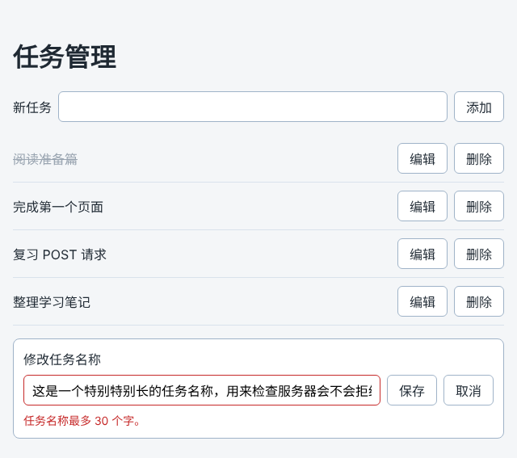

# 第 85 章：如何在打开任务页时读取服务器中的任务？

前置：[第 84 章：【组合】如何保证搜索结果始终对应最后输入的关键词？](第084章-如何保证搜索结果始终对应最后输入的关键词.md)

## 一、本章要解决的问题

第 45—53 章做的待办事项页可以添加、删除、修改任务，但任务只保存在浏览器内存的 state 里。刷新页面，所有改动都会消失，换一台电脑打开也看不到。真正的任务管理页要把任务保存在服务器上。

本章新建一个“任务管理”页。页面一打开，就从练习服务读取任务列表并显示出来。本章只读取，下一章开始把新增、修改、删除保存到服务器。

本章是第 10 部分的起点。学完第 10 部分（第 85—93 章）时，任务管理页的效果如下图：可以添加、修改、删除任务，所有改动都保存在服务器上，刷新后仍在；保存期间按钮不能重复点击；服务器拒绝保存时，原因显示在对应的输入框下方。



## 二、必要原理

### 任务保存在练习服务中

练习服务提供了任务接口。打开页面时要用的是读取全部任务：

| 操作 | 请求 | 成功时返回 |
| --- | --- | --- |
| 读取全部任务 | `GET /api/tasks` | 状态 200，任务数组 |

每条任务有三个字段：

```json
{ "id": "t1", "title": "阅读准备篇", "completed": true }
```

`id` 是文字，由服务器生成；`completed` 表示是否已完成。练习服务把任务写在 `server/data/practice-data.json` 文件中，所以重启练习服务，任务也不会丢失。刚开始时有两条任务，其中“阅读准备篇”已经完成。

### 新建一个页面，原来的待办事项页保留

`src/pages/TaskPage.tsx` 是只在浏览器中操作数据的版本，保留不动，第 94 章接入路由时它仍是一个独立的页面。本章新建 `src/pages/TaskServerPage.tsx`，名字中的 Server 表示数据来自服务器。

### 任务的类型放进 types 文件夹

第 67 章（如何让多个文件共用同一个数据类型）把文章的类型放进了 `src/types/article.ts`。任务也一样：新建 `src/types/task.ts`，写上 `Task` 类型和检查数据格式的 `isTask`（第 68 章）。

你可能注意到，`src/data/tasks.ts` 中已经有一个 `Task` 类型。那个文件放的是待办事项页的示例数据，类型是跟着示例数据一起写的。接口数据的类型按项目约定放在 `src/types` 中，两者字段相同，互不影响。

### 读取的写法和文章页完全相同

文章页（第 74、75 章）已经解决了“打开页面就读取”的所有问题，这里照着写：

- `fetchTasks` 写在组件外面，负责请求、检查状态码、检查数据格式。失败时抛出带中文提示的错误。
- Effect 的依赖数组是 `[]`，只在页面显示后执行一次；用 `ignore` 防止开发环境中执行两次时出错。
- `LoadState` 用联合类型区分读取中、成功、失败三种情况（第 69 章）。每种情况都带着 `tasks`，组件中用 `const tasks = loadState.tasks;` 直接取出。后面几章保存成功后要更新这个列表，这样写最方便。

### 两个页面共用一个样式文件

任务管理页的列表外观和待办事项页一样，所以直接导入 `TaskPage.module.css`。CSS Modules 的样式文件（第 15 章）可以被多个组件导入，它们拿到的是同一组类名。

## 三、动手实现

### 第 1 步：新建任务类型

新建 `src/types/task.ts`：

```ts
export type Task = {
  id: string;
  title: string;
  completed: boolean;
};

export function isTask(value: unknown): value is Task {
  return (
    typeof value === 'object' &&
    value !== null &&
    'id' in value &&
    typeof value.id === 'string' &&
    'title' in value &&
    typeof value.title === 'string' &&
    'completed' in value &&
    typeof value.completed === 'boolean'
  );
}
```

写法和 `isArticle` 相同，只是字段换成了任务的三个字段。注意 `id` 检查的是 `'string'`，任务编号是文字，不是数字。

### 第 2 步：新建任务管理页

新建 `src/pages/TaskServerPage.tsx`：

```tsx
import { useEffect, useState } from 'react';
import { apiUrl } from '../lib/api';
import { isTask } from '../types/task';
import type { Task } from '../types/task';
import styles from './TaskPage.module.css';

type LoadState =
  | { status: 'loading'; tasks: Task[] }
  | { status: 'success'; tasks: Task[] }
  | { status: 'error'; message: string; tasks: Task[] };

async function fetchTasks(): Promise<Task[]> {
  let response: Response;
  try {
    response = await fetch(apiUrl('/tasks'));
  } catch {
    throw new Error('无法连接练习服务，请确认它已经启动。');
  }
  if (!response.ok) {
    throw new Error('任务读取失败：服务器返回了状态 ' + response.status + '。');
  }
  const data: unknown = await response.json();
  if (!Array.isArray(data) || !data.every(isTask)) {
    throw new Error('任务数据格式不正确，暂时无法显示。');
  }
  return data;
}

function getErrorMessage(error: unknown) {
  return error instanceof Error ? error.message : '任务读取失败。';
}

export default function TaskServerPage() {
  const [loadState, setLoadState] = useState<LoadState>({ status: 'loading', tasks: [] });
  const tasks = loadState.tasks;

  useEffect(() => {
    let ignore = false;

    async function loadOnOpen() {
      try {
        const data = await fetchTasks();
        if (!ignore) {
          setLoadState({ status: 'success', tasks: data });
        }
      } catch (error) {
        if (!ignore) {
          setLoadState({ status: 'error', message: getErrorMessage(error), tasks: [] });
        }
      }
    }

    loadOnOpen();
    return () => {
      ignore = true;
    };
  }, []);

  async function handleRetry() {
    setLoadState({ status: 'loading', tasks: [] });
    try {
      const data = await fetchTasks();
      setLoadState({ status: 'success', tasks: data });
    } catch (error) {
      setLoadState({ status: 'error', message: getErrorMessage(error), tasks: [] });
    }
  }

  return (
    <main className="page">
      <h1>任务管理</h1>
      {loadState.status === 'loading' && <p role="status">正在读取任务……</p>}
      {loadState.status === 'error' && (
        <div>
          <p role="alert">{loadState.message}</p>
          <button type="button" onClick={handleRetry}>
            重试
          </button>
        </div>
      )}
      {loadState.status === 'success' && tasks.length === 0 && (
        <p className={styles.empty}>还没有任务。</p>
      )}
      {tasks.length > 0 && (
        <ul className={styles.list}>
          {tasks.map((task) => (
            <li key={task.id} className={styles.item}>
              <span className={task.completed ? styles.title + ' ' + styles.done : styles.title}>
                {task.title}
              </span>
            </li>
          ))}
        </ul>
      )}
    </main>
  );
}
```

这个文件没有新语法，各部分分别来自前面的章节：

- `fetchTasks` 和 `getErrorMessage` 与文章页的 `fetchArticles`、`getErrorMessage` 写法相同（第 74 章），只是地址换成 `/tasks`，提示文字换成“任务”。
- Effect 中的 `ignore` 来自第 75 章（为什么开发环境中的 Effect 会执行两次）。
- “重试”按钮来自第 66 章（请求失败后，如何让用户点击重试）。重试前列表一定是空的，所以直接写 `tasks: []`。
- 已完成的任务加上 `styles.done`，显示删除线，与第 48 章（如何切换任务的完成状态）的写法相同。完成状态的切换留到本部分的阶段练习。

### 第 3 步：让 App 显示任务管理页

把 `src/App.tsx` 改为：

```tsx
import './App.css';
import TaskServerPage from './pages/TaskServerPage';

export default function App() {
  return <TaskServerPage />;
}
```

## 四、运行与检查

保持开发服务器和练习服务都在运行（准备篇二）。

1. 刷新页面，先显示“正在读取任务……”，半秒后显示“阅读准备篇”和“完成第一个页面”两条任务，“阅读准备篇”带删除线。
2. 打开开发者工具的 Network（网络）面板，刷新页面，能看到 `tasks` 请求。点开它，在 Response（响应）标签中可以看到服务器返回的任务数组。开发环境中请求出现两次，原因见第 75 章。
3. 停止练习服务，刷新页面，显示“任务读取失败：服务器返回了状态 500。”和“重试”按钮。请求经过开发服务器的代理，所以是状态 500 的提示（第 74 章）。
4. 重新启动练习服务，点击“重试”，两条任务出现。

如果你之前练习时改动过任务数据，看到的任务可能不同。想恢复成初始的两条任务，先停止练习服务，运行 `npm.cmd run reset-data`，再重新启动。

最后运行检查，应没有错误：

```powershell
npm.cmd run check
```

**小练习**：在浏览器地址栏直接打开 `http://127.0.0.1:3001/api/tasks`，看看练习服务返回的原始数据，对照 `isTask` 检查的三个字段。

## 五、常见错误

| 现象 | 原因 | 怎么改 |
| --- | --- | --- |
| 页面显示“任务数据格式不正确” | `isTask` 中把 `id` 写成了检查 `'number'` | 任务编号是文字，检查 `typeof value.id === 'string'` |
| 列表没有样式，任务挤在一起 | 忘了导入样式文件，或类名写错 | 导入 `./TaskPage.module.css`，使用其中的 `list`、`item`、`title` |
| 页面一直显示“正在读取任务……” | 在 Effect 中定义了 `loadOnOpen` 却没有调用 | 在 Effect 中加一行 `loadOnOpen();` |
| 浏览器中还是显示搜索页 | `App.tsx` 没有改 | 按第三节第 3 步修改 |
| `check` 提示找不到 `../types/task` | 文件放错了位置或名字拼错 | 文件路径应是 `src/types/task.ts` |

## 六、本章完整代码

### `src/types/task.ts`

内容同第三节第 1 步。

### `src/pages/TaskServerPage.tsx`

内容同第三节第 2 步。

### `src/App.tsx`

内容同第三节第 3 步。

## 七、本章改动小结

新增 `src/types/task.ts` 和 `src/pages/TaskServerPage.tsx`；修改 `src/App.tsx`：改为显示任务管理页。

---

下一章：[第 86 章：如何把新增任务保存到服务器？](第086章-如何把新增任务保存到服务器.md)
