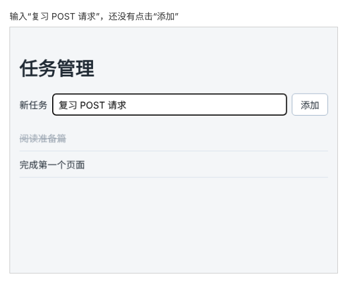

# 第 86 章：如何把新增任务保存到服务器？

前置：[第 85 章：如何在打开任务页时读取服务器中的任务？](第085章-如何在打开任务页时读取服务器中的任务.md)

## 一、本章要解决的问题

第 85 章的任务页打开时会自动从服务器读取任务列表，但还不能添加任务。第 45 章（如何向列表添加一条任务）做过添加功能，不过任务只存在浏览器内存里，刷新页面就没了。

本章在任务页加一个输入框和“添加”按钮。点击添加后，把新任务发送给服务器保存，再重新读取列表。完成后，新任务出现在列表中；刷新页面，甚至重启练习服务，它仍然存在。



## 二、必要原理

### 读取用 GET，新增用 POST

前面读取数据时，`fetch` 默认发送的是 GET 请求，意思是“把数据给我”。新增数据要发送 POST 请求，意思是“这是一份新数据，请保存”。练习服务的任务接口约定如下：

| 操作 | 请求 | 发送的内容 | 成功时返回 |
| --- | --- | --- | --- |
| 读取全部任务 | `GET /api/tasks` | 无 | 状态 200，任务数组 |
| 新增一条任务 | `POST /api/tasks` | `{ "title": "任务名称" }` | 状态 201，新建的任务 |

新任务的编号由服务器生成，前端只需要发送名称。名称为空或超过 30 个字时，服务器拒绝保存，返回状态 422。

### 用 fetch 发送 POST 请求

`fetch` 的第二个参数可以设置请求方式和要发送的内容：

```ts
await fetch(apiUrl('/tasks'), {
  method: 'POST',
  headers: { 'Content-Type': 'application/json' },
  body: JSON.stringify({ title }),
});
```

- `method: 'POST'` 指定请求方式。
- `body` 是要发送给服务器的内容。网络上只能传文字，`JSON.stringify` 把 JavaScript 对象转换成 JSON 格式的文字，例如 `{"title":"复习"}`。
- `headers` 中的 `Content-Type` 告诉服务器“正文是 JSON 格式”，服务器据此解析。

`{ title }` 是 `{ title: title }` 的简写：属性名和变量名相同时，可以只写一次。

### 保存写在事件处理函数里，不写在 Effect 里

第 74 章（如何在打开页面时自动读取数据）用 Effect 读取数据，因为“页面打开”这件事本身就需要读取。而保存任务是因为用户点击了“添加”才发生的，应该直接写在提交事件的处理函数里。

如果改成“点击时修改一个 state，再由 Effect 发现变化后去保存”，会多绕一圈，而且 Effect 在开发环境会多执行一次（第 75 章），可能把同一条任务保存两遍。判断方法很简单：**由用户操作引起的请求，写在事件处理函数里。**

### 服务器保存的才是真正的数据

页面上的任务列表只是服务器数据的一份显示副本。本章在保存成功后，不自己往数组里追加任务，而是重新向服务器读取一次列表。这样页面显示的一定是服务器上真实保存的结果。第 92 章会介绍更省事的做法：直接使用 POST 返回的新任务更新列表，省掉这次重新读取。

### 保存失败和读取失败要分开提示

保存失败时，任务没有存上，输入框里的文字要留着，用户才能直接再点一次。保存成功、但随后重新读取列表失败时，情况就不同了：任务已经存上，如果这时也提示“保存失败”，用户以为没保存，再点一次就会存出两条一样的任务。所以这两种情况要用不同的提示。

## 三、动手实现

本章只修改 `src/pages/TaskServerPage.tsx`。

### 第 1 步：导入提交事件的类型

在文件顶部的导入中加一行，这是第 40 章（如何阻止提交表单时刷新整个页面）用过的类型：

```tsx
import { useEffect, useState } from 'react';
import type { SubmitEvent } from 'react';
import { apiUrl } from '../lib/api';
```

### 第 2 步：增加输入框需要的两个 state

在 `TaskServerPage` 函数中，`loadState` 的下面加入：

```tsx
  const [loadState, setLoadState] = useState<LoadState>({ status: 'loading', tasks: [] });
  const [draft, setDraft] = useState('');
  const [saveError, setSaveError] = useState('');
```

`draft` 保存输入框中正在输入、还没提交的文字。`saveError` 保存保存失败时的提示。它和读取失败是两回事，分开保存，才不会互相覆盖。

### 第 3 步：编写提交处理函数

在 `handleRetry` 的下面、`return` 的上面，加入 `handleAdd`：

```tsx
  async function handleAdd(event: SubmitEvent<HTMLFormElement>) {
    event.preventDefault();
    const title = draft.trim();
    if (title === '') {
      setSaveError('请填写任务名称。');
      return;
    }
    setSaveError('');

    let response: Response;
    try {
      response = await fetch(apiUrl('/tasks'), {
        method: 'POST',
        headers: { 'Content-Type': 'application/json' },
        body: JSON.stringify({ title }),
      });
    } catch {
      setSaveError('无法连接练习服务，任务没有保存。输入的内容已保留。');
      return;
    }
    if (!response.ok) {
      setSaveError('保存失败：服务器返回了状态 ' + response.status + '。输入的内容已保留。');
      return;
    }

    setDraft('');
    try {
      const data = await fetchTasks();
      setLoadState({ status: 'success', tasks: data });
    } catch {
      setSaveError('任务已保存，但重新读取列表失败，请刷新页面查看。');
    }
  }
```

这个函数分三段：

1. **提交前检查**：`preventDefault()` 阻止浏览器刷新页面；`trim()` 去掉首尾空格后为空，就显示提示并直接结束，不发请求。
2. **发送保存请求**：写法和 `fetchTasks` 一样，先用 `try` 包住 `fetch`，连不上服务器时进入 `catch`；再检查 `response.ok`，服务器拒绝或出错时显示状态码。两种失败都直接 `return`，函数在这里结束。注意此时没有清空 `draft`，用户输入的文字还留在输入框里，可以直接再点一次重试。
3. **保存成功之后**：先清空输入框，再调用第 85 章写好的 `fetchTasks()` 重新读取列表。重新读取放在单独的 `try` 里，失败时提示“任务已保存”，原因见第二节最后一小节。

### 第 4 步：在页面上加入表单

在 `<h1>任务管理</h1>` 的下面加入表单和保存提示：

```tsx
      <h1>任务管理</h1>
      <form className={styles.addForm} onSubmit={handleAdd}>
        <label htmlFor="new-task">新任务</label>
        <input id="new-task" value={draft} onChange={(event) => setDraft(event.target.value)} />
        <button type="submit">添加</button>
      </form>
      {saveError && <p role="alert">{saveError}</p>}
```

输入框的写法与第 35 章（如何让输入框的内容与 state 保持同步）相同，`styles.addForm` 是待办事项页添加表单用过的样式。按钮的 `type="submit"` 让点击按钮和在输入框中按 Enter 都会提交表单。

## 四、运行与检查

保持开发服务器和练习服务都在运行（准备篇二）。打开任务页，先等列表显示出来。

1. 输入“复习 POST 请求”，点击“添加”。大约一秒后列表最后出现这条任务，输入框被清空。保存和重新读取各等待半秒，所以要一秒左右。
2. 在输入框中输入一个任务名后按 Enter，效果和点击按钮相同。
3. 刷新浏览器页面。页面重新读取后，刚才添加的任务仍在列表中。这说明任务已经保存在服务器上，而不只是保存在页面的 state 里。
4. 在练习服务的终端按 Ctrl+C 停止它，再重新运行 `npm.cmd run api`，刷新页面，任务仍然存在。练习服务把任务写在 `server/data/practice-data.json` 文件中，重启不会丢失。
5. 不输入内容直接点击“添加”，页面提示“请填写任务名称。”，Network（网络）面板中不会出现新的 POST 请求。
6. 停止练习服务，输入“停服时添加”并点击添加。页面提示“保存失败：服务器返回了状态 500。输入的内容已保留。”，输入框里仍是“停服时添加”。重新启动练习服务后再点击添加，保存成功。
7. 输入一个超过 30 个字的名称，页面提示服务器返回了状态 422。打开 Network 面板，点开这次 POST 请求的 Response（响应）标签，可以看到服务器说明了拒绝的原因。第 90 章会把这个原因显示在输入框下方。

想清空练习数据时，先停止练习服务，运行 `npm.cmd run reset-data`，再重新启动。

最后运行一次检查，应没有错误：

```powershell
npm.cmd run check
```

**小练习**：在 Network 面板中点开第 1 步发出的 POST 请求，分别在 Payload（载荷）和 Response（响应）标签中找到你发送的任务名称和服务器生成的 `id`。

## 五、常见错误

| 现象 | 原因 | 怎么改 |
| --- | --- | --- |
| 点击添加后页面整个刷新，输入的内容消失 | 漏写了 `event.preventDefault()` | 写在 `handleAdd` 的第一行 |
| Network 中请求方式显示为 GET，列表也没有新任务 | `fetch` 的第二个参数漏写了 `method: 'POST'` | 补上请求方式 |
| 服务器返回 400，提示请求正文不是有效的 JSON | `body` 直接写成了对象 `{ title }`，没有用 `JSON.stringify` 转换 | 写成 `body: JSON.stringify({ title })` |
| 点一次添加，列表中出现两条相同的任务 | 把保存请求放进了 Effect，开发环境中 Effect 执行了两次 | 保存请求写在 `handleAdd` 里，不放进 Effect |
| 保存失败后输入框被清空 | `setDraft('')` 写在了 `fetch` 之前 | 只在保存成功后清空输入框 |

## 六、本章完整代码

### `src/pages/TaskServerPage.tsx`

```tsx
import { useEffect, useState } from 'react';
import type { SubmitEvent } from 'react';
import { apiUrl } from '../lib/api';
import { isTask } from '../types/task';
import type { Task } from '../types/task';
import styles from './TaskPage.module.css';

type LoadState =
  | { status: 'loading'; tasks: Task[] }
  | { status: 'success'; tasks: Task[] }
  | { status: 'error'; message: string; tasks: Task[] };

async function fetchTasks(): Promise<Task[]> {
  let response: Response;
  try {
    response = await fetch(apiUrl('/tasks'));
  } catch {
    throw new Error('无法连接练习服务，请确认它已经启动。');
  }
  if (!response.ok) {
    throw new Error('任务读取失败：服务器返回了状态 ' + response.status + '。');
  }
  const data: unknown = await response.json();
  if (!Array.isArray(data) || !data.every(isTask)) {
    throw new Error('任务数据格式不正确，暂时无法显示。');
  }
  return data;
}

function getErrorMessage(error: unknown) {
  return error instanceof Error ? error.message : '任务读取失败。';
}

export default function TaskServerPage() {
  const [loadState, setLoadState] = useState<LoadState>({ status: 'loading', tasks: [] });
  const [draft, setDraft] = useState('');
  const [saveError, setSaveError] = useState('');
  const tasks = loadState.tasks;

  useEffect(() => {
    let ignore = false;

    async function loadOnOpen() {
      try {
        const data = await fetchTasks();
        if (!ignore) {
          setLoadState({ status: 'success', tasks: data });
        }
      } catch (error) {
        if (!ignore) {
          setLoadState({ status: 'error', message: getErrorMessage(error), tasks: [] });
        }
      }
    }

    loadOnOpen();
    return () => {
      ignore = true;
    };
  }, []);

  async function handleRetry() {
    setLoadState({ status: 'loading', tasks: [] });
    try {
      const data = await fetchTasks();
      setLoadState({ status: 'success', tasks: data });
    } catch (error) {
      setLoadState({ status: 'error', message: getErrorMessage(error), tasks: [] });
    }
  }

  async function handleAdd(event: SubmitEvent<HTMLFormElement>) {
    event.preventDefault();
    const title = draft.trim();
    if (title === '') {
      setSaveError('请填写任务名称。');
      return;
    }
    setSaveError('');

    let response: Response;
    try {
      response = await fetch(apiUrl('/tasks'), {
        method: 'POST',
        headers: { 'Content-Type': 'application/json' },
        body: JSON.stringify({ title }),
      });
    } catch {
      setSaveError('无法连接练习服务，任务没有保存。输入的内容已保留。');
      return;
    }
    if (!response.ok) {
      setSaveError('保存失败：服务器返回了状态 ' + response.status + '。输入的内容已保留。');
      return;
    }

    setDraft('');
    try {
      const data = await fetchTasks();
      setLoadState({ status: 'success', tasks: data });
    } catch {
      setSaveError('任务已保存，但重新读取列表失败，请刷新页面查看。');
    }
  }

  return (
    <main className="page">
      <h1>任务管理</h1>
      <form className={styles.addForm} onSubmit={handleAdd}>
        <label htmlFor="new-task">新任务</label>
        <input id="new-task" value={draft} onChange={(event) => setDraft(event.target.value)} />
        <button type="submit">添加</button>
      </form>
      {saveError && <p role="alert">{saveError}</p>}
      {loadState.status === 'loading' && <p role="status">正在读取任务……</p>}
      {loadState.status === 'error' && (
        <div>
          <p role="alert">{loadState.message}</p>
          <button type="button" onClick={handleRetry}>
            重试
          </button>
        </div>
      )}
      {loadState.status === 'success' && tasks.length === 0 && (
        <p className={styles.empty}>还没有任务。</p>
      )}
      {tasks.length > 0 && (
        <ul className={styles.list}>
          {tasks.map((task) => (
            <li key={task.id} className={styles.item}>
              <span className={task.completed ? styles.title + ' ' + styles.done : styles.title}>
                {task.title}
              </span>
            </li>
          ))}
        </ul>
      )}
    </main>
  );
}
```

## 七、本章改动小结

修改 `src/pages/TaskServerPage.tsx`：新增输入框、`draft` 和 `saveError` 两个 state，以及发送 POST 请求的 `handleAdd`。`src/lib/api.ts`、`src/types/task.ts` 和练习服务都不变。

---

下一章：[第 87 章：如何把任务名称的修改保存到服务器？](第087章-如何把任务名称的修改保存到服务器.md)
