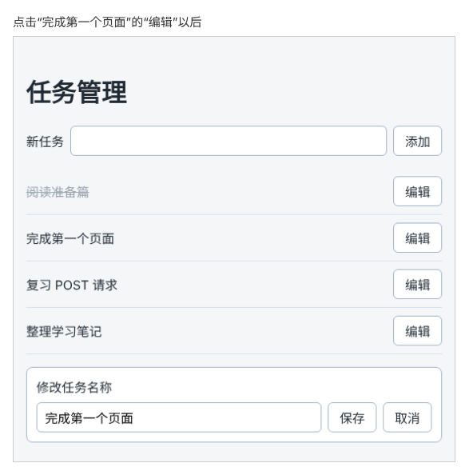

# 第 87 章：如何把任务名称的修改保存到服务器？

前置：[第 86 章：如何把新增任务保存到服务器？](第086章-如何把新增任务保存到服务器.md)

## 一、本章要解决的问题

任务管理页现在能添加任务，但名称写错了改不了。第 47 章（如何修改任务名称）做过修改功能，改的只是浏览器中的数组，刷新就恢复原样。

本章给每条任务加一个“编辑”按钮。点击后，列表下方出现编辑框；修改名称并保存，就把新名称发送给服务器，再重新读取列表。完成后，刷新页面，看到的仍是修改后的名称。



## 二、必要原理

### 修改用 PATCH，地址中带上任务编号

修改一条已有的任务，要告诉服务器两件事：改哪一条，改成什么。练习服务的约定是：

| 操作 | 请求 | 发送的内容 | 成功时返回 |
| --- | --- | --- | --- |
| 修改一条任务 | `PATCH /api/tasks/任务编号` | 要修改的字段，例如 `{ "title": "新名称" }` | 状态 200，修改后的任务 |

“改哪一条”写在地址里，例如修改编号为 `t2` 的任务，地址是 `/api/tasks/t2`。代码中用字符串拼接得到：`apiUrl('/tasks/' + id)`。地址中这种表示“哪一个”的部分，叫**路径参数**。

“改成什么”写在请求正文里，写法和第 86 章的 POST 相同。PATCH 的意思是“只修改我发送的字段”：本章只发送 `title`，任务的 `completed` 保持原样。

### 直接复用 TaskEditor 组件

第 53 章（切换正在编辑的任务后，如何避免保留上一条的输入）把编辑框提取成了 `TaskEditor` 组件：它自己保存输入中的草稿，点击“保存”时调用 `onSave(新名称)`，点击“取消”时调用 `onCancel()`。任务管理页的编辑框和它完全一样，直接拿来用，同样要加上 `key`，切换任务时才会换一个新的编辑框。

`TaskEditor` 的 `task` 属性，类型写的是 `src/data/tasks.ts` 中的 `Task`；任务管理页的任务，类型是 `src/types/task.ts` 中的 `Task`。两个类型名字相同，来自不同的文件，为什么能直接传？因为 TypeScript 比较的是**类型的结构**：只要字段的名字和类型都对得上，就认为可以传入，不看类型是在哪里定义的。

### 用箭头函数补上任务编号

`TaskEditor` 保存时只传出新名称，而发送 PATCH 还需要任务编号。在使用组件的地方写一个箭头函数，把编号补上：

```tsx
onSave={(title) => handleSaveEdit(editingTask.id, title)}
```

`TaskEditor` 调用 `onSave('新名称')` 时，执行的是 `handleSaveEdit(编号, '新名称')`。第 46 章（如何删除指定的任务）在 `onClick` 中补上任务编号，用的是同样的写法。

### 先关闭编辑框，再等结果

本章的做法和第 47 章一样：点击“保存”后立即关闭编辑框，然后发送请求，成功后重新读取列表。所以关闭编辑框后，列表上还是旧名称，大约一秒后才变成新名称。

这样写有一个问题：保存失败时，编辑框已经关了，刚才输入的新名称也跟着没了。本章先把成功的流程走通，第 91 章再解决这个问题。

## 三、动手实现

本章只修改 `src/pages/TaskServerPage.tsx`。

### 第 1 步：导入编辑框组件

在 `apiUrl` 的导入上面加一行：

```tsx
import TaskEditor from '../components/TaskEditor';
import { apiUrl } from '../lib/api';
```

### 第 2 步：记住正在编辑哪一条任务

在 `saveError` 的下面加入 `editingId`，在 `tasks` 的下面算出正在编辑的任务：

```tsx
  const [saveError, setSaveError] = useState('');
  const [editingId, setEditingId] = useState<string | null>(null);
  const tasks = loadState.tasks;
  const editingTask = tasks.find((task) => task.id === editingId);
```

和第 47 章一样，state 中只保存编号，任务本身从列表中查出来。没有在编辑时，`editingId` 是 `null`，`find` 找不到，`editingTask` 是 `undefined`。

### 第 3 步：编写保存修改的函数

在 `handleAdd` 的下面加入：

```tsx
  async function handleSaveEdit(id: string, title: string) {
    setEditingId(null);
    setSaveError('');

    let response: Response;
    try {
      response = await fetch(apiUrl('/tasks/' + id), {
        method: 'PATCH',
        headers: { 'Content-Type': 'application/json' },
        body: JSON.stringify({ title }),
      });
    } catch {
      setSaveError('无法连接练习服务，修改没有保存。');
      return;
    }
    if (!response.ok) {
      setSaveError('修改失败：服务器返回了状态 ' + response.status + '。');
      return;
    }

    try {
      const data = await fetchTasks();
      setLoadState({ status: 'success', tasks: data });
    } catch {
      setSaveError('修改已保存，但重新读取列表失败，请刷新页面查看。');
    }
  }
```

结构和 `handleAdd` 相同：发送请求，检查结果，成功后重新读取列表。不同的只有三处：请求方式是 `'PATCH'`，地址后面拼上了任务编号，第一行先关闭编辑框。名称是否为空，`TaskEditor` 已经检查过了（名称为空时“保存”按钮不能点），这里不用再检查。

### 第 4 步：给每条任务加上“编辑”按钮

在列表的 `</span>` 下面加入按钮：

```tsx
              <span className={task.completed ? styles.title + ' ' + styles.done : styles.title}>
                {task.title}
              </span>
              <button type="button" onClick={() => setEditingId(task.id)}>
                编辑
              </button>
```

### 第 5 步：在列表下方显示编辑框

在 `</ul>` 和它后面的 `)}` 下面，`</main>` 的上面加入：

```tsx
      {editingTask && (
        <TaskEditor
          key={editingTask.id}
          task={editingTask}
          onSave={(title) => handleSaveEdit(editingTask.id, title)}
          onCancel={() => setEditingId(null)}
        />
      )}
```

`editingTask` 存在时才显示编辑框。`key` 用任务编号，切换到另一条任务时，React 会换一个新的编辑框（第 53 章）。

## 四、运行与检查

保持开发服务器和练习服务都在运行（准备篇二）。

1. 点击“完成第一个页面”右边的“编辑”，列表下方出现编辑框，里面是“完成第一个页面”。
2. 改为“完成任务管理页”，点击“保存”。编辑框立刻关闭，列表上先还是旧名称，大约一秒后变成新名称。
3. 刷新页面，列表中仍是“完成任务管理页”。
4. 在 Network（网络）面板中找到这次保存的请求，请求方式是 `PATCH`，地址以 `/api/tasks/t2` 结尾（如果你修改的是别的任务，结尾是那条任务的编号）。Response（响应）标签中是修改后的完整任务。
5. 打开编辑框后点击“取消”，编辑框关闭，Network 中没有新的请求。
6. 先点击一条任务的“编辑”，再点击另一条任务的“编辑”，编辑框中换成了第二条任务的名称。
7. 停止练习服务，编辑一条任务并保存。页面提示“修改失败：服务器返回了状态 500。”，编辑框已经关闭，刚才输入的新名称没有了。这就是第二节最后提到的问题，第 91 章解决。做完后重新启动练习服务。

最后运行检查，应没有错误：

```powershell
npm.cmd run check
```

**小练习**：在编辑框中把名称改成首尾带空格的“  复习 PATCH  ”，保存后看列表中显示的名称有没有空格。想一想：空格是在哪里被去掉的？（提示：看看 `TaskEditor` 的 `handleSubmit`。）

## 五、常见错误

| 现象 | 原因 | 怎么改 |
| --- | --- | --- |
| 页面提示“修改失败：服务器返回了状态 404。” | 地址中漏写了 `/`，拼成了 `/api/taskst2`，服务器没有这个地址 | 写成 `apiUrl('/tasks/' + id)` |
| 保存后所有任务的名称都没变，Network 中是 POST 请求 | 复制 `handleAdd` 后忘了改 `method` | 写成 `method: 'PATCH'` |
| 切换编辑另一条任务时，编辑框中还是上一条的名称 | `TaskEditor` 上漏写了 `key` | 加上 `key={editingTask.id}` |
| `check` 提示 `onSave` 的参数个数不对 | 写成了 `onSave={handleSaveEdit}`，组件只传一个参数，函数却需要两个 | 用箭头函数补上编号：`onSave={(title) => handleSaveEdit(editingTask.id, title)}` |

## 六、本章完整代码

### `src/pages/TaskServerPage.tsx`

```tsx
import { useEffect, useState } from 'react';
import type { SubmitEvent } from 'react';
import TaskEditor from '../components/TaskEditor';
import { apiUrl } from '../lib/api';
import { isTask } from '../types/task';
import type { Task } from '../types/task';
import styles from './TaskPage.module.css';

type LoadState =
  | { status: 'loading'; tasks: Task[] }
  | { status: 'success'; tasks: Task[] }
  | { status: 'error'; message: string; tasks: Task[] };

async function fetchTasks(): Promise<Task[]> {
  let response: Response;
  try {
    response = await fetch(apiUrl('/tasks'));
  } catch {
    throw new Error('无法连接练习服务，请确认它已经启动。');
  }
  if (!response.ok) {
    throw new Error('任务读取失败：服务器返回了状态 ' + response.status + '。');
  }
  const data: unknown = await response.json();
  if (!Array.isArray(data) || !data.every(isTask)) {
    throw new Error('任务数据格式不正确，暂时无法显示。');
  }
  return data;
}

function getErrorMessage(error: unknown) {
  return error instanceof Error ? error.message : '任务读取失败。';
}

export default function TaskServerPage() {
  const [loadState, setLoadState] = useState<LoadState>({ status: 'loading', tasks: [] });
  const [draft, setDraft] = useState('');
  const [saveError, setSaveError] = useState('');
  const [editingId, setEditingId] = useState<string | null>(null);
  const tasks = loadState.tasks;
  const editingTask = tasks.find((task) => task.id === editingId);

  useEffect(() => {
    let ignore = false;

    async function loadOnOpen() {
      try {
        const data = await fetchTasks();
        if (!ignore) {
          setLoadState({ status: 'success', tasks: data });
        }
      } catch (error) {
        if (!ignore) {
          setLoadState({ status: 'error', message: getErrorMessage(error), tasks: [] });
        }
      }
    }

    loadOnOpen();
    return () => {
      ignore = true;
    };
  }, []);

  async function handleRetry() {
    setLoadState({ status: 'loading', tasks: [] });
    try {
      const data = await fetchTasks();
      setLoadState({ status: 'success', tasks: data });
    } catch (error) {
      setLoadState({ status: 'error', message: getErrorMessage(error), tasks: [] });
    }
  }

  async function handleAdd(event: SubmitEvent<HTMLFormElement>) {
    event.preventDefault();
    const title = draft.trim();
    if (title === '') {
      setSaveError('请填写任务名称。');
      return;
    }
    setSaveError('');

    let response: Response;
    try {
      response = await fetch(apiUrl('/tasks'), {
        method: 'POST',
        headers: { 'Content-Type': 'application/json' },
        body: JSON.stringify({ title }),
      });
    } catch {
      setSaveError('无法连接练习服务，任务没有保存。输入的内容已保留。');
      return;
    }
    if (!response.ok) {
      setSaveError('保存失败：服务器返回了状态 ' + response.status + '。输入的内容已保留。');
      return;
    }

    setDraft('');
    try {
      const data = await fetchTasks();
      setLoadState({ status: 'success', tasks: data });
    } catch {
      setSaveError('任务已保存，但重新读取列表失败，请刷新页面查看。');
    }
  }

  async function handleSaveEdit(id: string, title: string) {
    setEditingId(null);
    setSaveError('');

    let response: Response;
    try {
      response = await fetch(apiUrl('/tasks/' + id), {
        method: 'PATCH',
        headers: { 'Content-Type': 'application/json' },
        body: JSON.stringify({ title }),
      });
    } catch {
      setSaveError('无法连接练习服务，修改没有保存。');
      return;
    }
    if (!response.ok) {
      setSaveError('修改失败：服务器返回了状态 ' + response.status + '。');
      return;
    }

    try {
      const data = await fetchTasks();
      setLoadState({ status: 'success', tasks: data });
    } catch {
      setSaveError('修改已保存，但重新读取列表失败，请刷新页面查看。');
    }
  }

  return (
    <main className="page">
      <h1>任务管理</h1>
      <form className={styles.addForm} onSubmit={handleAdd}>
        <label htmlFor="new-task">新任务</label>
        <input id="new-task" value={draft} onChange={(event) => setDraft(event.target.value)} />
        <button type="submit">添加</button>
      </form>
      {saveError && <p role="alert">{saveError}</p>}
      {loadState.status === 'loading' && <p role="status">正在读取任务……</p>}
      {loadState.status === 'error' && (
        <div>
          <p role="alert">{loadState.message}</p>
          <button type="button" onClick={handleRetry}>
            重试
          </button>
        </div>
      )}
      {loadState.status === 'success' && tasks.length === 0 && (
        <p className={styles.empty}>还没有任务。</p>
      )}
      {tasks.length > 0 && (
        <ul className={styles.list}>
          {tasks.map((task) => (
            <li key={task.id} className={styles.item}>
              <span className={task.completed ? styles.title + ' ' + styles.done : styles.title}>
                {task.title}
              </span>
              <button type="button" onClick={() => setEditingId(task.id)}>
                编辑
              </button>
            </li>
          ))}
        </ul>
      )}
      {editingTask && (
        <TaskEditor
          key={editingTask.id}
          task={editingTask}
          onSave={(title) => handleSaveEdit(editingTask.id, title)}
          onCancel={() => setEditingId(null)}
        />
      )}
    </main>
  );
}
```

## 七、本章改动小结

修改 `src/pages/TaskServerPage.tsx`：每条任务加上“编辑”按钮，复用 `TaskEditor` 显示编辑框，新增发送 PATCH 请求的 `handleSaveEdit`。

---

下一章：[第 88 章：如何删除服务器中的指定任务？](第088章-如何删除服务器中的指定任务.md)
