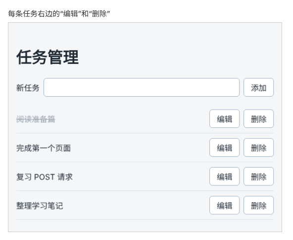

# 第 88 章：如何删除服务器中的指定任务？

前置：[第 87 章：如何把任务名称的修改保存到服务器？](第087章-如何把任务名称的修改保存到服务器.md)

## 一、本章要解决的问题

任务管理页已经能添加和修改任务，但做完的、加错的任务删不掉，列表只会越来越长。第 46 章（如何删除指定的任务）做过删除功能，删掉的任务刷新后又会回来。

本章给每条任务加一个“删除”按钮。点击后，通知服务器删除这条任务，再重新读取列表。完成后，刷新页面，删掉的任务不会再出现。



## 二、必要原理

### 删除用 DELETE

删除只需要告诉服务器“删哪一条”，编号同样写在地址里：

| 操作 | 请求 | 发送的内容 | 成功时返回 |
| --- | --- | --- | --- |
| 删除一条任务 | `DELETE /api/tasks/任务编号` | 无 | 状态 204，没有内容 |

DELETE 请求不需要正文，所以 `fetch` 的第二个参数只写 `method`：

```ts
await fetch(apiUrl('/tasks/' + id), { method: 'DELETE' });
```

### 状态 204：成功了，但没有内容

204 表示“请求成功，响应中没有内容”。任务已经删除，服务器没有什么需要返回的。`response.ok` 在状态码为 200—299 时都是 `true`，204 也包括在内。

因为响应中什么都没有，不要对它调用 `response.json()`。没有内容可以解析，`json()` 会出错。

### 状态 404：要删的任务已经不在了

同一个任务页可能在两个浏览器标签中打开。在第一个标签中删掉一条任务，第二个标签的列表还没更新，那条任务还显示着。这时在第二个标签中再删它，服务器找不到这条任务，返回 404。

删除的目的是“让这条任务不存在”。它已经不存在了，目的也就达到了，不需要提示“删除失败”。所以本章把 404 也当作删除成功，照常重新读取列表，第二个标签的列表随之更新。判断写成：

```ts
if (!response.ok && response.status !== 404) {
```

意思是：状态不在成功范围内，并且不是 404，才算删除失败。

### 删除正在编辑的任务时，关闭编辑框

如果删除的正好是正在编辑的那条任务，编辑框要随之关闭，否则用户还在修改一条已经不存在的任务。第 46 章的待办事项页也是这样处理的：比较要删除的编号和 `editingId`，相同就把 `editingId` 设为 `null`。

## 三、动手实现

本章只修改 `src/pages/TaskServerPage.tsx`。

### 第 1 步：编写删除函数

在 `handleSaveEdit` 的下面加入：

```tsx
  async function handleDelete(id: string) {
    if (id === editingId) {
      setEditingId(null);
    }
    setSaveError('');

    let response: Response;
    try {
      response = await fetch(apiUrl('/tasks/' + id), { method: 'DELETE' });
    } catch {
      setSaveError('无法连接练习服务，任务没有删除。');
      return;
    }
    if (!response.ok && response.status !== 404) {
      setSaveError('删除失败：服务器返回了状态 ' + response.status + '。');
      return;
    }

    try {
      const data = await fetchTasks();
      setLoadState({ status: 'success', tasks: data });
    } catch {
      setSaveError('任务已删除，但重新读取列表失败，请刷新页面查看。');
    }
  }
```

结构和前两章的保存函数相同：发送请求，检查结果，成功后重新读取列表。这里没有调用 `response.json()`，原因见第二节。

### 第 2 步：给每条任务加上“删除”按钮

在“编辑”按钮的下面加入：

```tsx
              <button type="button" onClick={() => setEditingId(task.id)}>
                编辑
              </button>
              <button
                type="button"
                aria-label={'删除：' + task.title}
                onClick={() => handleDelete(task.id)}
              >
                删除
              </button>
```

`aria-label` 让读屏软件读出“删除：任务名称”，而不是每个按钮都只读“删除”（第 46 章）。

## 四、运行与检查

保持开发服务器和练习服务都在运行（准备篇二）。如果列表中的任务太少，先添加几条。

1. 点击“阅读准备篇”右边的“删除”，大约一秒后这条任务从列表中消失。
2. 刷新页面，“阅读准备篇”没有再出现。
3. 在 Network（网络）面板中找到这次删除的请求，请求方式是 `DELETE`，状态是 `204`。点开 Response（响应）标签，里面是空的。
4. 点击某条任务的“编辑”，再点击同一条任务的“删除”，编辑框立刻关闭，任务随后从列表中消失。
5. 把任务页在两个浏览器标签中打开。在第一个标签中删除一条任务，再到第二个标签中删除同一条任务。Network 中这次的状态是 `404`，但页面没有提示失败，列表更新为和第一个标签相同。
6. 停止练习服务，点击“删除”，页面提示“删除失败：服务器返回了状态 500。”，任务仍在列表中。重新启动练习服务后再删除，删除成功。

最后运行检查，应没有错误：

```powershell
npm.cmd run check
```

**小练习**：删光所有任务，看看页面显示什么。这句提示是在哪一章写的？再添加一条任务，提示随之消失。

## 五、常见错误

| 现象 | 原因 | 怎么改 |
| --- | --- | --- |
| 点击删除后，控制台报错 `Unexpected end of JSON input` | 对 204 响应调用了 `response.json()` | 删除请求不读取响应内容 |
| 在第二个标签中删除已删掉的任务，提示“删除失败：服务器返回了状态 404。” | 判断中漏写了 `&& response.status !== 404` | 404 也当作删除成功 |
| 删除了正在编辑的任务，编辑框还在 | 漏写了 `id === editingId` 的判断 | 在 `handleDelete` 开头关闭编辑框 |
| 列表一打开就开始逐条删除任务 | 写成了 `onClick={handleDelete(task.id)}`，渲染时就调用了函数 | 写成 `onClick={() => handleDelete(task.id)}` |

## 六、本章完整代码

### `src/pages/TaskServerPage.tsx`

```tsx
import { useEffect, useState } from 'react';
import type { SubmitEvent } from 'react';
import TaskEditor from '../components/TaskEditor';
import { apiUrl } from '../lib/api';
import { isTask } from '../types/task';
import type { Task } from '../types/task';
import styles from './TaskPage.module.css';

type LoadState =
  | { status: 'loading'; tasks: Task[] }
  | { status: 'success'; tasks: Task[] }
  | { status: 'error'; message: string; tasks: Task[] };

async function fetchTasks(): Promise<Task[]> {
  let response: Response;
  try {
    response = await fetch(apiUrl('/tasks'));
  } catch {
    throw new Error('无法连接练习服务，请确认它已经启动。');
  }
  if (!response.ok) {
    throw new Error('任务读取失败：服务器返回了状态 ' + response.status + '。');
  }
  const data: unknown = await response.json();
  if (!Array.isArray(data) || !data.every(isTask)) {
    throw new Error('任务数据格式不正确，暂时无法显示。');
  }
  return data;
}

function getErrorMessage(error: unknown) {
  return error instanceof Error ? error.message : '任务读取失败。';
}

export default function TaskServerPage() {
  const [loadState, setLoadState] = useState<LoadState>({ status: 'loading', tasks: [] });
  const [draft, setDraft] = useState('');
  const [saveError, setSaveError] = useState('');
  const [editingId, setEditingId] = useState<string | null>(null);
  const tasks = loadState.tasks;
  const editingTask = tasks.find((task) => task.id === editingId);

  useEffect(() => {
    let ignore = false;

    async function loadOnOpen() {
      try {
        const data = await fetchTasks();
        if (!ignore) {
          setLoadState({ status: 'success', tasks: data });
        }
      } catch (error) {
        if (!ignore) {
          setLoadState({ status: 'error', message: getErrorMessage(error), tasks: [] });
        }
      }
    }

    loadOnOpen();
    return () => {
      ignore = true;
    };
  }, []);

  async function handleRetry() {
    setLoadState({ status: 'loading', tasks: [] });
    try {
      const data = await fetchTasks();
      setLoadState({ status: 'success', tasks: data });
    } catch (error) {
      setLoadState({ status: 'error', message: getErrorMessage(error), tasks: [] });
    }
  }

  async function handleAdd(event: SubmitEvent<HTMLFormElement>) {
    event.preventDefault();
    const title = draft.trim();
    if (title === '') {
      setSaveError('请填写任务名称。');
      return;
    }
    setSaveError('');

    let response: Response;
    try {
      response = await fetch(apiUrl('/tasks'), {
        method: 'POST',
        headers: { 'Content-Type': 'application/json' },
        body: JSON.stringify({ title }),
      });
    } catch {
      setSaveError('无法连接练习服务，任务没有保存。输入的内容已保留。');
      return;
    }
    if (!response.ok) {
      setSaveError('保存失败：服务器返回了状态 ' + response.status + '。输入的内容已保留。');
      return;
    }

    setDraft('');
    try {
      const data = await fetchTasks();
      setLoadState({ status: 'success', tasks: data });
    } catch {
      setSaveError('任务已保存，但重新读取列表失败，请刷新页面查看。');
    }
  }

  async function handleSaveEdit(id: string, title: string) {
    setEditingId(null);
    setSaveError('');

    let response: Response;
    try {
      response = await fetch(apiUrl('/tasks/' + id), {
        method: 'PATCH',
        headers: { 'Content-Type': 'application/json' },
        body: JSON.stringify({ title }),
      });
    } catch {
      setSaveError('无法连接练习服务，修改没有保存。');
      return;
    }
    if (!response.ok) {
      setSaveError('修改失败：服务器返回了状态 ' + response.status + '。');
      return;
    }

    try {
      const data = await fetchTasks();
      setLoadState({ status: 'success', tasks: data });
    } catch {
      setSaveError('修改已保存，但重新读取列表失败，请刷新页面查看。');
    }
  }

  async function handleDelete(id: string) {
    if (id === editingId) {
      setEditingId(null);
    }
    setSaveError('');

    let response: Response;
    try {
      response = await fetch(apiUrl('/tasks/' + id), { method: 'DELETE' });
    } catch {
      setSaveError('无法连接练习服务，任务没有删除。');
      return;
    }
    if (!response.ok && response.status !== 404) {
      setSaveError('删除失败：服务器返回了状态 ' + response.status + '。');
      return;
    }

    try {
      const data = await fetchTasks();
      setLoadState({ status: 'success', tasks: data });
    } catch {
      setSaveError('任务已删除，但重新读取列表失败，请刷新页面查看。');
    }
  }

  return (
    <main className="page">
      <h1>任务管理</h1>
      <form className={styles.addForm} onSubmit={handleAdd}>
        <label htmlFor="new-task">新任务</label>
        <input id="new-task" value={draft} onChange={(event) => setDraft(event.target.value)} />
        <button type="submit">添加</button>
      </form>
      {saveError && <p role="alert">{saveError}</p>}
      {loadState.status === 'loading' && <p role="status">正在读取任务……</p>}
      {loadState.status === 'error' && (
        <div>
          <p role="alert">{loadState.message}</p>
          <button type="button" onClick={handleRetry}>
            重试
          </button>
        </div>
      )}
      {loadState.status === 'success' && tasks.length === 0 && (
        <p className={styles.empty}>还没有任务。</p>
      )}
      {tasks.length > 0 && (
        <ul className={styles.list}>
          {tasks.map((task) => (
            <li key={task.id} className={styles.item}>
              <span className={task.completed ? styles.title + ' ' + styles.done : styles.title}>
                {task.title}
              </span>
              <button type="button" onClick={() => setEditingId(task.id)}>
                编辑
              </button>
              <button
                type="button"
                aria-label={'删除：' + task.title}
                onClick={() => handleDelete(task.id)}
              >
                删除
              </button>
            </li>
          ))}
        </ul>
      )}
      {editingTask && (
        <TaskEditor
          key={editingTask.id}
          task={editingTask}
          onSave={(title) => handleSaveEdit(editingTask.id, title)}
          onCancel={() => setEditingId(null)}
        />
      )}
    </main>
  );
}
```

## 七、本章改动小结

修改 `src/pages/TaskServerPage.tsx`：每条任务加上“删除”按钮，新增发送 DELETE 请求的 `handleDelete`。

---

下一章：[第 89 章：保存期间，如何避免重复点击提交按钮？](第089章-保存期间，如何避免重复点击提交按钮.md)
