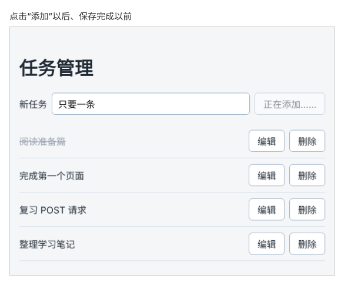

# 第 89 章：保存期间，如何避免重复点击提交按钮？

前置：[第 88 章：如何删除服务器中的指定任务？](第088章-如何删除服务器中的指定任务.md)

## 一、本章要解决的问题

在任务管理页输入一个任务名，快速连点两下“添加”，列表中会出现两条一模一样的任务。网络慢的时候，用户等不到结果，很容易再点一次，结果就是重复保存。

本章让“添加”按钮在保存期间不能点击，文字变成“正在添加……”；保存结束后，无论成功还是失败，按钮都恢复原样。完成后，连点多少下都只会保存一条。



## 二、必要原理

### 为什么会保存两次

点击“添加”后，`handleAdd` 发出 POST 请求，要等半秒以上才有结果。这段时间里，输入框中的文字还在，按钮也还能点。第二次点击又执行了一遍 `handleAdd`，又发出一个 POST 请求。服务器分别收到两个请求，每个都是合法的新任务，于是保存了两条。

服务器没有办法知道第二次点击是“手抖”，问题要在页面上解决：**保存还没结束时，不让用户再提交。**

### 用一个 state 记住“正在保存”

新增一个 state `isAdding`：发出请求前设为 `true`，请求结束后设为 `false`。按钮写成：

```tsx
<button type="submit" disabled={isAdding}>
  {isAdding ? '正在添加……' : '添加'}
</button>
```

这里必须用 state，不能用普通变量。只有调用 set 函数，React 才会重新渲染，按钮才会真的变成禁用（第 25 章）。

按钮被禁用后，鼠标点击它没有反应。在输入框中按 Enter 也不会提交表单：浏览器规定，表单的提交按钮被禁用时，按 Enter 不提交。所以禁用这一个按钮，两种提交方式都挡住了。

第 64 章（请求尚未完成时，如何显示加载提示）用 `isLoading` 显示加载提示，做法相同。区别只是这次除了显示提示，还要禁用按钮。

### 用 finally 保证按钮一定会恢复

`isAdding` 设为 `true` 之后，必须在**所有**结束的地方设回 `false`，否则按钮会一直禁用。保存过程中有好几个结束的地方：连接失败时 `return`，服务器拒绝时 `return`，成功后正常结束。每个地方各写一次 `setIsAdding(false)`，很容易漏掉。

第 64 章学过 `finally`：不管 `try` 中的代码是正常结束、中途 `return`，还是抛出了错误，`finally` 中的代码都会执行。把整个保存过程放进 `try`，`setIsAdding(false)` 写在 `finally` 中，只写一次就覆盖了所有情况。

### 把保存过程提取成一个函数

`handleAdd` 中原来已经有两个 `try` 和好几个 `return`，再在外面套一层 `try...finally`，代码会嵌套得很深。更清楚的写法是把“发送请求、处理结果”这部分提取成单独的函数 `saveNewTask`，`handleAdd` 只负责三件事：检查输入、标记正在保存、调用 `saveNewTask` 并在结束后恢复按钮。

```tsx
setIsAdding(true);
try {
  await saveNewTask(title);
} finally {
  setIsAdding(false);
}
```

`await saveNewTask(title)` 等到保存过程全部结束（无论从哪个 `return` 结束），才会执行 `finally`。

## 三、动手实现

本章只修改 `src/pages/TaskServerPage.tsx`。

### 第 1 步：增加 isAdding

在 `saveError` 的下面加入：

```tsx
  const [saveError, setSaveError] = useState('');
  const [isAdding, setIsAdding] = useState(false);
```

### 第 2 步：拆分 handleAdd

把整个 `handleAdd` 函数（从 `async function handleAdd` 到它结尾的 `}`）删除，在原来的位置换成下面两个函数：

```tsx
  async function handleAdd(event: SubmitEvent<HTMLFormElement>) {
    event.preventDefault();
    const title = draft.trim();
    if (title === '') {
      setSaveError('请填写任务名称。');
      return;
    }
    setSaveError('');
    setIsAdding(true);
    try {
      await saveNewTask(title);
    } finally {
      setIsAdding(false);
    }
  }

  async function saveNewTask(title: string) {
    let response: Response;
    try {
      response = await fetch(apiUrl('/tasks'), {
        method: 'POST',
        headers: { 'Content-Type': 'application/json' },
        body: JSON.stringify({ title }),
      });
    } catch {
      setSaveError('无法连接练习服务，任务没有保存。输入的内容已保留。');
      return;
    }
    if (!response.ok) {
      setSaveError('保存失败：服务器返回了状态 ' + response.status + '。输入的内容已保留。');
      return;
    }

    setDraft('');
    try {
      const data = await fetchTasks();
      setLoadState({ status: 'success', tasks: data });
    } catch {
      setSaveError('任务已保存，但重新读取列表失败，请刷新页面查看。');
    }
  }
```

对照原来的代码看：

- `handleAdd` 保留了开头的输入检查，后面换成了“标记正在保存 → 调用 `saveNewTask` → `finally` 中恢复”。
- `saveNewTask` 的内容就是原来 `handleAdd` 中从 `let response: Response;` 到最后的部分，一行都没有改。

`saveNewTask` 中用到的 `title` 来自参数，`setDraft`、`setSaveError` 等仍然可以直接使用，因为它也写在组件函数里面。

### 第 3 步：保存期间禁用按钮

把“添加”按钮改为：

```tsx
        <button type="submit" disabled={isAdding}>
          {isAdding ? '正在添加……' : '添加'}
        </button>
```

按钮被禁用时的半透明样式，`App.css` 中早已写好（`button:disabled`）。

## 四、运行与检查

保持开发服务器和练习服务都在运行（准备篇二）。

1. 输入“只要一条”，快速连点两下“添加”。第一下点击后，按钮变成半透明的“正在添加……”，第二下没有反应。大约一秒后列表中只多出一条“只要一条”，按钮恢复为“添加”。
2. 输入任务名后连按两次 Enter，同样只保存一条。
3. 停止练习服务，输入任务名并点击“添加”。页面提示保存失败，按钮恢复为可以点击的“添加”。重新启动练习服务后再点击，保存成功。这说明失败时 `finally` 也执行了。
4. 想看得更清楚，可以临时把 `saveNewTask` 中的 `apiUrl('/tasks')` 改为 `apiUrl('/tasks?delay=3000')`，让服务器等 3 秒再响应。这时“正在添加……”会持续 3 秒。看完后改回来。

最后运行检查，应没有错误：

```powershell
npm.cmd run check
```

**小练习**：把第 3 步按钮上的 `disabled={isAdding}` 暂时删掉，只保留文字的变化，再连点两下“添加”，看看列表中出现几条。由此体会：只改变按钮文字，并不能阻止重复提交。做完后恢复。

## 五、常见错误

| 现象 | 原因 | 怎么改 |
| --- | --- | --- |
| 保存失败后，按钮一直是“正在添加……” | `setIsAdding(false)` 写在了 `try` 的最后，失败时 `return` 跳过了它 | 写在 `finally` 中 |
| 按钮一直是“添加”，连点仍会保存两条 | 用普通变量 `let isAdding = true` 代替了 state，页面没有重新渲染 | 用 `useState` 保存，调用 `setIsAdding` |
| 按钮一闪就恢复，请求还没完成 | 调用 `saveNewTask(title)` 时漏写了 `await`，`finally` 立刻就执行了 | 写成 `await saveNewTask(title)` |
| 输入框为空时，点击“添加”后按钮一直禁用 | `setIsAdding(true)` 写在了空名称检查的前面，检查后直接 `return` 了 | 先检查输入，通过后再设为 `true` |
| `check` 提示 `saveNewTask` 中找不到 `title` | 新函数漏写了参数 | 写成 `async function saveNewTask(title: string)` |

## 六、本章完整代码

### `src/pages/TaskServerPage.tsx`

```tsx
import { useEffect, useState } from 'react';
import type { SubmitEvent } from 'react';
import TaskEditor from '../components/TaskEditor';
import { apiUrl } from '../lib/api';
import { isTask } from '../types/task';
import type { Task } from '../types/task';
import styles from './TaskPage.module.css';

type LoadState =
  | { status: 'loading'; tasks: Task[] }
  | { status: 'success'; tasks: Task[] }
  | { status: 'error'; message: string; tasks: Task[] };

async function fetchTasks(): Promise<Task[]> {
  let response: Response;
  try {
    response = await fetch(apiUrl('/tasks'));
  } catch {
    throw new Error('无法连接练习服务，请确认它已经启动。');
  }
  if (!response.ok) {
    throw new Error('任务读取失败：服务器返回了状态 ' + response.status + '。');
  }
  const data: unknown = await response.json();
  if (!Array.isArray(data) || !data.every(isTask)) {
    throw new Error('任务数据格式不正确，暂时无法显示。');
  }
  return data;
}

function getErrorMessage(error: unknown) {
  return error instanceof Error ? error.message : '任务读取失败。';
}

export default function TaskServerPage() {
  const [loadState, setLoadState] = useState<LoadState>({ status: 'loading', tasks: [] });
  const [draft, setDraft] = useState('');
  const [saveError, setSaveError] = useState('');
  const [isAdding, setIsAdding] = useState(false);
  const [editingId, setEditingId] = useState<string | null>(null);
  const tasks = loadState.tasks;
  const editingTask = tasks.find((task) => task.id === editingId);

  useEffect(() => {
    let ignore = false;

    async function loadOnOpen() {
      try {
        const data = await fetchTasks();
        if (!ignore) {
          setLoadState({ status: 'success', tasks: data });
        }
      } catch (error) {
        if (!ignore) {
          setLoadState({ status: 'error', message: getErrorMessage(error), tasks: [] });
        }
      }
    }

    loadOnOpen();
    return () => {
      ignore = true;
    };
  }, []);

  async function handleRetry() {
    setLoadState({ status: 'loading', tasks: [] });
    try {
      const data = await fetchTasks();
      setLoadState({ status: 'success', tasks: data });
    } catch (error) {
      setLoadState({ status: 'error', message: getErrorMessage(error), tasks: [] });
    }
  }

  async function handleAdd(event: SubmitEvent<HTMLFormElement>) {
    event.preventDefault();
    const title = draft.trim();
    if (title === '') {
      setSaveError('请填写任务名称。');
      return;
    }
    setSaveError('');
    setIsAdding(true);
    try {
      await saveNewTask(title);
    } finally {
      setIsAdding(false);
    }
  }

  async function saveNewTask(title: string) {
    let response: Response;
    try {
      response = await fetch(apiUrl('/tasks'), {
        method: 'POST',
        headers: { 'Content-Type': 'application/json' },
        body: JSON.stringify({ title }),
      });
    } catch {
      setSaveError('无法连接练习服务，任务没有保存。输入的内容已保留。');
      return;
    }
    if (!response.ok) {
      setSaveError('保存失败：服务器返回了状态 ' + response.status + '。输入的内容已保留。');
      return;
    }

    setDraft('');
    try {
      const data = await fetchTasks();
      setLoadState({ status: 'success', tasks: data });
    } catch {
      setSaveError('任务已保存，但重新读取列表失败，请刷新页面查看。');
    }
  }

  async function handleSaveEdit(id: string, title: string) {
    setEditingId(null);
    setSaveError('');

    let response: Response;
    try {
      response = await fetch(apiUrl('/tasks/' + id), {
        method: 'PATCH',
        headers: { 'Content-Type': 'application/json' },
        body: JSON.stringify({ title }),
      });
    } catch {
      setSaveError('无法连接练习服务，修改没有保存。');
      return;
    }
    if (!response.ok) {
      setSaveError('修改失败：服务器返回了状态 ' + response.status + '。');
      return;
    }

    try {
      const data = await fetchTasks();
      setLoadState({ status: 'success', tasks: data });
    } catch {
      setSaveError('修改已保存，但重新读取列表失败，请刷新页面查看。');
    }
  }

  async function handleDelete(id: string) {
    if (id === editingId) {
      setEditingId(null);
    }
    setSaveError('');

    let response: Response;
    try {
      response = await fetch(apiUrl('/tasks/' + id), { method: 'DELETE' });
    } catch {
      setSaveError('无法连接练习服务，任务没有删除。');
      return;
    }
    if (!response.ok && response.status !== 404) {
      setSaveError('删除失败：服务器返回了状态 ' + response.status + '。');
      return;
    }

    try {
      const data = await fetchTasks();
      setLoadState({ status: 'success', tasks: data });
    } catch {
      setSaveError('任务已删除，但重新读取列表失败，请刷新页面查看。');
    }
  }

  return (
    <main className="page">
      <h1>任务管理</h1>
      <form className={styles.addForm} onSubmit={handleAdd}>
        <label htmlFor="new-task">新任务</label>
        <input id="new-task" value={draft} onChange={(event) => setDraft(event.target.value)} />
        <button type="submit" disabled={isAdding}>
          {isAdding ? '正在添加……' : '添加'}
        </button>
      </form>
      {saveError && <p role="alert">{saveError}</p>}
      {loadState.status === 'loading' && <p role="status">正在读取任务……</p>}
      {loadState.status === 'error' && (
        <div>
          <p role="alert">{loadState.message}</p>
          <button type="button" onClick={handleRetry}>
            重试
          </button>
        </div>
      )}
      {loadState.status === 'success' && tasks.length === 0 && (
        <p className={styles.empty}>还没有任务。</p>
      )}
      {tasks.length > 0 && (
        <ul className={styles.list}>
          {tasks.map((task) => (
            <li key={task.id} className={styles.item}>
              <span className={task.completed ? styles.title + ' ' + styles.done : styles.title}>
                {task.title}
              </span>
              <button type="button" onClick={() => setEditingId(task.id)}>
                编辑
              </button>
              <button
                type="button"
                aria-label={'删除：' + task.title}
                onClick={() => handleDelete(task.id)}
              >
                删除
              </button>
            </li>
          ))}
        </ul>
      )}
      {editingTask && (
        <TaskEditor
          key={editingTask.id}
          task={editingTask}
          onSave={(title) => handleSaveEdit(editingTask.id, title)}
          onCancel={() => setEditingId(null)}
        />
      )}
    </main>
  );
}
```

## 七、本章改动小结

修改 `src/pages/TaskServerPage.tsx`：新增 `isAdding`，保存请求提取为 `saveNewTask`，保存期间禁用“添加”按钮。

---

下一章：[第 90 章：如何把服务器返回的字段错误显示在表单中？](第090章-如何把服务器返回的字段错误显示在表单中.md)
