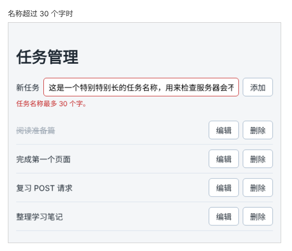

# 第 90 章：如何把服务器返回的字段错误显示在表单中？

前置：[第 89 章：保存期间，如何避免重复点击提交按钮？](第089章-保存期间，如何避免重复点击提交按钮.md)

## 一、本章要解决的问题

在任务管理页输入一个超过 30 个字的名称并点击“添加”，页面只提示“保存失败：服务器返回了状态 422。”。用户看不懂 422 是什么意思，也不知道该怎么改。其实服务器在响应中写明了原因：任务名称最多 30 个字。

本章读取服务器返回的原因，把它显示在输入框正下方，并把输入框标为红色边框。完成后，名称太长时提示“任务名称最多 30 个字。”，名称为空时提示“请填写任务名称。”，两种提示都在同一个位置。



## 二、必要原理

### 422 响应中带着出错的字段

服务器拒绝保存时，除了状态码 422，响应正文中还有一段 JSON：

```json
{
  "message": "任务名称太长",
  "fieldErrors": { "title": "任务名称最多 30 个字" }
}
```

- `message` 是整体说明。
- `fieldErrors` 按字段列出原因：`title` 字段出了问题，原因是“任务名称最多 30 个字”。

“字段”指请求中发送的每一项数据。一个表单有多个输入框时，`fieldErrors` 中可能有多项，前端按字段名找到对应的输入框，把原因显示在它下面。任务表单只有一个输入框，所以只需要读取 `title`。

### 规则以服务器为准

前端只检查名称是否为空，没有检查长度。长度规则写在服务器上，前端不必再写一遍：规则以后改成 50 个字，只改服务器就行，前端照样显示服务器给出的原因。

前端检查的作用是让用户更早看到提示，还能省掉一次请求；但最终决定能不能保存的是服务器。前端检查得再完整，也要能正确显示服务器的拒绝原因。

### 失败的响应也可以读取正文

第 65 章（为什么接口返回 404 时，fetch 不会进入 catch）讲过，服务器返回 4xx、5xx 时，`fetch` 照样拿到一个 `response`，只是 `response.ok` 为 `false`。这个 `response` 和成功时一样，可以调用 `response.json()` 读取正文。

读出来的数据要先检查格式再使用（第 68 章）。本章把读取和检查写成组件外面的函数 `readTitleError`，它从 422 响应中取出 `title` 的原因：

- 正文不是 JSON 时，`response.json()` 会抛出错误，用 `try...catch` 接住，返回一句通用提示。
- 正文是 JSON，就一层一层检查：是不是对象、有没有 `fieldErrors`、`fieldErrors` 是不是对象、有没有 `title`、`title` 是不是文字。全都符合，才返回这段原因；有一项不符合，也返回通用提示。

这和第 68 章的 `isArticle` 是同一个道理：每通过一个检查，TypeScript 就确认了这一层是什么，后面才允许读取下一层。全部通过以后，就可以直接读取 `data.fieldErrors.title`。

### 输入框的错误和其他错误分开保存

本章新增一个 state `titleError`，专门保存“输入框中的内容有什么问题”。名称为空和服务器返回 422，都存进 `titleError`，显示在输入框下方。连接失败、服务器出错（500 等）与输入的内容无关，仍然存进 `saveError`，显示在表单下面。

显示在输入框下方的错误，按第 43 章（如何让错误提示与对应的输入框关联）的做法关联起来：输入框加上 `aria-invalid` 和 `aria-describedby`，错误提示的 `id` 是输入框的 `id` 加上 `-error`，即 `new-task-error`。

## 三、动手实现

### 第 1 步：加入错误样式

在 `src/pages/TaskPage.module.css` 的末尾加入：

```css
.addForm [aria-invalid='true'] {
  border-color: #c62828;
}

.error {
  margin: 4px 0 0;
  color: #c62828;
  font-size: 14px;
}
```

颜色与注册页的错误提示相同。待办事项页没有用到这两个类名，不受影响。

以下各步修改 `src/pages/TaskServerPage.tsx`。

### 第 2 步：编写读取字段错误的函数

在 `getErrorMessage` 的下面、组件的上面加入：

```tsx
async function readTitleError(response: Response): Promise<string> {
  let data: unknown;
  try {
    data = await response.json();
  } catch {
    return '任务名称不符合要求。';
  }
  if (
    typeof data === 'object' &&
    data !== null &&
    'fieldErrors' in data &&
    typeof data.fieldErrors === 'object' &&
    data.fieldErrors !== null &&
    'title' in data.fieldErrors &&
    typeof data.fieldErrors.title === 'string'
  ) {
    return data.fieldErrors.title + '。';
  }
  return '任务名称不符合要求。';
}
```

服务器给出的原因末尾没有句号，返回前补上一个，和页面上其他提示保持一致。

### 第 3 步：增加 titleError

在 `saveError` 的上面加入：

```tsx
  const [titleError, setTitleError] = useState('');
  const [saveError, setSaveError] = useState('');
```

### 第 4 步：输入框的错误都存进 titleError

修改 `handleAdd` 中检查空名称的部分，提示改存进 `titleError`，通过检查后同时清除两种错误：

```tsx
    if (title === '') {
      setTitleError('请填写任务名称。');
      return;
    }
    setTitleError('');
    setSaveError('');
```

在 `saveNewTask` 中，`if (!response.ok)` 的上面加入对 422 的处理：

```tsx
    if (response.status === 422) {
      setTitleError(await readTitleError(response));
      return;
    }
    if (!response.ok) {
```

422 先单独处理，读取原因后 `return`，不会再走到下面的通用提示。其他失败状态仍由 `if (!response.ok)` 处理。

### 第 5 步：在输入框下方显示错误

把输入框改为：

```tsx
        <input
          id="new-task"
          value={draft}
          onChange={(event) => setDraft(event.target.value)}
          aria-invalid={titleError !== ''}
          aria-describedby={titleError ? 'new-task-error' : undefined}
        />
```

在 `</form>` 的下面、`saveError` 提示的上面加入：

```tsx
      </form>
      {titleError && (
        <p id="new-task-error" className={styles.error}>
          {titleError}
        </p>
      )}
      {saveError && <p role="alert">{saveError}</p>}
```

## 四、运行与检查

保持开发服务器和练习服务都在运行（准备篇二）。

1. 输入一个超过 30 个字的名称，点击“添加”。半秒后输入框变成红色边框，下方显示红色的“任务名称最多 30 个字。”，输入框中的内容保留。
2. 清空输入框，点击“添加”。同一个位置显示“请填写任务名称。”，Network（网络）中没有新的请求。
3. 输入一个正常的名称并添加，保存成功，红色边框和提示都消失了。
4. 停止练习服务，输入名称并点击“添加”。这次输入框没有变红，表单下方显示“保存失败：服务器返回了状态 500。输入的内容已保留。”。连接失败与输入的内容无关，所以不标在输入框上。做完后重新启动练习服务。
5. 打开开发者工具的 Elements（元素）面板，在第 1 步的状态下选中输入框，可以看到 `aria-invalid="true"` 和 `aria-describedby="new-task-error"`。

最后运行检查，应没有错误：

```powershell
npm.cmd run check
```

**小练习**：输入由 31 个空格组成的名称，点击“添加”，看看显示的是哪一种提示，再想一想为什么不是“任务名称最多 30 个字。”。

## 五、常见错误

| 现象 | 原因 | 怎么改 |
| --- | --- | --- |
| 名称太长时，仍然显示“服务器返回了状态 422” | 422 的判断写在了 `if (!response.ok)` 的后面，先进入了通用提示 | 422 的判断放在 `!response.ok` 前面 |
| 名称太长时，提示“任务名称不符合要求。” | 读取的字段名写错，例如写成了 `fieldError` 或 `name` | 字段名是 `fieldErrors` 和 `title` |
| `check` 提示 `data.fieldErrors.title` 的类型是 `unknown` | 少写了某一层检查，TypeScript 无法确定它的类型 | 按第 2 步逐层检查，最后检查 `typeof … === 'string'` |
| 添加成功后，红色提示仍然留着 | 提交时只清除了 `saveError` | 通过空名称检查后，同时调用 `setTitleError('')` |
| 输入框没有变成红色边框 | 第 1 步的样式没有加，或 `aria-invalid` 写成了 `ariaInvalid` | 补上样式；属性名是带连字符的 `aria-invalid` |

## 六、本章完整代码

### `src/pages/TaskPage.module.css`

```css
.addForm {
  display: flex;
  flex-wrap: wrap;
  align-items: center;
  gap: 8px;
}

.addForm input {
  flex: 1;
  min-width: 0;
  padding: 8px 10px;
  border: 1px solid #9fb3c8;
  border-radius: 6px;
  font: inherit;
}

.list {
  margin: 16px 0 0;
  padding: 0;
  list-style: none;
}

.item {
  display: flex;
  align-items: center;
  gap: 8px;
  padding: 10px 0;
  border-bottom: 1px solid #d9e2ec;
}

.title {
  flex: 1;
  overflow-wrap: anywhere;
}

.title input {
  margin-right: 8px;
}

.done {
  color: #9aa5b1;
  text-decoration: line-through;
}

.toolbar {
  display: flex;
  flex-wrap: wrap;
  justify-content: space-between;
  gap: 8px;
  margin-top: 16px;
  color: #52606d;
}

.empty {
  color: #52606d;
}

.addForm [aria-invalid='true'] {
  border-color: #c62828;
}

.error {
  margin: 4px 0 0;
  color: #c62828;
  font-size: 14px;
}
```

### `src/pages/TaskServerPage.tsx`

```tsx
import { useEffect, useState } from 'react';
import type { SubmitEvent } from 'react';
import TaskEditor from '../components/TaskEditor';
import { apiUrl } from '../lib/api';
import { isTask } from '../types/task';
import type { Task } from '../types/task';
import styles from './TaskPage.module.css';

type LoadState =
  | { status: 'loading'; tasks: Task[] }
  | { status: 'success'; tasks: Task[] }
  | { status: 'error'; message: string; tasks: Task[] };

async function fetchTasks(): Promise<Task[]> {
  let response: Response;
  try {
    response = await fetch(apiUrl('/tasks'));
  } catch {
    throw new Error('无法连接练习服务，请确认它已经启动。');
  }
  if (!response.ok) {
    throw new Error('任务读取失败：服务器返回了状态 ' + response.status + '。');
  }
  const data: unknown = await response.json();
  if (!Array.isArray(data) || !data.every(isTask)) {
    throw new Error('任务数据格式不正确，暂时无法显示。');
  }
  return data;
}

function getErrorMessage(error: unknown) {
  return error instanceof Error ? error.message : '任务读取失败。';
}

async function readTitleError(response: Response): Promise<string> {
  let data: unknown;
  try {
    data = await response.json();
  } catch {
    return '任务名称不符合要求。';
  }
  if (
    typeof data === 'object' &&
    data !== null &&
    'fieldErrors' in data &&
    typeof data.fieldErrors === 'object' &&
    data.fieldErrors !== null &&
    'title' in data.fieldErrors &&
    typeof data.fieldErrors.title === 'string'
  ) {
    return data.fieldErrors.title + '。';
  }
  return '任务名称不符合要求。';
}

export default function TaskServerPage() {
  const [loadState, setLoadState] = useState<LoadState>({ status: 'loading', tasks: [] });
  const [draft, setDraft] = useState('');
  const [titleError, setTitleError] = useState('');
  const [saveError, setSaveError] = useState('');
  const [isAdding, setIsAdding] = useState(false);
  const [editingId, setEditingId] = useState<string | null>(null);
  const tasks = loadState.tasks;
  const editingTask = tasks.find((task) => task.id === editingId);

  useEffect(() => {
    let ignore = false;

    async function loadOnOpen() {
      try {
        const data = await fetchTasks();
        if (!ignore) {
          setLoadState({ status: 'success', tasks: data });
        }
      } catch (error) {
        if (!ignore) {
          setLoadState({ status: 'error', message: getErrorMessage(error), tasks: [] });
        }
      }
    }

    loadOnOpen();
    return () => {
      ignore = true;
    };
  }, []);

  async function handleRetry() {
    setLoadState({ status: 'loading', tasks: [] });
    try {
      const data = await fetchTasks();
      setLoadState({ status: 'success', tasks: data });
    } catch (error) {
      setLoadState({ status: 'error', message: getErrorMessage(error), tasks: [] });
    }
  }

  async function handleAdd(event: SubmitEvent<HTMLFormElement>) {
    event.preventDefault();
    const title = draft.trim();
    if (title === '') {
      setTitleError('请填写任务名称。');
      return;
    }
    setTitleError('');
    setSaveError('');
    setIsAdding(true);
    try {
      await saveNewTask(title);
    } finally {
      setIsAdding(false);
    }
  }

  async function saveNewTask(title: string) {
    let response: Response;
    try {
      response = await fetch(apiUrl('/tasks'), {
        method: 'POST',
        headers: { 'Content-Type': 'application/json' },
        body: JSON.stringify({ title }),
      });
    } catch {
      setSaveError('无法连接练习服务，任务没有保存。输入的内容已保留。');
      return;
    }
    if (response.status === 422) {
      setTitleError(await readTitleError(response));
      return;
    }
    if (!response.ok) {
      setSaveError('保存失败：服务器返回了状态 ' + response.status + '。输入的内容已保留。');
      return;
    }

    setDraft('');
    try {
      const data = await fetchTasks();
      setLoadState({ status: 'success', tasks: data });
    } catch {
      setSaveError('任务已保存，但重新读取列表失败，请刷新页面查看。');
    }
  }

  async function handleSaveEdit(id: string, title: string) {
    setEditingId(null);
    setSaveError('');

    let response: Response;
    try {
      response = await fetch(apiUrl('/tasks/' + id), {
        method: 'PATCH',
        headers: { 'Content-Type': 'application/json' },
        body: JSON.stringify({ title }),
      });
    } catch {
      setSaveError('无法连接练习服务，修改没有保存。');
      return;
    }
    if (!response.ok) {
      setSaveError('修改失败：服务器返回了状态 ' + response.status + '。');
      return;
    }

    try {
      const data = await fetchTasks();
      setLoadState({ status: 'success', tasks: data });
    } catch {
      setSaveError('修改已保存，但重新读取列表失败，请刷新页面查看。');
    }
  }

  async function handleDelete(id: string) {
    if (id === editingId) {
      setEditingId(null);
    }
    setSaveError('');

    let response: Response;
    try {
      response = await fetch(apiUrl('/tasks/' + id), { method: 'DELETE' });
    } catch {
      setSaveError('无法连接练习服务，任务没有删除。');
      return;
    }
    if (!response.ok && response.status !== 404) {
      setSaveError('删除失败：服务器返回了状态 ' + response.status + '。');
      return;
    }

    try {
      const data = await fetchTasks();
      setLoadState({ status: 'success', tasks: data });
    } catch {
      setSaveError('任务已删除，但重新读取列表失败，请刷新页面查看。');
    }
  }

  return (
    <main className="page">
      <h1>任务管理</h1>
      <form className={styles.addForm} onSubmit={handleAdd}>
        <label htmlFor="new-task">新任务</label>
        <input
          id="new-task"
          value={draft}
          onChange={(event) => setDraft(event.target.value)}
          aria-invalid={titleError !== ''}
          aria-describedby={titleError ? 'new-task-error' : undefined}
        />
        <button type="submit" disabled={isAdding}>
          {isAdding ? '正在添加……' : '添加'}
        </button>
      </form>
      {titleError && (
        <p id="new-task-error" className={styles.error}>
          {titleError}
        </p>
      )}
      {saveError && <p role="alert">{saveError}</p>}
      {loadState.status === 'loading' && <p role="status">正在读取任务……</p>}
      {loadState.status === 'error' && (
        <div>
          <p role="alert">{loadState.message}</p>
          <button type="button" onClick={handleRetry}>
            重试
          </button>
        </div>
      )}
      {loadState.status === 'success' && tasks.length === 0 && (
        <p className={styles.empty}>还没有任务。</p>
      )}
      {tasks.length > 0 && (
        <ul className={styles.list}>
          {tasks.map((task) => (
            <li key={task.id} className={styles.item}>
              <span className={task.completed ? styles.title + ' ' + styles.done : styles.title}>
                {task.title}
              </span>
              <button type="button" onClick={() => setEditingId(task.id)}>
                编辑
              </button>
              <button
                type="button"
                aria-label={'删除：' + task.title}
                onClick={() => handleDelete(task.id)}
              >
                删除
              </button>
            </li>
          ))}
        </ul>
      )}
      {editingTask && (
        <TaskEditor
          key={editingTask.id}
          task={editingTask}
          onSave={(title) => handleSaveEdit(editingTask.id, title)}
          onCancel={() => setEditingId(null)}
        />
      )}
    </main>
  );
}
```

## 七、本章改动小结

修改 `src/pages/TaskPage.module.css`：加入输入框错误样式；修改 `src/pages/TaskServerPage.tsx`：新增 `readTitleError` 和 `titleError`，名称为空和服务器返回 422 时，把原因显示在输入框下方。

---

下一章：[第 91 章：修改任务保存失败时，如何保留编辑框中的内容？](第091章-修改任务保存失败时，如何保留编辑框中的内容.md)
