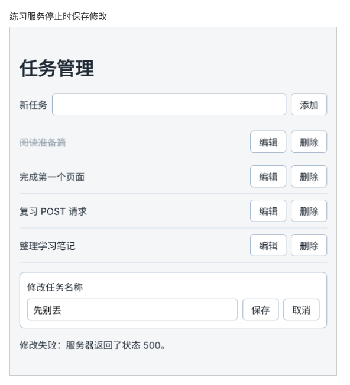

# 第 91 章：修改任务保存失败时，如何保留编辑框中的内容？

前置：[第 90 章：如何把服务器返回的字段错误显示在表单中？](第090章-如何把服务器返回的字段错误显示在表单中.md)

## 一、本章要解决的问题

第 87 章留下了一个问题：修改任务名称时，点击“保存”后编辑框立刻关闭。如果这时保存失败，页面提示“修改失败”，但编辑框已经不见了，刚才输入的新名称也没了，只能重新打开编辑框再输入一遍。

本章改为：保存成功后才关闭编辑框。保存失败时，编辑框留在原处，里面仍是刚才输入的内容，失败原因显示在编辑框下方，用户可以直接再点一次“保存”。



## 二、必要原理

### 输入的内容保存在编辑框组件里

第 53 章（切换正在编辑的任务后，如何避免保留上一条的输入）把草稿交给了 `TaskEditor` 自己管理：用户在编辑框中输入的文字，保存在 `TaskEditor` 的 state `draft` 中。

组件的 state 只在组件显示在页面上时存在。第 87 章的 `handleSaveEdit` 第一行就把 `editingId` 设为 `null`，`editingTask` 随之变成 `undefined`，`TaskEditor` 从页面上移除，它的 `draft` 也跟着被丢弃。下次再打开编辑框，React 创建一个新的 `TaskEditor`，`draft` 重新从任务的原名称开始。

所以输入的内容丢失，不是因为请求失败，而是因为**编辑框被移除得太早**。

### 成功之后再关闭编辑框

解决办法是调整顺序：先发送请求，确认保存成功以后，再把 `editingId` 设为 `null`。保存失败时直接 `return`，`editingId` 没有变，`TaskEditor` 一直留在页面上，`draft` 自然保留，什么都不用另外保存。

这和第 86 章添加任务的思路一样：添加失败时不清空输入框，修改失败时不关闭编辑框。**只有确认服务器保存成功，才清除用户输入的内容。**

### 修改的错误显示在编辑框旁边

原来修改失败的提示存进 `saveError`，显示在页面上方的添加表单下面。现在编辑框还开着，提示应该显示在编辑框旁边，用户才知道是这次修改出了问题。本章新增一个 state `editError` 专门保存修改的错误，显示在编辑框下方。

打开编辑框时要清除旧的 `editError`。否则上一次失败的提示，会出现在下一次打开的编辑框下面。所以“编辑”按钮不再直接调用 `setEditingId`，而是调用一个新函数 `handleStartEdit`，同时做这两件事。

### 请求期间编辑框仍然可以操作

现在点击“保存”后，编辑框要等请求结束才关闭。这段时间里，编辑框中的“保存”还能再点。再点一次会再发一个内容相同的 PATCH 请求，结果仍然正确，只是多了一次请求。第 93 章会用第 89 章的办法，在保存期间禁用编辑框的按钮。

## 三、动手实现

本章只修改 `src/pages/TaskServerPage.tsx`。

### 第 1 步：增加 editError

在 `editingId` 的下面加入：

```tsx
  const [editingId, setEditingId] = useState<string | null>(null);
  const [editError, setEditError] = useState('');
```

### 第 2 步：打开编辑框时清除旧的错误

在 `handleSaveEdit` 的上面加入：

```tsx
  function handleStartEdit(id: string) {
    setEditingId(id);
    setEditError('');
  }
```

### 第 3 步：调整 handleSaveEdit

把 `handleSaveEdit` 开头的两行：

```tsx
    setEditingId(null);
    setSaveError('');
```

改为一行：

```tsx
    setEditError('');
```

把两处失败提示中的 `setSaveError` 改为 `setEditError`，再在两个失败判断的后面、重新读取列表的前面，加上关闭编辑框的一行：

```tsx
    } catch {
      setEditError('无法连接练习服务，修改没有保存。');
      return;
    }
    if (!response.ok) {
      setEditError('修改失败：服务器返回了状态 ' + response.status + '。');
      return;
    }

    setEditingId(null);
    try {
      const data = await fetchTasks();
```

“已保存但重新读取失败”的提示仍用 `setSaveError`：这时修改已经成功，编辑框也关闭了，提示显示在页面上方。

### 第 4 步：修改“编辑”按钮和错误提示

把“编辑”按钮的 `onClick` 改为调用 `handleStartEdit`：

```tsx
              <button type="button" onClick={() => handleStartEdit(task.id)}>
                编辑
              </button>
```

在 `TaskEditor` 那一段的下面、`</main>` 的上面加入：

```tsx
      {editingTask && editError && <p role="alert">{editError}</p>}
```

编辑框显示着、并且有修改错误时，才显示这条提示。

## 四、运行与检查

保持开发服务器和练习服务都在运行（准备篇二）。

1. 停止练习服务。点击“完成第一个页面”的“编辑”，改为“先别丢”，点击“保存”。编辑框没有关闭，里面仍是“先别丢”，下方显示“修改失败：服务器返回了状态 500。”。
2. 重新启动练习服务，直接点击编辑框中的“保存”。大约一秒后编辑框关闭，错误提示消失，列表中显示“先别丢”。
3. 编辑一条任务，输入超过 30 个字的名称并保存，编辑框保留，下方提示“修改失败：服务器返回了状态 422。”。点击“取消”，再重新打开这条任务的编辑框，旧的错误提示没有出现。
4. 修改一条任务并保存成功，编辑框关闭，刷新页面后名称不变。

第 3 步中的 422 只显示了状态码，第 93 章会像第 90 章一样把具体原因显示在编辑框中。

最后运行检查，应没有错误：

```powershell
npm.cmd run check
```

**小练习**：在第 1 步的失败状态下（练习服务已停止），点击另一条任务的“编辑”，再点回原来那条任务的“编辑”，看看编辑框中是“先别丢”还是原来的名称。结合第 53 章想一想：为什么切换后，输入的内容没有保留？

## 五、常见错误

| 现象 | 原因 | 怎么改 |
| --- | --- | --- |
| 保存失败后，编辑框还是关闭了 | `setEditingId(null)` 仍写在函数开头 | 移到两个失败判断的后面 |
| 保存成功后，编辑框一直不关闭 | 删掉了 `setEditingId(null)`，没有移到新位置 | 在失败判断后面、重新读取列表前面加上 |
| 打开另一条任务的编辑框，下面还显示上次的错误 | “编辑”按钮仍然直接调用 `setEditingId` | 改为调用 `handleStartEdit`，同时清除 `editError` |
| 修改失败的提示出现在页面上方 | 失败时调用的仍是 `setSaveError` | 两处失败提示都改为 `setEditError` |

## 六、本章完整代码

### `src/pages/TaskServerPage.tsx`

```tsx
import { useEffect, useState } from 'react';
import type { SubmitEvent } from 'react';
import TaskEditor from '../components/TaskEditor';
import { apiUrl } from '../lib/api';
import { isTask } from '../types/task';
import type { Task } from '../types/task';
import styles from './TaskPage.module.css';

type LoadState =
  | { status: 'loading'; tasks: Task[] }
  | { status: 'success'; tasks: Task[] }
  | { status: 'error'; message: string; tasks: Task[] };

async function fetchTasks(): Promise<Task[]> {
  let response: Response;
  try {
    response = await fetch(apiUrl('/tasks'));
  } catch {
    throw new Error('无法连接练习服务，请确认它已经启动。');
  }
  if (!response.ok) {
    throw new Error('任务读取失败：服务器返回了状态 ' + response.status + '。');
  }
  const data: unknown = await response.json();
  if (!Array.isArray(data) || !data.every(isTask)) {
    throw new Error('任务数据格式不正确，暂时无法显示。');
  }
  return data;
}

function getErrorMessage(error: unknown) {
  return error instanceof Error ? error.message : '任务读取失败。';
}

async function readTitleError(response: Response): Promise<string> {
  let data: unknown;
  try {
    data = await response.json();
  } catch {
    return '任务名称不符合要求。';
  }
  if (
    typeof data === 'object' &&
    data !== null &&
    'fieldErrors' in data &&
    typeof data.fieldErrors === 'object' &&
    data.fieldErrors !== null &&
    'title' in data.fieldErrors &&
    typeof data.fieldErrors.title === 'string'
  ) {
    return data.fieldErrors.title + '。';
  }
  return '任务名称不符合要求。';
}

export default function TaskServerPage() {
  const [loadState, setLoadState] = useState<LoadState>({ status: 'loading', tasks: [] });
  const [draft, setDraft] = useState('');
  const [titleError, setTitleError] = useState('');
  const [saveError, setSaveError] = useState('');
  const [isAdding, setIsAdding] = useState(false);
  const [editingId, setEditingId] = useState<string | null>(null);
  const [editError, setEditError] = useState('');
  const tasks = loadState.tasks;
  const editingTask = tasks.find((task) => task.id === editingId);

  useEffect(() => {
    let ignore = false;

    async function loadOnOpen() {
      try {
        const data = await fetchTasks();
        if (!ignore) {
          setLoadState({ status: 'success', tasks: data });
        }
      } catch (error) {
        if (!ignore) {
          setLoadState({ status: 'error', message: getErrorMessage(error), tasks: [] });
        }
      }
    }

    loadOnOpen();
    return () => {
      ignore = true;
    };
  }, []);

  async function handleRetry() {
    setLoadState({ status: 'loading', tasks: [] });
    try {
      const data = await fetchTasks();
      setLoadState({ status: 'success', tasks: data });
    } catch (error) {
      setLoadState({ status: 'error', message: getErrorMessage(error), tasks: [] });
    }
  }

  async function handleAdd(event: SubmitEvent<HTMLFormElement>) {
    event.preventDefault();
    const title = draft.trim();
    if (title === '') {
      setTitleError('请填写任务名称。');
      return;
    }
    setTitleError('');
    setSaveError('');
    setIsAdding(true);
    try {
      await saveNewTask(title);
    } finally {
      setIsAdding(false);
    }
  }

  async function saveNewTask(title: string) {
    let response: Response;
    try {
      response = await fetch(apiUrl('/tasks'), {
        method: 'POST',
        headers: { 'Content-Type': 'application/json' },
        body: JSON.stringify({ title }),
      });
    } catch {
      setSaveError('无法连接练习服务，任务没有保存。输入的内容已保留。');
      return;
    }
    if (response.status === 422) {
      setTitleError(await readTitleError(response));
      return;
    }
    if (!response.ok) {
      setSaveError('保存失败：服务器返回了状态 ' + response.status + '。输入的内容已保留。');
      return;
    }

    setDraft('');
    try {
      const data = await fetchTasks();
      setLoadState({ status: 'success', tasks: data });
    } catch {
      setSaveError('任务已保存，但重新读取列表失败，请刷新页面查看。');
    }
  }

  function handleStartEdit(id: string) {
    setEditingId(id);
    setEditError('');
  }

  async function handleSaveEdit(id: string, title: string) {
    setEditError('');

    let response: Response;
    try {
      response = await fetch(apiUrl('/tasks/' + id), {
        method: 'PATCH',
        headers: { 'Content-Type': 'application/json' },
        body: JSON.stringify({ title }),
      });
    } catch {
      setEditError('无法连接练习服务，修改没有保存。');
      return;
    }
    if (!response.ok) {
      setEditError('修改失败：服务器返回了状态 ' + response.status + '。');
      return;
    }

    setEditingId(null);
    try {
      const data = await fetchTasks();
      setLoadState({ status: 'success', tasks: data });
    } catch {
      setSaveError('修改已保存，但重新读取列表失败，请刷新页面查看。');
    }
  }

  async function handleDelete(id: string) {
    if (id === editingId) {
      setEditingId(null);
    }
    setSaveError('');

    let response: Response;
    try {
      response = await fetch(apiUrl('/tasks/' + id), { method: 'DELETE' });
    } catch {
      setSaveError('无法连接练习服务，任务没有删除。');
      return;
    }
    if (!response.ok && response.status !== 404) {
      setSaveError('删除失败：服务器返回了状态 ' + response.status + '。');
      return;
    }

    try {
      const data = await fetchTasks();
      setLoadState({ status: 'success', tasks: data });
    } catch {
      setSaveError('任务已删除，但重新读取列表失败，请刷新页面查看。');
    }
  }

  return (
    <main className="page">
      <h1>任务管理</h1>
      <form className={styles.addForm} onSubmit={handleAdd}>
        <label htmlFor="new-task">新任务</label>
        <input
          id="new-task"
          value={draft}
          onChange={(event) => setDraft(event.target.value)}
          aria-invalid={titleError !== ''}
          aria-describedby={titleError ? 'new-task-error' : undefined}
        />
        <button type="submit" disabled={isAdding}>
          {isAdding ? '正在添加……' : '添加'}
        </button>
      </form>
      {titleError && (
        <p id="new-task-error" className={styles.error}>
          {titleError}
        </p>
      )}
      {saveError && <p role="alert">{saveError}</p>}
      {loadState.status === 'loading' && <p role="status">正在读取任务……</p>}
      {loadState.status === 'error' && (
        <div>
          <p role="alert">{loadState.message}</p>
          <button type="button" onClick={handleRetry}>
            重试
          </button>
        </div>
      )}
      {loadState.status === 'success' && tasks.length === 0 && (
        <p className={styles.empty}>还没有任务。</p>
      )}
      {tasks.length > 0 && (
        <ul className={styles.list}>
          {tasks.map((task) => (
            <li key={task.id} className={styles.item}>
              <span className={task.completed ? styles.title + ' ' + styles.done : styles.title}>
                {task.title}
              </span>
              <button type="button" onClick={() => handleStartEdit(task.id)}>
                编辑
              </button>
              <button
                type="button"
                aria-label={'删除：' + task.title}
                onClick={() => handleDelete(task.id)}
              >
                删除
              </button>
            </li>
          ))}
        </ul>
      )}
      {editingTask && (
        <TaskEditor
          key={editingTask.id}
          task={editingTask}
          onSave={(title) => handleSaveEdit(editingTask.id, title)}
          onCancel={() => setEditingId(null)}
        />
      )}
      {editingTask && editError && <p role="alert">{editError}</p>}
    </main>
  );
}
```

## 七、本章改动小结

修改 `src/pages/TaskServerPage.tsx`：保存成功后才关闭编辑框；新增 `editError` 和 `handleStartEdit`，修改失败的原因显示在编辑框下方。

---

下一章：[第 92 章：保存成功后，如何直接用服务器返回的数据更新列表？](第092章-保存成功后，如何直接用服务器返回的数据更新列表.md)
